## 操作系统概述

- ==操作系统的作用==：
  - `通过资源管理提高`计算机系统的`效率`
  - 改善人机界面向`用户提供友好的工作环境`
- 操作系统的==特征==： `并发性、共享性、虚拟性、不确定性`
- 操作系统的==功能==： `进程管理、存储管理、文件管理、设备管理、作业管理`
- 操作系统的==分类==：
  - `批处理`操作系统
  - `分时`操作系统（轮流使用CPU工作片）
  - `实时`操作系统（快速响应）
  - `网络`操作系统
  - `分布式`操作系统（物理分散的计算机互联系统）
  - `微机`操作系统（Windows）
  - `嵌入式`操作系统
- `计算机启动`的`基本流程`为：` BIOS——>主引导记录——>操作系统`

## 进程的组成和状态

- ==进程的组成==：
  - ==进程控制块PCB== （Process Control Block唯一标志）
  - ==程序==（描述进程要做什么）
  - ==数据==（存放进程执行时所需数据）
- ==进程==是程序在一个数据集合上运行的过程，它是系统进行==资源分配==和==调度==的一个独立单位
- ==PCB==：`PCB是进程存在的唯一标志`。内容包含`进程标识符、状态、位置信息、控制信息、队列指针`（链接同一状态的进程）、`优先级、现场保护区`等。
- ==进程与程序的区别==：进程是程序的一次执行过程，没有程序就没有进程
  - ==程序==是一个`静态`的概念，而==进程==是一个`动态`的概念，它由创建而产生，完成任务后因撤销而消亡
  - 进程是系统进行资源分配和调度的独立单位，而程序不是。
- ==挂起原因==：
  - 进程过多，主存资源不足，此时必须将某些进程挂起放到磁盘对换区，暂时不参与调度，以平衡系统负载
  - 系统出现故障，或者是用户调试程序，也可能需要将进程挂起检查问题

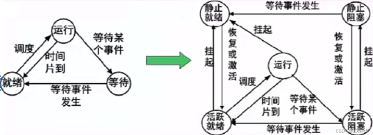

## 前趋图

- ==前趋图==：用来表示哪些任务可以并行执行，哪些任务之间有顺序关系

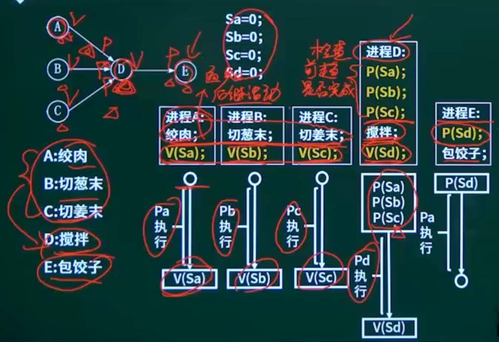

## 进程资源图

- ==进程资源图==：用来表示进程和资源之间的分配和请求关系

- ==P 代表进程==， ==R 代表资源==， R方框中有几个圆球就表示有几个这种资源，在图中，R1指向P1，表示R1有一个资源已经分配给了P1，P1指向R2，表示P1还需要请求一个R2资源才能执行
- ==阻塞节点==：某进程所请求的资源已经全部分配完毕，无法获取所需资源，该进程被阻塞了无法继续。如上图中P2
- ==非阻塞节点==：某进程所请求的资源还有剩余，可以分配给该进程继续运行。如上图中P1、P3
- 当`一个进程资源图中所有进程都是阻塞节点时`，即陷入==死锁状态==

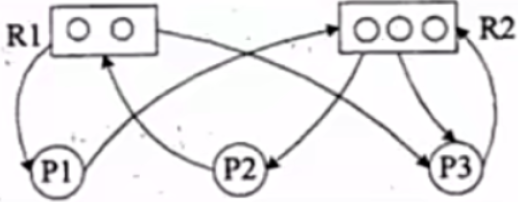

## 进程间通信 同步与互斥

- ==互斥==：
  - 某资源（即临界资源）在同一时间内只能由一个任务单独使用，使用时需要加锁，使用完后解锁才能被其他任务使用；如打印机
  - `间接制约`：源于对共享资源的竞争。多个进程都想使用同一个独占性资源，当一个进程在使用时，其他进程必须等待
- ==同步==： 
  - 多个任务可以并发执行，只不过有速度上的差异，在一定情况下停下等待， 不存在资源是否单独或共享的问题；如自行车和汽车
  - `直接制约`：源于进程间的合作。一个进程的执行依赖于另一个进程的“信号”或结果，必须等对方完成后自己才能继续。
- ==临界资源==：各进程间需要以互斥方式对其进行访问的资源
- ==临界区==：指进程中对临界资源实施操作的那段程序。`本质是一段程序代码`
- ==互斥信号量==：对临界资源采用互斥访问，使用互斥信号量后其他进程无法访问， `初值为1`
- ==同步信号量==：对共享资源的访问控制， `初值一般是共享资源的数量`

> 访问控制的三大主要策略是：**自主访问控制（DAC）**、**强制访问控制（MAC）** 和 **基于角色的访问控制（RBAC）**【没有基于时间的访问控制】

## 信号量操作

- ==信号量（S）==：是一种特殊的变量。【全局变量】
  - `信号量可以表示资源数量`
  - `信号量为负数时还可以表示排队进程数`
- PV操作是对`临界资源`进行操作
- PV操作对资源信号量的操作无先后，但`一定成对出现`
- ==P操作==： `申请资源，S=S-1`【一般表示加锁过程】
  - 若` S >=0 `，表示资源充足，当前进程继续执行；
  - 若` S < 0 `，是资源不足，当前进程被阻塞。此时S的绝对值 代表了正在等待该资源的进程数量
- ==V操作==： `释放资源，S=S+1`【一般是解锁的过程】
  - 若`S > 0` ，表示资源充足，没有进程在等待，当前进程继续执行。
  - 若`S <= 0 `，表示有进程因等待该资源而被阻塞，系统会从等待队列中唤醒一个进程，使其进入就绪态。然后，当前进程继续执行
  - 对于v操作，当先将资源释放，发现`s<=0`，则表示有进程因为该资源阻塞，而当前因为资源释放，所以可以唤醒一个进程

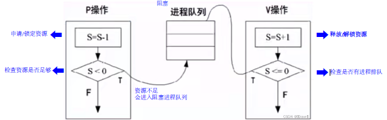

## 生产者和消费者问题

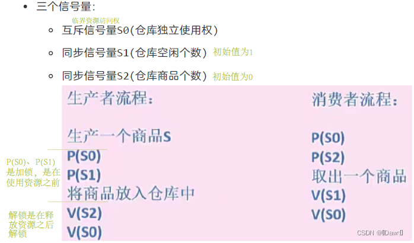

## 死锁

- 当一个进程在等待永远不可能发生的事件时，就会产生死锁，若系统中有多个进程处于死锁状态，就会造成系统死锁

- 死锁产生的==四个必要条件==：
  - `资源互斥`【互斥】
  - `每个进程占有资源并等待其他资源`【保持和等待】
  - `系统不能剥夺进程资源`【不剥夺】
  - `进程资源图是一个环路`【环路等待】

- 死锁产生后， ==解决措施是打破四大条件==，有下列方法：

  - ==死锁预防==：`采用某种策略限制并发进程对于资源的请求`，破坏死锁产生的四个条件之一，使系统任何时刻都不满足死锁的条件。
  - ==死锁避免==：一般`采用银行家算法来避免，银行家算法，就是提前计算出一条不会死锁的资源分配方法`，才分配资源，否则不分配资源，相当于借贷，`考虑对方还得起才借钱，提前考虑好以后，就可以避免死锁`
  - ==死锁检测==：允许死锁产生，但系统定时运行一个检测死锁的程序，`若检测到系统中发生死锁，则设法加以解除`。
  - ==死锁解除==：即死锁发生后的解除方法，如`强制剥夺资源，撤销进程等`

- ==死锁计算问题==： 

  - 系统内有$n$个进程，每个进程都需要$R$个资源，那么其发生死锁的最大资源数为==$n*(R-1)$==

  - 其不发生死锁的最小资源数为==$n*(R-1)+1$==

    > 资源数：4，进程数3
    >
    > - 每个进程需要最大资源数2。这个不会死锁，因为每个进程分一
    >   个，还有一个随便分，只要那个进程结束，直接释放两个资源。$3*1+1=4$
    > - 每个进程需要最大资源数3。这个会死锁，因为每个进程分一个，还有一个随便分，也不够。$3*2=6>4$

## 线程

- 传统的==进程==有两个属性

  - 可拥有`资源的独立单位`
  - 可`独立调度和分配的基本单位`

- 引入线程后， `线程是独立调度的最小单位`， `进程是拥有资源的最小单位`，`线程可以共享进程的公共数据、全
  局变量、代码、文件等资源`，但`不能共享线程独有的资源，如线程的栈指针等标识数据`

  > - 同一进程内的多个线程共享进程的大部分资源，包括`代码段、全局变量、已打开的文件描述符、堆内存等`。这些资源是进程级别的，所有线程都可以访问。
  > - 然而，每个线程必须拥有自己独立的私有资源，以维持其执行上下文的独立性，包括：`线程栈、栈指针、程序计数器、线程寄存器状态、线程ID`

## 页式存储管理

- ==页式存储==：将程序与内存均划分为同样大小的块，以页为单位将程序调入内存

- 将`进程空间分为一个个页`，假设`每个页大小为4K`，同样的`将系统的物理空间也分为一个个4K大小的物理块`(==物理块号也叫页帧号==)，这样，每次`将需要运行的逻辑页装入物理块中`，运行完再装入其他需要运行的页，就可以分批次运行完进程，而无需将整块逻辑空间全部装入物理内存中
- ==物理块号也叫页帧号==，然后计算页面偏移的时候注意，`如果没有说按照什么大小存储，默认按照字节存储，也就是1B=8b存储`
- `优点`：利用率高、碎片小(只在最后一个页中有)、分配及管理简单
- `缺点`：增加了系统开销,可能产生抖动现象

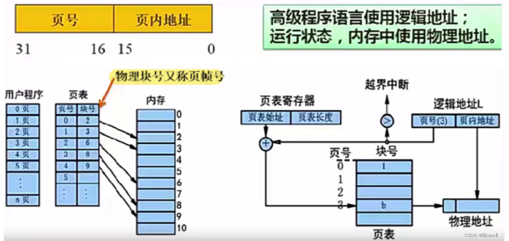

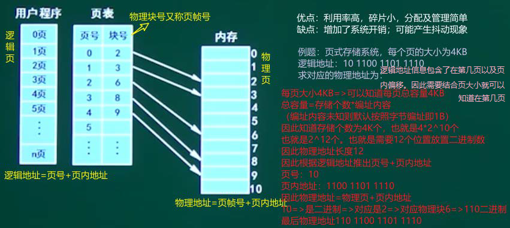

## 页面置换算法

- 有时候，进程空间分为100个页面，而系统内存只有10个物理块，无法全部满足分配，就需要将马上要执行的页面先分配进去，而后根据算法进行淘汰，使100个页面能够按执行顺序调入物理块中执行完

- `缺页表示需要执行的页不在内存物理块中，需要从外部调入内存，会增加执行时间，因此，缺页数越多，系统效率越低`

- ==最优算法==： `OPT `， 理论上的算法， 无法实现，是在进程执行完后进行的最佳效率计算，用来让其他算法比较差距。`原理是选择未来最长时间内不被访问的页面置换，这样可以保证未来执行的都是马上要访问的`

- ==先进先出算法==： FIFO (First-In, First-Out)，`先调入内存的页先被置换淘汰， 会产生抖动现象，即分配的页数越多，缺页率可能越多`(即效率越低)

- ==最近最少使用==： LRU (Least Recently Used)，在最近的过去，进程执行过程中， `过去最少使用的页面被置换淘汰`，根据局部性原理，这种方式效率高，且不会产生抖动现象

  > 时间局部性：刚被访问的内容，立即又被访问。
  > 空间局部性：刚被访问的内容，临近的空间很快被访问。

## 快表

- `快表是一块小容量的相联存储器`，由快速存储器组成，`按内容访问`，速度快，并且可以从硬件上保证按内容并行查找，一般用来`存放当前访问最频繁的少数活动页面的页号`
- `快表是将页表存于cache中`；`慢表将页表存于内存上`。`慢表需要访问两次内存才能取出页，而快表是访问一次Cache和一次内存，因此更快`

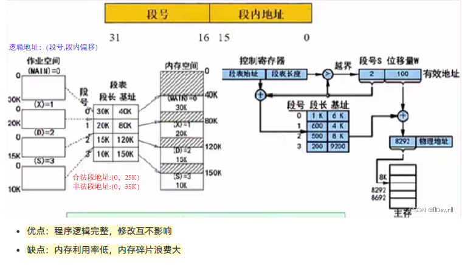

## 段页式存储管理

- 对进程空间先分段，后分页
- ==优点==：空间浪费小、存储共享容易、能动态连接
- ==缺点==：由于管理软件的增加，复杂性和开销也增加，执行速度下降
- 1个程序有若干个段，每个段中可以有若干页，每个页的大小相同，但每个段的大小不同。
- ==索引结构为每个文件建立一个索引表，记录文件所有数据块的物理地址==。这种方式`支持随机访问`，可以`快速定位到文件的任意位置`。`需要频繁进行随机读写、快速查找的文件`。数据库文件。`数据库需要快速定位和修改记录，索引结构能高效地支持这些操作`。
- ==链式结构将文件的数据分散存储在多个不连续的块中，每个块都包含一个指向下一个块的指针，形成一个链表==。这种方式`便于文件的动态增长，但只支持顺序访问`。`以顺序读写为主的文件，或者大小会频繁动态变化的文件`。`日志文件通常只在末尾追加内容，并按时间顺序读取，非常适合链式结构`。
- ==顺序结构要求文件的数据必须存储在连续的物理块中==。它的优点是`顺序访问效率极高`，但`缺点是文件创建时就需要确定大小`，且`难以动态扩展`。`创建后大小固定不变、且主要进行顺序访问的文件`。`CD/DVD中的音视频文件。这些文件在刻录后大小就固定了，播放时也是从头到尾顺序读取`。
- `“文件簇”是文件系统在磁盘上进行空间分配和管理的最小单位`，`它本身不是一种独立的文件结构，而是上述结构（尤其是链式和索引结构）的基础`。文件系统通过管理簇的分配来存储文件。`这是一个通用概念`，所有文件都存储在簇中。簇的大小会影响存储效率：
  - `大簇`：适合大型文件（高清电影），可以减少管理开销，提高读写速度。
  - `小簇`：适合大量小文件（配置文件），可以减少因文件末尾产生的内部碎片，节省磁盘空间。

> FAT 文件系统采用的是**基于文件的簇状链式结构**

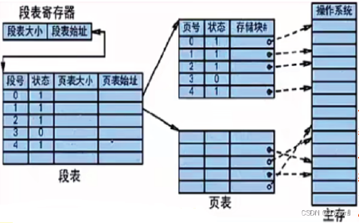

## 文件结构

- 计算机系统中采用的索引文件结构如图所示：

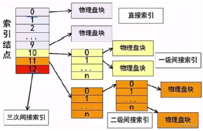

- 系统中有==13个索引节点==， ==0-9为直接索引==，`即每个索引节点存放的是内容`，`假设每个物理盘大小为4KB`，`共
  可存 4KB*10=40KB 数据`
- ==10号索引节点为一级间接索引节点==，`大小为4KB`，` 存放的并非直接数据`，`而是链接到直接物理盘块的地址`，
  `假设每个地址占4B`，`则共有1024个地址`，`对应1024个物理盘`，`可存 1024*4KB=4098KB 数据`
- ==二级索引节点类似，直接盘存放一级地址，一级地址再存放物理盘快地址==，`而后链接到存放数据的物理盘
  块`，`容量又扩大了一个数量级`，`为 1024*1024*4KB 数据`

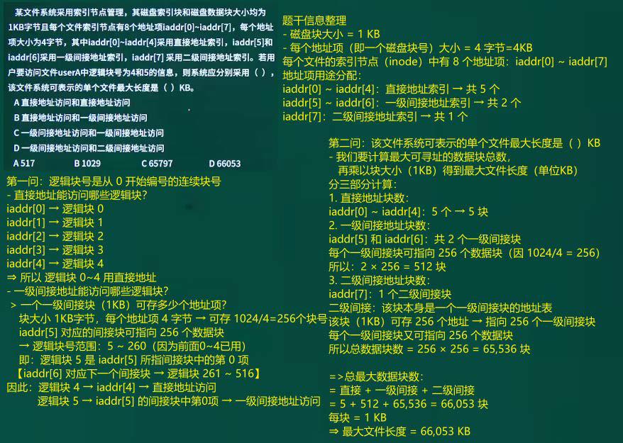

## 树形文件目录

- ==相对路径==：是从当前路径开始的路径

- ==绝对路径==：是从根目录开始的路径

- ==全文件名 = 绝对路径 + 文件名==。

  > 要注意， 绝对路径和相对路径是不加最后的文件名的，只是单纯的路径序列
  >
  > 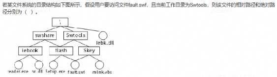
  >
  > - **相对路径**：从当前目录 `Swtools` 出发，进入子目录 `flash` 即可访问目标文件，故相对路径为：`flash\`
  >
  > - **绝对路径**：从根目录开始，依次经过 `Swtools` 和 `flash` 目录，故绝对路径为：`\Swtools\flash\`
  
- 树形结构主要是区分相对路径和绝对路径，如图所示

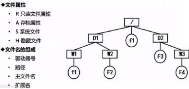

> 在Linux/Unix系统中，`文件权限通常用3个八进制数字表示`，分别对应：`文件所有者（User）的权限、所属组成员（Group）的权限、其他用户（Other）的权限`。
>
> 每个数字由以下权限值相加得到：`读取（r） = 4；写入（w） = 2；运行/执行（x） = 1；无权限 = 0。`
>
> 权限计算
>
> - 所有者：拥有所有权限（读取+写入+运行）= 4 + 2 + 1 = 7
> - 组成员：有读取和运行权限 = 4 + 1 = 5
> - 其他用户：只有运行权限 = 1
>
> > 在 Linux 系统中，修改文件权限设置的核心命令是 **chmod**

## 空闲存储空间管理

- ==空闲区表法==：将所有空闲空间整合成一张表，即空闲文件目录
- ==空闲链表法==：将所有空闲空间链接成一个链表，根据需要分配
- ==成组链接法==：既分组，每组内又链接成链表，是上述两种方法的综合
- ==位示图法==：`对每个物理空间用一位标识，为1则使用，为0则空闲`，形成一张位示图

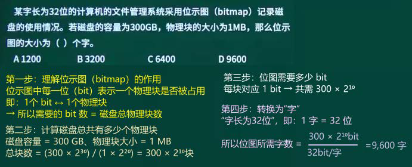

## 设备管理

- ==设备的分类方式==：
  - 按数据组织分类：块设备、字符设备
  - 资源分配角度分类：独占设备、共享设备和虚拟设备
  - 数据传输速率分类：低速设备、中速设备、高速设备

- ==I / 0 软件层次结构==：
  - `用户进程`：发出I/O调用。
  - `设备无关进程`：设备名解析、阻塞进程、分配缓冲区
  - `设备驱动程序`：设置寄存器，检查设备状态
  - `中断处理程序`：I/O完成后唤醒设备驱动程序
  - `硬件`：完成具体的I/O操作。

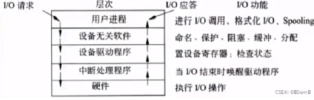

## 输入输出技术

- ==程序控制（查询）方式==：CPU主动查询外设是否完成数据传输， 效率极低
- ==程序中断方式==： 外设完成数据传输后，向CPU发送中断，等待CPU处理数据， 效率相对较高。适用于键盘等实时性较高的场景
  - ==中断响应时间==指的是从发出中断请求到开始进入中断处理程序
  - ==中断处理时间==指的是从中断处理开始到中断处理结束
  - ==中断向量==提供`中断服务程序的入口地址`
  - ==多级中断嵌套==， 使用`堆栈`来保护断点和现场
- ==DMA方式（直接主存存取）== ：`CPU只需完成必要的初始化等操作`，数据传输的整个过程都由DMA控制器来完成， 在主存和外设之间建立直接的数据通路， 效率很高。适用于硬盘等高速设备在一个总线周期结束后，CPU会响应DMA请求开始读取数据；CPU响应程序中断方式请求是在一条指令执行结束时；区分指令执行结束和总线周期结束

> - 中断方式和DMA方式都允许外设与CPU并行工作
> - DMA方式的数据传输速度快于程序中断方式，因为DMA方式减少了CPU的参与，避免了频繁的中断响应和现场保护开销
> - 在计算机中断系统中，**中断向量**是指向**中断服务程序入口地址**的指针或地址值。当CPU响应中断时，它会根据中断类型号（或向量号）在中断向量表中查找对应的中断向量，从而获得中断服务程序的起始执行地址。
>   - 设备地址通常由中断控制器或外设接口提供，用于识别中断来源，但不是中断向量本身。
>   - 数据传输起始地址通常由中断服务程序内部逻辑或DMA控制器决定，与中断向量无关。
>   - 断点地址是CPU在响应中断前自动保存的当前程序计数器（PC）值，用于中断返回时恢复执行
>   - **中断向量的核心作用就是提供中断服务程序的入口地址**，使CPU能够跳转到相应服务程序执行。

## 虚设备和SPOOLING技术

一台实际的物理设备，例如打印机，在同一时间只能由一个进程使用，其他进程只能等待，且不知道什么时候打印机空闲，此时，极大的浪费了外设的工作效率

`引入SPOOLING技术，就是在外设上建立两个数据缓冲区，分别称为输入井和输出井`，这样，无论多少进程，都可以共用这一台打印机，只需要将打印命令发出，数据就会排队存储在缓冲区中，打印机会自动按顺序打印，实现了物理外设的共享，使得每个进程都感觉在使用一个打印机,这就是物理设备的虚拟化。如下图所示：

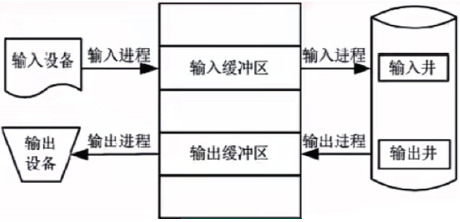

## 磁盘结构

- `磁盘有正反两个盘面，每个盘面有多个同心圆，每个同心圆是一个磁道，每个同心圆又被划分为多个扇区，数据就被存放在一个个扇区中`
- `读取数据时，磁头首先要寻找到对应的磁道，然后等待磁盘进行周期旋转，旋转到指定的扇区，才能读取到对应的数据`，因此，会产生==寻道时间和等待时间==，就是磁头移动到磁道所需的时间和等待读写的扇区转到磁头的下方所用的时间。其中寻道时间耗时最长，==寻道时间的调度算法==如下：
  - ==先来先服务FCFS==(First-Come, First-Served)：根据进程请求访问磁盘的先后顺序进行调度
  - ==最短寻道时间优先SSTF==(Shortest Seek Time First)：请求访问的磁道与当前磁道最近的进程优先调度，使得每次的寻道时间最短。会产生“饥饿”现象，即远处进程可能永远无法访问
  - ==扫描算法SCAN==(Scan Algorithm) ：`又称“ 电梯算法”，磁头在磁盘上双向移动`，其会选择离磁头当前所在磁道最近的请求访问的磁道，并且与磁头移动方向一致，`磁头永远都是从里向外或者从外向里一直移动完才掉头，与电梯类似`
  - ==单向扫描调度算法CSCAN== (Circular Scan)：与SCAN不同的是，其只做单向移动，即`只能从里向外或者从外向里`

- ==读取磁盘数据的时间应包括以下三个部分==：
  - `找磁道的时间`
  - `找块（扇区）的时间，即旋转延迟时间`
  - `传输时间`

> 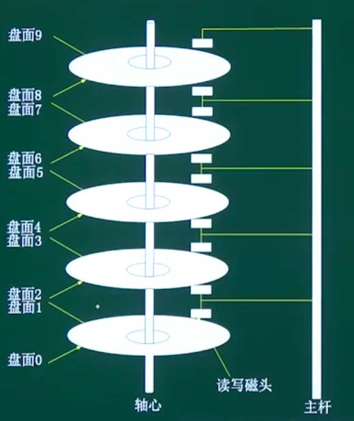
>
> 
>
> ---
>
> 
>
> 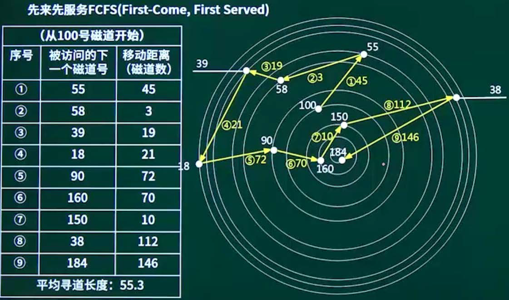
>
> ---
>
> 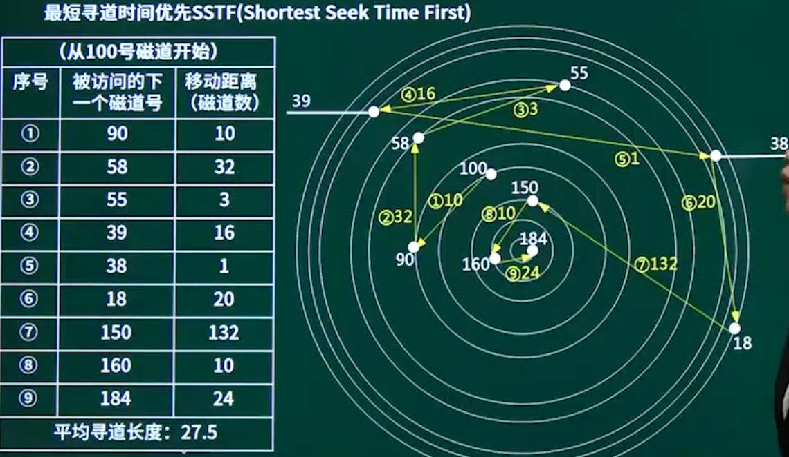
>
> ---
>
> 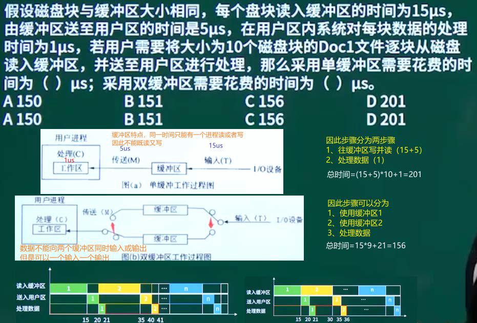
>
> ---
>
> 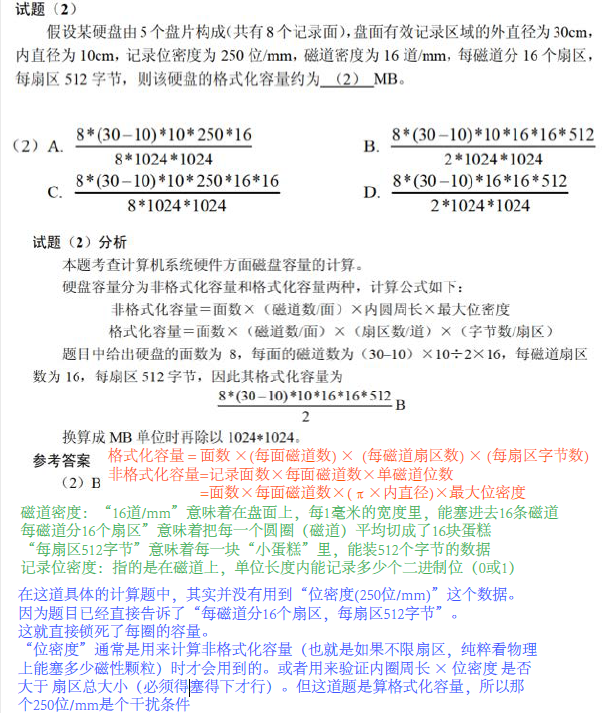
>
> 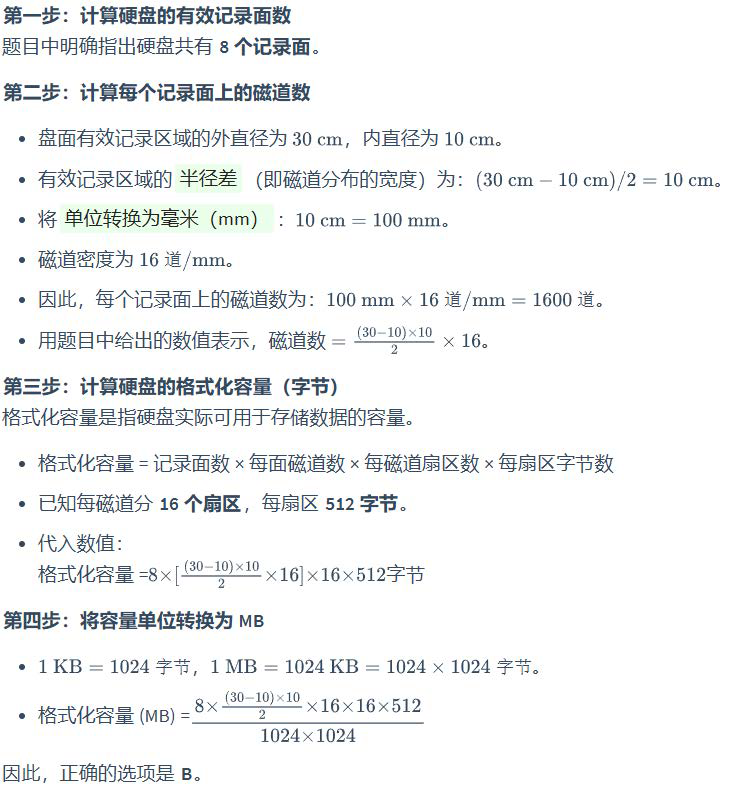
>
> ---
>
> 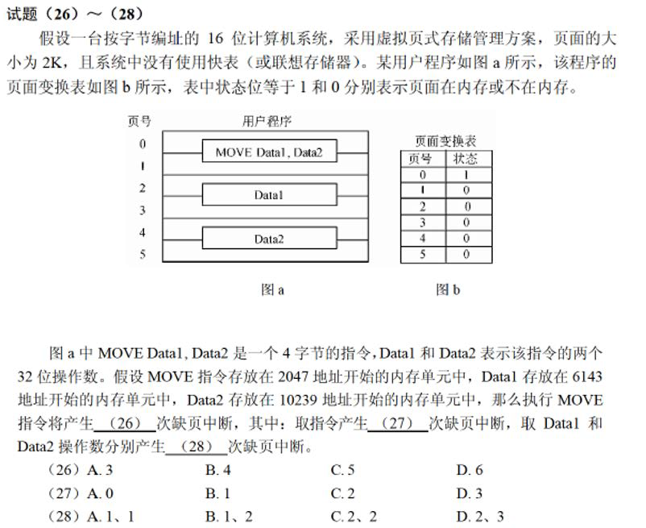
>
> 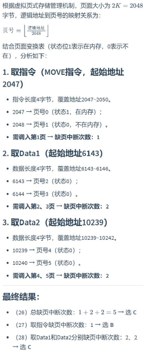

## 微内核操作系统

微内核，顾名思义，就是尽可能的将内核做的很小，只`将最为核心必要的东西放入内核中，其他能独立的东西都放入用户进程中`，这样，系统就被分为了==用户态和内核态==

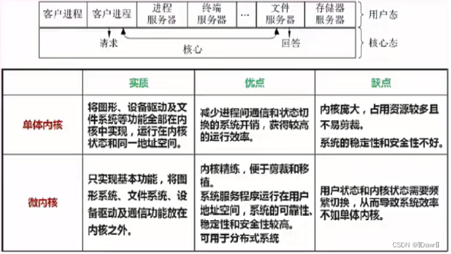

## 嵌入式操作系统

- 嵌入式操作系统特点：微型化、代码质量高、专业化、实时性强、可裁剪可配置
- 实时嵌入式操作系统的内核服务：异常和中断、计时器、I / O管理
- 常见的嵌入式RTOS(实时操作系统)：VxWorks、RT-Linux、QNX、pSOS
- 嵌入式系统初始化过程按照自底向上、从硬件到软件的次序依次为： 片级初始化——>板级初始化——>系统初始化
- 芯片级是微处理器的初始化，板卡级是其他硬件设备初始化，系统级初始化就是软件及操作系统初始化

> **嵌入式操作系统四大核心特点**
>
> 1. **微型化**：面向资源受限环境，内核小巧，占用内存与代码量极少。
> 2. **可定制性**（⭐高频考点）：能根据硬件和应用需求，对内核功能模块与系统结构进行灵活**裁剪和配置**。
> 3. **实时性**：具备严格的响应时间限制，必须在规定时间内完成指定任务。
> 4. **可靠性**：系统需长时间稳定运行，具备容错和防故障机制。
>
> | 核心概念 | 关注点   | 题干高频关键词                                        |
> | -------- | -------- | ----------------------------------------------------- |
> | 可定制性 | 功能调整 | 针对硬件变化进行结构与功能上的配置、裁剪。            |
> | 易移植性 | 代码迁移 | 采用硬件抽象层（HAL）/板级支持包（BSP）以跨平台迁移。 |

## 补充

- 运算速度是一个综合性的指标，通常用 MIPS（每秒百万条指令）或 FLOPS（每秒浮点运算次数）来衡量。虽然 64 位处理器通常比 32 位处理器快，但它们之间并不是严格的 2 倍关系。
  - 32 位处理器的通用寄存器是 32 位宽，64 位处理器是 64 位宽。
  - 64 位处理器的数据总线宽度通常是 64 位，而 32 位处理器是 32 位
  - 64 位 CPU 的 ALU 一次可以处理 64 位的数据，而 32 位 CPU 只能处理 32 位

- 在Linux操作系统中，通常使用的Web服务器软件是Apache
  - IIS是Windows平台下的Web服务器
  - NFS是网络文件系统
  - MySQL是数据库系统
- 对于Apache作为Web服务器时，其默认的Web站点目录为`/home/httpd`
  - `/etc/httpd` 通常是Apache的配置文件目录；
  - `/var/log/httpd` 是Apache的日志文件存放目录；
  - `/etc/home` 是系统配置目录，与Web站点无关。
  windows权限层级来看：administrators > power users > users > everyone

- ==response==：Response 对象用于将信息从服务器发送回客户端浏览器。它包含一个 Cookies 集合，专门用于创建或修改客户端计算机上的 Cookie

  ==request==：Request 对象用于从客户端获取信息。它也包含一个 Cookies 集合，但它是只读的，用于读取客户端在 HTTP 请求中发送过来的 Cookie值。不能通过它来修改客户端的 Cookie。
  ==application==：Application 对象用于在给定应用程序的所有用户之间共享信息。它的生命周期贯穿整个应用程序的运行期间，与特定用户的 Cookie操作无关。
  ==session==：Session 对象用于存储特定用户会话所需的信息。Session 对象本身是用来存储服务器端变量的，而不是直接用来操作客户端 Cookie 的

- 作业调度算法：
  - 先来先服务
  - 短作业优先
  - 最高响应比优先：响应比 = (等待时间 + 服务时间) / 服务时间= 1 + 等待时间 / 服务时间
  - 时间片轮转=系统对每个用户的响应时间 =T=n*q
  - 优先级调度算法