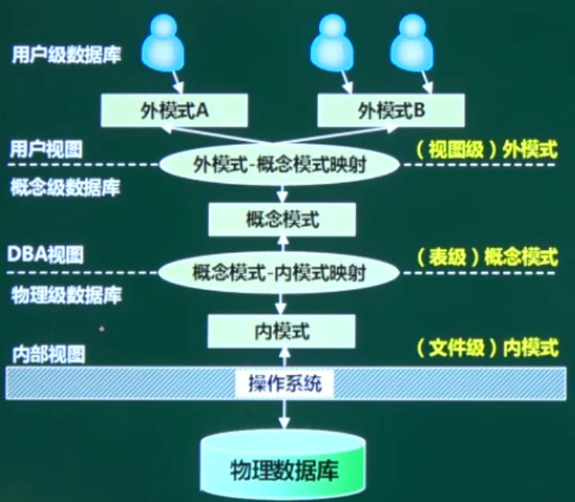
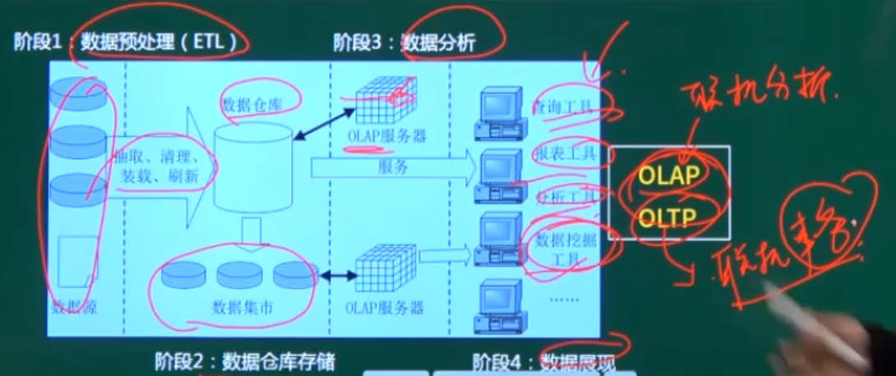
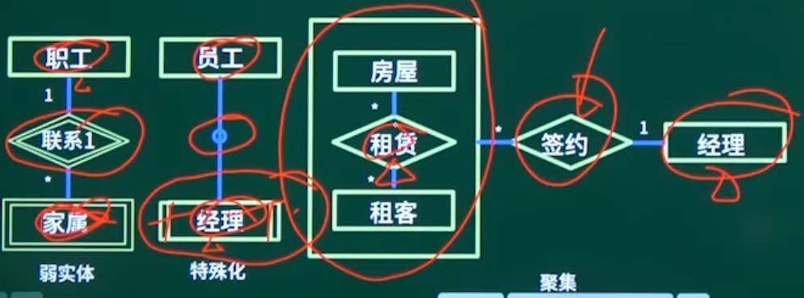

## 数据库与数据库管理系统

- 数据库系统（DBS）：从广义上讲是由数据库、硬件、软件和人员组成的，其中管理的对象是数据
  - 数据库（DB）：是指长期存储在计算机内的、有组织的、可共享的数据集合
  - 硬件：是指构成计算机系统的各种物理设备，包括存储数据所需的外部设备
  - 软件：包括操作系统、数据库管理系统及应用程序
  - 人员：系统分析员和数据库设计人员、应用程序员、最终用户、数据库管理员（DBA）

## DBMS 的特征与分类

- DBMS 的特征：数据结构化且统一管理、有较高的数据独立性、数据控制功能
- DBMS 的分类：==关系数据库系统（RDBS）==、==面向对象的数据库系统（OOBS）==、==对象关系数据库系统（ORDBS）==

## 数据库的三级模式结构

- 数据库系统采用三级模式结构，这是数据库管理系统内部的系统结构

  - ==概念模式【基本表】==。也称`模式`，是数据库中全体数据的逻辑结构和特征的描述，它`由若干个概念记录类型组成，只涉及行的描述，不涉及具体的值`
  - ==外模式【视图】==。也称`用户模式或子模式`，是用户与数据库系统的接口，是`用户用到的那部分数据的描述，由若干个外部记录类型组成`
  - ==内模式【存储文件】==。也称`存储模式`，是数据物理结构和存储方式的描述，`是数据在数据库内部的表示方式，定义所有的内部记录类型、索引和文件的组织方式以及数据控制方面的细节`

  > **聚簇索引**决定了表中数据的`物理存储顺序`。也就是说，创建聚簇索引后，表中的数据行会按照索引键的顺序在磁盘上进行物理存储。`创建聚簇索引改变了数据的物理存储顺序，这正是内模式所描述的内容。`

  > 在数据库安全机制中，为了保护数据库的关系模式不被第三方直接获取，通常会通过**存储过程**来封装数据更新逻辑。第三方开发人员只需调用存储过程并传入相应参数，即可完成数据操作，而无需直接接触底层表结构或关系模式。
  >
  > - **触发器**虽然也是存储过程的一种，但它是在特定事件（如INSERT、UPDATE、DELETE）发生时自动执行，主要用于保证数据完整性，而非供第三方主动调用进行数据更新。
  > - **视图**是虚拟表，用于限制用户访问的数据范围，但并不能阻止用户通过视图间接推断出底层表结构。
  > - **索引**用于优化查询性能，与数据安全无关。
  >
  > 因此，**存储过程**是正确答案，因为它允许封装业务逻辑和数据操作，同时隐藏数据库的物理结构，从而保障关系模式的安全性。



## 数据库的两级映像

- 数据库系统在三级模式之间提供了两级映像，即模式/内模式映像和外模式/模式映像

  - ==模式/内模式映像==。该映像存在于`概念级和内部级`之间，实现了`概念模式到内模式`之间的相互转换。（ 物理独立性）
  - ==外模式/模式映像==。该映像存在于`外部级和概念级`之间，实现了`外模式到概念模式`之间的相互转换。（ 逻辑独立性）

  > `物理独立性`：当`数据的物理结构发生变化时`，应用程序不用改变。但是为了能够保证应用程序能够正确执行，`需要修改概念模式和内模式之间的映像`
  >
  > `逻辑独立性`：当`数据的逻辑结构发生变化时`，用户程序不用改变。但是为了能够保证应用程序能够
  > 正确执行，`需要修改概念模式和外模式之间的映像`

## 数据仓库的特点

- 面向主题：数据按主题组织。
- 集成的：消除了源数据中的不一致性，提供整个企业的一致性全局信息。
- 相对稳定的（非易失的）：主要进行查询操作，只有少量的修改和删除操作（或是不删除）。
- 反映历史变化（随着时间变化）：记录了企业从过去某一时刻到当前各个阶段的信息，可对发展历程和未来趋势做定量分析和预



## 数据模型的基本概念

- ==概念数据模型==。也称`信息模型`，是按用户的观点对数据和信息建模，是`现实世界到信息世界的第一层抽象`，强调其语义表达功能，易于用户理解，是用户和数据库设计人员交流的语言，主要用于数据库设计。`这类模型中最著名的是实体联系模型，简称E-R模型`

- 基本数据模型。它是按计算机系统的观点对数据建模，是现实世界数据特征的抽象，用于DBMS的实现。`基本的数据模型有层次模型、网状模型、关系模型和面向对象模型(OOM)`

  > 1、`层次模型`：采用树状结构，适用于一对多关系，不使用二维表。
  > 2、`网状模型`：采用图结构，支持多对多关系，也不以二维表为核心结构。
  > 3、`面向对象模型`：基于对象和类的概念，强调封装、继承和多态，不以二维表表示数据。
  > 4、`关系模型`：核心特征是使用二维表（即关系）来表示实体类型及实体间的联系。每个表代表一个实体集，行（元组）代表实体，列（属性）代表实体的特征。多个表可通过外键建立联系，从而表达实体间的关联

## 数据模型的三要素

- 数据模型是用来描述数据的一组概念和定义。==数据模型的三要素是数据结构、数据操作、数据的约束条件==。

  - ==数据结构==：是所`研究的对象类型的集合`，是对系统静态特性的描述。
  - ==数据操作==：是对数据库中各种对象(型)的实例(值)允许执行的`操作集合`，包括操作及操作规则。数据操作是对系统动态特性的描述。
  - ==数据的约束条件==：是一组`完整性规则的集合`。也就是说，对于具体的应用数据必须遵循特定的语义约束条件，以保证数据的正确、有效、相容。

  > 在函数调用和返回时由系统控制和管理的是`栈区`；由用户在程序中根据需要进行申请和释放的是`堆区`
  >
  > 
  >
  > **A. 栈** 栈主要用于存储函数调用时的`局部变量、参数`等。栈位于内存中，访问栈中的变量需要通过内存地址，速度相对较慢，不如寄存器快。
  >
  > **B. 堆** 堆主要用于动态分配的内存（如 `malloc` 或 `new` 分配的内存）。堆的访问同样需要通过内存地址，且由于内存碎片、缓存局部性等原因，访问速度通常比栈还要慢一些，显然不是最优选择。
  >
  > **C. 静态存储区** 静态存储区用于存储全局变量和静态变量。这些变量在程序整个生命周期中都存在，存储在内存的固定位置。访问速度同样受限于内存访问，不如寄存器快。
  >
  > **D. 寄存器** 寄存器是 CPU 内部的高速存储单元，数量较少，但访问速度极快（通常在一个时钟周期内完成）。编译器在进行优化时，会尽量将频繁使用的变量（如循环计数器）放入寄存器中，这样可以避免频繁的内存访问，从而显著提升程序执行速度。
  >
  > 
  >
  > | 内存区域     | 存储内容                               | 管理方式                                     |
  > | ------------ | -------------------------------------- | -------------------------------------------- |
  > | 栈区 (Stack) | 非静态局部变量、函数参数、函数返回地址 | 自动管理：函数进入时分配，函数结束时自动销毁 |
  > | 堆区 (Heap)  | 程序员通过 `new/malloc` 手动申请的内存 | 手动管理：必须通过 `delete/free` 手动释放    |
  > | 静态数据区   | 全局变量、静态变量 (static)            | 程序启动时分配，结束时释放，贯穿整个生命周期 |
  > | 文本区       | 可执行代码 (函数体里的代码逻辑)        | 只读，不能被修改                             |

  

## E-R 模型

- ==实体==：是现实世界中可以区别于其他对象的“事件”或“物体”
- ==联系==： 实体集之间的对应关系称为联系
  - 一对一联系
  - 一对多联系
  - 多对多联系
- ==属性==：是实体某方面的特性
  - `简单属性`和`复合属性`
    - 简单属性是原子的、不可再分的
    - 复合属性可以细分为更小的部分(即划分为别的属性)
  - `单值属性`和`多值属性`
    - 若定义的属性对于一个特定的实体只有一个值，这样的属性叫做单值属性
    - 若定义的属性对应一组值，则称为多值属性
  - `NULL属性`：当实体在某个属性上没有值或属性值未知时，使用NULL值，表示无意义或不知道
  - `派生属性`：可以从其他属性得来

- ==E-R 方法==：概念模型中最常用的方法是实体-模型方法，简称E-R方法。该方法直接从现实世界中抽象出实体和实体间的联系，然后用非常直观的E-R图来表示数据模型
- ==扩充的 E-R 模型==：扩充的E-R模型包括弱实体、特殊化、概括、聚集等概念

| 构件              | 推荐画法                         | 含义                                     |
| ----------------- | -------------------------------- | ---------------------------------------- |
| 实体              | 单线矩形                         | 普通实体，如“员工”“房屋”“租客”           |
| ==弱实体==        | 双线矩形                         | 依赖其他实体存在，如“家庭成员”           |
| 联系              | 菱形                             | 普通实体间关系，如“租赁”“签约”           |
| ==弱联系==        | 双线菱形                         | 用于识别弱实体                           |
| 属性              | 椭圆                             | 普通属性                                 |
| ==多值属性==      | 双线椭圆                         | 一个实体可具有多个该属性                 |
| ==派生属性==      | 虚线椭圆                         | 可通过其他属性计算得到                   |
| ==特殊化 / 泛化== | **圆形连接，不使用菱形**         | 表示 ISA 继承关系                        |
| 聚集              | 外层矩形框住“实体—联系—实体”整体 | 将一个联系整体看成更高层对象参与其他联系 |

> 特殊化的关系则不需要菱形，直接是线上一个圈。特殊化的矩形则是两边加两竖线



## 关系数据库的基本概念

- ==属性和域==：在现实世界中，要描述一个事物，常常取其若干特征来表示。这些特征称为`属性`。每个属性的
  取值范围的集合，称为该`属性的域`。一般在关系数据库模型中，对域还加了一个限制，所有的域都应是原子
  数据的集合。关系数据模型的这种限制称为第一范式(1NF)条件。如果关系数据模型突破了1NF的限制，则称
  为非1NF的。

- 笛卡儿积和关系

  - 设 $D_1, D_2, \cdots, D_n$ 为任意集合，定义 $D_1, D_2, \cdots, D_n$ 的笛卡儿积为 $$D_1 \times D_2 \times \cdots \times D_n = {(d_1, d_2, \cdots, d_n) \mid d_i \in D_i, i = 1, 2, \cdots, n}$$ 其中，每一个元素 $(d_1, d_2, \cdots, d_n)$ 叫做一个 $n$ 元组，元组的每一个值 $d_i$ 叫做元组的一个分量，若 $D_i (i=1, 2, \cdots, n)$ 为有限集，其基数为 $m_i (i=1, 2, \cdots, n)$，则 $D_1 \times D_2 \times \cdots \times D_n$ 的基数 $M$ 为 $$M = \prod_{i=1}^{n} m_i$$ 笛卡儿积可以用二维表来表示。
  - $D_1 \times D_2 \times \cdots \times D_n$ 的子集叫做在域 $D_1, D_2, \cdots, D_n$ 上的关系，记为 $$R(D_1, D_2, \cdots, D_n)$$ 称关系 $R$ 为 $n$ 元关系。
  - 一个关系可以用二维表来表示。`关系中属性个数称为元数，元组的个数称为基数`

- **关系的相关名词：**

  - ==目或度==：常用R表示关系的名字，n表示关系的目或度。【关系模型中属性的个数】

  - ==候选码==：若关系中的某一`属性或属性组`的值能`唯一标识一个元组`，则称该`属性或属性组为候选码`

  - ==主码==：若`一个关系有多个候选码`，则`选定其中一个为主码`

  - ==主属性==：所有`候选码都是主属性`，`其他都是非主属性`

  - ==外码==：如果关系模式R中的属性或属性组非该关系的码，但它是其他关系的码，那么该属性集对关系模式R而言是外码

  - ==全码==：关系模式的`所有属性组`是这个关系模式的候选码，称为全码

    > - 候选键:能够唯一标识关系中每一个元组的`最小属性集`
    > - 主属性:包含在任何一个候选键中的属性
    > - 主键:从候选键中选择一个作为主键
    >
    > 假设关系模式为：R(学号, 姓名, 课程, 老师, 班级号, 成绩)
    >
    > 1. 确定函数依赖
    >    学号 → 姓名
    >    学号 → 班级号
    >    课程 → 老师
    >    (学号, 课程) → 成绩
    > 2. 寻找候选键:需要找到能推导出所有属性的最小属性集
    >    候选键是 (学号, 课程)
    > 3. 确定主属性和非主属性
    >    主属性：学号, 课程（包含在候选键中的属性）
    >    非主属性：姓名, 老师, 班级号, 成绩（不包含在候选键中的属性）

- 关系的三种类型：

  - ==基本关系==(通常又称为`基本表、基表`)：这是`实际存在的表，它是实际存储数据的逻辑表示`
  - ==查询表==：`查询结果`对应的表
  - ==视图表==：这是由`基本表或其他视图表导出的表`。由于它`本身不独立存储在数据库`中，数据库中`只存放它的定义`，所以常称为`虚表`

- 完整性约束：

  | 约束类型             | 约束对象 | 核心规则                   |
  | -------------------- | -------- | -------------------------- |
  | ==实体完整性==       | ==主键== | 唯一且非空                 |
  | ==参照完整性==       | ==外键== | 要么为空，要么匹配对方主键 |
  | ==用户自定义完整性== | ==字段== | 满足特定业务需求           |

- 关系运算

  <table>
      <tr>
          <th colspan="2">运算符</th>
          <th>含义</th>
          <th colspan="2">运算符</th>
          <th>含义</th>
      </tr>
      <tr>
          <td rowspan="4">集合运算符</td>
          <td>∪</td>
          <td>并</td>
          <td rowspan="6">比较运算符</td>
          <td>&gt;</td>
          <td>大于</td>
      </tr>
      <tr>
          <td>−</td>
          <td>差</td>
          <td>≥</td>
          <td>大于等于</td>
      </tr>
      <tr>
          <td>∩</td>
          <td>交</td>
          <td>&lt;</td>
          <td>小于</td>
      </tr>
      <tr>
          <td>×</td>
          <td>笛卡儿积</td>
          <td>≤</td>
          <td>小于等于</td>
      </tr>
      <tr>
          <td rowspan="4">专门的关系运算符</td>
          <td>σ</td>
          <td>选择</td>
          <td>=</td>
          <td>等于</td>
      </tr>
      <tr>
          <td>π</td>
          <td>投影</td>
          <td>≠</td>
          <td>不等于</td>
      </tr>
      <tr>
          <td>⋈</td>
          <td>连接</td>
          <td rowspan="3">逻辑运算符</td>
          <td>¬</td>
          <td>非</td>
      </tr>
      <tr>
          <td>÷</td>
          <td>除</td>
          <td>∧</td>
          <td>与</td>
      </tr>
      <tr>
          <td></td>
          <td></td>
          <td></td>
          <td>∨</td>
          <td>或</td>
      </tr>
  </table>


  > ```
  > 运算顺序：
  > 先做：非
  > 在做算数运算：* 、 /
  > 			+ 、-
  > 再做关系运算：＞、≥、＜、≤
  > 			==、!=
  > 接着：逻辑与&&
  >      逻辑或||
  > 最后：赋值=
  > 【注意有括号先做括号内部】
  > ```

## 5种基本的关系代数运算

- **并：** 关系 $R$ 与 $S$ 具有相同的关系模式，即 $R$ 与 $S$ 的元数相同（结构相同）。关系 $R$ 和关系 $S$ 的并由属于 $R$ 或属于 $S$ 的元组组成的集合组成，记作 $R \cup S = { t \mid t \in R \lor t \in S }$，式中，$t$ 为元组变量。

- **差：** 关系 $R$ 与 $S$ 具有相同的关系模式。关系 $R$ 与 $S$ 的差由属于 $R$ 但不属于 $S$ 的元组组成的集合组成，记作 $R - S = { t \mid t \in R \land t \notin S }$，式中，$t$ 为元组变量。

- **广义笛卡尔积：** 两个元数分别为 $n$ 目和 $m$ 目的关系 $R$ 和 $S$ 的广义笛卡尔积是一个 $n+m$ 列的元组的集合。元组的前 $n$ 列是关系 $R$ 的一个元组，后 $m$ 列是关系 $S$ 的一个元组。若 $R$ 有 $k_1$ 个元组，$S$ 有 $k_2$ 个元组，则关系 $R$ 和 $S$ 的广义笛卡尔积有 $k_1 \times k_2$ 个元组。记作 $R \times S = { t \mid t = <t^n, t^m> \land t^n \in R \land t^m \in S }$。

- ==**投影**==：`从关系的垂直方向进行运算`，在关系 $R$ 中选择出若干属性列 $A$ 组成新的关系。记作 $\Pi_A(R) = { t[A] \mid t \in R }$。

- ==**选择**==： `从关系的水平方向进行运算`，是从关系 $R$ 中选择满足给定条件的诸元组，记作 $\sigma_F(R) = { t \mid t \in R \land F(t) = \text{true} }$，式中，$F$ 中的运算对象是属性名（或列的序号）或常数，运算符是算术比较符和逻辑运算符。

  > ==注意投影和选择的符号==
  >
  > 【例】设有关系 $R$、$S$ 如下所示，请求出 $R \cup S$、$R - S$、$R \times S$、$\Pi_{A,C}(R)$、$\sigma_{A < B}(R)$ 和 $\sigma_{A < 4}(R \times S)$。
  >
  > |  A   |  B   |  C   |
  > | :--: | :--: | :--: |
  > |  a   |  b   |  c   |
  > |  b   |  a   |  d   |
  > |  c   |  d   |  e   |
  > |  d   |  f   |  g   |
  >
  > <center>关系 $R$</center>
  >
  > |  A   |  B   |  C   |
  > | :--: | :--: | :--: |
  > |  b   |  a   |  d   |
  > |  d   |  f   |  g   |
  > |  f   |  h   |  k   |
  >
  > <center>关系 $S$</center>
  >
  > ---
  >
  > **解：** $R \cup S$、$R - S$、$R \times S$、$\Pi_{A,C}(R)$、$\sigma_{A < B}(R)$ 和 $\sigma_{A < 4}(R \times S)$ 的结果如下所示。
  >
  > ### 1. $R \cup S$
  >
  > |  A   |  B   |  C   |
  > | :--: | :--: | :--: |
  > |  a   |  b   |  c   |
  > |  b   |  a   |  d   |
  > |  c   |  d   |  e   |
  > |  d   |  f   |  g   |
  > |  f   |  h   |  k   |
  >
  > ### 2. $R - S$
  >
  > ==【R-S只看R中减去S出现的，R还剩什么，不要考虑负的】==
  >
  > |  A   |  B   |  C   |
  > | :--: | :--: | :--: |
  > |  a   |  b   |  c   |
  > |  c   |  d   |  e   |
  >
  > ### 3. $\Pi_{A,C}(R)$
  >
  > ==【投影 ($\Pi$) 的下标是列名列表，用来筛选特定的列。】==
  >
  > |  A   |  C   |
  > | :--: | :--: |
  > |  a   |  c   |
  > |  b   |  d   |
  > |  c   |  e   |
  > |  d   |  g   |
  >
  > ### 4. $\sigma_{A < B}(R)$
  >
  > ==【选择 ($\sigma$) 的下标是用列名写的规则，用来筛选整行；】==
  >
  > |  A   |  B   |  C   |
  > | :--: | :--: | :--: |
  > |  b   |  a   |  d   |
  >
  > ### 5. $R \times S$
  >
  > | R.A  | R.B  | R.C  | S.A  | S.B  | S.C  |
  > | :--: | :--: | :--: | :--: | :--: | :--: |
  > |  a   |  b   |  c   |  b   |  a   |  d   |
  > |  a   |  b   |  c   |  d   |  f   |  g   |
  > |  a   |  b   |  c   |  f   |  h   |  k   |
  > |  b   |  a   |  d   |  b   |  a   |  d   |
  > |  b   |  a   |  d   |  d   |  f   |  g   |
  > |  b   |  a   |  d   |  f   |  h   |  k   |
  > |  c   |  d   |  e   |  b   |  a   |  d   |
  > |  c   |  d   |  e   |  d   |  f   |  g   |
  > |  c   |  d   |  e   |  f   |  h   |  k   |
  > |  d   |  f   |  g   |  b   |  a   |  d   |
  > |  d   |  f   |  g   |  d   |  f   |  g   |
  > |  d   |  f   |  g   |  f   |  h   |  k   |
  >
  > ### 6. $\sigma_{A < 4}(R \times S)$
  >
  > ==【下标就是列的名字】==
  >
  > | R.A  | R.B  | R.C  | S.A  | S.B  | S.C  |
  > | :--: | :--: | :--: | :--: | :--: | :--: |
  > |  a   |  b   |  c   |  d   |  f   |  g   |
  > |  a   |  b   |  c   |  f   |  h   |  k   |
  > |  b   |  a   |  d   |  f   |  h   |  k   |
  > |  c   |  d   |  e   |  f   |  h   |  k   |

## 扩展的关系代数运算

- ==交==

- ==连接==

  - ==$\theta$ 连接==
  - ==等值连接==
  - ==自然连接==

- ==除==

- ==广义投影==

- ==外连接==

  - ==左外连接==
  - ==右外连接==
  - ==全外连接==

  | 运算名称       | 一句话大白话解释                                             | 极简示例                                                     |
  | -------------- | ------------------------------------------------------------ | ------------------------------------------------------------ |
  | 交             | 找“交集”，两边都有的才算。                                   | 既是“篮球队”成员，又是“足球队”成员的人。                     |
  | $\theta$  连接 | 两个表拼在一起，但只保留符合某个“条件”（如大于、小于等）的行。 | “学生表”和“成绩表”拼起来，但只保留 `学生表.成绩 > 成绩表.及格线` 的记录。 |
  | 等值连接       | 两个表拼在一起，条件限定为“相等”。                           | “学生表”和“成绩单”拼起来，只保留 `学生表.学号 = 成绩单.学号` 的行。 |
  | 自然连接       | 两个表拼起来，找“同名同姓”的列自动对齐，并且拼完后删掉重复的列。 | “学生表”和“成绩表”拼起来，发现都有“学号”列，自动把学号相同的对上号，并且拼好后只留一列“学号”。 |
  | 除             | 寻找“全部”、“所有”关系。找谁（或哪些属性）完整包含了某个集合的所有元素。 | 查询“选修了全部课程的学生的学号”。                           |
  | 广义投影       | 在选取某些列的同时，可以在列上做计算（比如加减乘除、改名字）。 | 从“学生表”中只拿出“姓名”和“出生日期”这两列，并顺便增加一列新算出来的 `年龄 = 2023 - 出生年份`。 |
  | 左外连接       | 左边的表是“祖宗”，左表的数据必须全保留。右表没匹配上的，位置填上 `NULL`（空）。 | 打印“学生总名册”，即使某个学生没选任何课，他的名字也必须出现在结果里（对应的课程列显示为空）。 |
  | 右外连接       | 右边的表是“祖宗”，右表的数据必须全保留。左表没匹配上的，位置填上 `NULL`（空）。 | 打印“所有课程清单”，即使某门课没人选，这门课的名字也必须出现（对应的学生列显示为空）。 |
  | 全外连接       | 两边都是“祖宗”，左右两边没匹配上的数据全部保留，空缺的地方填 `NULL`。 | 打印“学生+课程总清单”，既包括没选课的学生，也包括没人选的课程，全保留下来，缺的地方填空。 |

> **1. 求关系R和S的自然连接结果集。**
> **2. 求R和S的左外连接、右外连接、完全外连接的元组个数。**
>
> |  A1  |  A2  |  A3  |  A1  |  A2  |  A4  |
> | :--: | :--: | :--: | :--: | :--: | :--: |
> |  1   |  2   |  3   |  1   |  9   |  1   |
> |  2   |  1   |  4   |  2   |  1   |  8   |
> |  3   |  4   |  4   |  3   |  4   |  1   |
> |  4   |  6   |  7   |  4   |  8   |  3   |
>
> 第一问：自然连接 (Natural Join)
>
> ==自然连接会基于两个关系中的公共属性（这里是 `A1` 和 `A2`）进行等值连接，并去除重复的属性列。==
>
> *   **匹配过程：**
>     *   R中 `(A1=2, A2=1)` 与 S中 `(A1=2, A2=1)` 匹配，合并为 `(2, 1, 4, 8)`
>     *   R中 `(A1=3, A2=4)` 与 S中 `(A1=3, A2=4)` 匹配，合并为 `(3, 4, 4, 1)`
>     *   R中其他行在S中无匹配，S中其他行在R中无匹配，均不包含在自然连接结果中。
> *   **结果集：** `{(2, 1, 4, 8), (3, 4, 4, 1)}`
>
> ---
>
>  第二问：外连接元组个数
>
> **1. 左外连接 (Left Outer Join)：**
>
> *   保留左表R的所有元组。
> *   匹配成功的元组正常合并。
> *   匹配失败的元组，右表部分用NULL填充。
> *   R有4行，其中2行匹配成功，2行匹配失败。
> *   结果元组数：**4**
>
> **2. 右外连接 (Right Outer Join)：**
>
> *   保留右表S的所有元组。
> *   匹配成功的元组正常合并。
> *   匹配失败的元组，左表部分用NULL填充。
> *   S有4行，其中2行匹配成功，2行匹配失败。
> *   结果元组数：**4**
>
> **3. 完全外连接 (Full Outer Join)：**
>
> *   保留R和S的所有元组。
> *   匹配成功的元组正常合并。
> *   R中未匹配的元组，S部分用NULL填充。
> *   S中未匹配的元组，R部分用NULL填充。
> *   匹配成功的元组：2个
> *   R中未匹配的元组：2个
> *   S中未匹配的元组：2个
> *   结果元组数：2 + 2 + 2 = **6**

## SQL 数据库体系结构

- SQL支持==三级模式结构==： 

  - 视图对应外模式
  - 基本表对应模式
  - 存储文件对应内模式

- SQL注入：

  其`首要目标是获得数据库的权限`，即通过注入语句使数据库执行攻击者指定的命令，进而实现对数据库结构的操控、数据的读取、修改或删除。

## SQL 数据定义

```mysql
-- 创建一个名为 Dept_count 的函数，用于计算指定学院的教师数量
-- 括号内定义输入参数：学院名称 (Dept_name)，类型为最多20个字符的字符串
Create function Dept_count(Dept_name varchar(20))

-- 【关键步骤1：定义返回值类型】
-- 告诉数据库这个函数执行结束后，会返回一个整数（integer）
returns integer
-- 函数代码体的开始标志
begin

-- 【关键步骤2：声明函数内部的局部变量】
-- 在 begin 之后，必须先声明后面要使用的变量 d_count，类型也是整数
declare d_count integer;

-- 【核心业务逻辑】
-- 从 Teacher 表中统计数据，条件是该条记录的 Dept_name 等于传入的参数 Dept_name
-- 将统计出来的总数量（count(*)）存入刚才声明的变量 d_count 中
select count(*) into d_count
from Teacher
where Teacher.Dept_name = Dept_name;

-- 【返回结果】
-- 将最终计算好的数量 d_count 返回给调用者
return d_count;

-- 函数代码体的结束标志
end;
```


### 1. 表的管理 (DDL)

- **创建表 (CREATE)**

  - **语法：** `CREATE TABLE 表名 (列名 类型 [约束], ...);`

  - **示例：**

    ```mysql
    CREATE TABLE Student (
        Sno CHAR(9) PRIMARY KEY,
        Sname VARCHAR(20) NOT NULL,
        Sage INT
    );
    ```

- **修改表 (ALTER)**

  - **增加列：** `ALTER TABLE Student ADD Sdept VARCHAR(20);`
  - **修改类型：** `ALTER TABLE Student MODIFY Sage SMALLINT;`
  - **删除列/约束：** `ALTER TABLE Student DROP COLUMN Sage;`

- **删除表 (DROP)**

  - **语法：** `DROP TABLE 表名;`
  - **示例：** `DROP TABLE Student;`

- **截断表 (TRUNCATE)**

  - **作用：** 清空表中所有数据，但保留表结构（比 DELETE 快，不可回滚）。
  - **示例：** `TRUNCATE TABLE Student;`

### 2. 索引与视图

- **索引 (Index)**

  - **建立：** `CREATE [UNIQUE] [CLUSTER] INDEX 索引名 ON 表名(列名);`
    - `UNIQUE`: 唯一索引。
    - `CLUSTER`: 聚簇索引（物理顺序与索引一致）。
  - **示例：** `CREATE UNIQUE INDEX Stusno ON Student(Sno);`
  - **删除：** `DROP INDEX Stusno;`

- **视图 (View)**

  - **定义：** 虚拟表，只存定义不存数据。

  - **创建：** `CREATE VIEW 视图名 AS SELECT 子句 [WITH CHECK OPTION];`

    - `WITH CHECK OPTION`: 保证更新操作满足视图定义的条件。

  - **示例：**

    ```sql
    CREATE VIEW IS_Student AS
    SELECT Sno, Sname FROM Student WHERE Sdept = 'IS'
    WITH CHECK OPTION;
    ```

  - **删除：** `DROP VIEW IS_Student;`

### 3. 数据查询 (DQL) - 重点

#### 聚合函数

| 函数        | 作用                 | 示例                              |
| ----------- | -------------------- | --------------------------------- |
| `COUNT(*)`  | 统计总行数（含NULL） | `SELECT COUNT(*) FROM Student;`   |
| `COUNT(列)` | 统计非NULL行数       | `SELECT COUNT(Sno) FROM Student;` |
| `SUM/AVG`   | 求和 / 平均值        | `SELECT AVG(Sage) FROM Student;`  |
| `MAX/MIN`   | 最大值 / 最小值      | `SELECT MAX(Sage) FROM Student;`  |

#### 分组与筛选

- **GROUP BY**：按列值分组。

- **HAVING**：对**分组后**的结果进行筛选（WHERE 是分组前筛选）。

- **示例：** 查询选修了3门以上课程的学生学号。

  ```sql
  SELECT Sno
  FROM SC
  GROUP BY Sno
  HAVING COUNT(*) > 3;
  ```

#### 排序与字符串

- **排序：** `ORDER BY 列名 DESC` (降序) / `ASC` (升序，默认)。
- **模糊查询 (LIKE)：**
  - `%`：匹配任意长度字符串。
  - `_`：匹配单个字符。
  - **示例：** `SELECT * FROM Student WHERE Sname LIKE '刘%';` (姓刘的学生)

### 4. 数据更新 (DML)

- **插入 (INSERT)**
  - **示例：** `INSERT INTO Student(Sno, Sname) VALUES('2023001', '张三');`
- **删除 (DELETE)**
  - **示例：** `DELETE FROM Student WHERE Sno = '2023001';`
- **修改 (UPDATE)**
  - **示例：** `UPDATE Student SET Sage = 22 WHERE Sno = '2023001';`

### 5. 数据控制 (DCL)

- **授权 (GRANT)**

  - **语法：** `GRANT 权限 ON 对象 TO 用户 [WITH GRANT OPTION];`

  - **示例：** 把查询 Student 表的权限给 U1，并允许他转授。

    ```sql
    GRANT SELECT ON Student TO U1 WITH GRANT OPTION;
    ```

- **收回权限 (REVOKE)**

  - **语法：** `REVOKE 权限 ON 对象 FROM 用户;`
  - **示例：** `REVOKE SELECT ON Student FROM U1;`

## 函数依赖

### 1. ==四种函数依赖==（决定关系）

函数依赖本质上就是：**知道 A，能不能唯一确定 B？**

| 类型                                     | 大白话解释                                                   | 示例                                                         |
| ---------------------------------------- | ------------------------------------------------------------ | ------------------------------------------------------------ |
| **完全函数依赖**                         | B 依赖于 A 的**整体**。如果去掉 A 中的任何一个属性，就无法确定 B 了。 | **(学号, 课程号) → 成绩** 单靠学号不知道成绩，单靠课程号也不知道，必须两个合在一起才能确定成绩。 |
| **部分函数依赖**                         | B 依赖于 A 的一部分。A 是个组合键，但其实只要其中某一个属性就能确定 B。 | **(学号, 课程号) → 姓名** 其实只要“学号”就能确定姓名，“课程号”是多余的依赖。 |
| **传递函数依赖**【传递依赖也称冗余依赖】 | A 决定 B，B 又决定 C，导致 A 间接决定了 C。                  | **学号 → 系名，系名 → 系主任** 所以：学号 → 系主任。（通过系名传递过去的） |
| **平凡/非平凡**                          | **平凡**：B 本来就是 A 的一部分（废话）。 **非平凡**：B 是 A 之外的属性（有意义的依赖）。 | **平凡**：(学号, 姓名) → 姓名 **非平凡**：学号 → 姓名        |

------

### 2. 码（Key）的概念

在一张表中，如何唯一标识一行数据？

- **==候选码==(Candidate Key)**【码】
  - **定义**：能**唯一标识**元组（行）的**最小**属性组。
  - **特点**：
    1. **唯一性**：没有两行数据的候选码是相同的。
    2. **最小性**：不能再少了，少一个属性就没法唯一标识了。
  - **例子**：学生表中，“学号”是候选码；选课表中，“(学号, 课程号)”是候选码。
- **==主码== (Primary Key)**
  - **定义**：从多个候选码中，**挑选一个**作为主要的标识符。
  - **例子**：一个人有身份证号、护照号（都是候选码），我们选“身份证号”做主码。
- **==主属性 vs 非主属性==**
  - **主属性**：包含在**任何一个**候选码里的属性。（哪怕它没被选为主码，只要它是候选码的一部分，它就是主属性）。
  - **非主属性**：不包含在任何候选码里的属性。
- **==外码== (Foreign Key)**
  - **定义**：表 A 中的某个字段，它是表 B 的主码。用来建立两张表的联系。

> `A->BC 则A可以推出单独的B或者C`

------

### 3. Armstrong 公理系统

这是一套逻辑推导规则，用来从已知的依赖推导出新的依赖。设 X, Y, Z 为属性组：

1. **自反律 (Reflexivity)**
   - **规则**：如果 Y 包含于 X，那么 X → Y。
   - **人话**：大集合决定小集合（自己决定自己的一部分）。
   - **例**：{学号, 姓名} → {姓名}。
2. **增广律 (Augmentation)**
   - **规则**：若 X → Y，则 XZ → YZ。
   - **人话**：等式两边同时加上同样的东西，依赖关系依然成立。
   - **例**：若 学号 → 姓名，则 (学号, 年龄) → (姓名, 年龄)。
3. **传递律 (Transitivity)**
   - **规则**：若 X → Y 且 Y → Z，则 X → Z。
   - **人话**：连锁反应。
   - **例**：学号 → 系名，系名 → 院长，所以 学号 → 院长。

#### 三条重要推论

- **合并规则**：若 X → Y 且 X → Z，则 X → YZ。（X 既能决定 Y 也能决定 Z，那 X 就能决定 Y 和 Z 的组合）
- **伪传递规则**：若 X → Y 且 WY → Z，则 XW → Z。（把 Y 替换掉）
- **分解规则**：若 X → YZ，则 X → Y 且 X → Z。（能决定整体，就能决定部分）

------

### 4. 图示法求候选码【码】

当属性很多，看不出谁是码时，用这个画图法：

1. **画有向图**：根据函数依赖画图（例如 A→B，就画个箭头从 A 指向 B）。
2. **找入度为 0 的点**：
   - 只有箭头指出，没有箭头指入的属性。**它一定是候选码的一部分**。
3. **遍历测试**：
   - 从这个“入度为 0”的点出发，顺着箭头走。
   - **情况 A**：如果能走遍所有节点，那它就是唯一的候选码【码】。
   - **情况 B**：如果走不到某些点，说明还需要结合其他属性。尝试把“中间节点”加进来一起试，直到能遍历所有点为止。

## 规范化

### 1、范式进阶之路 (1NF ➔ BCNF)

规范化的过程就是**不断拆表**的过程，目的是消除异常（插入难、删除丢数据、修改麻烦）和冗余。

#### 1. 第一范式 (1NF)：==原子性==

- **==口诀==**：**“字段不可再分”**
- **定义**：`表中的每一列都是基本数据项，不能再拆分。`
- **通俗理解**：格子里不能填“张三;李四”，也不能填一个子表格。
- **判定**：看有没有“多值属性”或“复合属性”。
- **==问题==**：满足 1NF 往往还有大量冗余。

> "原子化"：字段不可再分，数据最基础
>
> 消除非主属性对码部分函数依赖

#### 2. 第二范式 (2NF)：==消除部分依赖==

- **==前提==**：满足 1NF。
- **==口诀==**：**“主键是组合时，非主属性别偷懒”**
- **核心动作**：消除**非主属性**对码的**部分函数依赖**。
- **==通俗理解==**：`如果主键是 (A, B)，那么其他列必须依赖于 (A+B) 整体，不能只依赖于 A 或只依赖于 B。`
  - *注：如果主键只有一个字段，天然满足 2NF。*
- **例子**：选课表 (学号, 课程号, 成绩, 姓名)。
  - “姓名”只依赖“学号”，不依赖“课程号” ➔ **部分依赖** ➔ **不是 2NF**。
  - **解决**：拆成两张表。

> "消部分依赖，"完整依赖""：消除非主属性对候选码的部分函数依赖
>
> 消除非主属性对码的传递函数依赖

#### 3. 第三范式 (3NF)：消除传递依赖

- **==前提==**：满足 2NF。
- **==口诀==**：**“非主属性要直连，不要通过别人牵线”**
- **核心动作**：消除**非主属性**对码的**传递函数依赖**。
- **==通俗理解==**：`非主属性必须直接依赖于主键，不能 A→B→C（C是非主属性）。`
- **例子**：学生表 (学号, 姓名, 系名, 系主任)。
  - 学号→系名，系名→系主任。系主任是通过系名传递依赖学号的 ➔ **不是 3NF**。
  - **解决**：把系的信息拆出去。
- **重要结论**：**`没有非主属性，必定满足 3NF`**（全主属性表）。

> "消传递依赖"："消除传递依赖，关联要直接"
>
> 消除主属性对码的部分和传递函数依赖

#### 4. BCNF (巴斯-科德范式)：消除主属性依赖

- **==前提==**：满足 3NF。
- **==口诀==**：==**“左边决定因素，必须是码【候选码】”**==
- **核心动作**：消除**主属性**对码的部分和传递依赖。
- **通俗理解**：`3NF 只限制了“非主属性”，BCNF 更严，它要求**任何属性**（包括主属性）都不能依赖于“非码”的属性组。`
  - 即：`只要箭头左边 (X) 能决定右边 (Y)，那 X 就必须包含候选码。`
- **例子**：关系模式 STJ (学生, 课程, 教师)。
  - 规则：每门课只有一个老师；学生选定课就对应固定老师。
  - 依赖：(学生, 课程)→教师；(学生, 教师)→课程；教师→课程。
  - 分析：这里“教师”决定了“课程”，但“教师”不是候选码（候选码是(学生,课程)和(学生,教师)）。
  - 结论：`存在主属性（课程）对非码（教师）的依赖 ➔ **不是 BCNF**（虽然是 3NF）`。

> 多值依赖是第四范式核心要解决的问题
>
> 消除非平凡且非函数依赖的多值依赖
>
> ---
>
> 1. 什么是多值依赖？
>
> - **经典案例**：`课程` $\rightarrow\rightarrow$ `教师`，`课程` $\rightarrow\rightarrow$ `参考书`。
>   - 一门课有多个老师教。
>   - 一门课有多本参考书。
>   - **关键点**：哪个老师教课，跟用哪本参考书没有关系。
>
> 2. 多值依赖的危害（为什么要消除？）
>
> 如果不处理，会导致严重的数据冗余和异常：
>
> - **数据爆炸**：如果有 $M$ 个老师和 $N$ 本书，就需要存 $M \times N$ 行数据。
> - **插入异常**：新课来了老师但没定书，就没法录入系统。
> - **删除异常**：删了一本书的信息，可能把老师的信息也误删了。
>
> 3. 解决方案：第四范式 (4NF)
>
> - **核心思想**：**大表拆小表**（投影分解）。
> - **操作方法**：将相互独立的多值依赖拆分到不同的表中。
>   - 表1：`课程` - `教师`
>   - 表2：`课程` - `参考书`
> - **结果**：消除了非平凡的多值依赖，数据不再冗余，增删改查都正常。

> 例题一：元件库存管理 (经典 3NF 拆分)
>
> 1. 场景与已知条件
>
> - **关系模式**：P (元件号, 元件名称, 供应商, 供应商所在地, 库存量)
> - **函数依赖 (F)**：
>   - `元件号 → 元件名称`
>   - `(元件号, 供应商) → 库存量`
>   - `供应商 → 供应商所在地`
>
> 2. 解题步骤与推导
>
> - **第一步：找码 (Key)**
>   - 观察属性，“元件号”和“供应商”不依赖其他任何属性（入度为0）。
>   - 它们合在一起 `(元件号, 供应商)` 可以决定所有其他属性。
>   - **结论**：主键（候选码） = `(元件号, 供应商)`
> - **第二步：找主属性与非主属性**
>   - 主属性：元件号、供应商
>   - 非主属性：元件名称、库存量、供应商所在地
> - **第三步：判断范式**
>   - `元件号 → 元件名称`：非主属性“元件名称”只依赖于主键的一部分（元件号），存在**部分函数依赖**。
>   - `供应商 → 供应商所在地`：非主属性“供应商所在地”只依赖于主键的一部分（供应商），存在**部分函数依赖**。
>   - **结论**：最多只达到 **1NF**。
>
> 3. 问题与选择
>
> 4. **主键是什么？**
>    - 答案：**B. 元件号，供应商**
> 5. **如何分解（拆分）关系？**
>    - 必须拆分为多个表，确保每个非主属性完全依赖于该表的主键，并消除传递依赖。
>    - *拆分 1 (元件信息)*：`(元件号, 元件名称)`
>    - *拆分 2 (库存信息)*：`(元件号, 供应商, 库存量)` —— 主键为(元件号, 供应商)
>    - *拆分 3 (供应商信息)*：`(供应商, 供应商所在地)`
>    - 答案：**C**
> 6. **分解后达到什么范式？**
>    - 每个表的非主属性都完全依赖于码，且不存在传递依赖（如元件名称直接依赖元件号，库存量直接依赖(元件号,供应商)）。
>    - 答案：**C. 3NF**
>
> ------
>
> 例题二：学生选课教师 (全主属性 BCNF 陷阱)
>
> 1. 场景与已知条件
>
> - **关系模式**：STJ (S, T, J)  —— S:学生, T:老师, J:课程
> - **业务规则**：每个老师只教一门课（T决定J）；某个学生选了某门课对应固定老师（S,J 决定 T）。
> - **函数依赖 (F)**：
>   - `T → J`
>   - `(S, J) → T`
>
> 2. 解题步骤与推导
>
> - **第一步：找码 (Key)**
>   - 推导 1：已知 `T → J`。如果拥有 S 和 T，因为 T 决定 J，所以 `(S, T) → J`。因此 `(S, T)` 是候选码。
>   - 推导 2：已知 `(S, J) → T`，它直接决定所有属性，因此 `(S, J)` 也是候选码。
>   - **结论**：候选码 = `(S, T)` 和 `(S, J)`
> - **第二步：找主属性与非主属性**
>   - S、T、J 全部都包含在候选码里。
>   - **结论**：**没有非主属性！**（S, T, J 都是主属性）。
> - **第三步：判断范式**
>   - 因为没有非主属性，所以**天然满足 1NF、2NF、3NF**。
>   - 看 BCNF：BCNF 要求所有依赖的左边（决定因素）都必须是候选码【码】。
>   - 但是存在依赖 `T → J`，这里的决定因素 `T` 本身只是一个属性，不是候选码（`T` 无法单独决定 S）。
>   - **结论**：**不满足 BCNF**。

## 模式分解及分解应具有的特性

- 对一个给定的模式进行分解，使得==分解后的模式是否与原来的模式等价==有3种情况：
  - 分解具有无损连接性
  - 分解要保持函数依赖
  - 分解既要无损连接性，又要保持函数依赖

> 1. 思考题：成绩表的规范化分解
>
> **【题目背景】**
>
> - **关系模式**：成绩 (学号, 姓名, 课程号, 课程名, 分数)
> - **函数依赖集 F**：
>   - `学号 → 姓名`
>   - `课程号 → 课程名`
>   - `(学号, 课程号) → 分数`
> - **候选码**：(学号, 课程号)
> - **存在问题**：存在非主属性（姓名、课程名）对码的部分依赖，仅满足 1NF。
>
> **【分解方案】** 将其分解为三个关系模式：
>
> 1. **成绩表**：(学号, 课程号, 分数) —— 主键：(学号, 课程号)
> 2. **学生表**：(学号, 姓名) —— 主键：学号
> 3. **课程表**：(课程号, 课程名) —— 主键：课程号
>
> **【特性验证】**
>
> - **是否无损分解？**：**是**。
>   - 理由：存在自然连接的同名属性（如“学号”），且这些属性作为左侧决定因素，保留了原有的函数依赖。通过连接操作可以完全恢复原表信息。
> - **是否保持函数依赖？**：**是**。
>   - 理由：原有的依赖被分别保留在了分解后的表中：
>     - `学号 → 姓名` 保留在**学生表**中。
>     - `课程号 → 课程名` 保留在**课程表**中。
>     - `(学号, 课程号) → 分数` 保留在**成绩表**中。
>   - 结论：该分解同时满足无损连接性和保持函数依赖性，且达到了 3NF。
>
> ------
>
> 2. 经典反例：不保持函数依赖的分解
>
> **【题目】** 设关系模式 $R(U, F)$，其中 $U={A, B, C}$，$F={A \to B, B \to C, A \to C}$。 若分解 $\rho = {R_1(AB), R_2(BC)}$，请问是否保持函数依赖？
>
> **【解析】**
>
> - **结论**：**不保持**。
> - **推导过程**：
>   1. **计算投影**：
>      - $R_1(AB)$ 上的依赖：$F_1 = {A \to B}$
>      - $R_2(BC)$ 上的依赖：$F_2 = {B \to C}$
>   2. **合并依赖**：$G = F_1 \cup F_2 = {A \to B, B \to C}$
>   3. **验证丢失项**：原依赖集中有 $A \to C$。但在 $G$ 中，虽然可以通过传递性推导出 $A \to C$，但在数据库实现层面，我们需要在**单个表内**直接验证依赖。更严格来说，题目原图红字标注指出“不保持”，通常是因为某些特定语境下（如BCNF分解牺牲依赖），或者原题意指直接投影无法覆盖所有依赖。
>
> ------
>
> 3. 算法演示：Chase 算法（表格法）判定无损连接
>
> **【题目】** 将具有函数依赖 `学号→姓名`, `课程号→课程名`, `(学号, 课程号)→分数` 的关系模式分解为：
>
> - 成绩(学号, 课程号, 分数)
> - 学生(学号, 姓名)
> - 课程(课程号, 课程名) 请利用表格法判断是否为无损连接分解。
>
> **【图解步骤】**
>
> 1. **构建初始表**：
>    - 行：成绩、学生、课程
>    - 列：学号、姓名、课程号、课程名、分数
>    - 填值：若子模式包含该属性填 $a$（或打钩），否则填 $b$（或打叉）。
>
> | 子模式   | 学号         | 姓名         | 课程号       | 课程名       | 分数         |
> | -------- | ------------ | ------------ | ------------ | ------------ | ------------ |
> | **成绩** | $a_1$ (✓)    | $b_{12}$ (✗) | $a_3$ (✓)    | $b_{14}$ (✗) | $a_5$ (✓)    |
> | **学生** | $a_1$ (✓)    | $a_2$ (✓)    | $b_{23}$ (✗) | $b_{24}$ (✗) | $b_{25}$ (✗) |
> | **课程** | $b_{31}$ (✗) | $b_{32}$ (✗) | $a_3$ (✓)    | $a_4$ (✓)    | $b_{35}$ (✗) |
>
> 1. **应用依赖修改**：
>    - 利用 `学号 → 姓名`：观察“学号”列，第一行和第二行都是 $a_1$（相同）。因此，将它们在“姓名”列的值改为相同。第二行是 $a_2$，所以把第一行的 $b_{12}$ 改为 $a_2$ (✓)。
>    - 利用 `课程号 → 课程名`：观察“课程号”列，第一行和第三行都是 $a_3$（相同）。因此，将它们在“课程名”列的值改为相同。第三行是 $a_4$，所以把第一行的 $b_{14}$ 改为 $a_4$ (✓)。
> 2. **最终结果**：
>    - 此时，“成绩”这一行变成了：$a_1, a_2, a_3, a_4, a_5$（全为 $a$ / 全钩）。
>    - **结论**：因为出现了一行全 $a$，所以该分解是**无损连接分解**。
>
> ------
>
> 4. 补充例题：判断是否保持函数依赖
>
> **【题目】** 设关系模式 $R(U, F)$，其中 $U={A, B, C, D, E}$，$F={A \to BC, C \to D, BC \to E, E \to A}$。 分解 $\rho = {R_1(ABCE), R_2(CD)}$。 问：是否保持函数依赖？
>
> **【解析思路】**
>
> 1. **看 $R_1(ABCE)$**：包含属性 A, B, C, E。
>    - $A \to BC$ (在)
>    - $BC \to E$ (在)
>    - $E \to A$ (在)
>    - 注意：$C \to D$ 不在，因为缺 D。
> 2. **看 $R_2(CD)$**：包含属性 C, D。
>    - $C \to D$ (在)
> 3. **综合**：所有的原始依赖要么直接在 $R_1$，要么直接在 $R_2$ 中找到了归宿。
> 4. **结论**：**是**，保持函数依赖。


## 数据库事务管理

- 事务是一个操作序列，是数据库环境中不可分割的逻辑工作单位。事务的4个特性是==原子性、一致性、隔离性和持久性==【并发执行，ACID】

  - ==原子性==(Atomicity)：事务的所有操作在数据库中`要么全做，要么全都不做`

    > 比如你转账100元，要么成功把100元从A账户划到B账户，要么整个操作取消，不能只扣A的钱不转给B。

  - ==一致性==(Consistency)：一个事务独立执行的结果，将保持数据的一致性，即`数据不会因为事务的执行而被破坏`

    > 比如账户总钱数不能凭空多出来或消失

  - ==隔离性==(Isolation)：`一个事务的执行不能被其他事务干扰`

    > 比如两个人同时改账本，系统会让他们按顺序或隔离地操作，避免互相覆盖或读到别人没提交的数据，防止“脏读”“幻读”等问题。

  - ==持久性==(Durability)：`一个事务一旦提交，它对数据库中数据的改变必须是永久的`，即便系统出现故障时也是如此

    > 一旦事务说“提交成功”，它的修改就“刻在硬盘上”了，就算下一秒服务器断电、系统崩溃，数据也不会丢。数据库会通过日志（如Redo Log）确保已提交的事务永久生效。

  > 1.在数据库系统中，为了==确保事务的原子性和持久性==，当我们要修改数据时，==不能直接去改硬盘上的数据文件==。必须==先把“我要做什么修改”记录在一个专门的文件里，这个文件就是==`日志文件`。只有==当日志记录写入成功后，才允许去修改内存或磁盘上的数据==。这样万一系统崩溃了，我们还可以==通过日志文件知道
  > 刚才发生了什么，从而进行重做或撤销==。
  > 2.==数据库为了提高效率==，通常==不会每次修改都直接写硬盘==，而是==先在内存的`数据库缓冲区`里修改==。==当系统正常运行，或者达到一定时间间隔、缓冲区满时==，==数据库系统会把缓冲区里那些“已经确认修改”的数据真正写入到硬盘上，永久保存起来==。==这些数据最终存放的地方就是`数据文件`==。数据文件才是存储数据库实际内容（表、记录等）的地方。

## 数据库的故障类型

- ==事务内部故障==：事务内部的故障有的可以通过事务程序本身发现
- ==系统故障==：通常称为`软故障`，是指造成系统停止运行的任何事件，使得系统要重新启动
- ==介质故障==：通常称为`硬故障`，如磁盘损坏、磁头碰撞和瞬时强磁干扰。此类故障发生的几率小，但破坏性最大
- ==计算机病毒==：是一种`人为的故障和破坏`，是在计算机程序中插入的破坏，计算机功能或者数据可以繁殖和传播的一组计算机指令或程序代码

## 数据库的备份方法

- 恢复的基本原理是“==建立数据冗余”(重复存储)== 。建立冗余数据的方法是进行**数据转储**和**登记日志文件**。`数据的转储分为静态转储和动态转储、海量转储和增量转储`

  - ==静态转储和动态转储==：
    - 静态转储是指在转储期间`不允许`对数据库进行任何存取、修改操作
    - 动态转储是指在转储期间`允许`对数据库进行存取、修改操作
  - ==海量转储和增量转储==：
    - 海量转储是指每次转储`全部数据`
    - 增量转储是指每次只转储上次`转储后更新过的数据`。
  - ==日志文件==：在事务处理的过程中，DBMS把事务开始、事务结束以及对数据库的插入、删除和修改的`每一次操作写入日志文件`。一旦发生故障，DBMS的恢复子系统利用日志文件撤销事务对数据库的改变，回退到事务的初始状态。因此，DBMS 利用日志文件来进行事务故障恢复和系统故障恢复，并可协助后备副本进行介质故障恢复

> **OLAP**
>
> - **全称**：Online Analytical Processing
> - **解释**：**联机分析处理**。专门用于多维度复杂查询和分析（联网分析1）。
>
> **OLTP**
>
> - **全称**：Online Transaction Processing
> - **解释**：**联机事务处理**。用于日常的实时业务操作（如开单、转账）。
>
> **ETL**
>
> - **全称**：Extract, Transform, Load
> - **解释**：**数据抽取、转换和加载**。将数据从源头搬运并整理到数据仓库的过程。
>
> **Data Extraction**
>
> - **全称**：Data Extraction
> - **解释**：**数据抽取**。ETL流程中的第一步，指从原始系统中提取数据

## 数据库恢复三步骤

1. 反向扫描文件日志，查找该事务的更新操作
2. 对事务的更新操作执行逆操作
3. 继续反向扫描日志文件，查找该事务的其他更新操作，并做同样的处理，直到事务的开始标志

## 并发控制

- 并发操作是指在`多用户共享的系统中`，`许多用户可能同时对同一数据进行操作`。==并发操作带来问题的原因是事务的并发操作破坏了事务的隔离性==。DBMS的并发控制子系统负责协调并发事务的执行，保证数据库的完整性不被破坏，避免用户得到不正确的数据

- ==并发操作带来的问题==：并发操作带来的数据不一致性有3类，即`丢失修改`、 `读“脏”数据`和`不可重复读`

  > - ==丢失修改==：多次写回，第一次写回被覆盖
  > - ==读脏数据==：无效的数据被回滚了
  > - ==不可重复读==：验算前，其他事务对数据进行修改

## 并发控制技术

- ==封锁==：并发控制的主要技术

  - ==排他锁(X锁[也叫写锁])== ：若事务T对数据对象A加上X锁，则只允许T读取和修改A，其他事务都不能再对A加任何类型的锁，直到T释放A上的锁。【`霸道独占。谁拿了它，别人既不能读也不能写`】
  - ==共享锁(S锁[也叫读锁])==：若事务T对数据对象A加上S锁，则只允许T读取A，但不能修改A，其他事务只能再对A加S锁，直到T释放A上的S锁【`和平共处。大家都能拿它来读，但只要有一个人拿着S锁，谁都不能上X锁去修改`】

- ==三级封锁协议==

  - ==一级封锁协议==：`事务在修改数据R之前必须先对其加X锁`，`直到事务结束才释放`。一级封锁协议可以`解决丢失更新问题`

    > “丢失更新”是因为两个事务同时读、同时改同一个数据，后提交的覆盖了先提交的。
    >
    > 遗留问题：
    > 1、因为它不要求“读”加锁，所以 T2 可以在 T1 修改但未提交时读取数据，导致脏读；
    > 2、或者 T1 读完释放后 T2 立马修改，导致 T1 再次读时不一样（不可重复读）

  - ==二级封锁协议==：`在一级封锁协议的基础上`，`加上事务T在读取数据R前必须先对其加S锁`，`读完后即可释放S锁`。`二级封锁协议可以解决读“脏”数据的问题，但是由于二级封锁协议读完数据后即可释放S锁，所以它不能保证可重复读`

  - ==三级封锁协议==：`在一级封锁协议的基础上，加上事务T在读取数据R之前必须先对其加S锁，直到事务结束才释放`。三级封锁协议可以防止丢失修改、读“脏”数据和不可重复读

| 封锁协议级别 | 修改数据（写）        | ==读取数据（读）==    | ==能解决什么问题==                 |
| ------------ | --------------------- | --------------------- | ---------------------------------- |
| 一级         | 加X锁，保持到事务结束 | 不加锁                | 防止丢失修改                       |
| 二级         | 加X锁，保持到事务结束 | 加S锁，读完立即释放   | 防止丢失修改、读脏数据             |
| 三级         | 加X锁，保持到事务结束 | 加S锁，保持到事务结束 | 防止丢失修改、读脏数据、不可重复读 |

> 防止丢失修改都有是因为加了‘写锁’
>
> 而出现读脏数据是因为没有加‘读锁’，别人修改提交前就读了数据
>
> 出现不可重复读是因为A读完立马释放‘读锁’，B在释放那一刻并且是A事务还没结束就改了并提交了数据
>
> | 时刻 | T1（读事务）       | T2（写事务）             | 数据值 |
> | ---- | ------------------ | ------------------------ | ------ |
> | t1   | 加S锁，读A = 100   | 等待                     | 100    |
> | t2   | 读完，释放S锁      | 等待结束                 | 100    |
> | t3   | （T1事务还没结束） | 加X锁，修改A = 200，提交 | 200    |
> | t4   | 再次读A = 200      | 已完成                   | 200    |

## 分布式数据库

- ==分片透明==：指用户或应用程序不需要知道逻辑上访问的表具体是怎么分块存储的

- ==复制透明==：指采用复制技术的分布方法，用户不需要知道数据是复制到哪些节点，如何复制的。

- ==位置透明==：指用户无须知道数据存放的物理位置

- ==逻辑透明==：指用户或应用程序无需知道局部场地使用的是哪种数据模型

  

- ==共享性==：指数据存储在不同的结点数据共享

- ==自治性==：指每结点对本地数据都能独立管理

- ==可用性==：指当某一场地故障时，系统可以使用其他场地上的副本而不至于使整个系统瘫痪

- ==分布性==：指数据在不同场地上的存储