## 线性结构

- 线性结构：`每个元素最多只有一个出度和一个入度`，表现为一条线状。线性表按存储方式分为顺序表和链表
- 存储结构：
  - ==顺序存储==：用一组地址连续的存储单元依次存储线性表中的数据元素，使得逻辑上相邻的元素物理上也相邻
  - ==链式存储==：存储各数据元素的结点的地址并不要求是连续的，数据元素逻辑上相邻，物理上分开

## 线性表

顺序存储和链式存储对比：

<table>   <tr>     <th>性能类别</th>     <th>具体项目</th>     <th>顺序存储</th>     <th>链式存储</th>   </tr>   <tr>     <td rowspan="2">空间性能</td>     <td>存储密度</td>     <td>=1，更优</td>     <td>&lt;1</td>   </tr>   <tr>     <td>容量分配</td>     <td>事先确定</td>     <td>动态改变，更优</td>   </tr>   <tr>     <td rowspan="4">时间性能</td>     <td>查找运算</td>     <td>O(n/2)</td>     <td>O(n/2)</td>   </tr>   <tr>     <td>读运算</td>     <td>O(1)，更优</td>     <td>O([n+1]/2)，最好情况为1，最坏情况为n</td>   </tr>   <tr>     <td>插入运算</td>     <td>O(n/2)，最好情况为0，最坏情况为n</td>     <td>O(1)，更优</td>   </tr>   <tr>     <td>删除运算</td>     <td>O([n-1]/2)</td>     <td>O(1)，更优</td>   </tr> </table>

- 在空间方面，因为链表还需要存储指针，因此有空间浪费存在
- 在时间方面，由顺序表和链表的存储方式可知，当需要对元素进行破坏性操作(插入、删除）时，链表效率更高，因为其只需要修改指针指向即可，而顺序表因为地址是连续的，当删除或插入一个元素后，后面的其他节点位置都需要变动。而当需要对元素进行不改变结构操作时(读取、查找)，顺序表效率更高，因为其物理地址是连续的，如同数组一般，只需按索引号就可快速定位，而链表需要从头节点开始，一个个的查找下去

## 单链表

- ==单链表的插入和删除==

  - 插入操作：

    ```c++
    s->next = p->next;
    p->next = s;
    ```

  - 删除操作：

    ```c
    p->next = p->next->next;
    free(p);
    ```

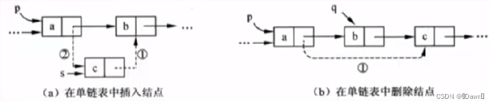

> - 无论链表是否有尾指针，单链表删除尾节点都必须遍历以找到前驱。而 【新增一个尾结点需要遍历链表】在特定优化结构下（带尾指针）可以不遍历
>
>   > | 题目关键词              | 入队（加尾巴） | 出队（删头）  | 遍历队列   |
>   > | ----------------------- | -------------- | ------------- | ---------- |
>   > | 带尾指针的循环单链表    | O(1) 不用遍历  | O(1) 不用遍历 | 都不用     |
>   > | 只带头指针的循环单链表  | O(n) 要遍历    | O(1) 不用遍历 | 入要出不要 |
>   > | 普通单链表 (只带头指针) | O(n) 要遍历    | O(1) 不用遍历 | 入要出不要 |
>
> - 链表是一种动态数据结构，其结点在运行时可以根据需要动态创建和销毁。这种动态性要求数据空间能够灵活分配和回收，而静态存储分配策略要求所有数据对象。在编译时就确定其存储位置且不可更改，显然不适用于链表。
>
> - 堆存储分配策略专门用于管理动态分配的数据，如链表、树等结构，允许程序在运行时申请和释放内存块。因此，若语言支持链表的定义和运算，其数据空间必须采用堆存储分配策略，以满足动态内存管理的需求。
>
> - 指令空间（即程序代码区）通常由操作系统加载后固定存放，与数据结构的动态性无关，不需要采用栈结构或堆区。栈结构主要用于函数调用时的局部变量和控制信息保存，而非链表数据的存储。
>
> 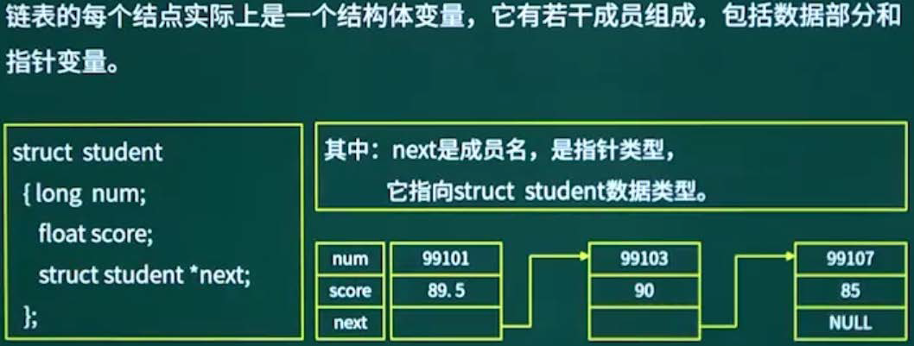
>
> 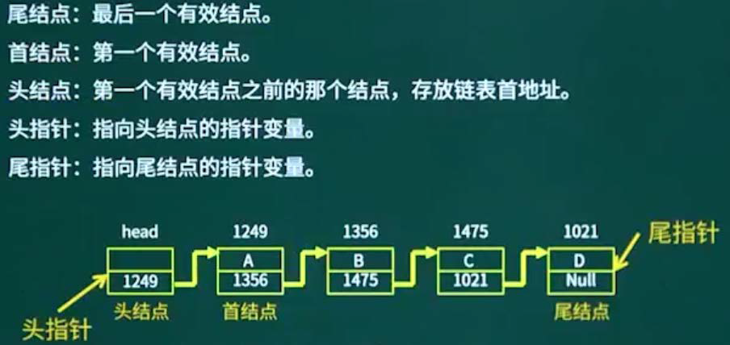

## 栈和队列

- ==栈==： 先进后出，只有栈顶能进出
- ==队列==： 先进先出，分队头和队尾

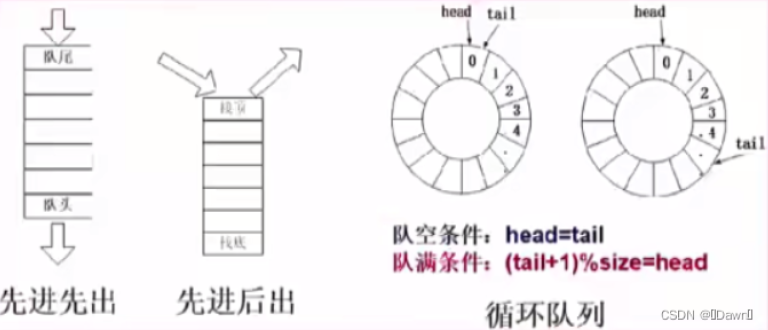

## 串

- ==字符串==是一种特殊的线性表，其数据元素都为字符

  - ==空串==：长度为0的字符串，没有任何字符
  - ==空格串==：由一个或多个空格组成的串，空格是空白字符，占一个字符长度
  - ==子串==：串中任意长度的连续字符构成的序列称为子串。含有子串的串称为主串，空串是任意串的子串
  - ==子序列==：将主串中一些字符按照相对位置提取构成新串

- ==串的模式匹配算法==：子串的定位操作，用于查找子串在主串中第一次出现的位置的算法

  - 基本的模式匹配算法：也称为布鲁特一福斯算法，其基本思想是从主串的第1个字符起与模式串的第1个字符比较，若相等，则继续逐个字符进行后续的比较；否则从主串中的第2个字符起与模式串的第1个字符重新比较，直至模式串中每个字符依次和主串中的一个连续的字符序列相等时为止，此时称为匹配成功，否则称为匹配失败

  - KMP算法：对基本模式匹配算法的改进，其改进之处在于：每当匹配过程中出现相比较的字符不相等时，不需要回溯主串的字符位置指针，而是利用已经得到的“部分匹配”结果将模式串向右“滑动”尽可能远的距离，再继续进行比较

    > 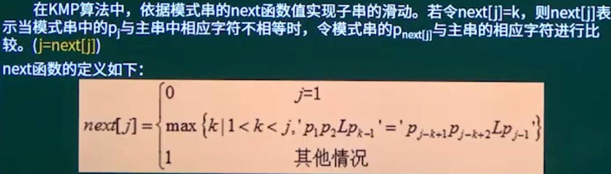
    >
    > 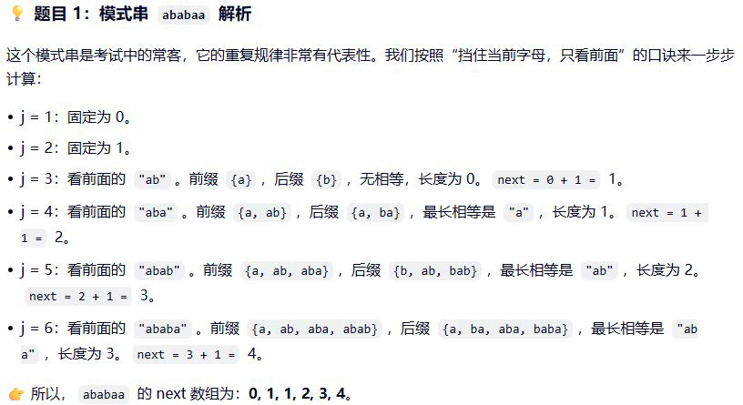

## 数组

| 数组类型           | 存储地址计算                                                 |
| ------------------ | ------------------------------------------------------------ |
| 一维数组 $a[n]$    | $a[i]$ 的存储地址为：$a + i \times len$                      |
| 二维数组 $a[m][n]$ | $a[i][j]$ 的存储地址（按行存储）为：$a + (i \times n + j) \times len$$a[i][j]$ 的存储地址（按列存储）为：$a + (j \times m + i) \times len$ |

- 其可以表示为行向量形式或者列向量形式线性表，单个关系最多只有一个前驱和一个后继，本质还是线性的
- 数组结构的特点：数据元素数目固定；数据元素类型相同；数据元素的下标关系具有上下界的约束且下标有序
- 数组数据元素固定，一般不做插入和删除运算，适合于采用顺序结构

## 数组存储地址的计算

- 假设每个数组元素占用内存长度为len，起始地址为a，存储地址计算如下：

| 数组类型              | 存储地址计算                                                 |
| --------------------- | ------------------------------------------------------------ |
| 一维数组  $ a[n] $    | $ a[i] $  的存储地址为： $ a + i \times len $                |
| 二维数组  $ a[m][n] $ | $a[i][j]$  的存储地址（按行存储）为： $a + (i \times n + j) \times len$   $a[i][j]$  的存储地址（按列存储）为： $a + (j \times m + i) \times len$ |

## 矩阵

- 特殊矩阵：矩阵中的元素(或非0元素）的分布有一定的规律。常见的特殊矩阵有对称矩阵、三角矩阵和对角矩阵

- 稀疏矩阵：在一个矩阵中，若非零元素的个数远远少于零元素个数，且非零元素的分布没有规律。存储方式为三元组结构，即存储每个非零元素的(行，列，值)

  > 基本结构：每个非零元素都是一个节点，节点中包含：
  > - 行号、列号、元素值。
  > - 一个指向同一行下一个非零元素的指针（`right`）。
  > - 一个指向同一列下一个非零元素的指针（`down`）。

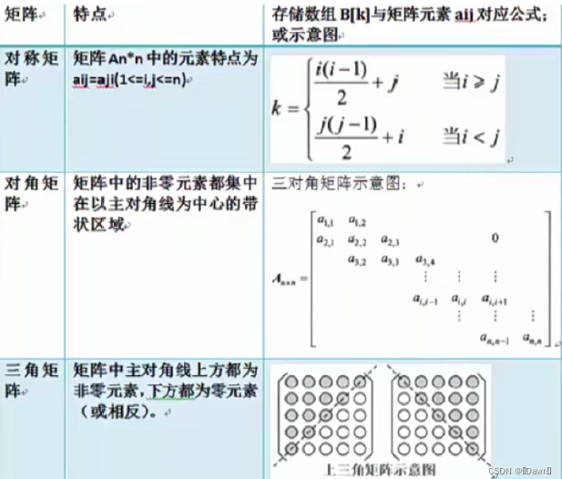

## 广义表

- 广义表是线性表的推广，是由0个或多个单元素或子表组成的有限序列
- 广义表与线性表的区别：线性表的元素都是结构上不可分的单元素，而广义表的元素既可以单元素，也可以是有结构的表
- 广义表一般记为：$LS =（a ,a_z,…,a_n）$
  - 其中LS是表名，$a_i$是表元素，它可以是表（称为子表），也可以是数据元素（称为原子）。
  - 其中n是广义表的长度（也就是最外层包含的元素个数），n=0的广义表为空表；
  - 递归定义的重数就是广义表的深度，即定义中所含括号的重数（ 单边括号的个数，原子的深度为0，空表的深度为1）
  - head() ： 取表头（广义表第一个表元素，可以是子表也可以是单元素）
  - tail() ： 取表尾（广义表中，除了第一个表元素之外的其他所有表元素构成的表，非空广义表的表尾必定是一个表，即使表尾是单元素）

## 树

- 树结构是一种非线性结构，树中的每一个数据元素可以有两个或两个以上的直接后继元素，用来描述层次结构关系。
- 树是n个结点的有限集合（n>=0），当n=0时称为空树，在任一颗非空树中有且仅有一个根节点；其余结点可分为m（m>=0）个互不相交的有限子集T1，T2,....，Tm，其中每个Ti又都是一棵树，并且成为根结点的子树
- 树的度，是指一棵树中所有节点的度（即子节点个数）的最大值。

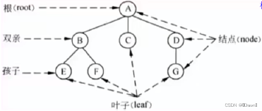

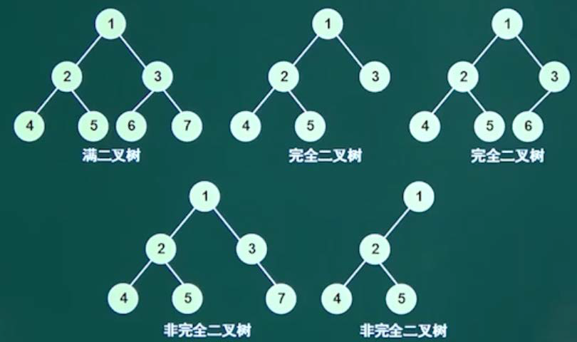

## 补充

- ==B树== (B-Tree写作B-树)

  - 核心思想是让每个节点能存储多个关键字和多个子节点指针，从而降低树的高度。

  1. 多路搜索：一个节点可以有多个（比如m个）子节点，这被称为m阶B树。【每个节点最多m棵树】

  2. 数据分散：关键字分散存储在整棵树的所有节点中，包括根节点、内部节点和叶子节点。

  3. 节点有序：每个节点内的关键字都是有序排列的。

  4. 所有叶子在同一层：这是它保持平衡的关键，确保了查找效率的稳定。

  5. 根节点除外的所有非终端结点至少有【(m/2)上取整】棵子树

- ==B+树== (B+ Tree)

  1. 数据只在叶子：所有关键字和关联的数据只存储在叶子节点中。内部节点只存储关键字，作为索引。

  2. 叶子节点链表：所有叶子节点通过指针从左到右链接起来，形成一个有序链表。

  3. 内部节点更“瘦”：因为内部节点不存数据，只存索引，所以一个节点能容纳更多的关键字，这使得B+树通常比同等阶数的B树更矮更胖。

- ==红黑树==

  1. 二叉树：每个节点最多只有两个子节点。

  2. 近似平衡：通过颜色规则，确保从根节点到任意叶子节点的最长路径不超过最短路径的两倍。它不是严格平衡（像AVL树那样），但平衡性足够好。

- AVL树首先是一棵二叉搜索树（左子树所有节点值 < 根节点值 < 右子树所有节点值），在此基础上多了一个硬性约束：树上任意节点的左右子树高度差的绝对值不超过1

  - **平衡因子**
  - 用平衡因子（BF）来量化这个约束：
  - BF=左子树高度−右子树高度
  - AVL树要求每个节点的平衡因子只能是 -1、0 或 1，超出这个范围就说明失衡了，需要修复。

- 二叉树相关定义：
  - ==完全二叉树==的定义是：它的节点是按从上到下、从左到右的顺序依次填充的。节点编号 *i* 的左孩子是 2*i* ，右孩子是 2*i*+1 
  - ==二叉排序树==(也叫==二叉查找树==)的定义是：它或者是一棵空树，或者是具有下列性质的二叉树：
    1. 左子树上所有节点的值均小于它的根节点的值；
    2. 右子树上所有节点的值均大于它的根节点的值
  - ==线索二叉树==是为了加快查找节点前驱和后继的速度，对二叉树的链式存储结构进行改造而得到的。它利用二叉树中大量的空指针域，存放指向节点在某种遍历次序下的前驱和后继节点的指针
  - ==最优二叉树==（也叫哈夫曼树）
  - ==平衡二叉树==：树上任意一个节点，它的左子树和右子树的高度差不能超过 1。（AVL 树，还有红黑树）
  - ==最小生成树==不属于二叉树，它是图论里的概念。给定一个带权无向连通图，从中选出若干条边，满足：
    - 覆盖所有顶点
    - 没有环
    - 边的权值总和最小

> 在结点数目确定的情况下，**完全二叉树**的结构最为紧凑，其高度达到最小值。这是因为完全二叉树的定义要求：对于高度为 h、有 n 个结点的二叉树，其每一个结点都与高度为 h 的满二叉树中编号为 1 到 n 的结点一一对应。这种结构保证了从根到叶子的路径尽可能短，从而使得树的高度最小。
>
> 相比之下：
>
> - **二叉排序树**的结构依赖于插入顺序，可能退化为链表，高度可达 n；
> - **线索二叉树**是对二叉树的存储结构优化，不改变树的高度；
> - **最优二叉树**（如哈夫曼树）是带权路径长度最小的树，其高度不一定最小。
>
> 因此，当结点数目确定时，**完全二叉树**的高度一定是所有二叉树中最小的。

> 已知一棵度为3的树（一个节点的度是指其子树的数目，树的度是指该树中所有节点的度的最大值）中有5个度为1的节点，4个度为2的节点，2个度为3的节点，那么，该树中的叶子节点数目为
>
> ==我们可以通过树的节点数和边数（分支数）之间的关系来进行推理计算。==
>
> - ==性质一：树中所有节点的总数 N等于所有度为 0、1、2、3 的节点数之和。==
> - ==性质二：树中的总分支数（即边数）B等于所有节点的度之和。==
> - ==性质三： 在一棵树中，节点总数等于分支数加 1==
>
> B=0×n0+1×n1+2×n2+3×n3=1×5+2×4+3×2=5+8+6=19
> N=n0+n1+n2+n3=n0+5+4+2=n0+11
> N=B+1
> n0=9

## 二叉树

- 二叉树是n个节点的有限集合，它或者是空树，或者是由一个根节点及两颗互不相交的且分别称为左、右子树的二叉树所组成。与树的区别在于每个根节点最多只有两个孩子结点

- 二叉树：子树上所有结点的值均小于根结点的值；右子树上所有结点的值均大于根结点的值。

- 二叉树的重要特性：

  - 二叉树第$i$层（$i≥1$）上最多有$2^{i-1}$个结点

  - 高度为$k$的二叉树最多有$2^k-1$个结点（$k≥1$)

  - 对于任何一棵二叉树，若其终端结点数为$n_o$，度为2的结点数为$n_2$，则$n_o = n_2 + 1$

  - 具有$n$个结点的完全二叉树的深度为：$\lfloor log_2n \rfloor + 1$

  - 对一棵有n个结点的完全二叉树的所有结点按层次自上而下、自左至右进行编号，则对于任一结点$i$（$1
    ≤ i ≤ n$）有:

    - 若 $i = 1$ ，则结点$i$是二叉树的根，无双亲：若$ i > 1$，则其双亲为：$\lfloor \frac i2 \rfloor $
    - 若$ 2i > n$ ，则结点$i$没有左孩子，否则其左孩子为$2i$
    - 若 $2i + 1 > n$ ，则结点$i$没有右孩子，否则其右孩子为 $2i + 1$

    > 想象一棵简单的二叉排序树：
    > 1. 根结点是 10。
    > 2. 10 的右孩子是 20(因为20 > 10,符合定义)
    > 3. 20 的左孩子是 15(因为15 < 20，符合定义)

## 二叉树的顺序存储结构

- ==顺序存储==，就是用一组连续的存储单元存储二叉树中的节点，按照从上到下，从左到右的顺序依次存储每个节点
  - 对于深度为k的完全二叉树，除第k层外，其余每层中节点数都是上一层的两倍，由此，从一个节点的编号可推知其双亲、左孩子、右孩子结点的编号。假设有编号为 i 的节点，则有：
    - 若$i = 1$ ，该结点为根结点，无双亲
    - 若 $i ≥ 1$ ，该结点的双亲为$(i+1)/2$(取整数)
    - 若 $2i≤ n$ ，则该结点的左孩子编号为$2i$，否则无左孩子。若 $2i+1 ≤ n$ ，则该结点的右孩子编号为$2i+1$ ，否则无右孩子
    - 若 $i$为奇数且不为$ 1$，则该结点左兄弟的编号为$ i-1$ ，否则无左兄弟
    - 若$i$为偶数且小于$n$，则该结点右兄弟的编号为$ i+1 $，否则无右兄弟

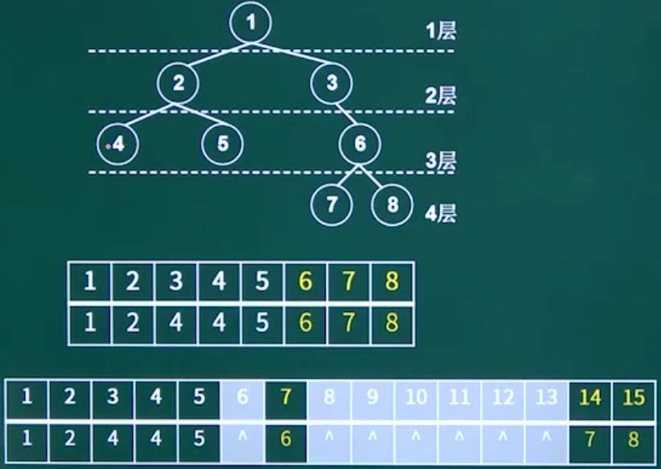

## 二叉树的链式存储结构

- 一般用二叉链表来存储二叉树节点，二叉链表中除了该节点本身的数据外，还存储有左孩子结点的指针、右孩子结点的指针，即 一个数据 + 两个指针。每个二叉链表节点存储一个二叉树节点，头指针则指向根节点

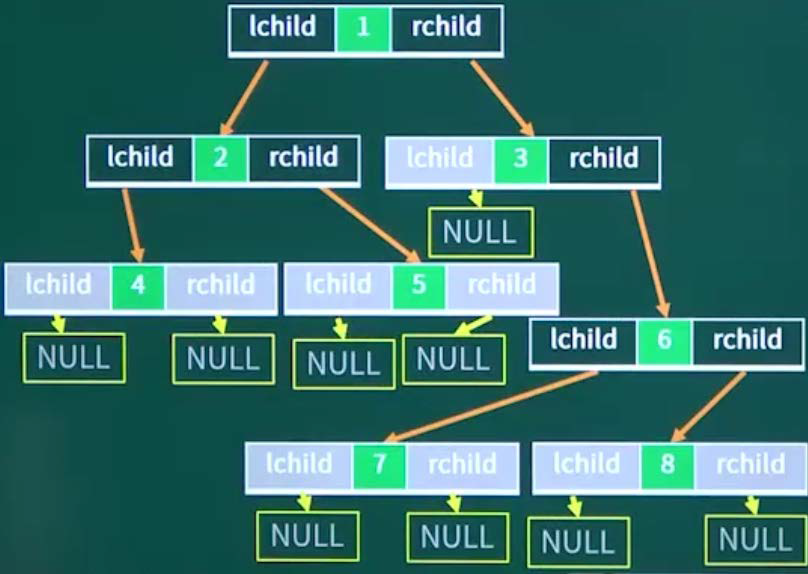

## 二叉树的遍历

- 一颗非空的二叉树由根节点、左子树、右子树三部分组成，遍历这三部分也就遍历了整颗二叉树。这三部分遍历的基本顺序是先左子树后右子树，但根节点顺序可变，以根节点访问的顺序为准有下列三种遍历方式：
  - 先序（前序）遍历： 根左右
  - 中序遍历： 左根右
  - 后序遍历： 左右根
- 层次遍历：按层次，从上到下，从左到右

> 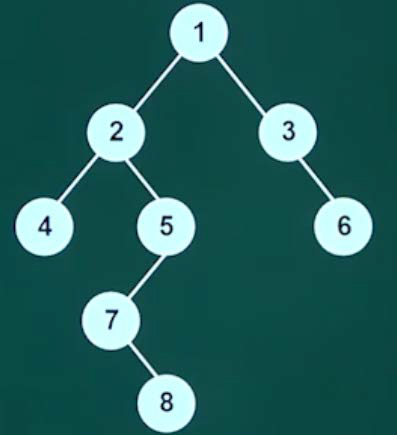
>
> 先序（根左右）：1,2,4,5,7,8,3,6
> 中序（左根右）：4,2,7,8,5,1,3,6
> 后序（左右根）：4,8,7,5,2,6,3,1
> 层次：1,2,3,4,5,6,7,8

## 线索二叉树

- 引入线索二叉树是为了保存二叉树遍历时某节点的前驱节点和后继节点的信息，二叉树的链式存储只能获取到某节点的左孩子和右孩子结点，无法获取其遍历时的前驱和后继节点，因此可以在链式存储中再增加两个指针域，使其分别指向前驱和后继节点，但这样太浪费存储空间，考虑下述实现方法:
  - 若n个节点的二叉树使用二叉链表存储，则必然有 n+1 个空指针域，利用这些空指针域来存放节点的前驱和后继节点信息，为此，需要增加两个标志，以区分指针域存放的到底是孩子结点还是遍历节点，如下：
  - 若二叉树的二叉链表采用上述结构，则称为线索链表，其中指向前驱、后继节点的指针称为线索，加上线索
    的二叉树称为线索二叉树

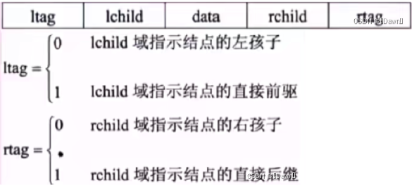

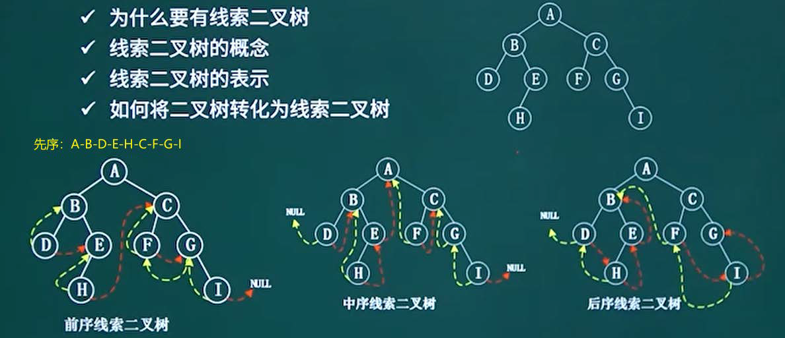

## 最优二叉树

- 最优二叉树又称为哈夫曼树，是一类带权路径长度最短的树
  - 路径：树中一个结点到另一个结点之间的通路
  
  - 结点的路径长度：路径上的分支数目
  
  - 树的路径长度：根节点到达每一个叶子节点之间的路径长度之和
  
  - 权：节点代表的值
  
  - 结点的带权路径长度：该结点到根结点之间的路径长度乘以该节点的权值
  
  - 树的带权路径长度（树的代价）：树的所有叶子节点的带权路径长度之和
  
  - 哈夫曼树的求法：给出一组权值，将其中两个最小的权值作为叶子节点，其和作为父节点，组成二叉树，而后删除这两个叶子节点权值，并将父节点的值添加到该组权值中。重复进行上述步骤，直至所有权值都被使用完。
    - 构造出的哈夫曼树中，所有初始给出的权值都作为了叶子节点，此时，求出每个叶子节点的带权路径长度，而后相加，就是树的带权路径长度，这个长度是最小的
    
      > 哈夫曼树压缩

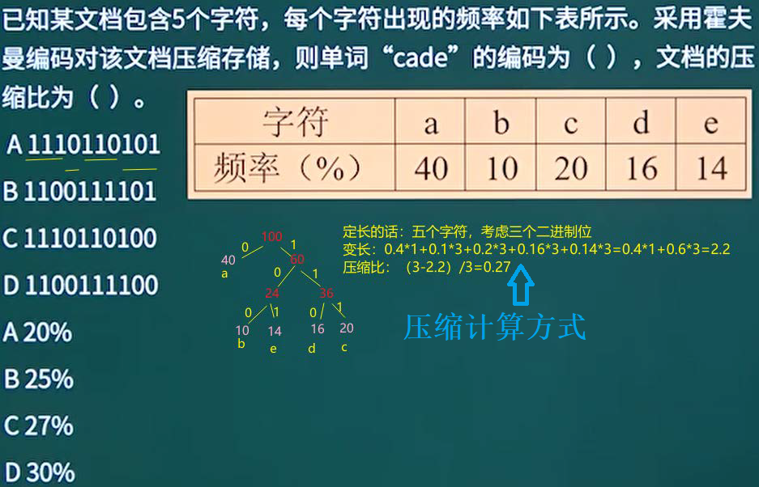

> 在数据压缩领域，熵编码是一类基于信源符号统计特性进行无损压缩的编码方法，其核心思想是：出现频率高的符号用较短的码字表示，出现频率低的符号用较长的码字表示，从而降低平均码长，实现压缩。
>
> 常见的熵编码包括：
>
> - 哈夫曼编码（Huffman Coding）：典型的熵编码方法，根据符号概率构建最优前缀码。
> - 算术编码（Arithmetic Coding）：将整个消息映射为一个区间，通过区间划分实现高效压缩。
> - 行程编码（Run-Length Encoding, RLE）：对连续重复的符号进行压缩，也属于熵编码范畴。
> 而：
> - 小波变换编码属于变换编码，是信源编码的一种，主要用于有损压缩，通过变换域中能量集中特性进行压缩。
> - 线性预测编码属于预测编码，通过预测当前值与真实值的差值进行编码，常用于音频压缩，也是有损编码。

## 树的存储结构

- 双亲表示法：用一组连续的地址单元存储树的节点，并在每个节点中附带一个指示器，指出其双亲节点所在数组元素的下标
- 孩子表示法：在存储结构中用指针指示出节点的每个孩子，为树中每个节点的孩子建立一个链表
- 孩子兄弟表示法：又称为二叉链表表示法，为每个存储节点设置两个指针域，分别指向该节点的第一个孩子和下一个兄弟节点

## 树和森林的遍历

由于树中每个节点可能有多个子树，因此遍历树的方法有两种：

- 先根遍历：先访问根节点，再依次遍历根的各颗子树
- 后根遍历：先遍历根的各颗子树，再访问根节点

森林中有很多课树，森林的遍历方法也分为两种，与树的遍历类似，就是对森林中的每棵树都依次做先根遍历或后根遍历

## 树二叉树的转换

- 规则是:树的最左边节点作为二叉树的左子树，树的其他兄弟节点作为二叉树的右子树节点
- 示例如下图：采用连线法，将最左边节点和其兄弟节点都连接起来，而原来的父节点和兄弟节点的连线则断开

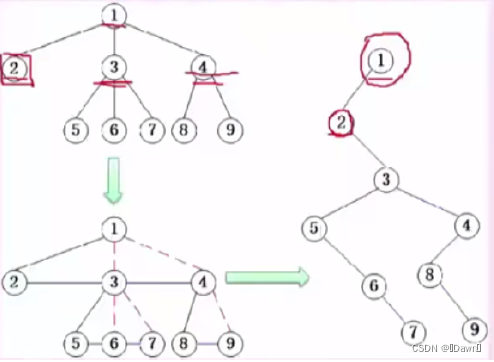

> ```
> (第一棵树 T1)      (第二棵树 T2)      (第三棵树 T3)
>     A                D                E
>    / \                                |
>   B   C                               F
> 
> 节点总数： n1    n2   n3
> 
> 二叉树右子节点= n2 + n3
> 
>      A  <-- 二叉树的总根节点
>     / \
>    /   \
>   B     D  <-- 右子树的开始 (T2的根)
>    \     \
>     C     E  <-- T3的根
>          /
>         F 
> ```
>
> 

## 查找二叉树

- 查找二叉树上的每个节点都存储一个值，且每个节点的所有左孩子结点值都小于父节点值，而所有右孩子结点值都大于父节点值，是一个有规律排列的二义树，这种数据结构可以方便查找、插入等数据操作
- 二叉排序树的查找效率取决于二叉排序树的深度，对于结点个数相同的二叉排序树，平衡二叉树的深度最小，而单枝树的深度是最大的，故效率最差

## 平衡二叉树

- 在查找二叉树特点的基础上要求`每个节点的平衡度只能为 0 或 1 或 -1`
  - **0**：表示该节点的**左子树高度等于右子树高度**。这是最完美的平衡状态。
  - **1**：表示该节点的**左子树比右子树高 1 层**。这是允许的平衡状态。
  - **-1**：表示该节点的**右子树比左子树高 1 层**。这也是允许的平衡状态。
- 节点的左右子树深度就是其左右子树各自的层数，而后将左子树深度减去右子树深度，就得到了该节点的平衡度。
- 因此，`平衡二叉树就是任意左右子树层次相差不超过 1`

> 要使总结点数最少，对于高度为 $h$ 的平衡二叉树，它的根结点的左右子树高度应该尽可能小，且左右子树本身也必须是结点数最少的平衡二叉树。
>
> 由于左右子树高度差不能超过 1，为了让总结点数最少，我们可以让其中一棵子树的高度为 $h-1$，另一棵子树的高度为 $h-2$（因为如果两棵子树高度都是 $h-1$，结点数会更多）。
>
> 因此，==高度为 $h$ 的平衡二叉树的最少结点数 $N(h)$ 满足以下递推关系：==
> $$
> N(h) = N(h-1) + N(h-2) + 1
> $$
> 其中：
>
> - $N(0) = 0$ （高度为 0 的树为空树，结点数为 0）
> - $N(1) = 1$ （高度为 1 的树只有根结点，结点数为 1）
>
> 逐步计算
>
> 我们根据递推公式，依次计算不同高度的最少结点数：
>
> - **高度 $h = 1$**： $$N(1) = 1$$
> - **高度 $h = 2$**： 左右子树高度分别为 1 和 0。 $$N(2) = N(1) + N(0) + 1 = 1 + 0 + 1 = 2$$
> - **高度 $h = 3$**： 左右子树高度分别为 2 和 1。 $$N(3) = N(2) + N(1) + 1 = 2 + 1 + 1 = 4$$
> - **高度 $h = 4$**： 左右子树高度分别为 3 和 2。 $$N(4) = N(3) + N(2) + 1 = 4 + 2 + 1 = 7$$
> - **高度 $h = 5$**： 左右子树高度分别为 4 和 3。 $$N(5) = N(4) + N(3) + 1 = 7 + 4 + 1 = 12$$

## 图的相关概念

- 图也是一种非线性结构，图中任意两个节点间都可能有直接关系

  - 无向图：图的结点之间连接线是没有箭头的，不分方向
  - 有向图：图的结点之间连接线是箭头，区分A到B，和B到A是两条线
  - 完全图：
    - 无向完全图中，节点两两之间都有连线，n个结点的连线数为$(n-1)+(n-2)+...+1=n (n-1)/2$
    - 有向完全图中，节点两两之间都有互通的两个箭头，n个节点的连线数为$n (n-1)$
  - 度、出度和入度：顶点的度是关联与该顶点的边的数目。
    - 在有向图中，顶点的度为出度和入度之和。
    - 出度是以该顶点为起点的有向边的数目。
    - 入度是以该顶点为终点的有向边的数目
  - 路径：存在一条通路，可以从一个顶点到达另一个顶点，有向图的路径也是有方向的
  - 连通图和连通分量：
    - 针对无向图。若从顶点v到顶点u之间是有路径的，则说明v和u之间是连通的，若无向图中任意两个顶点之间都是连通的，则称为连通图。
    - 无向图G的极大连通子图称为其连通分量
  - 强连通图和强连通分量：
    - 若有向图任意两个顶点间都互相存在路，即存在v到u，也存在u到v的路径，则称为强连通图
    - 有向图中的极大连通子图称连通分量
  - 网：边带权值的图称为网

  > 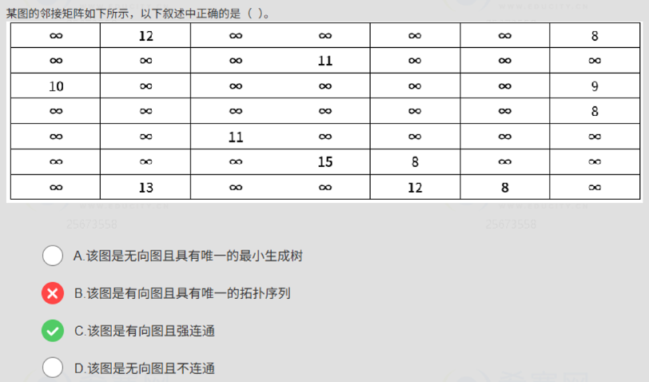
  >
  > 1. **判断图的类型** ==一个图的邻接矩阵如果是对称的==（即矩阵中第 $i$ 行第 $j$ 列的元素等于第 $j$ 行第 $i$ 列的元素），==则该图为无向图==。否则为有向图。 观察给定的邻接矩阵，例如第1行第2列的元素是12，而第2行第1列的元素是 $\infty$。因为 $A_{12} \neq A_{21}$，所以该矩阵不是对称的。 因此，该图是**有向图**。 这个结论可以排除选项A和D，因为它们都描述的是无向图。
  > 2. **分析选项B：拓扑序列** 拓扑序列是针对有向无环图（DAG）而言的。==如果一个有向图中存在环，那么它就不存在拓扑序列==。 我们来检查图中是否存在环。根据邻接矩阵，我们可以找到以下路径：
  >    - 从顶点1到顶点2有边 ($1 \to 2$)
  >    - 从顶点2到顶点4有边 ($2 \to 4$)
  >    - 从顶点4到顶点7有边 ($4 \to 7$)
  >    - 从顶点7到顶点3有边 ($7 \to 3$)
  >    - 从顶点3到顶点1有边 ($3 \to 1$) 这些边构成了一个环：$1 \to 2 \to 4 \to 7 \to 3 \to 1$。 由于图中存在环，所以它不是一个有向无环图，也就不存在拓扑序列。 因此，选项B是错误的。
  > 3. **分析选项C：强连通性** ==一个有向图是强连通的，如果从图中任意一个顶点到任意另一个顶点都存在一条路径==。 我们来验证这个性质：
  >    - 从顶点1出发，可以到达顶点2和7。从这些顶点出发，可以继续到达其他所有顶点。例如，路径 $1 \to 2 \to 4$，$1 \to 7 \to 6$，$1 \to 7 \to 5 \to 3$。所以顶点1可以到达所有其他顶点。
  >    - 我们再检查是否所有顶点都能到达顶点1。
  >      - $2 \to 4 \to 7 \to 3 \to 1$
  >      - $3 \to 1$
  >      - $4 \to 7 \to 3 \to 1$
  >      - $5 \to 3 \to 1$
  >      - $6 \to 4 \to 7 \to 3 \to 1$
  >      - $7 \to 3 \to 1$
  >    - 因为所有顶点都能到达顶点1，并且顶点1能到达所有顶点，所以对于任意两个顶点 $u$ 和 $v$，都存在一条从 $u$ 到 $v$ 的路径（路径为 $u \to \dots \to 1 \to \dots \to v$）。
  >    - 因此，该图是**强连通**的。
  
  ## 图的存储
  
  - 邻接矩阵：
  
    - 假设一个图中有$n$个节点，则使用$n$阶矩阵来存储这个图中各节点的关系，规则是若节点$i$到节点$j$有连线，则矩阵$R_{ij}=1$，否则为0
  
    - 因此，如果是一个无向图，肯定是沿对角线对称的，只需要存储上三角或者下三角就可以了，而有向图则不一定对称
  
      > ==对于邻接矩阵的深度和广度遍历时间复杂度都是O($n^2$)==；顶点数:n；边数:e
      >
      > 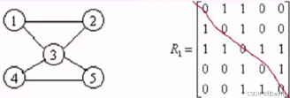
  
  - 邻接链表:
  
    - 用到了两个数据结构，先用一个一维数组将图中所有顶点存储起来。而后，对此一维数组的每个顶
      点元素，使用链表挂上和其有连线关系的结点的编号和权值
  
    - 注意：邻接表是链表不是矩阵
  
      > ==对于邻接表的深度和广度遍历时间复杂度都是O(n+e)==；顶点数:n；边数:e
      >
      > 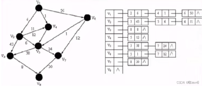

> 有向图和无向图是否适合用邻接矩阵或邻接表存储，不能简单按有向、无向区分，主要看图的稠密程度
>
> 1、完全图的边数很多，邻接矩阵存储时，矩阵的元素大部分都会被利用，空间利用率高
>
> 2、邻接表存储完全图时，会因为边太多导致链表的指针域占用较多空间，利用率低

## 图的遍历

- 图的遍历是指从图的任意节点出发，沿着某条搜索路径对图中所有节点进行访问且只访问一次，分为以下两种方式：
  - 深度优先遍历：从任一顶点出发，遍历到底，直至返回，再选取任一其他节点出发，重复这个过程直至遍历完整个图
  - 广度优先遍历：先访问完一个顶点的所有邻接顶点，而后再依次访问其邻接顶点的所有邻接顶点，类似于层次遍历

## 图的最小生成树**Apache** 

- 假设有n个节点，那么这个图的最小生成树有 n-1 条边（不会形成环路，是树非图)，这n-1条边会将所有顶点都连接成一个树，并且这些边的权值之和最小，因此称为最小生成树
  - 普里姆算法（Prim）：==从任意顶点出发，找出与其邻接的边权值最小的==，此时此边的另外一个顶点自动加入树集合中，而后再从这这个树集合的所有顶点中找出与其邻接的边权值最小的，同样此边的另外一个顶点加入树集合中，依次递归，直至图中所有顶点都加入树集合中，此时此树就是该图的最小生成树【设计策略都是**贪心法**】
  - 克鲁斯卡尔算法（推荐Kruskal）：==这个算法是从边出发的，因为本质是选取权值最小的n-1条边==，因此，就将边按权值大小排序，依次选取权值最小的边，直至囊括所有节点，要注意，每次选边后要检查不能形成环路【设计策略都是**贪心法**】

## 图的拓扑序列

- AOV网（以顶点表示活动的网)：在有向图中，以顶点表示活动，用有向边表示活动之间的优先关系
  - `AOV网用来表示大的工程项目执行计划，因此不能出现有向环`，若存在，则意味着某项活动必须以自身任务的完成为先决条件,因此若要检测一个工程是否可行，首先应检查对应的AOV网是否存在回路。`检测的方法是对有向图构造其顶点的拓扑有序序列`
  - 构造方法：将有向图的有向边作为活动开始的顺序若图中一个节点入度为0，则应该最先执行此活动，而后删除掉此节点和其关联的有向边，再去找图中其他没有入度的结点，执行活动，依次进行，示例如下：

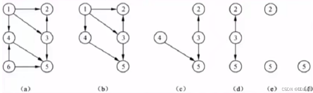

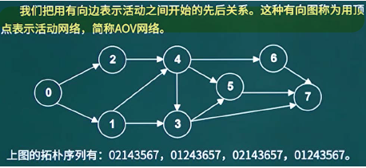

> 一个有向图能够进行拓扑排序，当且仅当它是一个**有向无环图**。也就是说，图中不能存在任何有向环
>
> 因为有拓扑排序，所以只能往前排，不能往后看。反映在表格上，所有的箭头全都在右上方，这就变成了**三角矩阵**。