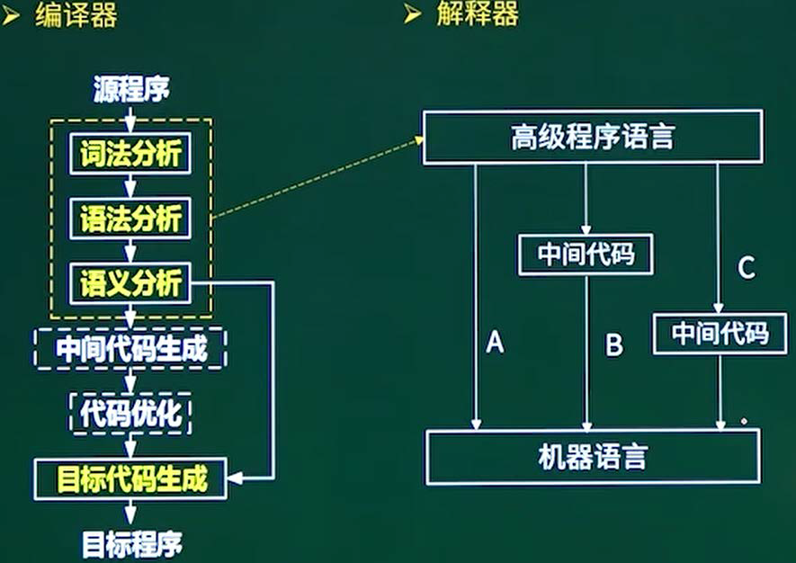
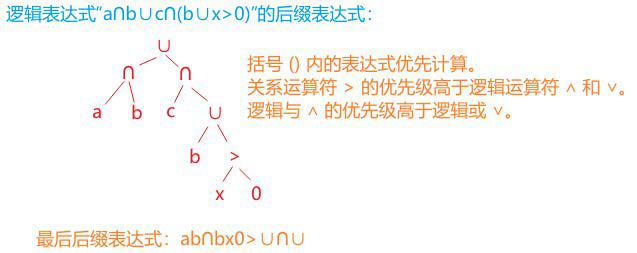
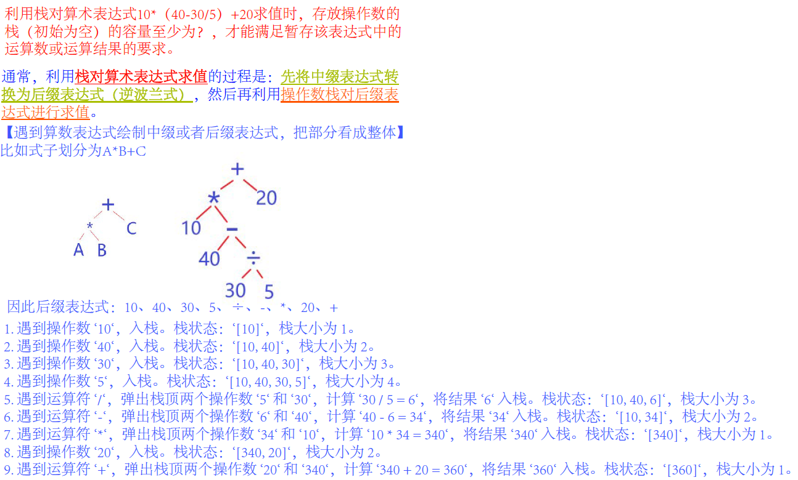
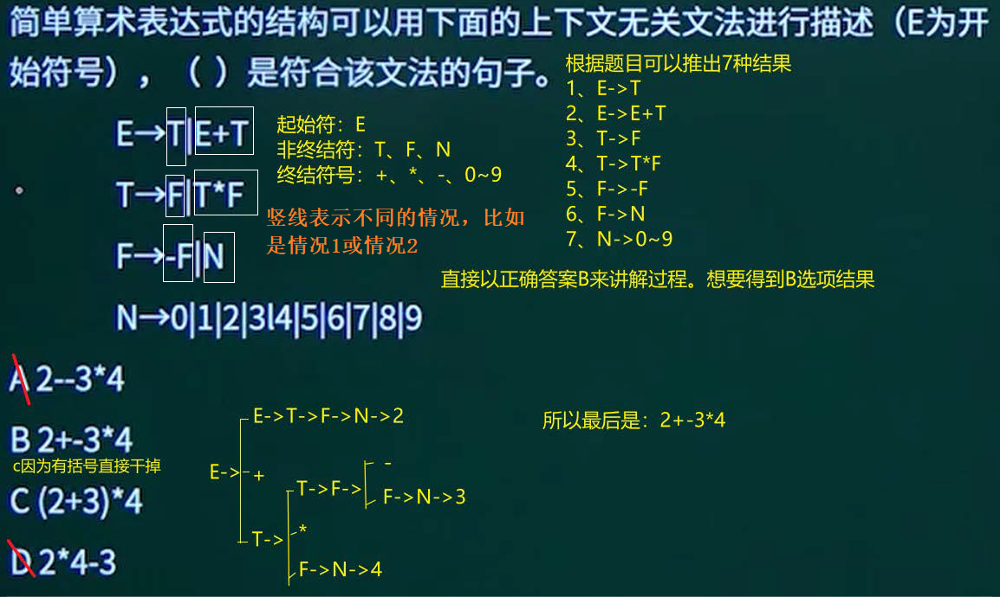
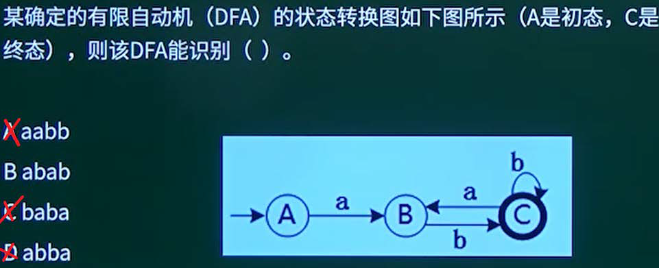
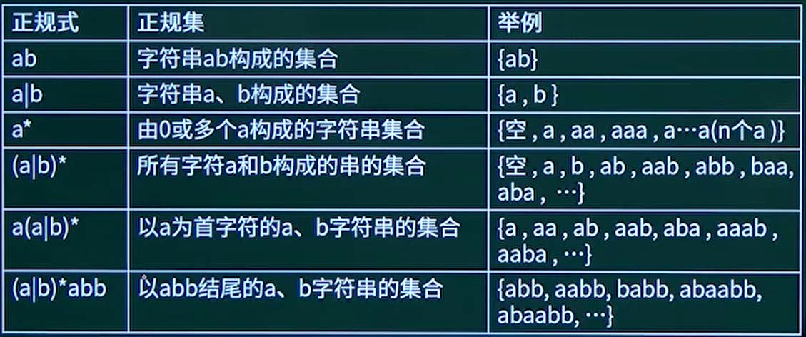

## 程序设计语言的基本概念

- 低级语言与高级语言

  - 低级语言：机器语言（计算机硬件只能识别o和1的指令序列)，如==汇编语言==
  - 高级语言：功能更强,抽象级别更高，与人们使用的自然语言比较接近，常见的有Java，C，C++，PHP，Python，Delphi等

- 各程序设计语言特点：

  - Fortran 语言（==科学计算，执行效率高==）

  - Pascal 语言（为==教学而开发的==，表达能力强，Delphi）

  - C 语言（ ==指针操作能力强==，高效）

  - Lisp 语言（ ==函数式程序语言==，符号处理，人工智能）

  - C++ 语言（ ==面向对象==，高效)

  - Java 语言（==面向对象，中间代码， 跨平台==）

  - C# 语言（ ==面向对象，中间代码， .Net==）

  - Prolog 语言（==逻辑推理==，==简洁性==，表达能力， ==数据库和专家系统==）

  - python语言（==解释型==、==面向对象、胶水语言==）

    > `switch...case`在Python中根本不存在
    >
    > Python 中 `for` 和 `while` 循环后附加的 `else` 子句，其执行逻辑与普通的 `if...else` 完全不同。它的核心规则是：**只有当循环“正常结束”时，才会执行 `else` 块中的代码**

    > - **选项A**：**脚本语言中不使用变量和函数** —— 此说法错误。脚本语言（如JavaScript、Python、Shell脚本等）是**动态语言**，**广泛使用变量和函数**。它们通过解释器在运行时动态分配内存和绑定函数，语法灵活，但并非“不使用”变量和函数。相反，变量和函数是脚本语言的核心组成部分。
    > - **选项B**：标记语言常用于描述格式化和链接 —— 正确。如HTML、XML等标记语言，其核心功能是通过标签（tag）描述文档结构、样式和超链接，不涉及复杂逻辑运算。
    > - **选项C**：脚本语言采用解释方式实现 —— 正确。脚本语言通常不预先编译成机器码，而是由解释器逐行读取并执行，便于快速开发和调试。
    > - **选项D**：编译型语言的执行效率更高 —— 正确。编译型语言（如C、C++）在编译阶段将源代码转换为机器码，运行时无需解释，因此执行效率通常高于解释型脚本语言。
    >
    > 综上，**唯一错误的叙述是A选项**。
    >
    > **答案：** 
    >
    > A

- 解释与编译


  <table class="merge-table">
    <tr>
      <th></th>
      <th></th>
      <th>编译型语言</th>
      <th>解释型语言</th>
    </tr>
    <tr>
      <td rowspan="2"><b>共同点</b></td>
      <td colspan="3">高级程序语言</td>
    </tr>
    <tr>
      <td colspan="3">有词法分析、语法分析、语义分析过程</td>
    </tr>
    <tr>
      <td rowspan="7" style="vertical-align: middle;"><b>不同点</b></td>
      <td><b>翻译程序</b></td>
      <td>编译器</td>
      <td>解释器</td>
    </tr>
    <tr>
      <td><b>是否生成目标代码</b></td>
      <td>生成目标代码</td>
      <td>不会生成目标代码</td>
    </tr>
    <tr>
      <td><b>目标程序能够直接执行</b></td>
      <td>目标程序直接执行</td>
      <td>边解释边执行</td>
    </tr>
    <tr>
      <td><b>翻译程序是否参与执行</b></td>
      <td>编译器不参与执行</td>
      <td>解释器参与执行</td>
    </tr>
    <tr>
      <td><b>执行效率</b></td>
      <td>执行效率高</td>
      <td>执行效率低</td>
    </tr>
    <tr>
      <td><b>灵活性与可移植性</b></td>
      <td>灵活性差，可移植性差</td>
      <td>灵活性好，可移植性强</td>
    </tr>
  </table>


> **编译型语言**：==编译程序生成独立的可执行文件，直接运行，运行时无法控制源程序，效率高。==
>
> - 编译时间点：写完代码后，点击“生成/构建”或者手动执行编译器命令的那一刻。
> - 发生：编译器把源代码(如 `.c` 文件)全部翻译成机器能看懂的二进制文件(如 `.exe` 文件)
> - 结果：翻译完这一步，编译器的任务就彻底结束了。当双击打开那个软件去“运行”它的时候，实际上是在跑那个已经翻译好的二进制文件，跟最初的源代码已经没有直接关系了
>
> **解释型语言**：==解释程序不生成可执行文件，可以遂条解释执行，用于调试模式，可以控制源程序，因为还需要控制程序，因此执行速度慢，效率低。==
>
> - 解释时间点：就在敲下运行命令(如python main.py)，程序开始执行的那一瞬间。
> - 发生：解释器会读取源代码，读到第一行，马上翻译并执行第一行；然后读第二行，翻译并执行第二行……如果程序中间报错了，它就会停在那一行。
> - 结果：在整个程序跑的过程中，解释器必须一直陪着，随时拿着你的源代码进行实时翻译。
>
> `灵活和移植`考虑的是编译之后，编译型语言已经针对特定机型生成exe文件，不可以再修改了



## 程序设计语言

- ==传值调用==：将实参的值传递给形参，实参可以是变量、常量和表达式。`不可以实现形参和实参间双向传递数据的效果`。
- ==传引用（地址） 调用==：将实参的地址传递给形参，形参必须有地址，实参不能是常量（值）、表达式。`可以实现形参和实参间双向传递数据的效果`，`即改变形参的值同时也改变了实参的值`。

## 补充

- ==汇编语言是低级语言==，其指令语句最终会被汇编程序翻译成对应的==机器码==（二进制指令），供计算机硬件执行。
- 汇编程序的处理流程是：`先处理伪指令（如分配内存、记录符号地址等）`，`再处理指令语句（翻译成机器码）`。==但**伪指令本身不生成机器代码**==，==伪指令是给汇编程序的“指示”==，`用于定义数据、分配存储空间、设置段等，它们不会被翻译成机器代码`
- ==汇编程序的输入是汇编语言源程序==，==输出是机器语言的目标程序==
- 汇编语言的指令语句**`必须具有操作码字段`**，`可以没有操作数字段`
  - 汇编指令的格式通常为：`[标号:] 操作码 [操作数] [;注释]`
  - `操作码是指令的核心`，`必须存在`；`操作数是可选的`
- 无论是编译方式还是解释方式，要让计算机理解高级语言，==词法分析和语法分析==都是必不可少的基础步骤
- `编译器`会将源程序一次性全部翻译成`目标程序`（如 .exe 文件）。==一旦编译完成，程序的运行就不再依赖源程序，也不需要编译器在场==。
- `解释器`是==“边翻译边执行”或“边解释边执行”==，==它需要依赖源程序（或中间代码）和解释器本身才能运行==。

## 编译方式与解释方式

- `编译方式`：词法分析、语法分析、语义分析、中间代码生成、代码优化、目标代码生成。

- `解释方式`：词法分析、语法分析、语义分析。

- `编译器和解释器`都==不可省略词法分析、语法分析、语义分析==且==顺序不可交换==。

- ==编译方式中中间代码生成和代码优化不是必要的， 可省略==。

- **词法分析**：

  - `输入：源程序`

  - `输出：记号流`

  - 词法分析阶段的主要作用是`分析构成程序的字符及由字符按照构造规则构成的符号是否符合程序语言的规定`

    > 1.词法分析： 将源程序视为一个线性字符序列， 逐个字符识别单词,如关键字,标识符,运算符等
    >
    > 2.`只识别单词， 不涉类别， 只关心拼接是否正确， 不关心含义`

- **语法分析**：

  - `输入：记号流`

  - `输出：语法树(分析树)`

  - 语法分析阶段的主要作用是对各条语句的结构进行合法性分析分析程序中的句子结构是否正确

    > 1.`语法分析阶段可以发现程序中所有的语法错误`
    >
    > 2.==编译正确的程序必然不包含**语法错误**；编译正确的程序可能包含**语义错误**==
    >
    > 3.检查代码的结构是否符合规范，只负责检查结构（例如括号是否匹配，语句是否完整），不涉及类型逻辑。
    >
    > 4.在词法分析基础上，根据语法规则判断程序结构是否合法，如括号匹配、语句结构等。它`能发现大部分语法错误，但不能保证发现“所有”语法错误`，`因为某些错误可能在语义或运行时才暴露`。不过，通常认为**语法分析阶段是发现语法错误的主要阶段，且它能发现程序中的“所有”语法错误**

- **语义分析**：

  - `输入：语法树(分析树）`

  - 语义分析阶段的主要作用是进行类型分析和检查语义分析阶段不能发现程序中所有的语义错误

    > 1.语义分析阶段可以发现`静态语义错误`
    > 2.`不能发现动态语义错误`，`动态语义错误运行时才能发现`
    >
    > 3.在语法正确的基础上，检查程序语义是否合法，如变量是否声明、类型是否匹配、数组越界等。但`语义分析无法发现所有语义错误`，例如逻辑错误（如死循环、错误的算法）、运行时错误（如除零、空指针）等，这些往往在运行时或静态分析工具中才能发现。
    >
    > 4.有语义错误是可以编译成功的，例如a/0；这是符合语法的，也符合静态语义，编译器检验不出来
    > 这个是错的，只有运行才会报错，也就是动态语义，动态语义错误常见的有死循环

## 补充

- ==动态错误==：发生在程序运行时，也叫动态语义错误，陷入死循环、变量取零时做除数、引用数组元素下标越界等错误
- ==静态错误==：编译时所发现的程序错误。分为语法错误和静态语义错误
  - ==语法错误包含==：单词拼写错误、标点符号错误、表达式中缺少操作数、括号不匹配等有关语言结构上的错误
  - ==静态语义分析==：运算符与运算对象类型不合法等错误
- `目标代码生成阶段的工作与具体的机器密切相关`。`寄存器的分配处于目标代码生成阶段`
- 在`语义分析之后，编译器会生成一种中间表示形式`，并对其进行优化【`中间代码优化与目标机器无关`】
- 常用的中间代码有后级式、三元式、四元式和树等形式
  【四元式：（运算符, 操作数1, 操作数2, 结果）】

## 后缀式

- 表达式：

  - 前缀表达式：`+ab`

  - 中缀表达式：`a+b`

  - 后缀表达式：`ab+`【后缀表达式也是逆波兰式】

    ```mermaid
    flowchart TD
        Root('+')
        NodeA('a')
        NodeB('b')
    
        Root --- NodeA
        Root --- NodeB
    ```





## 文法定义

- 文法就是编译器用来判断你写的代码是否符合语法规则的依据

- 文法是一个有序的四元组：**$G = (V, T, S, P)$**

  | 符号  | 严格定义                                                     | 通俗解释                                                     |
  | ----- | ------------------------------------------------------------ | ------------------------------------------------------------ |
  | **V** | **非终结符集**不是语言的基本组成部分，不是最终结果。         | **占位符/变量**用来代表某种语法结构（如 `<语句>`、`<表达式>`），最终必须被替换掉。 |
  | **T** | **终结符集**是语言的基本组成部分，是推导的最终结果。$V \cap T = \varnothing$ (两者不相交)。 | **真实字符**语言里的“砖块”，如关键字、运算符等，不能再被拆分或替换。 |
  | **S** | **起始符**$S \in V$，推导过程的起点。                        | **大老板**整个句子的源头，所有推导都必须从它开始。           |
  | **P** | **产生式集合**定义符号串替换规则的集合，形如 $\alpha \rightarrow \beta$。 | **翻译/替换规则**告诉你如何把左边的符号（通常含V）替换为右边的符号串（V和T的组合）。 |

- 闭包与正则闭包（集合的生成规则）

  - 假设 $A$ 是一个符号的集合，定义其幂次：$A^0 = {\epsilon}$（空串），$A^1 = A$，$A^2 = {xy \mid x \in A, y \in A}$...
    - **正则闭包（$A^+$）**
      - **定义**：$A^+ = A^1 \cup A^2 \cup A^3 \cup \dots \cup A^n \dots$
      - **解释**：由集合 $A$ 中的元素**至少拼接1次及以上**组成的所有字符串集合（**不含空串**）。
      - *例如：$a^+ = {a, aa, aaa, \dots}$*
    - **闭包（$A^*$）**
      - **定义**：$A^* = A^0 \cup A^+ = {\epsilon} \cup A^1 \cup A^2 \dots$
      - **解释**：由集合 $A$ 中的元素拼接**0次或多次**组成的所有字符串集合（**包含空串 $\epsilon$**）。
      - 例如：$(ab)^ = {\epsilon, ab, abab, ababab, \dots}$

> 1. **F+ 和 G+ 是什么？**
>    - 它们代表了 F 和 G 的**“全部潜力”**（也就是闭包）。
>    - 比如 F 说“我能推导出 A→B”，G 说“我也能推导出 A→B”。F+ 就是把 F 能推导出的所有东西都列出来。
> 2. **为什么选 B (F+ = G+)？**
>    - 如果 **F+ = G+**，说明 F 和 G 的**全部潜力是一模一样的**。
>    - 不管用 F 还是用 G，最后能推导出的规则完全一致。这就叫**等价**。
> 3. **为什么不选 D (F = G)？**
>    - **F = G** 意思是它们长得**一模一样**（连写法都不能变）。
>    - 但在数据库里，有时候写法不同，但意思一样。
>    - *例子*：
>      - F 说：“A能推B，B能推C”。
>      - G 说：“A能推B，B能推C，而且A能直接推C”。
>      - 虽然 F 和 G **长得不一样**（F ≠ G），但它们的**能力是一样的**（因为 F 其实也能推出 A→C，只是没写出来）。所以它们是等价的。
>
> **一句话总结：** **等价不看“长相”（F=G），只看“本事”（闭包 F+=G+）是否一样。**
>
> ---
>
> ### 四种文法的分类
>
> 乔姆斯基将文法分为4种类型：
>
> | 类型 | 名称           | 典型用途       | 对应自动机     |
> | ---- | -------------- | -------------- | -------------- |
> | 0型  | 短语结构文法   | 可计算性理论   | 图灵机         |
> | 1型  | 上下文有关文法 | 上下文依赖结构 | 线性有界自动机 |
> | 2型  | 上下文无关文法 | 程序语法分析   | 下推自动机     |
> | 3型  | 正规文法       | 词法分析       | 有限自动机     |
>
> 0型：短语结构（0型对应图灵机，表达能力最强。）
>
> 1型：上下文有关（1型考虑上下文，对应线性有界自动机。）
>
> 2型：上下文无关（程序设计语言常用）
>
> 3型：正规文法（词法分析常用）
>
> ---
>
> 简单来说，乔姆斯基把描述语言的规则（文法）分成了4个等级，就像游戏里的装备一样，从弱到强排列。
>
> 为了让你彻底弄懂，我用一个**“造句子”**的通俗例子来解释这四种文法的区别：
>
> ### 1. 3型文法（正规文法）—— “只会接龙”
>
> - **能力：** 最弱。它只能处理简单的线性序列，像铁链一样一环扣一环。
> - **例子：** 比如识别手机号 `138xxxx`，或者识别关键字 `if`、`while`。
> - **局限：** 它没有“记忆”，不知道括号有没有闭合。如果你给它一串 `((()))`，它数不过来，不知道是不是匹配的。
> - **用途：** **词法分析**（把代码切成一个个单词）。
>
> ### 2. 2型文法（上下文无关文法）—— “懂嵌套和结构”
>
> - **能力：** 中等偏上。**这是重点！** 它拥有“栈”一样的记忆能力，能处理**嵌套**结构。
> - **例子：** 编程里最常见的 `if (...) { ... }` 或者数学公式 `(a + b) * c`。
>   - 它能理解：有一个左括号 `{`，后面必须得有个右括号 `}` 跟它配对，不管中间隔了多少行代码。
>   - 它能理解：`if` 里面可以套 `while`，`while` 里面又可以套 `if`（这就是嵌套）。
> - **为什么选它？** 因为编程语言的核心就是**结构**（函数套语句，语句套表达式），这种“层层包裹”的关系，刚好就是2型文法最擅长的。
> - **用途：** **语法分析**（检查你的代码结构对不对，有没有少写分号或括号）。
>
> ### 3. 1型文法（上下文有关文法）—— “看脸色行事”
>
> - **能力：** 很强。它在替换一个词的时候，要看这个词前后的“上下文”环境。
> - **例子：** 自然语言里的歧义。比如“咬死了猎人的狗”。
>   - 如果是“(咬死了猎人)的狗”，那狗是活的。
>   - 如果是“咬死了(猎人的狗)”，那狗死了。
>   - 要理解这句话，必须看上下文。但在编程语言的标准语法定义中，通常不需要这么复杂的环境依赖。
> - **用途：** 自然语言处理（让电脑读懂人话）。
>
> ### 4. 0型文法（短语结构文法）—— “无所不能”
>
> - **能力：** 最强，相当于图灵机。只要你能想到的逻辑，它都能描述。
> - **局限：** 太复杂了，计算机算起来太慢，甚至可能算不完（死循环）。杀鸡焉用牛刀，描述个代码语法没必要用这个。
>
> ------
>
> ### 总结一下你的笔记：
>
> | 类型    | 别名           | 核心特点           | 对应场景              | 记忆口诀       |
> | ------- | -------------- | ------------------ | --------------------- | -------------- |
> | **3型** | 正规文法       | 简单接龙，无记忆   | **认单词** (词法分析) | **词法用3型**  |
> | **2型** | **上下文无关** | **能嵌套，能配对** | **定结构** (语法分析) | **语法用2型**  |
> | **1型** | 上下文有关     | 看环境，太复杂     | 自然语言              | (考试很少考)   |
> | **0型** | 短语结构       | 啥都能干           | 理论极限              | (太强大不常用) |

- 语法树（推导树）的核心特征

  - 语法树直观地展示了字符串是如何从起始符 $S$ 一步步推导出来的。它必须满足以下规则：

  1. **节点有标记**：树中的每个节点都有一个标记，这个标记必须是文法 $G$ 中的某个符号（即属于 $V \cup T$）。
  2. **根是起始符**：树的根节点（最顶部的节点）的标记必须是起始符 **$S$**。
  3. **内部节点是非终结符**：如果某个节点有子节点（子孙），那么该节点的标记必须是**非终结符**（属于 $V$）。
  4. **父子节点满足产生式**：如果父节点标记为 $A$，它的直接子节点从左到右标记为 $A_1, A_2, \dots, A_k$，那么 **$A \rightarrow A_1 A_2 \dots A_k$** 一定是产生式 $P$ 中的一条规则。



## 有限自动机

- 确定的有限自动机和不确定的有限自动机： 输入一个字符，看是否能得出唯一的后继，若能，则是确定的，否则若得出多个后继，则是不确定的
- 有限自动机也是不能存储计数值



## 正规表达式

- 正规式有一个主要限制：没有记忆能力，无法计数比较两个不同部分的数量是否相等

