## 算法分析基础知识

算法是对特定问题求解步骤的一种描述，它是指令的有限序列，其中每一条指令表示一个或多个操作5个重要特性：

- 有穷性：执行有穷步之后结束，且每一步都可在有穷时间内完
- 确定性：算法中每一条指令都必须有确切的含义，不能含糊不清
- 可行性（有效性）：算法的每个步骤都能有效执行并能在执行有限次后得到确定的结果。例如a=0，b/a就无效
- 输入
- 输出

## 算法时间复杂度

| 时间复杂度       | 名称       | 示例算法                       |
| ---------------- | ---------- | ------------------------------ |
| $ O(1) $         | 常数阶     | 访问数组元素、哈希表查找       |
| $ O(\log_2 n) $  | 对数阶     | 二分查找、归并排序的递归深度   |
| $ O(n) $         | 线性阶     | 遍历数组、线性搜索             |
| $ O(n\log_2 n) $ | 线性对数阶 | 快速排序、归并排序、堆排序     |
| $ O(n^2) $       | 平方阶     | 冒泡排序、插入排序、选择排序   |
| $ O(n^3) $       | 立方阶     | 矩阵乘法（朴素算法）、三重循环 |
| $ O(2^n) $       | 指数阶     | 汉诺塔问题、递归斐波那契数列   |

## 渐进复杂度比较原则

在算法分析中，不同量级的函数随着 n*n* 的增大，其增长速度有明确的层次。通常从低到高的顺序为：

1. **常数阶** O(1)*O*(1)
2. **对数阶** O(lg⁡n)*O*(lg*n*) （无论底数是多少，对数增长最慢）
3. **多项式阶** O(nc)*O*(*n**c*) （ c*c* 为常数， c*c* 越大增长越快，例如 n2/3<n1<n4*n*2/3<*n*1<*n*4 ）
4. **线性阶** O(n)*O*(*n*) （属于多项式阶， c=1*c*=1 ）
5. **指数阶** O(2n)*O*(2*n*) （底数大于 1 的指数函数）
6. **阶乘阶** O(n!)*O*(*n*!) （增长极快，比指数阶更快）

## 渐进符号

这三个符号分别用来描述算法运行时间随输入规模 $n$ 增长时的**上界**、**下界**和**确界**。

- 大 $O$ 符号 ($O$) —— 渐进上界

  - **含义**：表示算法运行时间的**最坏情况**。

  - **定义**：$f(n) = O(g(n))$，意味着 $f(n)$ 的增长速度**不超过** $g(n)$。

  - **类比**：数学不等式中的 $\le$ (小于等于)。

  - **理解**：无论输入数据多糟糕，程序运行时间都不会比这个更慢。

- 大 $\Omega$ 符号 ($\Omega$) —— 渐进下界

  - **含义**：表示算法运行时间的**最好情况** (或者说至少需要的时间)。

  - **定义**：$f(n) = \Omega(g(n))$，意味着存在着正常数 $c$ 和 $n_0$，使得对于所有 $n \ge n_0$，都有 $f(n) \ge c \cdot g(n)$。即 $f(n)$ 的增长速度**不低于** $g(n)$。

  - **类比**：数学不等式中的 $\ge$ (大于等于)。

  - **理解**：无论输入数据多有利，程序运行时间至少需要这么久。

- 大 $\Theta$ 符号 ($\Theta$) —— 渐进紧确界

  - **含义**：表示算法运行时间的**确切阶数**。

  - **定义**：$f(n) = \Theta(g(n))$，意味着 $f(n)$ **既是**大 $O(g(n))$，**也是**大 $\Omega(g(n))$。

  - **类比**：数学等式中的 $=$ (等于，指同阶)。

  - **理解**：算法运行时间被 $g(n)$ 从上下两个方向“夹”住了，增长速度与 $g(n)$ 相同。

> 本题考察的是算法复杂度中渐近符号（$O, \Omega, \Theta$）的基本定义与性质。我们需要判断 $n^2$ 与不同阶函数之间的关系，找出表示**不正确**的选项。
>
> 首先，我们明确几个渐近符号的含义：
>
> - **$O$（大 O 符号）**：表示函数的**上界**（增长不快于）。若 $f(n) = O(g(n))$，意味着 $f(n)$ 的增长速度小于或等于 $g(n)$。
> - **$\Omega$（大 Omega 符号）**：表示函数的**下界**（增长不小于）。若 $f(n) = \Omega(g(n))$，意味着 $f(n)$ 的增长速度大于或等于 $g(n)$。
> - **$\Theta$（大 Theta 符号）**：表示函数的**紧确界**（同阶）。若 $f(n) = \Theta(g(n))$，意味着 $f(n)$ 的增长速度与 $g(n)$ 同阶，即既是上界也是下界。
>
> - **A. $n^2 = \Theta(n^2)$**
>
>   根据定义，一个函数与自身是同阶的。$n^2$ 的增长速度既不超过 $n^2$，也不低于 $n^2$，所以它是 $\Theta(n^2)$。 **结论：正确。**
>
> - **B. $n^2 = O(n^2)$**
>
>   $O$ 表示上界。$n^2$ 的增长速度不会超过它自身，所以 $n^2 = O(n^2)$ 是成立的（就像 $5 \le 5$ 一样）。 **结论：正确。**
>
> - **C. $n^2 = O(n)$**
>
>   这里表示 $n^2$ 是 $O(n)$，即 $n^2$ 的增长速度小于或等于 $n$。 但实际上，$n^2$ 是比 $n$ 更高阶的函数（例如当 $n=100$ 时，$n^2 = 10000$，远大于 $n=100$）。$n^2$ 的增长速度明显快于 $n$，所以 $n^2$ 不能是 $O(n)$。 正确的下界关系应该是 $n^2 = \Omega(n)$（$n^2$ 至少长得和 $n$ 一样快，实际上更快）。 **结论：不正确。**
>
> - **D. $n^2 = O(n^3)$**
>
>   这里表示 $n^2$ 是 $ O(n^3) $，即 $n^2$ 的增长速度不超过 $n^3$。 因为 $n^2$ 是低阶函数，$n^3$ 是高阶函数，低阶函数自然被高阶函数所界定（就像 $5 \le 100$ 一样）。所以 $n^2 = O(n^3)$ 是成立的。 **结论：正确。**
>
> ---
>
> 遇到这种形如 ==$T(n) = aT(n/b) + f(n)$== 的递归式题目，直接使用**主定理（Master Theorem）**的“三步走”口诀即可快速计算。
>
> ### 第一步：==找两个关键数==
>
> 从公式 $T(n) = aT(n/b) + f(n)$ 中提取出 $a$、$b$ 和 $f(n)$，然后算出**临界指数** $E = \log_b a$。
>
> - **$a$**：递归调用的次数（子问题个数）。
> - **$b$**：问题规模缩小的倍数。
> - **$f(n)$**：除了递归调用外，剩余部分的复杂度（通常是加减号后面的那一项）。
>
> > $T(n) = 4T(n/2) + n\lg n$
> >
> > $a = 4$, $b = 2$, $f(n) = n\lg n$
> >
> > 算指数：$E = \log_2 4 = 2$
>
> ### 第二步：==比大小（核心步骤）==
>
> 比较 **$n^E$**（即 $n^{\log_b a}$）与 **$f(n)$** 谁大谁小。
>
> > 比对象：$n^2$ vs $n\lg n$
>
> 1. **若 $n^E$ 更大（且大一个多项式因子）：**
>    - **结果：** 答案就是 **$O(n^E)$**。
>    - *理解：* 递归树底层的叶子节点太多，总时间主要花在最后那一层。
> 2. **若 $f(n)$ 更大（且大一个多项式因子）：**
>    - **结果：** 答案就是 **$O(f(n))$**。
>    - *理解：* 根节点的代价太大，总时间主要花在第一层。
> 3. **若两者相等（或只差对数因子 $\log n$）：**
>    - **结果：** 答案是 **$O(n^E \cdot \log n)$** （或者更准确地说是 $O(f(n) \cdot \log n)$）。
>    - *理解：* 每一层的代价都差不多，总时间 = 单层代价 × 层数。

## 空间复杂度

空间复杂度是指对一个算法在运行过程中临时占用存储空间大小的度量。一个算法的空间复杂度只考虑在运行过程
中为局部变量分配的存储空间的大小

## 查找-顺序查找

- 将待查找的关键字为key的元素从头到尾与表中元素进行比较，如果中间存在关键字为key的元素，则返回成功；否则，则查找失败
- 顺序查找的时间复杂度为：时间复杂度为O(n)

$$
ASL = \sum_{i=1}^{n} P_i * (n - i + 1) = \frac{1 + 2 + L + n}{n} = \frac{n + 1}{2}
$$

## 查找-折半（二分）查找

- 设查找表的元素存储在一维数组$r[1..n]$中，在表中元素已经按照关键字递增方式排序的情况下，进行折半查
  找的方法是：

1. 首先将待查元素的关键字（key）值与表r中间位置上（下标为mid）记录的关键字进行比较，若相等,则查找成功

2. 若$key > r[mid].key$，则说明待查记录只可能在后半个子表$r[mid+1..n]$中，下一步应在后半个子表中查找
3. 若$key < r[mid].key$，说明待查记录只可能在前半个子表$r[1..mid-1]$中，下一步应在$r$的前半个子表中查找
4. 重复上述步骤，逐步缩小范围，直到查找成功或子表为空失败时为止

> mid=下取整$\lfloor (left+right)/2 \rfloor$]；left或者是right需要=mid-1或者是mid+1
>
> 折半查找在查找成功时关键字的比较次数最多为 $\lfloor \log_2 n + 1 \rfloor$ 次。
>
> 折半查找的时间复杂度为 $ O(\log_2 n) $ 次。
>
> 折半查找的前提：有序顺序存储。
>
> 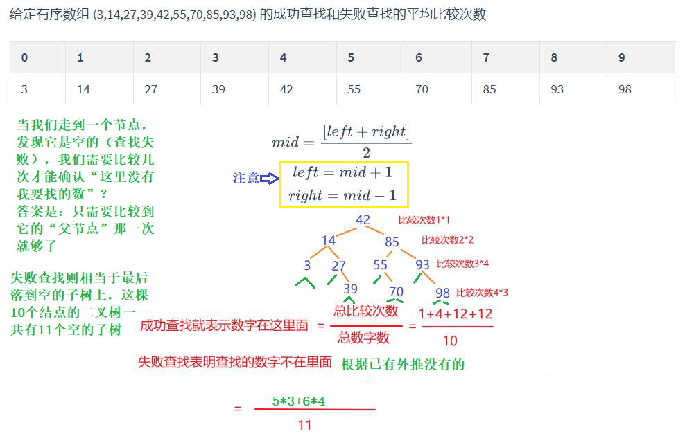
>
> ---
>
> 
>
> ### 折半查找的基本规律
>
> 在有序表（假设从小到大排列）中进行折半查找时，比较序列的关键字必须满足：
>
> - 每次比较后，目标值要么比当前中间值小（去左半区），要么比当前中间值大（去右半区）。
> - 因此，后续比较的中间值必须落在当前确定的区间内。
>
> #### A. 43, 65, 99, 85, 78
>
> - **43** 是第一个中间值。假设目标值比 43 大，则去右半区（大于 43 的部分）。
> - **65** 是右半区的中间值。假设目标值比 65 大，继续去右半区（大于 65 的部分）。
> - **99** 是新区间的中间值。假设目标值比 99 小，去左半区（65 到 99 之间）。
> - **85** 是 65 到 99 之间的中间值。假设目标值比 85 小，去左半区（65 到 85 之间）。
> - **78** 是 65 到 85 之间的中间值。
>
> 这个序列完全符合折半查找的区间缩小规律，是可能的。
>
> #### D. 99, 85, 65, 78, 43
>
> - **99** 是第一个中间值。目标值比 99 小，去左半区（小于 99）。
> - **85** 是左半区的中间值。目标值比 85 小，去左半区（小于 85）。
> - **65** 是小于 85 的区间的中间值。此时目标值比 65 大（因为下一步到了 78），所以去右半区（65 到 85 之间）。
> - **78** 是 65 到 85 之间的中间值。此时目标值比 78 小（因为下一步到了 43），所以应该去 65 到 78 之间的左半区。
>
> **问题出现了：** 43 小于 65，它不在当前的查找区间（65 到 78 之间，或者更广义的当前有效区间）内。 在到达 65 这一步时，我们已经确定目标值在 65 到 85 之间（因为从 85 到 65 是往右找，说明目标 > 65）。那么接下来的查找区间下限是 65，上限是 85。 在这个区间里，无论如何折半，都不可能再遇到 43（43 远小于 65，早已经被排除了）。

## 查找-哈希表

- 散列（哈希）表：根据设定的哈希函数H(key)和处理冲突的方法，将一组关键字映射到一个有限的连续的地址集上，并以关键字在地址集中的“像”作为记录在表中的存储位置

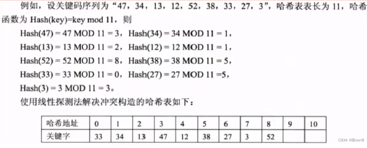

> H(Key)=Key mod p【p一般选不大于n且最接近n的质数】

- 在上图中，很明显，哈希函数产生了冲突，使用的是线性探测法解决冲突，还有其他方法如下：
  - 线性探测法：按物理地址顺序取下一个空闲的存储空间
  - 伪随机数法：将冲突的数据随机存入任意空闲的地址中
  - 再散列法：原有的散列函数冲突后，继续用此数据计算另外一个哈希函数，用以解决冲突
  - 拉链法：在原有位置构建链表，然后冲突的数据放在链表上

## 排序

- 排序的分类
  - 稳定与不稳定排序：依据是两个相同的值在一个待排序序列中的顺序和排序后的顺序应该是相对不变的，即开始时21在21前，那排序结束后，若该21还在21前，则为稳定排序；不改变相同值的相对顺序
  - 内排序和外排序：依据排序是在内存中进行的还是在外部进行的
- 排序的算法：
  - 插入类排序：直接插入排序、希尔排序【插入排序：“抽一张牌，插到已排好序的牌堆里”】
  - 交换类排序：冒泡排序、快速排序【交换排序：“不断比较并交换相邻或特定位置的元素，让大的往后走”】
  - 选择类排序：简单选择排序、堆排序【选择排序：“在一堆牌里找到最小的，放到最前面”】
  - 归并排序
  - 基数排序

| 排序方法     | 大白话实现原理                                               |
| ------------ | ------------------------------------------------------------ |
| 直接插入排序 | **打扑克牌抓牌**：手里拿好牌，新摸一张，插到合适位置。       |
| 希尔排序     | **分组快跑升级版**：设定间隔先排几组，缩小间隔再排，最后直接插入。 |
| 简单选择排序 | **挑最矮的站前面**：每轮从剩余人里挑出最矮的，依次站好。     |
| 堆排序       | **自动排队塔**：建成金字塔，不断把塔顶最大的人抽走去排队。   |
| 冒泡排序     | **高个子往后飘**：相邻两人比高低，高的往后换，最大气泡飘到最后。 |
| 快速排序     | **找标杆，分两边**：挑个标杆人，比他矮的站左边，比他高的站右边，递归重复。 |
| 归并排序     | **先分堆，再合并**：切成单个人，再两两比大小合并，最终合成完整队伍。 |
| 基数排序     | **按位数分桶**：不看大小，从个位到最高位，逐位扔进对应桶里再取出。 |

## 直接插入排序

- 直接插入排序是一种简单的排序方法
  - 具体做法是：在插入第i个记录时，R1、R2、…、Ri-1。已经排好序，这时将Ri的关键字ki依次与关键字ki-1、ki-2等进行比较，从而找到应该插入的位置并将Ri插入，插入位置及其后的记录依次向后移动
- `直接插入排序是一种稳定的排序方法`，时间复杂度为 $ O(n^2) $。在排序过程中仅需要一个元素的辅助空间，空间复杂度为 $ O(1) $。
- 适用于基本有序的情况，此时时间复杂度近乎线性，即 $ O(n) $。

> <3, 1, 4, 1, 5, 9>
> 核心逻辑：从第2个数开始，拿当前数跟前面的数比，比它大
> 就往后挪，直到找到比它小的。
> - 过程拆解：
> 1. 插 `1`：比 `3`（1次） -> 交换
> 2. 插 `4`：比 `3`（1次） -> 停下
> 3. 插 `1`：比 `4`、`3`、`1`（3次） -> 停下
> 4. 插 `5`：比 `4`（1次） -> 停下
> 5. 插 `9`：比 `5`（1次） -> 停下
> - 总次数：1+1+3+1+1=7 次

## 希尔排序

- 希尔排序的基本思想是：
  - `先将整个待排记录序列分割成若干子序列，然后分别进行直接插入排序`，待整个序列中的记录基本有序时，
  - 再对全体记录进行一次直接插入排序。
  - 具体做法是：先取一个小于n的整数di作为第一个增量，把文件的全部记录分成d1个组，即将所有距离为d1倍数序号的记录放在同一个组中,在各组内进行直接插入排序；
  - 然后取第二个增量d2(d2 < d1)，重复上述分组和排序工作，依此类推，直到所取的增量di = 1(di < di-1 < …< d2 < d1)，即所有记录放在同一组进行直接插入排序为止
  
- `希尔排序是一种**不稳定**的排序方法`，据统计分析其时间复杂度约为 $O(n^{1.3})$。在排序过程中仅需要一个元素的辅助空间用于数组元素的交互，空间复杂度为 $ O(1) $。

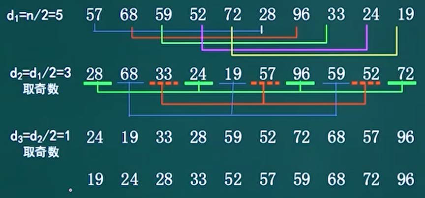

## 简单选择排序

- n个记录进行简单选择排序的基本方法是
  - 通过 n-i ( 1 ≤ i ≤ n )在次关键字之间的比较，从 n-i+1 个记录中选出关键字最小的记录，并和第i个记录进行交换，当i等于n时所有记录有序排列
  - `选择排序因为找到最小的之后，会把最小的和前面的数交换`，因此前面的数就有概率出现不稳定
- `直接选择排序是一种**不稳定**的排序方法`，其时间复杂度约为 $ O(n^2) $。在排序过程中仅需要一个元素的辅助空间用于数组元素的交互，空间复杂度为 $ O(1) $。

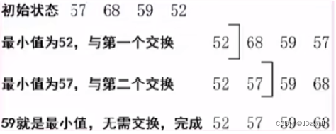

## 堆排序

- 堆的定义

  - 设有 $n$ 个元素的序列 ${K_1, K_2, \cdots, K_n}$，当且仅当满足下列关系之一时，称之为堆。其中下标 $i$ 满足 $1 \le i \le \lfloor n/2 \rfloor$（即 $2i$ 和 $2i+1$ 需不大于 $n$）。

    - 小顶堆（Min Heap）： $$ \begin{cases} K_i \le K_{2i} \ K_i \le K_{2i+1} \end{cases} $$ *(特点：根节点是序列中的最小值)*

    - 大顶堆（Max Heap）： $$ \begin{cases} K_i \ge K_{2i} \ K_i \ge K_{2i+1} \end{cases} $$ *(特点：根节点是序列中的最大值)*

- 堆排序利用了完全二叉树的性质。其核心流程如下：
  1. 建立初始堆： 将待排序记录的关键字排成一个堆（例如大顶堆）。
  2. 输出堆顶： 输出堆顶的最大关键字（对于大顶堆而言）。
  3. 调整堆：将剩余的关键字重新调整成新堆，得到次大的关键字。
  4. 反复执行： 重复上述步骤，直到全部关键字排成有序序列为止。

- 初始堆的建立方法

  - 将待排序的关键字存放到一棵完全二叉树的各个结点中。

    - 起点： 从完全二叉树的第 $i = \lfloor \frac{n}{2} \rfloor$ 个结点 $K_i$ 开始。

    - 过程： 逐步向前，使以 $K_{\lfloor n/2 \rfloor}, K_{\lfloor n/2 \rfloor - 1}, \cdots, K_1$ 为根的子树满足堆的定义。

    - 原理： 显然，所有 $i > \lfloor \frac{n}{2} \rfloor$ 的结点 $K_i$ 都没有子结点（叶子结点），因为它们为根的子树已经是堆。

- 堆排序的时间复杂度为：$ O(n\log_2 n) $。

- 堆排序的空间复杂度为：$ O(1) $。

> **找“最大”的 K 个，用“小”顶堆；找“最小”的 K 个，用“大”顶堆**
>
> 1. **小顶堆的特性**：
>    堆顶（根节点）永远是堆里**最小**的那个元素。
>    如果我们维护一个大小为 10 的小顶堆，那么**堆顶就是这 10 个候选者里的“守门员”**（即当前第 10 大的数）。
> 2. **筛选逻辑**：
>    当我们拿来一个新的数 `x` 时，我们只需要把它和“守门员”（堆顶）比：
>    - **如果 `x` > 堆顶**：说明 `x` 比当前第 10 名还要大，它有资格入围！于是我们把原来的“守门员”踢走，让 `x` 进来，然后重新调整堆，选出新的“守门员”。
>    - **如果 `x` < 堆顶**：说明 `x` 连当前的第 10 名都打不过，那它肯定进不了前 10，直接丢弃。

> 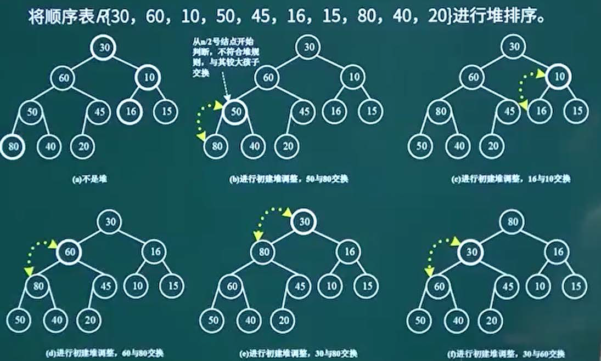
>
> 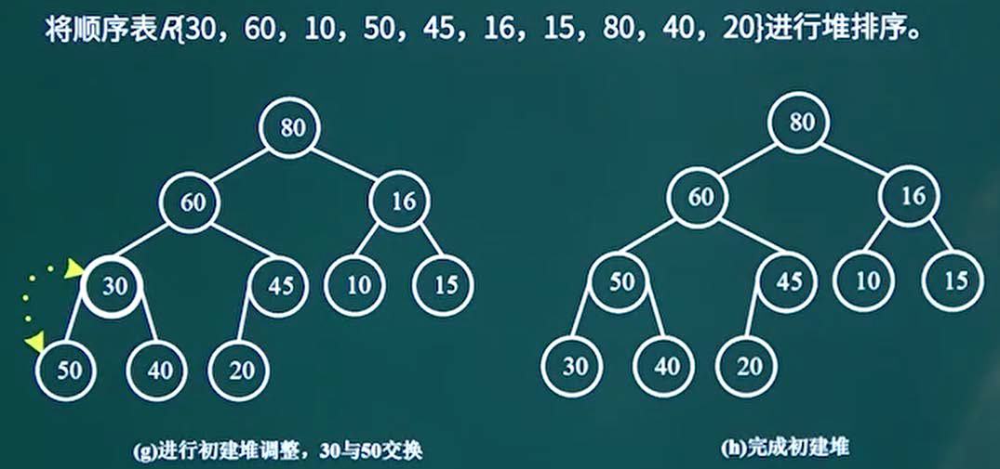
>
> 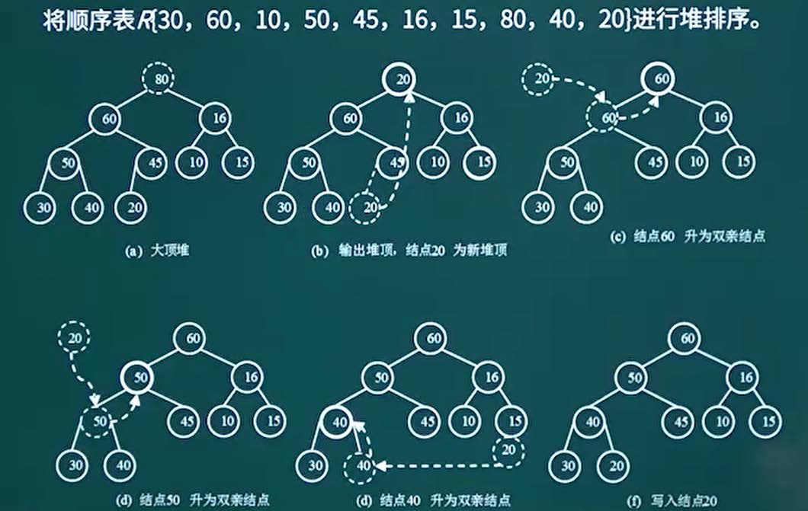

## 冒泡排序

- n个记录进行冒泡排序的方法是：
  - 首先将第一个记录的关键字和第二个记录的关键字进行比较，若为逆序，则交换这两个记录的值，然后比较第二个记录和第三个记录的关键字，依此类推，直到第n-1个记录和第n个记录的关键字比较过为止。
  - 上述过程称为第一趟冒泡排序，其结果是关键字最大的记录被交换到第n个记录的位置上。
  - 然后进行第二趟冒泡排序，对前n-1个记录进行同样的操作，其结果是关键字次大的记录被交换到第n-1个记录的位置上。
  - 最多进行n-1趟，所有记录有序排列。若在某趟冒泡排序过程没有进行相邻位置的元素交换处理，则可结束排序过程
  
  > 通过重复遍历待排序序列，依次比较相邻的两个元素，将较大的元素逐步“冒泡”到序列末端。

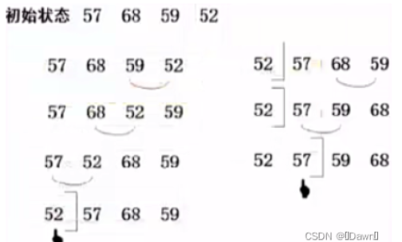

## 快速排序

- `快速排序的基本思想是：通过一趟排序将待排的记录划分为独立的两个部分，其中一部分记录的关键字均不大于另一部分记录的关键字，然后再分别对这两部分记录继续进行快速排序，以达到整个序列有序`

- 快速排序的平均时间复杂度是 O(nlgn) 。但在最坏情况下（例如，每次选取的基准元素都是当前序列中的最大值或最小值，导致划分极度不平衡，一边为空，另一边为 n-1个元素），其时间复杂度会退化为 O($n^2$)

> - 快排不稳定【快排思想是分治】
>
> > ### 快速排序笔记：双指针对向交换法
> >
> > #### 1. 核心思想
> >
> > - **基准选择**：选取最后一个元素作为基准（Pivot）。
> > - **指针分工**：设置两个指针 `i` 和 `j`，分别从数组的**最左端**和**最右端（基准的前一个位置）**开始，**相向而行**。
> >   - **`i` (左指针)**：从左向右扫描，寻找**比基准大**的元素（因为它应该在右边）。
> >   - **`j` (右指针)**：从右向左扫描，寻找**比基准小**的元素（因为它应该在左边）。
> > - **交换与归位**：
> >   - 当 `i` 找到大的，`j` 找到小的，且 `i < j` 时，交换这两个元素。
> >   - 当 `i` 和 `j` 相遇或交错时，停止扫描，将**基准元素**与相遇点（通常是 `i` 指向的位置）的元素交换，完成归位。
> >
> > #### 2. 题目实战推演
> >
> > **数组**：$A = (2, 8, 7, 1, 3, 5, 6, 4)$ **基准 (Pivot)**：$4$
> >
> > | 步骤          | 动作描述                               | 指针状态           | 数组变化                   | 备注                                                         |
> > | ------------- | -------------------------------------- | ------------------ | -------------------------- | ------------------------------------------------------------ |
> > | **初始**      | `i` 指向首位(2)，`j` 指向末位前一位(6) | `i`=0, `j`=6       | `[2, 8, 7, 1, 3, 5, 6], 4` | 基准 4 暂不参与移动                                          |
> > | **1. i 寻找** | `i` 向右找 $>4$ 的数                   | `i` 停在 8 (索引1) | `[2, 8, ...]`              | 2<4 跳过，8>4 停                                             |
> > | **2. j 寻找** | `j` 向左找 $<4$ 的数                   | `j` 停在 3 (索引4) | `[..., 3, 5, 6]`           | 6,5>4 跳过，3<4 停                                           |
> > | **3. 交换**   | 交换 `i`(8) 和 `j`(3)                  | `i`=1, `j`=4       | `[2, 3, 7, 1, 8, 5, 6], 4` | 小的换到左边，大的换到右边                                   |
> > | **4. i 继续** | `i` 继续向右找 $>4$                    | `i` 停在 7 (索引2) | `[..., 7, ...]`            | 3<4 跳过，7>4 停                                             |
> > | **5. j 继续** | `j` 继续向左找 $<4$                    | `j` 停在 1 (索引3) | `[..., 1, ...]`            | 8>4 跳过，1<4 停                                             |
> > | **6. 交换**   | 交换 `i`(7) 和 `j`(1)                  | `i`=2, `j`=3       | `[2, 3, 1, 7, 8, 5, 6], 4` | 再次修正位置                                                 |
> > | **7. i 继续** | `i` 继续向右找 $>4$                    | `i` 停在 7 (索引3) | `[..., 7, ...]`            | 此时 `i` 指向 7                                              |
> > | **8. j 继续** | `j` 继续向左找 $<4$                    | `j` 停在 1 (索引3) | `[..., 1, ...]`            | 此时 `j` 指向 1                                              |
> > | **9. 相遇**   | `i` 和 `j` 在索引 3 处相遇/交错        | `i`=3, `j`=3       | `[2, 3, 1, 7, 8, 5, 6], 4` | 扫描结束                                                     |
> > | **10. 归位**  | **交换基准(4) 与 `i` 指向的元素(7)**   | -                  | `[2, 3, 1, 4, 8, 5, 6, 7]` | **注意：**此处题目解析可能有特殊处理或印刷差异，标准逻辑是基准归位到分界点。 |
> >
> > > **⚠️ 关键点解析（针对选项 C）** 根据题目给出的正确选项 C `(2, 3, 1, 4, 7, 5, 6, 8)`，我们可以反推其具体的执行细节可能略有不同（例如指针移动顺序或交换时机），但核心逻辑必须满足：
> > >
> > > 1. **基准 4 归位**：最终 4 在中间。
> > > 2. **左侧集合**：${2, 3, 1}$ 都小于 4。
> > > 3. **右侧集合**：${7, 5, 6, 8}$ 都大于 4。
> > >
> > > *注：题目解析中的文字描述“2和4比较...交换”可能是一种简化的、非标准的口语化描述，或者对应特定的代码实现版本。但在考试中，只要抓住**“左小右大”**且**“基准归位”**这两个特征即可锁定答案 C。*
> >
> > #### 3. 为什么选 C？
> >
> > - **A**：4 还在最后，没排完。
> > - **B**：左边是 1,2,3，虽然数值对，但顺序变成了有序，一趟快排通常无法让子序列完全有序。
> > - **D**：右边是 8,7,5,6，虽然都大于4，但通常快排划分后，右侧第一个元素往往是刚才交换过来的大数（如7或8），C 选项的分布更符合一般划分后的乱序特征。
> > - **C**：`(2, 3, 1)` 在左，`(7, 5, 6, 8)` 在右，4 在中间。完全符合划分定义。
> >
> > #### 4. 时间复杂度
> >
> > - **一趟划分**：无论使用哪种指针方法，每个元素都被访问了一次。
> > - **复杂度**：$ O(n) $。
>
> - 快速排序效率最高（即达到最佳时间复杂度 O($nlog_2n$)）的情况是：每次划分都能将序列均匀地分成两部分，即基准元素恰好是当前子序列的中位数【每次基准都是子序列的中位数，则是最佳数列】
> - 注意快排的辅助空间是O($log_2n$)

## 归并排序

- 所谓“归并”，是将两个或两个以上的有序文件合并成为一个新的有序文件。归并排序是把一个有n个记录的无序文件看成是由n个长度为1的有序子文件组成的文件，然后进行两两归并，得到$\frac n2$个长度为 2 或 1 的有序文件，再
  两两归并，如此重复，直到最后形成包含n个记录的有序文件为止。
- 这种反复将两个有序文件归并成一个个有序文件的排序方法称为`两路归并排序`
- 归并排序是一种**稳定**的排序方法，其时间复杂度约为 $ O(n\log_2 n) $。在排序过程中仅需要一个元素的辅助空间用于数组元素的交互，空间复杂度为 $ O(n) $。

> <3, 1, 4, 1, 5, 9>
> 核心逻辑：分组归并，比较发生在合并阶段。
> 1. 归并 [3] 和 [1]：3与1比（1次） -> `<1, 3>`
> 2. 归并 [4]：单个元素，无需比较（0次）
> 3. 归并 [1, 3] 和 [4]：1与4比，3与4比（2次） -> `<1, 3, 4>`
> 4. 归并 [1] 和 [5]：1与5比（1次） -> `<1, 5>`
> 5. 归并 [9]：单个元素（0次）
> 6. 归并 [1, 5] 和 [9]：1与9比，5与9比（2次） -> `<1, 5, 9>`
> 7. 最终归并 [1, 3, 4] 和 [1, 5, 9]：
> - 1与1，1与5，3与5，4与5（4次比较后左边空了，右边直接复制）
> - 总次数：1+1+3+1+1=71+1+3+1+1=7 次

## 基数排序

- 基数排序是一种借助多关键字排序思想对单逻辑关键字进行排序的方法。基数排序不是基于关键字比较的排序方法，它适合于元素很多而关键字较少的序列。基数的选择和关键字的分解是根据关键字的类型来决定的，例如关键字是十进制数，则按个位、十位来分解
- 基数排序是一种**稳定**的排序方法，其时间复杂度约为 $O(d(n+rd))$。在排序过程中仅需要一个元素的辅助空间用于数组元素的交互，空间复杂度为 $O(rd)$。

> 基数排序适合大量数据且数据分布均匀的情况，但它需要对整个数据集进行完整排序。

> 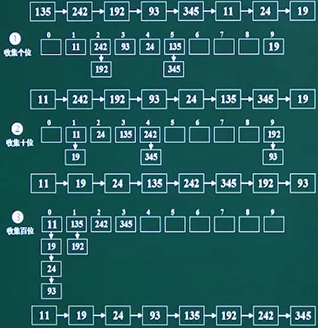

## 排序算法总结

- 空间复杂度中，大部分排序都是比较交换，无需多余空间，快速排序则是需要存储每次的基准值，归并排序需要一个新表，基数排序需要新表，还需要存储关键字的空间

- 时间复杂度中，与堆、树、二分有关的算法都是nlogn

| 排序方法     | 大白话实现原理                                               |
| ------------ | ------------------------------------------------------------ |
| 直接插入排序 | **打扑克牌抓牌**：手里拿好牌，新摸一张，插到合适位置。       |
| 希尔排序     | **分组快跑升级版**：设定间隔先排几组，缩小间隔再排，最后直接插入。 |
| 简单选择排序 | **挑最矮的站前面**：每轮从剩余人里挑出最矮的，依次站好。     |
| 堆排序       | **自动排队塔**：建成金字塔，不断把塔顶最大的人抽走去排队。   |
| 冒泡排序     | **高个子往后飘**：相邻两人比高低，高的往后换，最大气泡飘到最后。 |
| 快速排序     | **找标杆，分两边**：挑个标杆人，比他矮的站左边，比他高的站右边，递归重复。 |
| 归并排序     | **先分堆，再合并**：切成单个人，再两两比大小合并，最终合成完整队伍。 |
| 基数排序     | **按位数分桶**：不看大小，从个位到最高位，逐位扔进对应桶里再取出。 |

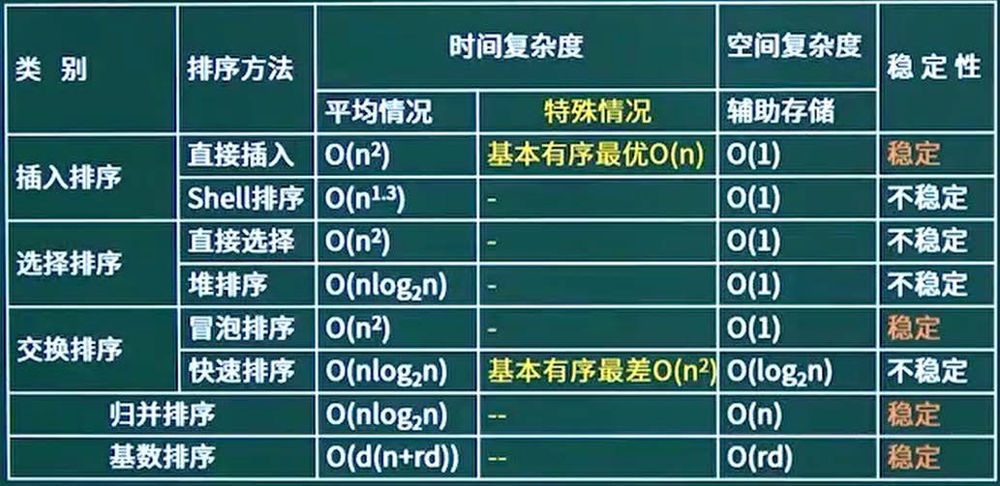

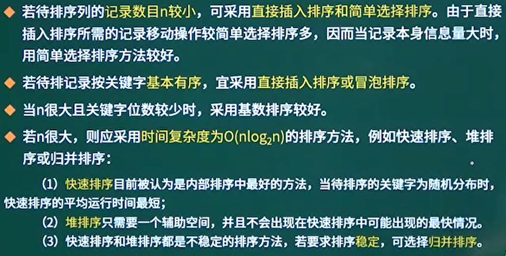

## 常用算法原理

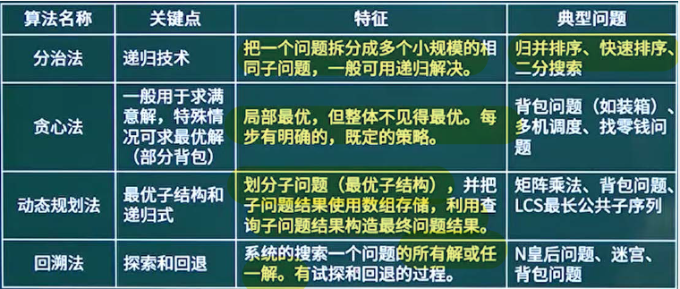

> - 背包问题：
>   - 0/1背包：选或者不选
>   - 部分背包：可以拆分物品
>   - 多重背包问题：每个物品有限个
>   - 完全背包：每个物品无限个
>   - 分组背包：物品分组，每组互斥
> - 最大公共子序列（LCS）
>   - 给定两个序列，找出它们最长的公共子序列
> - 旅行商问题（TSP）
>   - 寻找一条经过每个城市恰好一次并回到起点的最短回路。

## 分治法

- 递归：`指子程序（函数）直接调用自己或通过一系列调用语句间接调用自己`，是一种描述问题和解决问题的常用方法
- 递归两个基本要素：
  - `边界条件（确定递归何时终止，即递归出口）`
  - `递归模式（大问题如何分解成小问题，即递归体）`
- 分治法：`对于一个规模为n的问题，若该问题可以容易地解决则直接解决，否则将其分解为k个规模较小的子问题，这些子问题互相独立且与原问题形式相同，递归地解决这些子问题`，然后`将各子问题的解合并得到原问题的解`
  - 步骤： 分解（将原问题分解成一系列子问题）――求解（递归地求解各子问题，若子问题足够小，则直接求解）――合并（将子问题的解合并成原问题的解）
  - 凡是涉及到分组解决的都是分治法（二分查找、归并排序等)
- 经典问题：斐波那契数列、归并排序、快速排序、矩阵乘法、二分搜索、大整数乘法、汉诺塔

> 该问题的规模缩小到一定的程度就可以容易地解决【分解】
>
> 该问题可以分解为若干个规模较小的相同问题【解决】
>
> 利用该问题分解出的子问题的解可以合并为该问题的解【合并】
>
> 该问题所分解出的各个子问题是相互独立的

## 回溯法

- 回溯法：`有 “通用的解题法” 之称，可以系统地搜索一个问题的所有解或任一解。在包含问题的所有解的解空间树中，按照深度优先的策略，从根节点触发搜索解空间树`。搜索至任一结点时，总是先判断该结点是否肯定不包含问题的解，如果不包含，则跳过对以该结点为根的子树的搜索`，逐层向其祖先结点回溯`；否则，进入该子树；继续按深度优先的策略进行搜索
- 可以理解为先进行深度优先搜索，一直向下探测，当此路不通时，返回上一层探索另外的分支，重复此步骤，这就是回溯，意为先一直探测，当不成功时再返回上一层
- 经典：N皇后问题、迷宫、背包问题

## 动态规划法

- 动态规划法：`在求解问题中，对于每一步决策，列出各种可能的局部解，再依据某种判定条件，舍弃哪些肯定不能得到最优解的局部解，在每一步都经过筛选，以每一步都是最优解来保证全局是最优解`
  - 本质也是将复杂的问题划分成一个个子问题，与分治法不同的是每个子问题间不是相互独立的，并且不全都相同
  - 常用于求解具有某种最优性质的问题
  - 此算法会将大量精力放在前期构造表格上面，其会对每一步，列出各种可能的答案，这些答案会存储起
    来，最终要得出某个结果时，是通过查询这张表来得到的动态规划法不但每一步最优，全局也最优
- 经典问题：斐波那契数列、矩阵乘法、背包问题、LCS最长公共子序列

## 贪心法

- 贪心法：`总是做出在当前来说是最好的选择,而并不从整体上加以考虑，它所做的每步选择只是当前步骤的局部最优选择，但从整体来说不一定是最优的选择`。由于它不比为了寻找最优解而穷尽所有可能解，因此其耗费时间少，一般可以快速得到满意的解，但得不到最优解
  - 局部贪心，只针对当前的步骤取最优，而非整体考虑
  - 判断此类算法，就看算法是否是每一步都取最优，并且整体题意没有透露出最终结果是最优的
- 经典：背包问题（如装箱）、多机调度、找零钱问题

## 分支限界法

- 分支限界法：`与回溯法类似，同样是在问题的解空间树上搜索问题解的算法`
  - 搜索原理：在分支限界法中，每一个活结点只有一次机会成为扩展结点。活结点一旦成为扩展结点，就一次性产生其所有儿子结点。在这些儿子结点中，导致不可行解或导致非最优解的儿子结点被舍弃，其余儿子结点被加入活结点表中。此后，从活结点表中取下一结点成为当前扩展结点，并重复上述结点扩展过程。这个过程一直持续到找到所需的解或活结点表为空时为止
  - 与回溯法的区别：
    - 求解目标是找出满足约束条件的一个解，或是在满足约束条件的解中找出使某一目标函数值达到极大或极小的解，即在某种意义下的最优解
    - 以广度优先或以最小耗费(最大收益）优先的方式搜索解空间树
  - 从活节点表中选择下一个扩展节点的类型：
    - 队列式(FIFO)分支限界法：按照队列先进先出（FIFO）原则选取下一个节点为扩展节点
    - 优先队列式分支限界法：按照优先队列中规定的优先级选取优先级最高的节点成为当前扩展节点

## 概率算法

- 概率算法：在算法执行某些步骤时，可以随机地选择下一步该如何进行，同时允许结果以较小的概率出现错误，并以此为代价， 获得算法运行时间的大幅度减少（降低算法复杂度）
  - 基本特征是对所求解问题的同一实例用同一概率算法求解两次，可能得到完全不同的效果
  - 如果一个问题没有有效的确定性算法可以在一个合理的时间内给出解，但是该问题能接受小概率错误，那么采用概率算法就可以快速找到这个问题的解
  - 四类概率算法：
    - 数值概率算法（数值问题的求解）
    - 蒙特卡洛算法（求问题的精确解）
    - 拉斯维加斯算法（不会得到不正确的解）
    - 舍伍德算法（总能求得问题的一个正确解）
  - 概率算法的特征：
    - 概率算法的输入包括两部分，一部分是原问题的输入，另一部分是一个供算法进行机选择的随机数序列
    - 概率算法在运行过程中，包括一处或多处随机选择，根据随机值来决定算法的运路径
    - 概率算法的结果不能保证一定是正确的，但能限制其出错概率
    - 概率算法在不同的运行过程中，对于相同的输入实例可以有不同的结果，因此，对于相同的输入实例，概率算法的执行时间可能不同

## 近似算法

- 近似算法：解决难解问题的一种有效策略，其基本思想是放弃求最优解，而用近似最优解代替最优解，以换取算法设计上的简化和时间复杂度的降低
  - 虽然它可能找不到一个最优解，但它总会给待求解的问题提供一个解
  - 为了具有实用性，近似算法必须能够给出算法所产生的解与最优解之间的差别或者比例的一个界限，它保证任意一个实例的近似最优解与最优解之间的相差成都。显然，这个差别越小，近似算法越具有实用性
  - 衡量近似算法性能两个标准：
    - 算法的时间复杂度。近似算法的时间复杂度必须是多项式阶的，这是近似算法的基本目标
    - 解的近似程度。近似最优解的近似程度也是设计近似算法的重要目标。近似程度与近似算法本身、问题规模，乃至不同的输入实例有关

## 数据挖掘算法

- 概述： 分析爆炸式增长的各类数据的技术，以发现隐含在这些数据中的有价值的信息和知识。数据挖掘利用及其学习方法对多种数据进行分析和挖掘。其核心是算法，主要功能包括分类、回归、关联规则和聚类等
- 分类：是一种有监督的学习过程，根据历史数据预测未来数据的模型
  - 分类的数据对象属性：一般属性、分类属性或目标属性
  - 分类设计的数据：训练数据集、测试数据集、未知数据
  - 数据分类的两个步骤：
    - 学习模型（基于训练数据集采用分类算法建立学习模型）
    - 应用模型（应用测试数据集的数据到学习模型中，根据输出来评估模型的好坏以及将未知数据输入到学习模型中，预测数据的类型)
  - 分类算法：决策树归纳（自顶向下的递归树算法)、朴素贝叶斯算法、后向传播BP、支持向量机SVM
- 频繁模式和关联规则挖掘：挖掘海量数据中的频繁模式和关联规则可以有效地指导企业发现交叉销售机会、进行决策分析和商务管理等。(沃尔玛-啤酒尿布故事)首先要求出数据集中的频繁模式，然后由频繁模式产生关联规则
- 关联规则挖掘算法：类Apriori算法、基于频繁模式增长的方法如FP-growthh，使用垂直数据格式的算法，如ECLAT
- 聚类：是一种无监督学习过程。根据数据的特征，将相似的数据对象归为一类，不相似的数据对象归到不同的类中。物以类聚，人以群分
- 典型算法：基于划分的方法、基于层次的方法、基于密度的方法、基于网格的方法基于统计模型的方法
- 数据挖掘的应用：信用分析、定向促销顾客的分类与聚类等。

## 智能优化算法

- 概述：优化技术是一种以数学为基础，用于求解各种工程问题优化解的应用技术
  - 人工神经网络ANN：一个以有向图为拓扑结构的动态系统，通过对连续或断续的输入作状态响应而进行信息处理。从信息处理角度对人脑神经元网络进行抽象，建立某种简单模型，按不同的连接方式组成不同的网络
  - 遗传算法：源于模拟达尔文的 “优胜劣汰、适者生存” 的进化论和孟德尔.摩根的遗传变异理论，在迭代过程中保持已有的结构，同时寻找更好的结构。其本意是在人工适应系统中设计一种基于自然的演化机制
  - 模拟退火算法SA：求解全局优化算法。基本思想来源于物理退火过程，包括三个阶段：加温阶段、等温阶段、冷却阶段
  - 禁忌搜索算法TS：模拟人类智力过程的一种全局搜索算法，是对局部邻域搜索的一种扩展
  - 蚁群算法：是一种用来寻找优化路径的概率型算法
  - 粒子群优化算法PSO：又称为鸟群觅食算法，在鸟群觅食飞行时，在飞行过程中经常会突然改变方向、散开、聚集，其行为不可预测，但其整体总保持一致性，个体与个体间也保持着最适官的距离。通过对类似生物群体行为的研究，发现生物群体中存在着一种信息共享机制，为群体的进化提供了一种优势，这就是基本粒子群算法形成的基础

