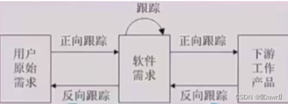

## 系统分析概述

- 系统分析是一种问题求解技术，它将一个系统分解成各个组成部分，目的是研究各个部分如何工作、交互，以实现其系统目标
- 目的和任务：系统分析的主要任务是对现行系统进一步`详细调查`，`将调查中所得到的文档资料集中`， `对组织内部整体管理状况和信息处理过程进行分析`，`为系统开发提供所需的资料`，并`提交系统方案说明书`
- ==系统分析的主要步骤==：
  - 认识、理解当前的现实环境，获得当前系统的`“物理模型”`
  - 从当前系统的“`物理模型`”`抽象`出当前系统的“`逻辑模型`”
  - 对当前系统的`“逻辑模型”进行分析和优化`，建立`目标系统的“逻辑模型”`
  - 对目标系统的`逻辑模型具体化（物理化)`，建立`目标系统的物理模型`
- ==系统开发==的目的是将==现有系统的物理模型==转换为==目标系统的物理模型==

## 补充

- 根据==模块在数据流==中的作用，可以将==软件模块==分为以下几类：
  - ==传入模块==: `从下级模块获取数据,并进行处理`，然后`将结果送给上级模块`。它的`主要功能是接收外部数据`
  - ==传出模块==: `从上级模块接收数据`,`然后将其传递给下级模块或输出到外部环境`。它的`主要功能是输出数据`
  - ==变换模块== : `从上级模块接收数据`,`进行特定的计算或处理`,然后`将结果返回给原上级模块`。它的`核心是"变换"或“处理”数据`
  - ==协调模块== : 负责`调用和协调其他模块的工作`，`本身不进行具体的数据处理`

- 在软件设计阶段进行模块划分时，核心原则之一是`确保模块的作用范围应包含在其控制范围之内`
  - ==控制范围==：指模块本身及其所有直接或间接从属于它的模块集合（即它调用的所有子模块）
  - ==作用范围==：指受该模块中某个判定（如条件语句）所影响的模块集合
- ==启发式（Heuristic）==是一种基于经验、直觉或实用规则的解决问题的方法，它不保证最优解，但通常能快速找到“足够好”的解决方案。在软件工程中，启发式设计原则是指导模块划分、结构设计等决策的经验性规则，如“提高模块独立性”“作用域在控制域内”等，它们帮助设计者避免常见错误，提升系统质量。

## 系统设计的基本原理

- 系统设计基本原理：
  - ==抽象==（重点说明本质方面，忽略非本质方面）
  - ==模块化==（可组合、分解和更换的单元）
  - ==信息隐蔽==（将每个程序的成分隐蔽或封装在一个单一的设计模块中）
  - ==模块独立==（每个模块完成一个相对独立的特定子功能，且与其他模块之间的联系简单）
- 模块的设计要求独立性高，就必须==高内聚，低耦合==
  - ==内聚==是指一个模块内部功能之间的相关性
  - ==耦合==是指多个模块之间的联系

## 用户界面设计原则

- ==置于用户控制之下==
  - 以不强迫用户进入不必要的或不希望的动作的方式来定义交互方式
  
  - 提供灵活的交互
  
  - 允许用户交互可以被中断和撤消
  
  - 当技能级别增加时可以使交互流水化并允许定制交互
  
  - 使用户隔离内部技术细节
  
  - 设计应允许用户和出现在屏幕上的对象直接交互
  
- ==减少用户的记忆负担==
  - 减少对短期记忆的要求
  
  - 建立有意义的缺省
  
  - 定义直觉性的捷径
  
  - 界面的视觉布局应该基于真实世界的隐喻
  
  - 以不断进展的方式揭示信息
  
- ==保持界面的一致性==
- 允许用户将当前任务放入有意义的语境
  
- 在应用系列内保持一致性
  
- 如过去的交互模型已建立起了用户期望，除非有迫不得已的理由，不要改变它

## ==内聚类型总结==

内聚性按照从低（最差）到高（最好）的顺序，可以分为以下七类：

1. ==**偶然内聚（巧合内聚）**==【无直接关系】
   - **描述**：完成一组没有联系或松散关系的任务。
   - **定义**：一个模块内的各处理元素之间`没有任何联系`。
2. ==**逻辑内聚**==【逻辑相似、参数决定】
   - **描述**：完成`逻辑上相关`的一组任务（通过参数来决定具体执行哪一个）。
   - **定义**：模块内执行若干个`逻辑上相似`的功能，通过`参数确定`该模块完成哪一个`功能`。
3. ==**瞬时内聚（时间内聚）**==【同时执行】
   - **描述**：所包含的任务必须在`同一时间`间隔内`执行`。
   - **定义**：把需要`同时执行`的动作组合在一起形成的模块。
4. ==**过程内聚**==【指定的过程。顺序不一定存在数据传递】
   - **描述**：处理元素相关，而且必须按`特定的次序执行`。
   - **定义**：一个模块完成多个任务，这些任务必须按`指定的过程执行`。
5. ==**通信内聚**==【相同数据结构、相同输入输出】
   - **描述**：所有处理元素`集中在一个数据结构的区域`上。
   - **定义**：模块内的所有`处理元素都在同一个数据结构`上操作，或者各处理使用`相同的输入数据`或者`产生相同的输出数据`。
6. ==**顺序内聚**==【顺序执行、输入为输出】
   - **描述**：处理元素相关，而且`必须顺序执行`。
   - **定义**：一个模块中的`各个处理元素都密切相关于同一功能且必须顺序执行`，`前一个功能元素的输出就是下一个功能元素的输入`。
7. ==**功能内聚**==【共同作用、缺一不可】
   - **描述**：`完成一个单一功能`，`各个部分协同工作`，`缺一不可`（最强的内聚，功能最单一）。
   - **定义**：最强的内聚，模块内的所有元素共同作用完成一个功能，缺一不可。

## 耦合类型总结

> 耦合是衡量模块间相对独立性（即互相连接的紧密程度）的指标。其强弱主要取决于以下三个方面：
>
> - **模块间接口的复杂程度**：接口越复杂，模块间耦合越强。
> - **调用模块的方式**：调用方式越直接、越深入，耦合越紧密。
> - **通过接口的信息类型**：传递的信息越复杂（如控制信号、数据结构等），耦合度越高。
>
> 而**模块提供的功能数**，属于模块内部职责的范畴，与模块之间的连接关系无直接关联。无论一个模块提供多少个功能，只要其对外接口简洁、调用方式独立、传递信息类型单一，其耦合度仍可保持较低。

1. ==**非直接耦合（无直接耦合）**==【无直接关系】
   - **描述**：`两个模块之间没有直接关系`，它们之间的联系完全是通过主模块的控制和调用来实现的。
   - **定义**：两个模块之间没有直接的关系，它们分别`从属于不同模块的控制与调用`，`不传递任何信息`。
2. ==**数据耦合**==【传递数据值调用】
   - **描述**：一组`模块借助参数表传递简单数据`。
   - **定义**：两个模块之间有调用关系，`传递的是简单的数据值`，`相当于高级语言中的值传递`。
3. ==**标记耦合**==【传递数据结构】
   - **描述**：一组模块`通过参数表传递记录信息（数据结构）`。
   - **定义**：两个模块之间`传递的是数据结构`。
4. ==**控制耦合**==【控制变量、选择执行某一功能】
   - **描述**：模块之间传递的信息中包含用于`控制模块内部逻辑的信息`。
   - **定义**：一个模块调用另一个模块时，`传递的是控制变量`，`被调用模块通过该控制变量的值有选择的执行模块内的某一功能`。
5. ==**外部耦合**==【软件外部环境】
   - **描述**：`一组模块都访问同一全局简单变量`，而且`不是通过参数表传递该全局变量的信息`。
   - **定义**：`模块间通过软件之外的环境联合`（如 I/O 将模块耦合到特定的设备、格式、通信协议上）时。
6. ==**公共耦合**==【公共数据结构】
   - **描述**：`多个模块都访问同一个公共数据环境`。
   - **定义**：`通过一个公共数据环境相互作用`的那些模块间的耦合。
7. ==**内容耦合**==【模块内部关联】
   - **描述**：一个`模块直接访问另一个模块的内部数据`；一个`模块不通过正常入口转到另一个模块的内部`；`两个模块有一部分程序代码重叠`；`一个模块有多个入口`。
   - **定义**：当`一个模块直接使用另一个模块的内部数据`，或`通过非正常入口转入另一个模块内部时`。

## 系统设计

- ==概要设计==基本任务：设计软件系统`总体结构`、`数据结构及数据库设计`、`模块之间的接口`、`编写概要设计文档`、`评审`
- ==详细设计==的基本任务： 模块内`详细算法设计`、`模块内数据结构设计`、`数据库的物理设计`、其他设计（代
  码、输入/输出格式、用户界面)、编写详细设计说明书、评审

>  本题考查信息系统开发生命周期（SDLC）中各阶段产生的文档。
>
>  在**系统规划**和**系统分析**阶段，主要任务是明确项目目标、分析业务需求、评估技术经济可行性等。
>
>  - **A. 可行性研究报告**：属于系统规划阶段的典型文档，用于评估项目的可行性。
>  - **B. 总体规划报告**：属于系统规划阶段，用于规划信息系统的整体架构和战略。
>  - **C. 项目开发计划**：通常在系统规划或分析阶段制定，用于安排项目进度、人员分工等。
>
>  而 **D. 用户使用手册** 是在系统的**设计**、**实现（编码）\**甚至\**测试**阶段完成后，为了指导用户如何操作软件而编写的交付文档。它**不属于**项目前期的“系统规划和系统分析阶段”用来交流需求的文档。

## 系统总体结构设计

- ==系统结构设计原则==：

  - 分解—协调原则
  - 自顶向下原则
  - 信息隐蔽和抽象原则
  - 一致性原则
  - 明确性原则
  - 模块间高内聚低耦合
  - 模块的扇入系数和扇出系数合理
  - 模块规模适当

  > `扇出（Fan-out）`
  >
  > - 定义：一个模块直接调用或控制的其他模块的数量。
  > - 扇出值越高，说明该模块控制的子模块越多
  > - 如果模块A直接调用了模块B、C、D，则模块A的扇出为3。
  >
  > `扇入（Fan-in）`
  >
  > - 定义：有多少个上级模块直接调用或依赖某个模块。
  > - 扇入值越高，说明该模块被更多模块重用
  >
  > - 如果模块B被模块A和模块C同时调用，则模块B的扇入为2。
  >
  > `控制域（Control Domain）`
  >
  > - 定义：一个模块的控制域是指该模块本身及其所有直接或间接控制的下级模块所组成的集合。
  > - 作用域（Scope of Effect / Influence Scope）
  > - 定义：一个判定的作用域是指受该判定影响的所有模块所组成的集合。

- ==子系统划分的原则==：
  - 子系统要具有相对独立性
  - 子系统之间数据的依赖性尽量小
  - 子系统划分的结果应使数据冗余较小
  - 子系统的设置应考虑今后管理发展的需要
  - 子系统的划分应便于系统分阶段实现
  - 子系统的划分应考虑到各类资源的充分利用

## 软件架构风格

- ==数据流风格==

  - ==批处理序列==
    - 特点：构件是固定顺序的计算单元；前一步结束才能开始下一步。
    - 关键：数据必须是`完整的`，以整体方式传递。

  - ==管道-过滤器==
    - 特点：`构件称为过滤器`（处理数据流），`连接件称为管道`（传输数据）。
    - 应用**：**早期编译器
    
    > 核心特点是构件（过滤器）之间通过管道传递数据流，前一个构件的输出直接作为后一个构件的输入。这种结构天然支持**高内聚、低耦合**，因为每个过滤器只关注自身的输入输出，内部逻辑独立；同时，由于构件功能单一且接口明确，**支持软件复用**；此外，由于数据流可以并行处理，**支持并行执行**，从而提高系统性能。
    >
    > 然而，该风格强调**顺序执行和数据流的线性传递**，构件之间没有事件驱动的动态交互机制，也不支持用户与系统之间的实时交互。因此，它**不适合交互处理应用**，如图形界面、游戏或实时控制系统等需要用户输入和即时反馈的场景。

- ==调用/返回风格==

  - **主程序/子程序**
    - **特点**：单线程控制，层次化调用。语义逻辑表现为：主程序正确性取决于子程序正确性。
    
    - **面向对象**
      - **特点**：构件是对象（封装数据与操作），通过**函数和过程调用**交互。
    
  - **层次结构**
  
    - **特点**：每层为上一层提供服务，使用下一层服务。**只能见到邻接层**。
    - **优点**：支持抽象层设计，修改某一层最多影响相邻两层，支持复用。
    - **缺点**：很难找到合适的层次抽象方法。
  
    - **MVC 架构**
      - **Model (模型)**：处理**数据逻辑**（存取数据库）。
        - **View (视图)**：处理**数据显示**。
        - **Controller (控制器)**：处理**用户交互**（读取输入，发送数据）。
        - **J2EE 对应**：View=JSP, Controller=Servlet, Model=EJB (Entity/Session Bean)。
  
- ==独立构件风格==

  - **进程通信**

    - **特点**：构件是独立过程，连接件是**消息传递**（点对点、异步/同步、RPC）。

    - **事件驱动系统（隐式调用）**
      - **特点**：构件不直接调用过程，而是**触发/广播事件**。系统自动调用注册了该事件的过程。
        - **优点**：支持软件复用，方便维护演化。
        - **缺点**：构件放弃了对系统计算的控制。

- ==虚拟机风格==

  - **解释器**

    - **组成**：解释引擎 + 代码存储区 + 状态数据结构 + 进度数据结构。
    - **特点**：包含虚拟机仿真硬件执行，**缺点是执行效率低**。

    - **基于规则的系统**
      - **组成**：规则集 + 规则解释器 + 选择器 + 工作内存。
        - **应用**：**人工智能 (AI)**、决策支持系统 (DSS)。

- ==仓库风格（以数据为中心）==

  - **数据库系统**

    - **组成**：中央共享数据源 + 多个独立处理单元。

    - **黑板系统**
      - **组成**：**知识源**（独立计算单元）+ **黑板**（全局数据库/唯一媒介）+ **控制**。
      - **应用**：无确定性算法的问题（如信号处理、编译器优化）。
    - **超文本系统**
      - **特点**：网状链接，非线性组织。结点为基本单位，链为关联。
      - **应用**：互联网领域、**现代集成编译环境**。

## WebApp 基础

- **定义**：基于 Web 的系统与应用，多数采用==**敏捷开发**==过程模型。
- **6 大核心特性**：
  1. **网络密集性**：服务不同客户群体，支持开放/受限网络访问。
  2. **并发性**：大量用户可同时访问，使用模式差异大。
  3. **负载不可预知**：用户数量可能呈数量级波动。
  4. **性能敏感**：响应时间过长直接统一过导致用户流失。
  5. **高可用性**：要求 7×24×365 全天候可用。
  6. **数据驱动**：核心功能是通过超媒体提供内容，或访问外部数据库。

## WebApp 分析

1. **内容模型**
   - **内容**：WebApp 提供的全部文字、图形、图像、音视频等。
   - **核心元素**：内容对象（文本、新闻、照片等）+ 分析类（交互时生成/操作的可见实体）。
   - **数据树**：由内容对象组成的层级结构，是内容设计基础，用于审核遗漏与不一致。
   - **开发时机**：实现前、构建中、运行后均可（全过程）。
2. **交互模型**
   - **定义**：描述用户与 WebApp 的交互方式。
   - **核心工具**：
     - **用例**：主要分析工具，便于客户理解系统功能。
     - **顺序图**：描述按固定顺序的交互流程（如登录）。
     - **状态图**：动态描述系统状态变化。
     - **用户界面原型**：展现布局、内容、导航、交互机制及整体美观度。
3. **功能模型**
   - **定义**：定义用于 WebApp 内容的操作，以及不依赖内容但用户必需的处理功能。
   - **特点**：功能与内容直接相关（既能使用又能生成内容，如统计报表），以用户交互活动为目标。
4. **导航模型**
   - **定义**：为 WebApp 定义所有导航策略，考虑每类用户如何从一个元素导航到另一个元素。
5. **配置模型**
   - **定义**：描述 WebApp 所在的环境和基础设施。
   - **工具**：复杂配置体系结构下可使用 **UML 部署图**。

## WebApp 设计

1. **架构设计**

   - **核心**：采用**多层架构**（展示层 + 控制器层 + 模型/内容层）。
   - **基础模型**：**MVC 结构**，将 WebApp 的功能与信息内容分离。
   - **职责**：管理用户交互、内部处理任务、导航实现及内容展示。

2. **构件设计**

   - **WebApp 构件**：定义良好的聚合功能包，为用户处理内容或提供计算/数据处理，包含**内容设计元素**和**功能设计元素**。

     > 基于构件的软件开发，主要强调在构建软件系统时复用已有的软件“构件”，
     > 在检索到可以使用的构件后，需要针对新系统的需求对构件进行`合格性检验`、`适应性修改`，然后集成到新系统中。

   - **构件级内容设计**：关注内容对象及其展示方式，需适配 WebApp 特性。

   - **构件级功能设计**：将 WebApp 作为一系列构件交付，与信息体系结构并行开发以确保一致性。

3. **内容设计**

   - **核心**：着重内容对象的表现和导航的组织。
   - **常用结构**：线性结构、网格结构、层次结构、网络结构（及其组合）。

4. **导航设计**

   - **核心**：定义导航路径，使用户可访问 WebApp 的内容和功能。

## 软件需求

- ==按需求内容分类==：

  - ==业务需求==：由客户提出的宏观的一个功能需求
  - ==用户需求==：设计员去调查需求中涉及到的每个用户的具体需求
  - ==系统需求==：经过整合，形成最终的系统需求，包括功能、性能、设计约束三个方面的需求

- ==从客户角度分类==：

  - ==基本需求==：需求明确规定的功能
  - ==期望需求==：除了基本需求外，客户认为理所应当包含在内的其他功能
  - ==兴奋需求==：客户未要求的其他功能需求，会浪费项目开发时间和成本。

- ==软件需求分类==：

  - ==功能需求==：软件必须完成的基本动作

  - ==性能需求==：说明软件或人与软件交互的静态或动态数值需求,如系统响应速度、处理速度等

  - ==设计约束==：受其他标准硬件限制等方面的影响

  - ==属性==：可用性、安全性、可维护性、可转移/转移性

  - ==外部接口需求==：用户接口、硬件接口、软件接口、通信接口。

    > - 功能需求是所开发的软件必须具备什么样的功能
    > - 非功能需求是指产品必须具备的属性或品质，如可靠性、性能、响应时间和扩展性等等设计约束通常对解决方案的一些约束说明
    > - 比如
    >   - 功能：每月几号发工资，系统可以登录
    >   - 非功能：响应时间3秒，精度符合财务要求，允许100人同时查询

## 需求工程

需求工程六个阶段：

1. 需求获取：获取需求，方法有收集资料、联合讨论会JRP、用户访谈、书面调查、现场观摩、参加业务实践、阅读历史文档、抽样调查
2. 需求分析与协商：分析不同人提出的所有需求之间的关系并判断
3. 系统建模：建立系统的抽象模型
4. 需求规约：也即需求定义，目的是为了编写需求规约(即需求规格说明书），在双方之间达成一个共识
5. 需求验证：需求开发阶段的复查手段，需求验证通过后，要请用户签字确认，作为验收标准之一，此时，这个需求规格说明书就是需求基线
6. 需求管理：对需求工程涉及的所有过程进行规划和控制

## 需求管理

- ==定义需求基线==：通过了评审的需求说明书就是需求基线，下次如果需要变更需求，就需要按照流程来一步步进行
- ==处理需求变更==：主要关心需求变更过程中的需求风险管理，带有风险的做法有： 无足够用户参与、忽略了用户分类、用户需求的不断增加、模棱两可的需求、不必要的特性、过于精简的SRS 、不准确的估算
- ==需求跟踪==： 双向跟踪，两个层次，正向跟踪表示用户原始需求是否都实现了，反向跟踪表示软件实现的是否都是用户要求的， 不多不少。如下图所示：



> - **需求分析**看**图**（数据流图、ER图）—— 解决“做什么”的问题。
> - **详细设计**看**码**（算法、数据结构、界面细节）—— 解决“怎么做”的问题。

## 数据流图

- 数据流图描述数据在系统中如何被传送或变换，以及如何对数据流进行变换的功能或子功能，用于对功能建模
- 数据流图是可以分层的，从顶层（即上下文无关数据流）到0层、1层等，顶层数据流图只含有一个加工处理表示整个管理信息系统，描述了系统的输入和输出，以及和外部实体的数据交互

- ==数据流图基本设计原则==：
  - ==数据守恒原则==：对任何一个加工来说，其所有输出数据流中的数据必须能从该加工的输入数据流中直接获得，或者说是通过该加工能产生的数据
  - ==守恒加工原则==：对同一个加工来说，输入与输出的名字必须不相同，即使它们的组成成分相同
  - 对于每个加工， `必须既有输入数据流， 又有输出数据流`
    - `外部实体与外部实体之间不存在数据流`
    - `外部实体与数据存储之间不存在数据流`
    - `数据存储与数据存储之间不存在数据流`
  - ==父图与子图的平衡原则==：子图的输入输出数据流同父图相应加工的输入输出数据流必须一致，此即父图与子图的平衡。父图与子图之间的平衡原则不存在于单张图
  - `数据流与加工有关，且必须经过加工`

> 数据流图（DFD）的组成包括数据流、外部实体、数据加工（处理），但不包括控制流。
>
> 控制流属于程序流程图或状态图的范畴，数据流图仅描述数据的流动和处理，不涉及控制逻辑。
>
> | 核心点   | 数据流图 (DFD)                     | 结构图 (SC)                                        |
> | -------- | ---------------------------------- | -------------------------------------------------- |
> | 所属阶段 | 需求分析阶段                       | 概要设计阶段                                       |
> | 核心作用 | 描述“数据怎么流”（功能模型）       | 描述“模块怎么调”（结构模型）                       |
> | 基本成分 | 外部实体、加工、数据流、数据存储   | 模块、调用关系、数据（数据耦合）、控制（控制耦合） |
> | 绝对禁区 | 不能有控制流（不涉及程序逻辑跳转） | 绝对不包括外部实体（不涉及系统边界外的用户）       |

## 数据字典

- 定义与作用

  - **定义**：用来定义在==**数据流图 (DFD)**==中出现的符号或者名称的含义。

  - **核心原则**：DFD 中的每个存储、加工、实体的含义都必须定义，且**父图和子图之间这些名称要相同**。

- 数据字典符号体系

| 符号                                | 含义              | 示例说明                                                     |
| ----------------------------------- | ----------------- | ------------------------------------------------------------ |
| **=**                               | **被定义为**      | (用于定义数据项)                                             |
| **+**                               | **与** (顺序连接) | $x = a + b$：表示 $x$ 由 $a$ 和 $b$ 组成                     |
| **[... , ...]** 或 **[... \| ...]** | **或** (选择)     | $x = [a, b]$ 或 $x = [a | b]$：表示 $x$ 由 $a$ 或由 $b$ 组成 |
| **{...}**                           | **重复** (循环)   | $x = {a}$：表示 $x$ 由 0 个或多个 $a$ 组成                   |
| **(...)**                           | **可选**          | $x = (a)$：表示 $a$ 可在 $x$ 中出现，也可以不出现            |

> ==在结构化分析方法==中，数据流图（DFD）是核心建模工具，用于描述系统中数据的流动、加工、存储和外部实体。然而，数据流图本身仅展示元素之间的关系，**并不提供对每个元素的详细定义**。
>
> 为了弥补这一不足，**数据字典**被引入作为结构化分析的核心辅助工具。它系统地定义了数据流图中所有元素的含义，包括：
>
> - **数据流**：描述数据的组成、来源、去向及流动路径。
> - **数据存储**：定义数据的静态存储结构，如文件或数据库表。
> - **数据项**：描述最小数据单位，如字段、属性。
> - **加工（处理逻辑）**：说明数据如何被变换，包括输入、输出、处理规则。
>
> > 或者在某种程度也包括：数据结构、外部实体
>
> 因此，数据流图中的所有元素必须在**数据字典**中进行精确定义，以保证系统分析的一致性和可维护性。
>
> **流程图**是程序执行过程的图形表示，属于详细设计阶段工具，不用于结构化分析阶段的元素定义。
>
> **结构图**是结构化设计阶段的产物，用于描述模块之间的调用关系和数据传递，属于**系统设计**阶段，**不属于结构化分析的输出**。

## 系统测试

- 系统测试是为了发现错误而执行程序的过程，成功的测试是发现了至今尚未发现的错误的测试
- ==测试原则==：
  - 应尽早并不断的进行测试
  - 测试工作应该避免由原开发软件的人或小组承担
  - 在设计测试方案时，不仅要确定输入数据，而且要根据系统功能确定预期的输出结果
  - 既包含有效、合理的测试用例，也包含不合理、失效的用例
  - 检验程序是否做了该做的事，且是否做了不该做的事
  - 严格按照测试计划进行
  - 妥善保存测试计划和测试用例
  - 测试用例可以重复使用或追加测试

## 测试阶段

- ==单元测试==：`对单个模块进行测试`，由程序员自己测试模块内部的接口、信息、功能， 测试依据是软件详细说明书。针对软件中最小可测试单元（如函数、模块）进行的测试。主要验证模块内部的功能和逻辑是否正确。
- ==集成测试==：` 将模块组合起来进行测试`，分为`一次性组装`（简单，节约时间，发现错误少， 只适合于小项目）和`增量式组装`（能够发现更多错误，耗时长，`又可分为：自顶向下、自底向上、混合式`）主要目的是发现模块之间的接口问题，例如数据传递错误、模块间调用关系异常等。
- ==确认测试==：对已完成的软件进行功能上的测试，分为`内部确认测试`（ 无用户情况）` Alpha测试`（ 用户在开发环境下进行测试）、`Beta测试`（ 用户在实际使用时进行的测试）、`验收测试`（用户根据SRS对项目进行验收)
- ==系统测试==： 对软件进行性能测试，主要测试三个方面，即`负载测试`（在极限情况下，系统各项性能指标）、`强度测试`（系统资源特别低的情况下）、`容量测试`（ 并发测试，系统可以处理的同时在线的最大用户数量）。其他还有可靠性等性能测试， 系统测试采用的是黑盒测试方法。验证系统是否满足需求规格说明书的要求，关注系统的整体功能和性能
- ==回归测试==： 软件修改错误或变更后，进行回归测试以验证之前正确的代码是否引入

## 测试方法

- ==动态测试==： 程序`运行时`测试，分为：
  - ==黑盒测试法==： 功能性测试，不了解软件代码结构，根据功能设计用例，测试软件功能
  - ==白盒测试法==： 结构性测试，明确代码流程，根据代码逻辑设计用例，进行用例覆盖
  - ==灰盒测试法==：即既有黑盒，也有白盒
- ==静态测试==： 程序`静止`时，即对代码进行`人工审查`，分为：
  - ==桌前检查==： 程序员检查自己编写的程序，在程序编译后，单元测试前
  - ==代码审查==：由若干个程序员和测试人员组成评审小组，通过召开程序评审会来进行审查
  - ==代码走查==：也是采用开会来对代码进行审查，但并非简单的检查代码，而是由测试人员提供测试用例，让程序员扮演计算机的角色， 手动运行测试用例，检查代码逻辑

> 黑盒测试主要基于软件的外部功能和需求，不考虑内部代码结构，主要依据是软件需求规格说明书

## 测试策略

- ==自底向上==： 从`最底层模块开始测试`，需要编写驱动程序，而后开始`逐一合并模块`，最终完成整个系统的测试。`优点是较早的验证了底层模块`
- ==自顶向下==： 先`测试整个系统`，需要编写桩程序，而后`逐步向下直至最后测试最底层模块`。优点是`较早的验证了系统的主要控制和判断点`
- ==三明治==： 既有自底向上也有自顶向下的测试方法，二者都包括。兼有二者的优点，`缺点是测试工作量大`

## 测试用例设计

- ==黑盒测试用例==：将程序看做一个黑盒子，只知道输入输出，不知道内部代码，由此设计出测试用例，分为下面几类：
  - ==等价类划分==：`把所有的数据按照某种特性进行归类，而后在每类的数据里选取一个即可`。等价类测试用例的设计原则：设计一个新的测试用例，使其尽可能多地覆盖尚未被覆盖的有效等价类，重复这一步，直到所有的有效等价类都被覆盖为止；计一个新的测试用例，使其仅覆盖一个尚未被覆盖的无效等价类，重复这一步，直到所有的无效等价类都被覆盖为止
  
    > 主要目的：用较少的测试用例，覆盖更多的输入情况，减少冗余测试用例，提高测试效率
  
  - ==边界值划分==：将每类的边界值作为测试用例， `边界值一般为范围的两端值`以及在`此范围之外的与此范围间隔最小的两个值`，`如年龄范围为0-150，边界值为 0，150，-1，151 四个`。
  
  - ==错误推测==：没有固定的方法，凭经验而言，来推测有可能产生问题的地方作为测试用例进行测试
  
  - ==因果图==：由一个结果来反推原因的方法，具体结果具体分析，没有固定方法
  
- ==白盒测试用例==：知道程序的代码逻辑，按照程序的代码语句，来设计覆盖代码分支的测试用例， 覆盖级别从低至高分为下面六种：【语句覆盖 < 判定覆盖 < 条件覆盖 < 判定/条件覆盖 < 条件组合覆盖 < 路径覆盖】
  
  1. ==语句覆盖==：`逻辑代码中的所有语句都要被执行一遍`，`覆盖层级最低`，`因为执行了所有的语句`，`不代表执行了所有的条件判断`
  2. ==判定覆盖==：`逻辑代码中的所有判断语句的条件的真假分支都要覆盖一次`【判定覆盖指`整个表达式的真假结果都要被执行一次`，==**判定是表达式的真假结果各执行一次**==】
  3. ==条件覆盖==：`对于代码中的一个条件，可能是组合的，如 a>0 && b<0` ，`判定覆盖只针对此组合条件的真假分支做两个测试用例`，而`条件覆盖是对每个独立的条件都要做真假分支的测试用例`，共可`有4个测试用例`，层级更高【==**条件则是每个单独的基本条件的真假各执行一次**==】
  4. ==判定/条件覆盖==：使`判定中每个条件的所有可能取值（真/假）至少出现一次`，`并且每个判定本身的判定结果（真/假）也至少出现一次`，即两种覆盖的综合【==**整个表达式的真假结果各执行一次 且 每个单独的基本条件的真假值各执行一次**==】
  5. ==条件组合覆盖==：每个`判定条件中条件的各种可能值的组合都至少出现一次`【如果有执行结果一样，可以合并组合数】
  6. ==路径覆盖==：逻辑代码中的`所有可行路径都覆盖了，覆盖层级最高`【关注的是整个函数或程序的执行路径。它要求程序中的所有可能路径（从入口到出口）都至少走一次】
  
  > ## 案例代码
  >
  > ```c
  > void test(int a, int b, int c, int d)
  > {
  > // 第一个判断
  > if (a > 0 && b > 0)
  > {
  >   printf("语句1");
  > }
  > else
  > {
  >   printf("语句2");
  > }
  > 
  > // 第二个判断
  > if (c > 0 && d > 0)
  > {
  >   printf("语句3");
  > }
  > else
  > {
  >   printf("语句4");
  > }
  > }
  > ```
  >
  > 将四个基本条件简化为：
  >
  > | 基本条件 | 含义  |
  > | -------- | ----- |
  > | A        | a > 0 |
  > | B        | b > 0 |
  > | C        | c > 0 |
  > | D        | d > 0 |
  >
  > 两个完整判断为：
  >
  > $$
  > D_1=A\land B
  > $$
  >
  > $$
  > D_2=C\land D
  > $$
  >
  > ### 程序的所有执行路径
  >
  > 第一个判断有真假两种结果，第二个判断也有真假两种结果，因此共有：
  >
  > $$
  > 2\times2=4\text{条路径}
  > $$
  >
  > | 路径 | 第一个判断 | 第二个判断 | 实际执行语句  |
  > | ---- | ---------- | ---------- | ------------- |
  > | P1   | 真         | 真         | 语句1 → 语句3 |
  > | P2   | 真         | 假         | 语句1 → 语句4 |
  > | P3   | 假         | 真         | 语句2 → 语句3 |
  > | P4   | 假         | 假         | 语句2 → 语句4 |
  >
  > %22%20viewBox%3D%220%200%20340%20470%22%20width%3D%22100%25%22%20xmlns%3D%22http%3A%2F%2Fwww.w3.org%2F2000%2Fsvg%22%3E%3Cdefs%3E%3Cmarker%20id%3D%22arrow%22%20markerWidth%3D%228%22%20markerHeight%3D%228%22%20refX%3D%227%22%20refY%3D%223%22%20orient%3D%22auto%22%3E%3Cpath%20d%3D%22M0%200L7%203L0%206%22%20fill%3D%22none%22%20stroke%3D%22currentColor%22%20stroke-width%3D%221.2%22%2F%3E%3C%2Fmarker%3E%3C%2Fdefs%3E%3Cg%20stroke%3D%22currentColor%22%20stroke-width%3D%221.5%22%20fill%3D%22none%22%20marker-end%3D%22url(%23arrow)%22%3E%3Cpath%20d%3D%22M170%2041V66%22%2F%3E%3Cpath%20d%3D%22M124%20102H72V155%22%2F%3E%3Cpath%20d%3D%22M216%20102H267V155%22%2F%3E%3Cpath%20d%3D%22M72%20194V216H170V246%22%2F%3E%3Cpath%20d%3D%22M267%20194V216H170V246%22%2F%3E%3Cpath%20d%3D%22M124%20283H72V339%22%2F%3E%3Cpath%20d%3D%22M216%20283H267V339%22%2F%3E%3Cpath%20d%3D%22M72%20379V401H170V428%22%2F%3E%3Cpath%20d%3D%22M267%20379V401H170V428%22%2F%3E%3C%2Fg%3E%3Cg%20stroke-width%3D%221.5%22%3E%3Crect%20x%3D%22123%22%20y%3D%225%22%20width%3D%2294%22%20height%3D%2236%22%20rx%3D%226%22%20fill%3D%22%23DBEAFE%22%20stroke%3D%22%2360A5FA%22%2F%3E%3Cpath%20d%3D%22M170%2066L216%20102L170%20138L124%20102Z%22%20fill%3D%22%23FEF3C7%22%20stroke%3D%22%23D97706%22%2F%3E%3Crect%20x%3D%2222%22%20y%3D%22155%22%20width%3D%22100%22%20height%3D%2239%22%20rx%3D%226%22%20fill%3D%22%23DCFCE7%22%20stroke%3D%22%2322C55E%22%2F%3E%3Crect%20x%3D%22217%22%20y%3D%22155%22%20width%3D%22100%22%20height%3D%2239%22%20rx%3D%226%22%20fill%3D%22%23FEE2E2%22%20stroke%3D%22%23F87171%22%2F%3E%3Cpath%20d%3D%22M170%20246L216%20283L170%20320L124%20283Z%22%20fill%3D%22%23FEF3C7%22%20stroke%3D%22%23D97706%22%2F%3E%3Crect%20x%3D%2222%22%20y%3D%22339%22%20width%3D%22100%22%20height%3D%2240%22%20rx%3D%226%22%20fill%3D%22%23DCFCE7%22%20stroke%3D%22%2322C55E%22%2F%3E%3Crect%20x%3D%22217%22%20y%3D%22339%22%20width%3D%22100%22%20height%3D%2240%22%20rx%3D%226%22%20fill%3D%22%23FEE2E2%22%20stroke%3D%22%23F87171%22%2F%3E%3Crect%20x%3D%22123%22%20y%3D%22428%22%20width%3D%2294%22%20height%3D%2234%22%20rx%3D%226%22%20fill%3D%22%23DBEAFE%22%20stroke%3D%22%2360A5FA%22%2F%3E%3C%2Fg%3E%3Cg%20font-size%3D%2212%22%20fill%3D%22%231E293B%22%20text-anchor%3D%22middle%22%3E%3Ctext%20x%3D%22170%22%20y%3D%2227%22%3E%E5%BC%80%E5%A7%8B%3C%2Ftext%3E%3Ctext%20x%3D%22170%22%20y%3D%22106%22%3EA%20%26amp%3B%26amp%3B%20B%3C%2Ftext%3E%3Ctext%20x%3D%2272%22%20y%3D%22179%22%3E%E8%AF%AD%E5%8F%A51%3C%2Ftext%3E%3Ctext%20x%3D%22267%22%20y%3D%22179%22%3E%E8%AF%AD%E5%8F%A52%3C%2Ftext%3E%3Ctext%20x%3D%22170%22%20y%3D%22287%22%3EC%20%26amp%3B%26amp%3B%20D%3C%2Ftext%3E%3Ctext%20x%3D%2272%22%20y%3D%22363%22%3E%E8%AF%AD%E5%8F%A53%3C%2Ftext%3E%3Ctext%20x%3D%22267%22%20y%3D%22363%22%3E%E8%AF%AD%E5%8F%A54%3C%2Ftext%3E%3Ctext%20x%3D%22170%22%20y%3D%22450%22%3E%E7%BB%93%E6%9D%9F%3C%2Ftext%3E%3C%2Fg%3E%3Cg%20font-size%3D%2212%22%20font-weight%3D%22bold%22%3E%3Ctext%20x%3D%2290%22%20y%3D%2291%22%20fill%3D%22%2316A34A%22%3E%E7%9C%9F%3C%2Ftext%3E%3Ctext%20x%3D%22244%22%20y%3D%2291%22%20fill%3D%22%23DC2626%22%3E%E5%81%87%3C%2Ftext%3E%3Ctext%20x%3D%2290%22%20y%3D%22271%22%20fill%3D%22%2316A34A%22%3E%E7%9C%9F%3C%2Ftext%3E%3Ctext%20x%3D%22244%22%20y%3D%22271%22%20fill%3D%22%23DC2626%22%3E%E5%81%87%3C%2Ftext%3E%3C%2Fg%3E%3C%2Fsvg%3E)
  >
  > ---
  >
  > ## 三、六种覆盖方式的具体分析
  >
  > ### 1. 语句覆盖
  >
  > **要求：所有可执行语句至少执行一次。**
  >
  > 本例需要覆盖：
  >
  > - 语句1
  > - 语句2
  > - 语句3
  > - 语句4
  >
  > 设计测试用例：
  >
  > | 测试用例 | A    | B    | C    | D    | 执行路径          |
  > | -------- | ---- | ---- | ---- | ---- | ----------------- |
  > | 1        | 真   | 真   | 真   | 真   | P1：语句1 → 语句3 |
  > | 2        | 假   | 假   | 假   | 假   | P4：语句2 → 语句4 |
  >
  > **结果：**
  >
  > - 第一次执行语句1、语句3。
  > - 第二次执行语句2、语句4。
  > - 四条语句全部执行过。
  >
  > ==语句覆盖完成：2组测试用例，覆盖P1、P4，但没有经过P2、P3。==
  >
  > ---
  >
  > ### 2. 判定覆盖
  >
  > **要求：每个完整判断的真假结果都至少出现一次。**
  >
  > 本例关注两个完整判断：
  >
  > ```c
  > A && B
  > C && D
  > ```
  >
  > 设计测试用例：
  >
  > | 测试用例 | A && B | C && D | 执行路径 |
  > | -------- | ------ | ------ | -------- |
  > | 1        | 真     | 真     | P1       |
  > | 2        | 假     | 假     | P4       |
  >
  > 两个完整判断都分别出现过真和假。
  >
  > ==判定覆盖完成：2组测试用例，覆盖P1、P4。==
  >
  > 注意：判定覆盖关注整个表达式的真假，不要求所有基本条件组合。
  >
  > ---
  >
  > ### 3. 条件覆盖
  >
  > **要求：每个独立基本条件的真假值都至少出现一次。**
  >
  > 与判定覆盖不同，条件覆盖需要分别考虑：
  >
  > - A：真、假
  > - B：真、假
  > - C：真、假
  > - D：真、假
  >
  > 从逻辑真假组合来看，可以设计：
  >
  > | 测试用例 | A    | B    | C    | D    | 执行路径 |
  > | -------- | ---- | ---- | ---- | ---- | -------- |
  > | 1        | 真   | 假   | 真   | 假   | P4       |
  > | 2        | 假   | 真   | 假   | 真   | P4       |
  >
  > 可以发现：
  >
  > - A、B、C、D都分别取过真和假。
  > - 但两个完整判断始终为假。
  >
  > ==因此，条件覆盖不一定满足判定覆盖。==
  >
  > **注意短路求值：**
  >
  > 由于本例采用 `&&`，当A为假时，B不会被实际求值；当C为假时，D不会被实际求值。
  >
  > 如果严格要求每个基本条件都实际参与求值，可以再增加：
  >
  > | 测试用例 | A    | B    | C    | D    | 执行路径 |
  > | -------- | ---- | ---- | ---- | ---- | -------- |
  > | 3        | 真   | 真   | 真   | 真   | P1       |
  >
  > 这样每个基本条件都实际出现过真和假。
  >
  > ==本例考虑短路求值时，条件覆盖使用3组测试用例，覆盖P1、P4。==
  >
  > ---
  >
  > ### 4. 判定/条件覆盖
  >
  > **要求：同时满足判定覆盖和条件覆盖。**
  >
  > 即：
  >
  > 1. 每个完整判断的真假结果都至少出现一次。
  > 2. 每个独立基本条件的真假值都至少出现一次。
  >
  > 设计测试用例：
  >
  > | 测试用例 | A    | B    | C    | D    | 执行路径 |
  > | -------- | ---- | ---- | ---- | ---- | -------- |
  > | 1        | 真   | 真   | 真   | 真   | P1       |
  > | 2        | 真   | 假   | 真   | 假   | P4       |
  > | 3        | 假   | 真   | 假   | 真   | P4       |
  >
  > 检查结果：
  >
  > | 检查项目           | 是否满足             |
  > | ------------------ | -------------------- |
  > | A、B、C、D各有真假 | 是（按条件逻辑取值） |
  > | A && B有真假       | 是                   |
  > | C && D有真假       | 是                   |
  >
  > ==判定/条件覆盖：整体表达式真假＋每个基本条件真假。==
  >
  > 注意：如果严格考虑短路求值，第三组中的B、D并未实际求值。不过前两组已使A、B、C、D分别实际出现过真和假，足以满足本例的判定/条件覆盖。
  >
  > ---
  >
  > ### 5. 条件组合覆盖
  >
  > **要求：每个判定中基本条件的所有真假组合都至少出现一次。**
  >
  > 例如：
  >
  > ```c
  > A && B
  > ```
  >
  > 两个基本条件存在四种组合：
  >
  > | 组合 | A    | B    |
  > | ---- | ---- | ---- |
  > | ①    | 真   | 真   |
  > | ②    | 真   | 假   |
  > | ③    | 假   | 真   |
  > | ④    | 假   | 假   |
  >
  > 同理，C和D也有四种组合。
  >
  > 设计测试用例：
  >
  > | 测试用例 | A    | B    | C    | D    | 执行路径 |
  > | -------- | ---- | ---- | ---- | ---- | -------- |
  > | 1        | 真   | 真   | 真   | 真   | P1       |
  > | 2        | 真   | 假   | 真   | 假   | P4       |
  > | 3        | 假   | 真   | 假   | 真   | P4       |
  > | 4        | 假   | 假   | 假   | 假   | P4       |
  >
  > 结果：
  >
  > - A、B的四种真假组合全部出现。
  > - C、D的四种真假组合全部出现。
  > - 但程序只经过P1和P4，没有经过P2和P3。
  >
  > ==条件组合覆盖完成：4组测试用例，覆盖P1、P4。==
  >
  > **注意：条件组合覆盖不一定满足路径覆盖。**
  >
  > 这里的条件组合针对每个判定分别考虑，并非要求A、B、C、D组成全部16种全局组合。
  >
  > 对于采用短路求值的程序，通常按基本条件的逻辑取值讨论组合，不能将未实际求值的条件误认为已经执行过。
  >
  > ---
  >
  > ### 6. 路径覆盖
  >
  > **要求：程序从入口到出口的所有可执行路径都至少经过一次。**
  >
  > 本例共有四条路径：
  >
  > | 路径 | 执行语句      |
  > | ---- | ------------- |
  > | P1   | 语句1 → 语句3 |
  > | P2   | 语句1 → 语句4 |
  > | P3   | 语句2 → 语句3 |
  > | P4   | 语句2 → 语句4 |
  >
  > 设计测试用例：
  >
  > | 测试用例 | A    | B    | C    | D    | 覆盖路径 |
  > | -------- | ---- | ---- | ---- | ---- | -------- |
  > | 1        | 真   | 真   | 真   | 真   | P1       |
  > | 2        | 真   | 真   | 假   | 假   | P2       |
  > | 3        | 假   | 假   | 真   | 真   | P3       |
  > | 4        | 假   | 假   | 假   | 假   | P4       |
  >
  > 四条完整执行路径全部经过。
  >
  > ==路径覆盖完成：4组测试用例，覆盖P1、P2、P3、P4。==
  >
  > 但是，A、B的组合只覆盖TT、FF，没有覆盖TF、FT。
  >
  > **因此，路径覆盖不一定满足条件组合覆盖。**
  >
  > 
  >
  > ### 最终记忆口诀
  >
  > | 覆盖方式      | 一句话记忆             |
  > | ------------- | ---------------------- |
  > | 语句覆盖      | 每条语句都执行         |
  > | 判定覆盖      | 整个判断有真有假       |
  > | 条件覆盖      | 单个条件有真有假       |
  > | 判定/条件覆盖 | 整体和单个都有真假     |
  > | 条件组合覆盖  | 判断内部所有真假组合   |
  > | 路径覆盖      | 从入口到出口的所有路线 |
  >
  > ==核心区别：条件组合覆盖关注一个判断内部条件的不同搭配；路径覆盖关注整个程序从头到尾的不同走法。==
  >
  > **注意：六种覆盖方式并非严格按照上述顺序逐级增强，路径覆盖不一定满足条件组合覆盖，条件覆盖也不一定满足判定覆盖。**
  >
  > ---
  >
  > **1. 提取条件与动作**
  >
  > 首先，我们需要从题干描述中找出影响系统行为的“条件”以及对应的“动作（操作）”。
  >
  > - **条件 1（C1）：订货单金额**
  >   - 条件 1.1：大于 5000 元（记为 Y）
  >   - 条件 1.2：小于或等于 5000 元（记为 N）
  > - **条件 2（C2）：欠款时间**
  >   - 条件 2.1：超过 60 天（记为 Y）
  >   - 条件 2.2：不超过 60 天（记为 N）
  > - **动作（A）：**
  >   - A1：不予批准
  >   - A2：发出批准书
  >   - A3：发出发货单
  >   - A4：发催款通知书
  >
  > **2. 列出所有条件组合并分析动作**
  >
  > 两个条件，每个条件有 2 种取值，理论上总共有 $2 \times 2 = 4$ 种条件组合。我们逐一分析这 4 种组合下系统需要执行的动作：
  >
  > - **组合 1：订货单金额 > 5000 元，且 欠款时间 > 60 天**
  >   - 对应题干描述：“若订货单金额大于 5000 元，且欠款时间超过 60 天，则不予批准”
  >   - 执行动作：不予批准（A1）。
  >   - 此时没有提到发批准书、发货单或催款书，即只执行 A1。
  > - **组合 2：订货单金额 > 5000 元，且 欠款时间 不超过 60 天**
  >   - 对应题干描述：“若订货单金额大于 5000 元，且欠款时间不超过 60 天，则发出批准书和发货单”
  >   - 执行动作：发出批准书（A2） + 发出发货单（A3）。
  > - **组合 3：订货单金额 ≤ 5000 元，且 欠款时间 > 60 天**
  >   - 对应题干描述：“若订货单金额小于或等于 5000 元，则发出批准书和发货单，若欠款时间超过 60 天，则还要发催款通知书。”
  >   - 执行动作：发出批准书（A2） + 发出发货单（A3） + 发催款通知书（A4）。
  > - **组合 4：订货单金额 ≤ 5000 元，且 欠款时间 不超过 60 天**
  >   - 对应题干描述：虽然题干没有直接写出这句话，但根据“若订货单金额小于或等于 5000 元，则发出批准书和发货单”可知，这是基础动作。而“若欠款时间超过 60 天，则还要发催款通知书”是附加条件。
  >   - 当欠款时间不超过 60 天时，不触发催款通知书。
  >   - 执行动作：发出批准书（A2） + 发出发货单（A3）。
  >
  > **3. 合并相同的规则**
  >
  > 将上述 4 种组合对应的动作进行对比：
  >
  > - 组合 1 动作：{不予批准}
  > - 组合 2 动作：{发出批准书，发出发货单}
  > - 组合 3 动作：{发出批准书，发出发货单，发催款通知书}
  > - 组合 4 动作：{发出批准书，发出发货单}
  >
  > 可以发现，**组合 2** 和 **组合 4** 对应的执行动作完全相同，都是“发出批准书和发货单”。
  >
  > 在绘制决策表时，如果不同条件组合对应的动作完全一致，我们可以将它们合并为一条规则，以简化决策表。
  >
  > - 规则 1：C1=Y, C2=Y $\rightarrow$ 不予批准
  > - 规则 2：C1=Y, C2=N $\rightarrow$ 发出批准书和发货单
  > - 规则 3：C1=N, C2=Y $\rightarrow$ 发出批准书、发货单和催款通知书
  > - 规则 4：C1=N, C2=N $\rightarrow$ 发出批准书和发货单
  >
  > 由于规则 2 和规则 4 的动作相同，我们可以进行合并。在决策表中，这意味着我们可以将条件 C1 在 C2 为 N 时的取值视为“无关”（即无论金额是否大于 5000 元，只要欠款不超过 60 天，都只发批准书和发货单）。
  >
  > 因此，经过化简合并后，决策表中实际需要保留的、代表不同处理逻辑的条件取值组合数为：
  >
  > 1. 金额 > 5000 且 欠款 > 60 天
  > 2. 欠款 不超过 60 天（此时无论金额大小，动作均相同，可合并为 1 种组合）
  > 3. 金额 ≤ 5000 且 欠款 > 60 天
  >
  > 所以，条件取值的组合数最少是 **3** 种。

## 调试

- `测试是发现错误`， `调试是找出错误的代码和原因`

- 调试需要确定错误的准确位置；确定问题的原因并设法改正；改正后要进行回归测试

- `调试的方法`有：
  - 蛮力法
  
  - 回溯法（从出错的地方开始，向回找）
  
  - 原因排除法（找出所有可能的原因，逐一进行排除，具体包括演绎法、归纳法、二分法）
  
    > **试探法**：通过猜测错误位置，设置断点或输出语句，逐步观察程序运行状态，寻找错误线索。适用于简单程序，效率较低。
    >
    > **回溯法**：从错误现象出发，沿程序执行路径反向追踪，寻找错误根源。适用于错误表现明显但位置不易确定的情况。
    >
    > **归纳法**：从测试暴露的错误数据出发，收集所有正确与错误的数据，分析其关系，提出假设错误原因，并用数据验证或反驳，最终定位错误。是从特殊到一般的推理方法。
    >
    > **演绎法**：根据测试结果列出所有可能的错误原因，再通过逻辑推理排除不可能的情况，最终锁定错误。是从一般到特殊的推理方法

## 系统转换

- ==系统转换==是指`新系统开发完毕，投入运行，取代现有系统的过程，需要考虑多方面的问题，以实现与老系统的交接`，有以下三种转换计划：
  - `直接转换`:现有系统被新系统直接取代了，风险很大，适用于新系统不复杂，或者现有系统己经不能使用的情况。优点是节省成本。
  - `并行转换`：新系统和老系统并行工作一段时间，新系统经过试运行后再取代，若新系统在试运行过程中有问题，也不影响现有系统的运行，风险极小，在试运行过程中还可以比较新老系统的性能，适用于大型系统。缺点是耗费人力和时间资源，难以控制两个系统间的数据转换。
  - `分段转换`：分期分批逐步转换，是直接和并行转换的集合，将大型系统分为多个子系统，依次试运行每个子系统，成熟一个子系统，就转换一个子系统。同样适用于大型项目，只是更耗时，而且现有系统和新系统间混合使用，需要协调好接口等问题
- ==数据转换与迁移==：将数据从旧数据库迁移到新数据库中。要在新系统中尽可能的保存归系统中合理的数据结构，才能降低迁移的难度。也有三种方法：
  - 系统切换前通过工具迁移
  - 系统切换前采用手工录入
  - 系统切换后通过新系统生成
- ==转换的过程==称为ETL，有三个步骤：
  - `抽取`（旧数据库数据）
  - `转换`（三种转换方法）
  - `装载`（装入新数据库，并校验数据）

## 系统维护

- `软件维护`是`软件生命周期中的最后一个阶段`，`不属于系统开发过程`。是在软件已经交付使用之后为了改正错误或满足新的需求而修改软件的过程，即软件在交付使用后对软件所做的一切改动
- `系统的可维护性`可以定义为维护人员理解、改正、改动和改进这个软件的难易程度，其评价指标如下：
  - ==易测试性==：指为确认经修改软件所需努力有关的软件属性
  - ==易分析性==：指为诊断缺陷或失效原因，或为判定待修改的部分所需努力有关的软件属性
  - ==易改变性==：指与进行修改、排错或适应环境变换所需努力有关的软件属性
  - ==稳定性==：指与修改造成未预料效果的风险有关的软件属性
- 系统维护包括硬件维护、软件维护和数据维护，其中软件维护类型如下：
  - ==正确性维护==： `发现了bug 而进行的修改`
  - ==适应性维护==：`由于外部环境发生了改变，被动进行的对软件的修改和升级`
  - ==完善性维护==：`基于用户主动对软件提出更多的需求，修改软件， 增加更多的功能，使其比之前的软件功能、性能更高，更加完善`
  - ==预防性维护==：` 对未来可能发生的bug 进行预防性的修改`

> 在 ISO/IEC 25010 标准中，**可维护性**（Maintainability）是软件产品质量模型中的一个主要特性。它主要关注软件产品在被修改时（如纠正、改进或适应环境变化）的难易程度。
>
> 可维护性通常包含以下子特性：
>
> - **可模块化（Modularity）**：软件组件被分离为独立、命名明确、功能相关的部分。
> - **可重用性（Reusability）**：资产可以被用于多个系统。
> - **可分析性（Analysability）**：诊断缺陷或原因，或识别待修改部分的能力。
> - **可修改性（Modifiability）**：在不引入缺陷或降低质量的前提下，有效且高效地修改软件的能力。
> - **可测试性（Testability）**：建立测试准则和测试所需前提条件的能力，以及软件在测试后验证结果的能力。
>
> - **A. 可修改性（Modifiability）** 如上所述，这是可维护性的核心子特性之一，表示软件被修改的难易程度。因此，它**属于**可维护性。
> - **B. 可分析性（Analysability）** 这也是可维护性的子特性，指诊断问题或确定修改位置的能力。因此，它**属于**可维护性。
> - **C. 模块化（Modularity）** 模块化是可维护性的重要子特性，良好的模块化设计能显著提升软件的可维护性。因此，它**属于**可维护性。
> - **D. 容错性（Fault Tolerance）** 容错性是指软件在发生故障或违反指定接口的情况下，维持规定性能级别的能力。在 ISO/IEC 25010 标准中，容错性属于**可靠性（Reliability）**（或包含在“可靠性/可用性”大特性中）的子特性，而不是可维护性的子特性。

> 系统可维护性是指维护人员理解、改正、改动和改进软件系统的难易程度。其核心评价指标包括：
>
> - **可理解性**：指维护人员理解系统结构、功能、接口和内部过程的难易程度。良好的模块化、清晰的文档和一致的设计风格有助于提高可理解性。
> - **可测试性**：指诊断系统缺陷和验证修改是否正确的难易程度。系统结构清晰、支持中间结果输出、具备错误追踪能力等，均有助于提升可测试性。
> - **可修改性**：指对系统进行变更（如功能扩展、修复缺陷、适配新环境）的难易程度。良好的模块划分、避免硬编码、支持扩展设计等，都是提高可修改性的关键。
>
> 而**一致性**虽然在软件设计中是一个重要的质量属性（如编码风格、接口规范、数据命名等的一致性），但它并不是可维护性的直接评价指标，而是支撑可理解性、可测试性和可修改性的基础设计原则之一。

> - **选项A**：软件维护确实是在软件产品交付用户后，为解决运行中出现的各种问题（如错误、需求变更、环境适配等）而进行的活动。该叙述**正确**。
> - **选项B**：软件维护期通常远长于开发期，且维护成本往往远高于开发成本（有资料指出大型软件维护成本可达开发成本的4倍）。该叙述**正确**。
> - **选项C**：软件可维护性是软件开发各阶段（如需求、设计、编码、测试）都必须考虑的关键目标，以确保后期维护的便利性与成本控制。该叙述**正确**。
> - **选项D**：软件维护工作**并不比开发工作简单**，反而因需理解遗留系统、处理耦合修改、适应变化环境等，往往**更复杂、更具挑战性**。因此该叙述**错误**。

## 系统评价

- ==系统评价分类==：
  - ==立项评价==：系统开发前的预评价，分析是否立项开发，做可行性评价
  - ==中期评价==：项目开发中期每个阶段的阶段评审。或者项目在开发中途遇到重大变故,评价是否还要继续
  - ==结项评价==：系统投入正式运行后，了解系统是否达到预期的目的和要求而对系统进行的综合评价
- ==系统评价指标==：
  - 从信息系统的组成部分出发，信息系统是一个由人机共同组成的系统，所以可以按照运行效果和用户需求(人)、系统质量和技术条件（机）这两条线索构造指标
  - ==从信息系统的评价对象出发==，`对于开发方来说，他们所关心的是系统质量和技术水平`;`对于用户方而言，关心的是用户需求和运行质量`；`系统外部环境则主要通过社会效益指标来反映`
  - ==从经济学角度出发==，分别按`系统成本、系统效益和财务指标`3条线索建立指标