## 计算机网络的分类

<table>     <thead>         <tr>             <th>网络分类</th>             <th>缩写</th>             <th>分布距离</th>             <th>计算机分布范围</th>             <th>传输速率范围</th>         </tr>     </thead>     <tbody>         <tr>             <td rowspan="3">局域网</td>             <td rowspan="3">LAN</td>             <td>10m左右</td>             <td>房间</td>             <td rowspan="3">4Mbps~1Gbps</td>         </tr>         <tr>             <td>100m左右</td>             <td>楼寓</td>         </tr>         <tr>             <td>1000m左右</td>             <td>校园</td>         </tr>         <tr>             <td>城域网</td>             <td>MAN</td>             <td>10km</td>             <td>城市</td>             <td>50Kbps~100Mbps</td>         </tr>         <tr>             <td>广域网</td>             <td>WAN</td>             <td>100km以上</td>             <td>国家或全球</td>             <td>9.6Kbps~45Mbps</td>         </tr>     </tbody> </table>

> “三网合一”是将电信网、广播电视网以及互联网进行整合，实现业务互联互通的网络解决方案。

## 网络的拓扑结构

- 总线型（利用率低、千扰大、价格低）
- 星型(交换机形成的局域网、中央单元负荷大）
- 环型（流动方向固定、效率低扩充难）
- 树型（总线型的扩充、分级结构）
- 分布式（任意节点连接、管理难成本高)

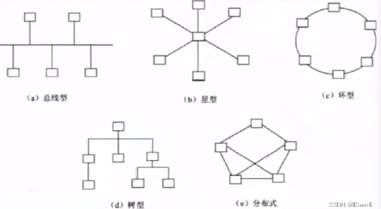

## ==OSI/RM参考模型==

<table class="os-table">
    <thead>
        <tr>
            <th style="width: 10%;">层次</th>
            <th style="width: 15%;">名称</th>
            <th style="width: 30%;">主要功能</th>
            <th style="width: 45%;">主要设备及协议</th>
        </tr>
    </thead>
    <tbody>
        <tr>
            <td>7</td>
            <td><strong>应用层</strong></td>
            <td>实现具体的应用功能</td>
            <td rowspan="3">POP3、FTP、HTTP、Telnet、SMTP DHCP、TFTP、SNMP、DNS</td>
        </tr>
        <tr>
            <td>6</td>
            <td><strong>表示层</strong></td>
            <td>数据的格式与表达、加密、压缩</td>
        </tr>
        <tr>
            <td>5</td>
            <td><strong>会话层</strong></td>
            <td>建立、管理和终止会话</td>
        </tr>
        <tr>
            <td>4</td>
            <td><strong>传输层</strong></td>
            <td>端到端的连接</td>
            <td>TCP、UDP</td>
        </tr>
        <tr>
            <td>3</td>
            <td><strong>网络层</strong></td>
            <td>分组传输和路由选择</td>
            <td>三层交换机、路由器 ARP、RARP、IP、ICMP、IGMP</td>
        </tr>
        <tr>
            <td>2</td>
            <td><strong>数据链路层</strong></td>
            <td>传送以帧为单位的信息</td>
            <td>网桥、交换机（多端口网桥）、以太网交换机、网卡 PPTP、L2TP、SLIP、PPP</td>
        </tr>
        <tr>
            <td>1</td>
            <td><strong>物理层</strong></td>
            <td>二进制传输</td>
            <td>中继器、集线器（多端口中继器）</td>
        </tr>
    </tbody>
</table>

- OSI / RM (ISO/OSI) 七层模型（从下到上）：

  - 物理层： `二进制数据传输`，`物理链路和物理特性`相关

    > 物理层：`比特流、电压、接口、集线器、网线、光纤、“信号传输”、“物理介质”`
    >
    > `中继器用来信号放大还原，所有的端口都在同一个冲突域`

  - 数据链路层：`将数据封装成帧进行传送，准确传送至局域网内的物理主机上`

    > 数据链路层的核心职责之一是在`物理线路上提供可靠的数据传输服务`
    >
    > 数据链路层：`MAC地址、帧、交换、VLAN、“物理寻址”、“帧同步”、交换机、网桥、802.1Q`
    >
    > MAC地址由制造商在生产时分配，前24位为厂商代码，后24位为设备序列号，确保全球唯一
    >
    > `多端口网桥多个端口在同一个网络(一个广播域)`
    >
    > `交换机的一个接口对应一个冲突域`
    >
    > `帧头和帧尾包含MAC地址`
    >
    > `交换机通过识别帧中的目的MAC地址，将数据帧准确地转发到目标端口`
    >
    > `帧是数据链路层的数据单元`
    >
    > **以太网交换机**

  - 网络层： `数据分组传输和路由选择，能准确的将数据传送至互联网的网络主机上`
  
    > `分组里面有IP地址和端口信息`
    >
    > 网络层：`IP地址、路由、寻址、路由器、IP、ICMP“负责路径选择”、“逻辑地址”`
    >
    > `路由器1个端口连接不同网络，1个接口1个广播域，接口与接口之间对应不同冲突域`
    >
    > `IP地址 属于网络层，用于路由选择`

  - 传输层： 端到端的连接，传送数据至主机端口上

    > 传输层：`防火墙（部分）、TCP、UDP端口、可靠传输、“端到端”、“流量控制”`

  - 会话层：`管理主机之间的会话，提供会话管理服务`（建立、维护和结束会话）

  - 表示层：提供解释所交换信息含义的服务，`包括数据之间的格式转换、压缩、加密等操作，对数据进行处理`
  
  - 应用层： 实现具体的应用功能。`直接进程间的通信`

## 网络互连硬件

- ==物理层==： `中继器`（扩大信号）、`集线器Hub` （多路中继器）

  > 集线器工作在物理层，仅负责信号的放大与转发

- ==数据链路层==：` 网桥`（分析帧地址）、`交换机`（多口网桥，MAC地址表）

  > 三层交换机具备路由功能，能根据第三层协议（如IP地址）进行转发决策，但它并非只能根据第三层协议交换。它同样支持基于第二层MAC地址的交换，是二层交换与三层路由功能的结合体

- ==网络层==： `路由器`（连接多个逻辑上分开的网络，路由选择)

- ==应用层==：` 网关`（连接不同类型且协议差别较大的网络，协议转换）

- ==传输介质==：

  - `有线介质`：双绞线(最大长度100m，每端需要一个RJ45插件）、同轴电缆、光纤
  - `无线介质`：微波、红外线和激光、卫星通信

- 组建网络：服务器、客户端、网络设备、通信介质、网络软件

## 检测冲突的层次

- ==物理层==（第1层）
  - ==CSMA/CD机制==：载波监听多路访问/冲突检测，是物理层的重要功能
  - ==载波监听==：发送前先检测信道是否空闲
  - ==冲突检测==：在发送过程中持续监测信道，检测是否有冲突发生
  - ==信号监测==：通过监测电压变化等方式检测冲突
- ==数据链路层==（第2层）
  - ==MAC子层==：介质访问控制子层负责冲突检测机制的实现
  - ==CSMA/CD协议==：在数据链路层实现具体的冲突检测算法
  - ==退避算法==：检测到冲突后执行二进制指数退避算法

## 隔离冲突的层次

- ==物理层设备==
  - 集线器（Hub）：不隔离冲突域，所有端口处于同一个冲突域
  - 中继器：不隔离冲突域，只是放大信号
- ==数据链路层设备==
  - 交换机（Switch）：每个端口都是独立的冲突域，有效隔离冲突
  - 网桥（Bridge）：可以分割冲突域，隔离冲突
- ==冲突域的概念==
  - 冲突域：网络中可能发生数据冲突的区域
  - 集线器环境：所有连接到集线器的设备处于同一个

| 设备类型        | 工作层次   | 是否隔离广播域  | 是否隔离冲突域  | 记忆口诀               |
| --------------- | ---------- | --------------- | --------------- | ---------------------- |
| 集线器 (Hub)    | 物理层     | 否              | 否              | 傻瓜设备，全在一个域里 |
| 交换机 (Switch) | 数据链路层 | 否              | 是 (每端口一个) | 隔离冲突，共享广播     |
| 路由器 (Router) | 网络层     | 是 (每端口一个) | 是              | 隔离所有域，网络边界   |

## 网络的协议

- 局域网的协议：
  - IEEE802.3标准以太网（CSMA/CD），速度为10Mbps，传输介质为`同轴电缆`
  - IEEE802.3u为快速以太网，速度为100Mbps，传输介质为`双绞线`
  - IEEE802.3z为千兆以太网，速度为1000Mbps，传输介质为`光纤或双绞线`
  - IEEE802.4令牌总线网
  - IEEE802.5令牌环网
- 无线局域网协议：CSMA/CA（载波侦听多路访问方法）
- ==广域网的协议==：
  - 点对点协议PPP（拨号上网）
  - 数字用户线xDSL (ADSL上传网速和下载网速不对等，下载网速一般很快）
  - 数字专线DDN（市内或长途的数据电路）
  - 帧中继（以帧为传输单位）

> - 帧中继（FrameRelay，FR）是为克服X.25交换网的缺陷、提高传输性能而发展起来的`高速分组交换`技术。
> - 帧中继网络`不进行差错和流量控制`，并且`通过流水方式进行交换`，所以`比X25网络的通信开销更少`，`传输速度更快`。
> - 帧中继`提供面向连接的虚电路DLCI服务`，因而`比DDN专线更能提高通信线路利用率`，用户负担的`通信费用也更低廉`。
> - 在帧中继网中，用户的信息速率可以在一定的范围内变化，从而`既可以适应流式业务`，又可以`适应突发式业务`，这`使得帧中继成为远程传输的理想形式`。
> - 异步传输模式（ATM）是为`高速、面向连接的广域网设计`的，核心特点是`把数据切割成固定长度（53字节）的“信元”进行传输`，并采用异步时分复用技术，支持高达数Gbps的数据速率，而帧中继通常最高支持2Mbps（在T1/E1速率下），远低于ATM的能力。因此，帧中继不能比ATM提供更高的数据速率
> - ATM 交换机就是基于 ATM（异步传输模式） 技术工作的网络交换设备。实现异步传输模式的硬件设备。它的作用就是接收这些信元，根据信元头部的标识（VPI/VCI），快速地将它们转发到正确的目的地。
> - 码分复用：可以在相同时间、相同频率上同时传输，接收端通过相关码来区分不同用户
> - 频分复用：不同用户使用不同频率，时间可以相同
> - 时分复用：不同用户使用不同时间片、但频率相同
> - 波分复用：主要用于光纤通信，本质是光的频分复用

> 在ADSL接入Internet的场景中，用户端需要安装**PPPoE协议**。这是因为ADSL虽然通过电话线传输数据，但用户设备（如电脑或路由器）通常通过以太网接口（RJ-45）连接，而PPPoE（Point-to-Point Protocol over Ethernet）正是为在以太网上运行PPP协议而设计的。它负责用户认证、IP地址分配以及建立虚拟拨号连接，是ADSL宽带接入中最核心、最广泛使用的协议。
>
> 虽然PPP协议本身也用于拨号上网，但它适用于传统的串行线路（如调制解调器拨号），而ADSL属于宽带接入，其物理层和链路层结构不同，因此需要PPPoE来适配以太网环境并实现PPP功能。
>
> SLIP和PPTP均不适用于ADSL接入：SLIP是早期串行线路协议，已逐渐被淘汰；PPTP主要用于虚拟专用网（VPN），与ADSL拨号接入无关。

## TCP/IP 协议族

- 特性：
  - 逻辑编址（网卡-物理地址，Internet-逻辑地址）
  - 路由选择（定义路由器如何选择网络路径)
  - 域名解析（域名解析为IP地址）
  - 错误检测和流量控制（可靠性、防止拥塞)

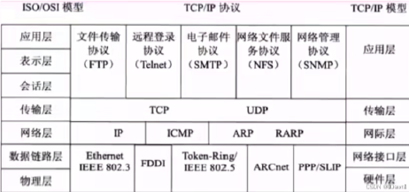

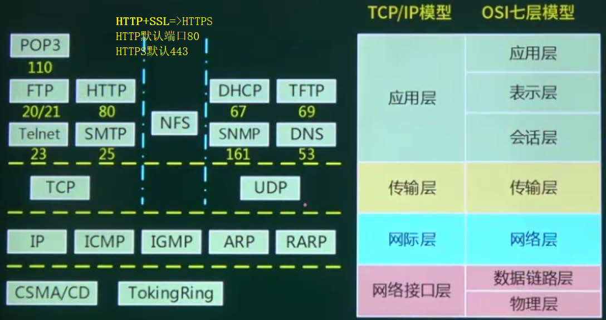

> TCP 是面向`字节流`的协议
>
> 赫兹：这是频率的单位，与数据传输的序号完全无关
>
> 比特：这是物理层传输的最小单位
>
> 报文：`TCP 传输的数据块通常称为“报文段”`
>
> 注意带有安全两个字，要加S；
>
> FTP文件共享是可靠但不安全的方式；
>
> TFTP文件共享是不可靠且不安全的；
>
> ICMP是Internet控制报文协议，与文件传输功能无关；
>
> SSH文件传输协议，安全文件传送协议；
>
> SFTP是一数据流连接，提供文件访问、传输和管理功能的网络传输协议，涉及文件安全传输
>
> RFB 负责底层的图形化远程桌面，远程访问图形用户界面

## TCP/IP分层模型：

- 应用层：具体应用功能

  > TLS 是传输层安全协议，用于在应用层与传输层之间建立加密通道

- ==传输层==：`提供应用程序间端到端的通信`

- ==网际层==：`又称IP层，处理机器间的通信，数据以分组为单位`

  > ==IPSec==是专门设计用于在` IP 层对数据报文`进行加密和认证的安全协议框架

- ==网络接口层==：`又称为数据链路层，负责接收IP数据报，并把数据报通过选定的网络发送出去`

> P2P 是一种网络架构模型，本身不提供加密功能；
>
> 在IP数据报加密的上下文中，**IPSec** 是专为IP层设计的安全协议套件，其核心功能之一就是对IP数据报进行加密。IPSec包含两个主要协议：**AH（鉴别首部协议）** 和 **ESP（封装安全载荷协议）**。其中，**ESP协议提供数据加密服务**，而AH仅提供鉴别和完整性校验，不提供加密。
>
> - **PP2P** 是点对点协议，主要用于拨号或专线连接，不涉及IP数据报加密。
> - **HTTPS** 是应用层安全协议，基于HTTP + SSL/TLS，用于加密Web通信，不直接作用于IP数据报。
> - **TLS** 是传输层安全协议，用于加密TCP连接（如HTTPS、SMTPS等），也不直接加密IP数据报本身。
>
> 因此，**IPSec** 是专门用于对IP数据报进行加密的协议，尤其在**隧道模式**下，它会对整个原始IP数据报（包括IP首部）进行加密封装，实现端到端的安全传输。

## 网际层协议:

- IP ：最重要核心的协议， 无连接、不可靠

- ICMP ：因特网控制信息协议，用来检测网络通信是否顺畅

  > - I G M P “ 频道订阅” 系统。在没有I G M P 时， 组播数据就像广播一样发送给网络中的所有设备， 造成带宽浪费。而有了I G M P ， 路由器就能知道哪些设备“ 订阅” 了哪个“ 频道”
  >
  > - ICMP 则负责报告传输过程中的问题和状态

- ARP和RARP：地址解析协议

  - ARP【Address Resolution Protocol】 ：将IP地址转换为物理地址

  - RARP 【Reverse Address Resolution Protocol】：将物理地址转换为IP地址

    > ARP Request：广播传输，因为发送方不知道目标MAC地址，需向整个局域网广播请求。
    > ARP Response：单播传输，因为响应方已知请求方的MAC地址，可直接定向回复。
    >
    > ARP 和 ICMP 是网络层协议，X.25 是数据链路层协议，只有 SNMP 是应用层协议。
    > SNMP 协议的报文是封装在 UDP 协议中传送。

## 传输层协议：

- UDP协议： 不可靠连接，因为数据传输只管发送，不用对方确认，因此可能会有丢包现象。一般用于视频、音频数据传输

  > 比如volp就是网络电话

- TCP协议： 可靠连接，因为有验证机制,每发送一个数据包，都要求对方回复确认；初始建立连接，有三次握手机制，即A发送连接信息给B(SEQ=X)，B收到后回复确认帧(SEQ=Y，ACK=X+1)，A收到确认帧后冉发送确认(SEQ=X+1，ACK=Y+1)，才能建立连接（上述SEQ表示本机发送的数据包序号，A和B之间的SEQ分别计数，而ACK为确认帧，ACK=X+1表示已经收到了A机发送的第X个数据包，期望下一个收到第X+1个数据包）

  > - TCP和UDP都是基于IP协议的
  >
  > - 三次握手核心目的：确认双方的发送和接收能力均正常。
  >   1. 第一次握手(客户端发):请求建立连接。 (服务器确认：客户端"发"正常，自己"收"正常)
  >   2. 第二次握手(服务器回):同意连接，并请求确认。(客户端确认:服务器"发"和"收"都正常)
  >   3. 第三次握手(客户端回):确认收到同意，连接正式建立。 (服务器确认：自己"发"正常，客户端"收"正常)

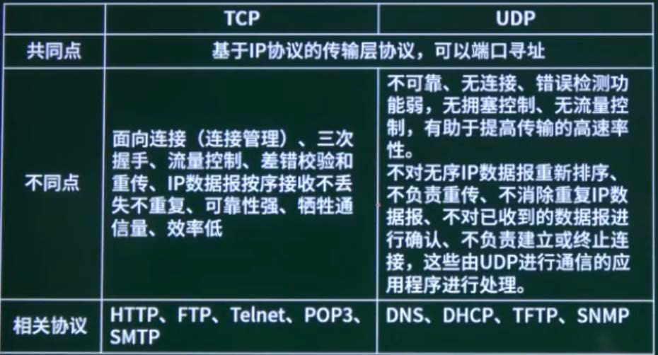

## 应用层协议：

- 基于TCP 的FTP、HTTP等都是可靠传输。基于UDP 的DHCP、DNS等都是不可靠传输

  - FTP：可靠的文件传输协议

  - HTTP：超文本传输协议，用于上网。使用SSL加密后的安全网页协议为HTTPS

    > HTTP是`WWW服务器与客户机`之间传输网页内容的标准协议。
    >
    > HTTPS是HTTP的安全版本，用于加密通信。
    >
    > **HTTPS** 是 HTTP 与 SSL/TLS 的结合，用于在`浏览器与服务器`之间建立安全通信，防止数据被窃听或篡改。
    >
    > HTML是超文本标记语言，用于编写网页内容，不是传输协议。
    >
    > 在PKI体系中，SSL/TLS协议用于实现HTTPS安全通信。在浏览器与服务器之间建立安全连接时，首先通过**非对称加密**（公钥加密）协商一个**会话密钥**，该密钥随后用于**对称加密**来加密实际的HTTP消息内容

  - SMTP和POP3：邮件传输协议，邮件报文采用ASCII格式表示
  
    > SMTP发送邮件【客户端->服务器】，POP3接受邮件【浏览器下载到本地】，IMAP4接收和管理【多端管理】
    >
    > SMTP 协议：
    >
    > - 主要用于发送邮件，默认情况下，SMTP 传输的内容是**明文**的（除非配置了 SSL/TLS 等加密通道，但协议本身不强制）
    > - 它只负责传输，不涉及对邮件内容的加密。
    >
    > 在电子邮件系统中，客户端向服务器发送邮件的过程依赖于特定的协议。根据电子邮件协议体系，**SMTP（Simple Mail Transfer Protocol）** 是专门用于**发送邮件**的协议，它定义了邮件从客户端传输到邮件服务器，以及服务器之间转发邮件的规则。
    >
    > 而 **POP3（Post Office Protocol version 3）** 和 **IMAP4（Internet Message Access Protocol version 4）** 是用于**接收和管理邮件**的协议，它们允许用户从服务器下载或同步邮件到本地客户端。
    >
    > **MIME（Multipurpose Internet Mail Extensions）** 是一种扩展协议，用于支持非文本内容（如图片、音频、附件等）在电子邮件中的传输，但它本身不负责邮件的发送或接收。
    >
    > 在电子邮件系统中，POP3（邮局协议第3版）是用于接收邮件的协议。该协议依赖于**TCP**（传输控制协议）作为其传输层协议，因为TCP提供面向连接、可靠的数据传输服务，这对于确保邮件完整、有序地传输至关重要。
    >
    > POP3服务器默认监听**TCP端口110**，客户端通过向该端口发起TCP连接来与服务器通信，从而下载或管理邮件。虽然存在加密版本POP3S（使用端口995），但题目中未提及加密，因此应使用标准端口110。
  
  - Telnet：远程连接协议
  
    > Telnet协议是**基于TCP协议**的远程登录协议，它运行在应用层，通过TCP端口23进行通信，采用客户机/服务器模式。虽然它提供远程终端仿真功能，但其传输过程是**明文**的，因此**不安全**，不建议在现代网络环境中使用，推荐使用SSH替代。
  
  - TFTP：不可靠的小文件传输协议
  
  - SNMP：简单网络管理协议，必须以管理员的身份登录才能完成配置
  
  - DHCP：动态分配IP地址协议，客户机/服务器模型，租约默认为8天，当租约过半时，客户机需要向DHCP服务器申请续租，当租约超过87.5%时，如果仍然没有和当初提供IP地址的DHCP服务器联系上，则开始联系其他DHCP服务器
  
    > 当主机通过DHCP动态申请IP地址时，若未收到DHCP服务器的响应（如服务器不可用、网络中断或无可用地址池），操作系统会自动为其分配一个**链路本地地址**（Link-Local Address），也称为**APIPA地址**（Automatic Private IP Addressing）。
    >
    > 根据标准协议（RFC 3927），该自动分配的IP地址属于 **169.254.0.0/16** 网段，即从 169.254.0.1 到 169.254.255.254 的范围。该地址仅用于本地网络通信，无法路由到其他网络。
  
  - DNS：域名解析协议，将域名解析为IP地址【也就是网址转IP】
  
    > > #### 1. 浏览器输入域名（客户端流程）
    > >
    > > > **本地 DNS 缓存** →→ **本地 Hosts 文件** →→ **本地 DNS 服务器** →→ 根域名服务器 →→ 顶级域名服务器 →→ 权限域名服务器
    > >
    > > #### 2. 主域名服务器收到请求（服务器端流程）
    > >
    > > > **区域数据配置文件**（自己的管辖记录） →→ **本地缓存** →→ 根域名服务器...
    > >
    > > - *解释：服务器首先看自己是不是这个域名的“老板”（查配置文件），如果是直接返回；如果不是，再看以前有没有帮别人查过（查缓存）；最后才去问别人。*
    > >
    > > #### 3. 补充说明（防坑指南）
    > >
    > > - **Hosts 文件**：只存在于**客户端**（你的电脑），服务器端没有这个概念
    >
    > DNS循环是实现DNS负载均衡最常用的技术。它的原理是：当一个域名对应多个IP地址时，DNS服务器在响应客户端的查询请求时，会按照顺序轮流返回这些IP地址。来自不同客户端的请求就会被分散到不同的服务器上，从而达到负载均衡的目的。
    >
    > 转发器的作用是将DNS服务器无法解析的请求转发给其他指定的DNS服务器，而不是直接指向Web服务器
  
  > POP3：110端口，邮件收取 
  >
  > SMTP：25端口，邮件发送 
  >
  > > SMTP协议是简单邮件传输协议，其核心特性之一是仅支持7位ASCII码的文本传输。但是现在通过MIME协议扩展了功能，可以传输非ASCII字符、图片视频等，但还是编码为ASCII
  > >
  > > SMTP 协议：
  > >
  > > - 主要用于发送邮件，默认情况下，SMTP 传输的内容是**明文**的（除非配置了 SSL/TLS 等加密通道，但协议本身不强制）。
  > > - 它只负责传输，不涉及对邮件内容的加密。
  > >
  > > MIME 协议：
  > >
  > > - 扩展了 SMTP，支持非 ASCII 字符、附件（如图片、文档等）的发送。
  > > - MIME 只是对邮件内容进行了编码（如 Base64 编码），使其能够通过 SMTP 传输，但这种编码**不是加密**，任何人都可以解码还原。
  >
  > FTP：20数据端口/21控制端口，文件传输协议 
  >
  > HTTP：80端口，超文本传输协议，网页传输 
  >
  > > HTTPS协议是以安全为目标的HTTP通道，HTTPS是HTTP的安全版，使用SSL和TLS加密协议做加密传输。
  > >
  > > 不同于HTTP协议使用TCP80端口，HTTPS 使用TCP端口443。
  > >
  > > 对于电子支付类高安全性网站应使用HTTPS协议而不是HTTP协议。
  > >
  > > > 我们逐项分析每个步骤：
  > > >
  > > > 1. **在浏览器中输入URL，并按下回车键** —— 这是整个过程的起点，用户发起访问请求。
  > > > 2. **浏览器向DNS服务器发出域名解析请求并获得结果** —— 浏览器需要将域名（如http://www.example.com）转换为IP地址，这是后续建立连接的前提。
  > > > 3. **根据目的IP地址和端口号，与服务器建立TCP连接** —— 使用DNS解析得到的IP地址和HTTP默认端口（80）发起TCP三次握手。
  > > > 4. **浏览器向服务器发送数据请求** —— TCP连接建立后，浏览器发送HTTP GET请求，请求特定资源。
  > > > 5. **服务器将网页数据发送给浏览器** —— 服务器处理请求，返回HTML等响应数据。
  > > > 6. **浏览器解析收到的数据并显示** —— 浏览器渲染HTML，呈现给用户。
  > > > 7. **通信完成，断开TCP连接** —— 数据传输完毕，释放TCP连接。
  >
  > DHCP：67端口，IP地址自动分配 
  >
  > SNMP：161端口，简单网络管理协议
  >
  > DNS：53端口，域名解析协议，记录域名与IP的映射关系 
  >
  > TCP：可靠的传输层协议 
  >
  > UDP：不可靠的传输层协议 
  >
  > > TCP和UDP协议均属于传输层协议，其核心功能之一是为应用层进程提供**端口寻址**能力。两者均使用**16位端口号**来标识主机上的不同应用进程，从而实现多路复用和分用，确保数据能正确交付到目标进程。
  > >
  > > - **连接管理**是TCP独有的特性，通过三次握手建立连接、四次挥手断开连接；UDP是无连接协议，不涉及连接管理。
  > > - **差错校验和重传**：TCP提供可靠的差错重传机制（如确认应答、超时重传），而UDP仅提供简单的差错校验（校验和），若发现错误则直接丢弃，**不提供重传**。
  > > - **流量控制**是TCP的特性，用于调节发送速率以匹配接收方处理能力；UDP**不提供流量控制**。
  >
  > ICMP：因特网控制协议PING命令来自该协议 
  >
  > IGMP：组播协议 
  >
  > ARP：地址解析协议，IP地址转换为MAC地址 
  >
  > RARP：反向地址解析协议，MAC地址转IP地址
  
  > 1、ping:用于检查网络是否连通；
  > 2、tracert(linux:traceroute）:用于确定IP数据包访问目标所采取的路径，若网络不通，能定位到具体哪个结点不通；traceroute可以利用ICMP协议定位到一台计算机与另一台计算机之间的所有路径。
  > 3、ipconfig(linux: ifconfig)：仅显示简要的网络配置信息，如IP地址、子网掩码和默认网关，**不包含DHCP启用状态**。
  > 4、nslookup(查询DNS 记录)，用于查询DNS域名与IP地址的映射关系
  > 5、netstat：用于显示网络连接、路由表和网络接口信息；显示当前活动的TCP/IP网络连接、监听端口、进程ID（PID）及对应的程序名称，是排查端口占用、服务监听状态和潜在安全风险；用于显示协议统计信息和当前TCP/IP网络连接。
  > 6、telnet：用于远程登录到其他主机
  > 7、ipconfig/renew：该命令用于从DHCP服务器重新获取IP地址配置，与DNS缓存无关。
  > 8、ipconfig/flushdns：这是专门用于刷新或清空本地DNS解析器缓存的命令，强制系统清除已缓存的DNS记录，从解决因缓存错误导致的域名解析失败问题。
  > 9、netstat -r：用于显示本地路由表，与DNS缓存无关
  > 10、arp -a：用于显示本地ARP缓存表，即IP地址与MAC地址的映射关系，不涉及DNS解析
  > 11、ipconfig/release：用于释放当前通过DHCP自动获取的IP地址，使网卡暂时失去网络连接
  > 12、ipconfig/displaydns：用于显示当前本地DNS缓存的内容，包括从hosts文件加载的记录以及最近解析过的域名映射
  > 13、ipconfig/registerdns：用于刷新DNS注册信息，使客户端向DNS服务器重新注册其主机名和IP地址
  >
  > 14、ipconfig /all命令。该命令会显示本机所有网络接口的完整配置信息，包括IP地址、子网掩码、默认网关、DNS服务器地址，以及DHCP是否已启用和DHCP服务器的IP地址等关键信息
  >
  > 15、无效id：windows（169.254.x.x）、linux（0.0.0.0）
  >
  > 16、chmod：Linux修改文件权限设置的核心命令
  >
  > 17、attrib：Windows 系统中的命令，用于修改文件属性（如只读、隐藏），不适用于 Linux
  
  > 题目描述了一个特定的网络故障现象：
  >
  > - **现象 1**：无法打开任意网页。
  > - **现象 2**：互联网即时聊天软件使用正常。
  >
  > - **A. IP 地址配置错误** 如果 IP 地址配置错误（例如 IP 地址冲突、子网掩码错误或缺少默认网关等），通常会导致主机无法正常访问网络。既然即时聊天软件能正常使用，说明主机的 IP 配置基本是正确的，能够与服务器建立连接。因此，A 选项不符合。
  > - **B. DNS 配置错误** 网页通常是通过域名（如 `www.example.com`）来访问的，而即时聊天软件（如微信、QQ 等）在配置时往往直接使用服务器的 IP 地址，或者软件内部已经缓存了服务器地址，对实时 DNS 解析的依赖较小。 如果 DNS 配置错误，电脑将无法把网页的域名解析为正确的 IP 地址，从而导致无法通过域名访问网页。但此时，只要 IP 连通性正常，不依赖域名解析的即时聊天软件依然可以正常工作。这与题目描述的现象完全吻合。
  > - **C. 网卡故障** 如果网卡出现故障（例如驱动异常、硬件损坏），主机将无法连接网络，即时聊天软件自然也无法使用。这与“聊天软件使用正常”矛盾，因此 C 选项不符合。
  > - **D. 链路故障** 链路故障（如网线断开、交换机端口故障等）同样会导致整个网络中断，即时聊天软件不可能正常。因此，D 选项也不符合。
  
  > 在URL结构中，主机名（或称主机域名）是位于协议（如http://）之后、路径之前的部分，用于标识要访问的服务器。对于给定的URL“xxyftp.abc.can.cn”，其中`“xxyftp”是主机名，而“abc.can.cn”是域名部分（其中“cn”是顶级域名，“can”是二级域名，“abc”是三级域名`）。

## 路由选择策略

- ==静态路由选择==（不能根据网络流量和拓扑结构的变化来调整自身的路由表，也就不能找出最佳路由）:
  - ==固定式路由选择==：每个网络节点存储一张表格，表格中每一项记录着对应某个目的节点的下一节点或链路，当一个分组到达某节点时，该节点只要根据分组上的地址信息，便可从固定的路由表中查出对应的目的节点及所应选择的下一节点
  - ==洪泛式路由选择==：又叫扩散法，一个分组由源站发送到与其相邻的所有节点，最先到达目的节点的一个或若干个分组肯定经过了最短的路径，其主要应用在诸如军事网络等强壮性要求很高的场合
  - ==随机路由选择==：一个分组只在与其相邻的节点中随机的选择一条转发
- ==动态路由选择==（节点的路由选择要依靠网络当前的状态信息来决定。这种策略能较好地适应网络流量、拓扑结构的变化，有利于改善网络的性能。但由于算法复杂，会增加网络的负担）:
  - ==分布式路由选择==：基本算法有距离向量算法（各节点周期性地向所有相邻节点发送路由刷新报文)和链路状态算法（各节点独立计算最短通路、能够快速适应网络变化、交换的路由信息少，复杂难以实现）
  - ==集中式路由选择==。由网络控制中心（NCC）负责全网状态信息的收集、路由计算及最佳路由的实现。最简单的方法是将最新路由定期发送到网络中各节点上去
  - ==混合式动态路由选择==：将分布路由选择与集中路由选择、以及其它路由选择方法混合使

> “路由协议是一种允许数据包在主机之间传送信息的协议”是错误的这是网络层协议（如IP协议）的功能，它定义了数据包的格式和寻址方式，负责将数据包从源主机传送到目标主机。
>
> 而路由协议的作用是指导路由器如何选择路径，它本身不直接传输用户数据，而是为IP数据包提供路径选择服。
>
> 当路由器从多个不同的路由协议学习到关于同一目标的多条路由时，其选择最优路由的核心依据是**管理距离。管理距离是衡量路由来源可信度的指标，数值越小，表示该路由来源越可靠。
>
> - **选项A“选择与自己路由协议相同的”**：错误。路由器不会仅因为协议相同而优先选择，而是依据管理距离和度量值等标准。
> - **选项B“选择路由费用最小的”**：错误。“费用最小”是度量值（Metric）的比较标准，适用于**同一协议内**多条路径的选择，而非跨协议比较。
> - **选项C“比较各个路由的管理距离”**：**正确**。当路由来自不同协议时，路由器首先比较管理距离，选择AD值最小的路由放入路由表。
> - **选项D“比较各个路由协议的版本”**：错误。路由协议版本不影响路由选择决策，路由器依据的是管理距离和度量值，而非版本信息。
>
> 因此，路由器在接收多个路由协议转发的关于同一目标的多条路由时，其选路策略是**比较各个路由的管理距离**，并选择管理距离最小的路由。

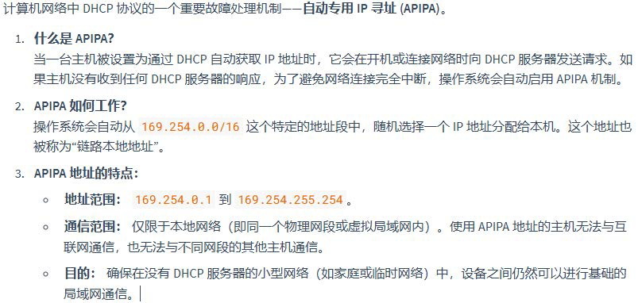

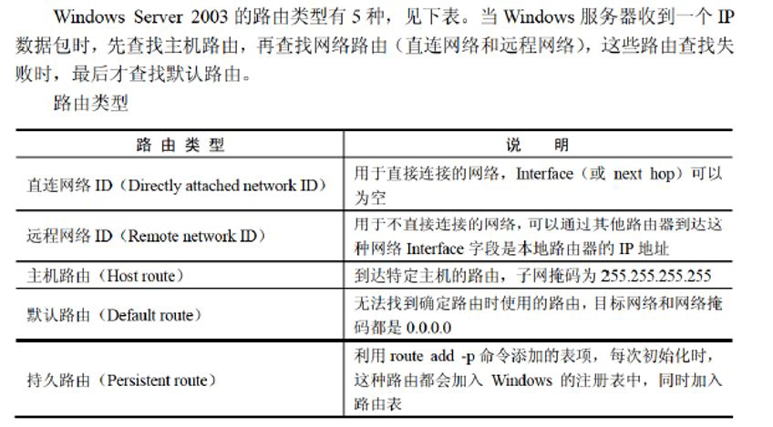

## IP 地址

- IP地址长度为32位（IPv4）或128位（IPv6），MAC地址长度为48位

- 分类地址格式：IP地址分四段，每段八位，共32位二进制数组成

- 在逻辑上，这32位IP地址分为网络号和主机号，依据网络号位数的不同，可以将IP地址分为以下几类：

  > ==IP地址/网络号==后面的网络号表示前面多少位是网络号

  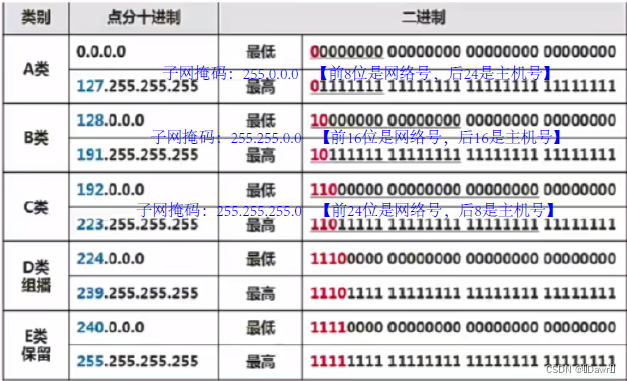

  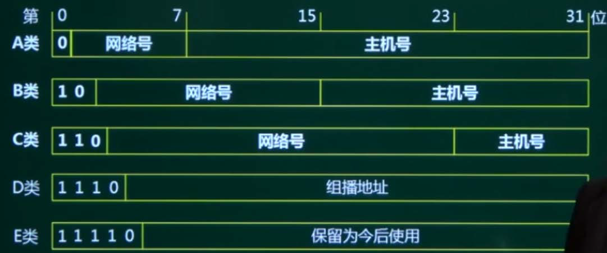

  - A类地址网络号占8位，主机号则为32-8=24位，能分配的主机个数为$2^{24}-2$个（注意： 主机号为全0和全1的不能分配，是特殊地址）
  - B类地址网络号为16位
  - C类地址网络号为24位

- 子网划分：

  - 按上述划分的ABC三类，一般是最常用的，但是却并不实用，因为主机数之间相差的太大了，不利于分配，因此，我们一般采用子网划分的方法来划分网络，即自定义网络号位数，就能自定义主机号位数，就能根据主机个数来划分出最适合的方案,不会造成资源的浪费。因此就有子网的概念，一般的IP地址按标准划分为ABC类后，可以进行再一步的划分，将主机号拿出几位作为子网号，就可以划分出多个子网，此时IP地址组成为网络号 + 子网号 + 主机号
  - 网络号和子网号都为1，主机号都为0，这样的地址为子网掩码
  - 要注意的是： 子网号可以为全0和全1，主机号不能为全0或全1，因此，主机数需要-2，而子网数不用

- 无分类编制：除了上述的分类编址外，还有无分类编址，即不按照ABC类规则，自动规定网络号，无分类编址

  格式为：IP地址/网络号，示例: 128.168.0.11/20表示的IP地址为128.168.0.11，其网络号占20位，因此

  主机号占32-20=12位，也可以划分子网

  > IP 地址：128.168.0.11/20
  > 子网掩码：255.255.240.0
  > 网络地址：128.168.0.0/20

- 特殊含义的IP地址：

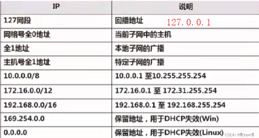

> 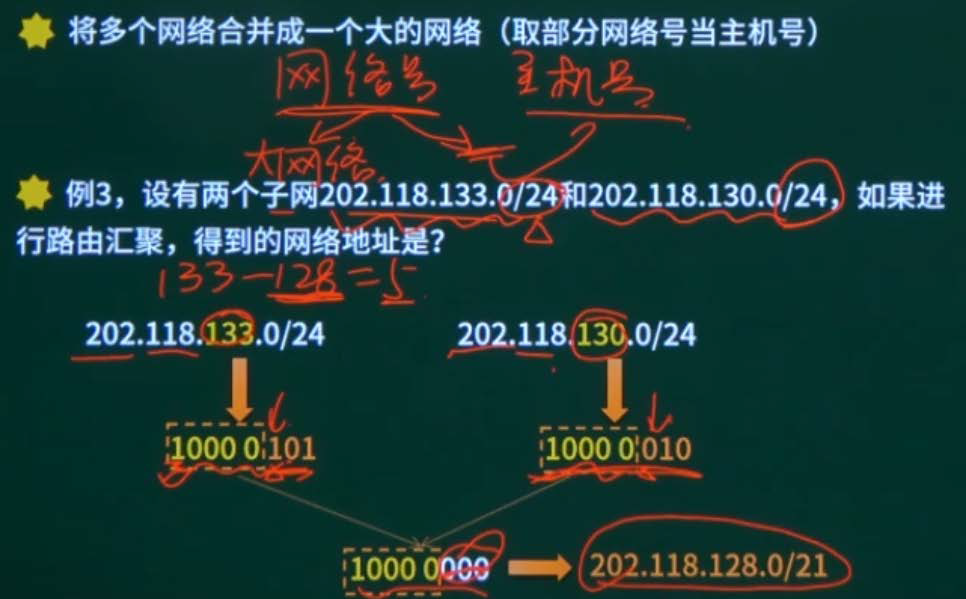
>
> ---
>
> 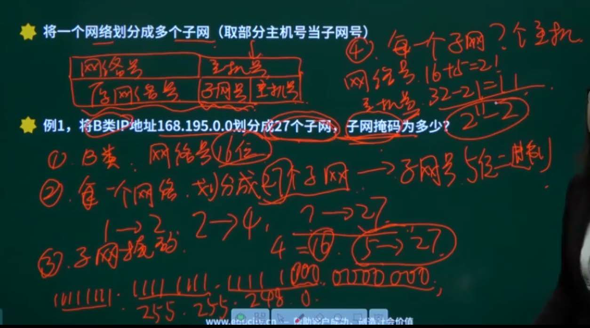
>
> ---
>
> 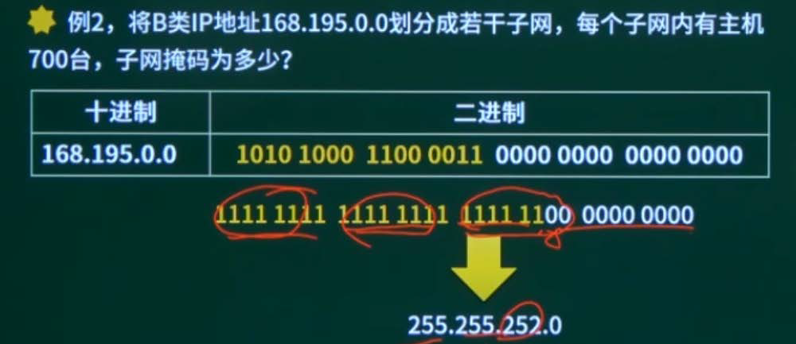
>
> ---
>
> IP地址块222.125.80.128/26
> IP地址块222.125.80.128/26留给主机的地址码只有6位，26-2=62。这些地址都采用222.125.80.10xxxxxx的形式，其中最小的地址是22.125.80.10000001，即222.125.80.129，最大的是222.125.80.10111110，即 222.125.80.190

## IPv6

主要是为了解决IPv4地址数不够用的情况而提出的设计方案，IPv6具有以下特性：

- IPv6地址长度为128位，地址空间增大了$2^{96}$倍
- 灵活的IP报文头部格式，使用一系列固定格式的扩展头部取代了IPv4中可变长度的选项字段。IPv6中选项部分的出现方式也有所变化，使路由器可以简单携过选项而不做任何处理，加快了报文处理速度
- IPv6简化了报文头部格式，加快报文转发，提高了吞吐量提高安全性，身份认证和隐私权是IPv6的关键特性支持更多的服务类型
- 允许协议继续演变，增加新的功能，使之适应未来技术的发展

> 若需使两个IPv6节点通过现有的IPv4网络通信，应使用隧道技术
> 若需使纯IPv6节点与纯IPv4节点相互通信，则必须使用翻译技术
>
> ipv6地址类型：
>
> - 单播：一对一通信
> - 多播：一对多通信（取消广播地址，用多播地址实现广播功能）
> - 任播：一对最近的多播通信

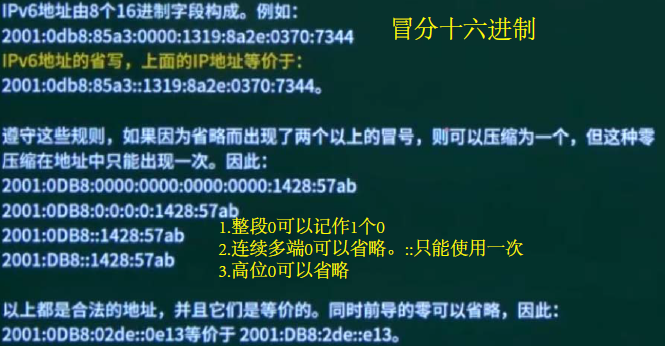

## 补充

### IPv4 地址类型

| 类型     | 通信模式 | 说明                                 |
| -------- | -------- | ------------------------------------ |
| 单播     | 一对一   | 发给一个明确目标，如网页、邮件       |
| 组播     | 一对一组 | 发给加入该组的成员，如IPTV、视频会议 |
| 广播     | 一对全体 | 发给本网段所有设备，不跨网段         |
| 网络地址 | —        | 标识网段本身，不用于发包             |

> 记忆：私聊用单播，群发给特定成员用组播，局域网喊所有人用广播

------

### IPv6 地址类型

| 类型 | 通信模式   | 地址前缀                                                     |
| ---- | ---------- | ------------------------------------------------------------ |
| 单播 | 一对一     | 2000::/3（全球）、FE80::/10（链路本地）、FC00::/7（唯一本地） |
| 组播 | 一对多     | FF00::/8                                                     |
| 任播 | 一对"最近" | 借用单播格式                                                 |

**与 IPv4 的核心区别**：

- IPv6 取消了广播，由组播替代
- IPv6 新增任播，实现就近访问（如DNS、CDN）

> 记忆：IPv6 = 单播（一对一）+ 组播（一对多）+ 任播（一对最近）

## 其他重要应用

1. 层次化网络模型（三层架构）

| 层级       | 核心特点                                       | 记忆口诀 |
| ---------- | ---------------------------------------------- | -------- |
| **核心层** | 功能单一，只负责**高速数据交换**               | 高速转发 |
| **汇聚层** | 功能多样，负责**策略控制**（过滤、寻址、处理） | 策略中转 |
| **接入层** | 功能单一，向本地网段提供**用户接入**           | 用户入口 |

2. NAT（网络地址转换）

- **定义**：将公司内网的大量私有IP，映射到少量可访问因特网的公网IP。
- **核心作用**：**节省公网IP地址**的使用量。

3. 默认网关

- **定义**：主机找不到可用网关时，默认发送数据包的目标网关。
- **硬性要求**：默认网关的IP必须与本机IP在**同一个网段**（同网络号）。

4. 冲突域与广播域（必考设备对比）

| 设备       | 冲突域           | 广播域           |
| ---------- | ---------------- | ---------------- |
| **集线器** | 整体是一个冲突域 | 整体是一个广播域 |
| **交换机** | 可划分多个冲突域 | 整体是一个广播域 |
| **路由器** | 可阻断冲突域     | 可阻断广播域     |

5. ==VLAN（虚拟局域网）==

- **本质**：逻辑上的设备分组，不受物理位置限制。
- **工作层级**：==数据链路层==
- **核心作用**：划分**广播域**，实现二层隔离，减少广播风暴。
- **通信规则**：VLAN间通信必须通过**第3层路由器**完成。
- **优点**：管理开销少、控制广播活动、提高安全性。
- **局限**：**不能隔绝内外网通信**（内外网需三层路由，VLAN不阻止）。

6. VPN（虚拟专用网）

- **定义**：在公用网络（如Internet）上建立的**逻辑专用网络**。
- **核心特点**：无端到端物理链路，数据在逻辑链路中传输。

## 网络规划与设计

- 需求分析：
  - 网络功能要求
  - 网络的性能要求
  - 网络运行环境的要求
  - 网络的可扩充性和可
  - 维护性要求

- 网络规划原则
  - 实用性原则
  - 开放性原则
  - 先进性原则

- 网络设计
  - 与实施原则
  - 可靠性原则
  - 安全性原则
  - 高效性原则
  - 可扩展性原则

- 层次化网络设计
  - 核心层
  - 汇聚层
  - 接入层

## 网络接入技术

- 有线接入：
  - 公用交换电话网络（PSTN）
  - 数字数据网（DDN）
  - 综合业务数字网（ISDN）
  - 非对称数字用户线路（ADSL）【上行和下行速度不一样】
  - 同轴光纤技术(HFC)

- 无线接入：
  - IEEE802.11(WiFi)
  - IEEE 802.15(蓝牙Bluetooth)
  - 红外(IrDA)
  - WAPI

> | 技术类型            | 代表技术/标准             | 典型覆盖范围                | 核心特点与应用场景                                           |
> | ------------------- | ------------------------- | --------------------------- | ------------------------------------------------------------ |
> | WPAN (无线个人域网) | 蓝牙 (802.15.1)           | 2~30米 (最短)               | 短距离、低功耗。用于耳机、鼠标、智能手表等随身设备互联。     |
> |                     | ZigBee (802.15.4)         | 10~100米                    | 比蓝牙稍远，主打低功耗组网，常用于智能家居传感器。           |
> | WLAN (无线局域网)   | Wi-Fi (802.11系列)        | 100~300米                   | 中距离、高带宽。用于家庭、办公室、校园的局域网接入。         |
> | WMAN (无线城域网)   | WiMAX (802.16)            | 2~50公里                    | 远距离。曾被视为“宽带无线接入”，覆盖整个城市区域。           |
> | WWAN (无线广域网)   | 蜂窝通信 (4G/5G) CDMA/GSM | 几公里~全国                 | 超远距离、移动性强。通过基站接力，实现 anywhere 的连接。     |
> |                     | 窄带微波                  | 视距传输 (几公里至几十公里) | 点对点传输。通常用于两个固定点之间的数据中继（如两栋大楼之间）。 |

## 补充

- 建筑物综合布线系统中的园区子系统，其核心功能是连接各个独立的建筑物，实现建筑群内部的语音、数据、图像等信息的传输与互通。它是整个综合布线系统中负责“建筑间”通信的关键部分。

  - 由终端到信息插座之间的连线系统：是工作区子系统，即从终端设备（如电脑、电话）到墙上信息插座之间的连接部分。

  - 楼层接线间到工作区的线缆系统：是水平子系统，即从楼层配线间到工作区信息插座之间的线缆系统。

  - 各楼层设备之间的互连系统：是干线子系统（垂直子系统），即各楼层设备间之间的垂直互连系统。

- ==RIP==：全称是路由信息协议。它是一种典型的内部网关协议，使用跳数作为度量标准，适用于小型网络。
- ==OSPF==：全称是开放最短路径优先。它也是一种广泛使用的内部网关协议，使用链路状态算法，适用于中大型网络。
- ==BGP==：全称是边界网关协议。它是目前互联网上用于连接不同自治系统的标准外部网关协议。它主要负责在不同ISP（互联网服务提供商）之间传递路由信息。
- UDP：全称是用户数据报协议。它工作在传输层（第四层），而不是网络层（第三层），因此它根本不是路由协议。

- **内部网关协议（IGP）**：用于**同一个自治系统（AS）内部**的路由选择，常见协议包括：
  - **RIP**（路由信息协议）
  - **OSPF**（开放最短路径优先）
  - IS-IS、EIGRP 等

- **外部网关协议（EGP）**：用于**不同自治系统之间**交换路由信息，目前最广泛使用的协议是：
  - **BGP**（边界网关协议）
- 在 IE 浏览器中，安全区域共有 4 个。给不同的网站或网络环境划分出的不同“信任等级”
  1.Internet 区域（默认安全级别：中）：访问所有未明确归类到其他区域的公共网站
  2.本地 Intranet 区域（默认安全级别：中低）：企业内部网络中的站点（如内网门户、OA 系统等）
  3.可信站点区域（默认安全级别：中低）：用户手动添加的、认为绝对安全的网站（如银行、政府官网）
  4.受限站点区域（默认安全级别：高）：用户认为可能存在风险的网站（如广告弹窗、可疑链接）

> 题目考察的是 QoS（Quality of Service，服务质量）在网络中的部署位置。QoS 是一种网络机制，用于确保重要业务量不会延迟或丢弃，从而保证网络的高效运行。我们需要明确 QoS 通常部署在哪个网络设备或组件上。
>
> - **A. 网闸** 网闸（Gap）主要用于实现不同安全级别网络之间的安全隔离和数据交换，例如内网与外网之间的物理隔离。`它的主要功能是安全隔离，而不是流量调度或服务质量保障`，因此不是 QoS 的主要部署位置。
> - **B. 防火墙** 防火墙（Firewall）`主要用于控制网络访问，防止非法入侵，实现网络安全防护`。虽然部分高级防火墙具备一定的流量管理功能，但其核心功能是访问控制和安全防护，而非 QoS 的主要载体。
> - **C. 路由器** 路由器（Router）是网络层的核心设备，`负责在不同网络之间转发数据包`。由于`路由器直接处理数据包的转发和流量调度，它可以根据网络流量情况和业务优先级，对数据包进行分类、调度和队列管理等操作，从而保证重要业务量不会延迟或丢弃`。因此，QoS 通常部署在路由器上。
> - **D. IDS** IDS（Intrusion Detection System，入侵检测系统）`主要用于检测网络中的入侵行为，属于安全监控设备`，与 QoS 的功能完全不同。

> 防火墙是用于隔离内部网与外部网的安全设备，其核心功能是对通信数据流进行监控和过滤。题干强调“对应用层的通信数据流进行监控和过滤”，这指向工作在OSI模型**应用层**的防火墙类型。
>
> - **包过滤**：工作在网络层（IP层），仅检查数据包的源/目的IP、端口、协议等头部信息，**无法理解或过滤应用层内容**。
> - **应用级网关**：工作在应用层，能**深入解析应用层协议**（如HTTP、FTP等），对具体应用数据进行过滤、监控和记录，符合题干描述。
> - **数据库**与**WEB**：不属于防火墙类型，是干扰项。

> 在网络安全管理中，加强内防内控的核心目标是**防止内部威胁**，包括非法终端接入、合法终端越权访问、终端安全状态不可控以及员工行为不可审计等问题。
>
> - **① 控制终端接入数量**：此措施主要影响网络的承载能力与性能，属于资源管理范畴，**并非内防内控的核心策略**。内防内控更关注“谁可以接入”“接入后做什么”，而非“接入多少”。
> - **② 终端访问授权，防止合法终端越权访问**：这是内防内控的关键措施，通过权限控制确保终端只能访问其被授权的资源，防止内部人员滥用权限。
> - **③ 加强终端的安全检查与策略管理**：终端是否安装补丁、是否运行安全软件、是否符合安全基线，直接影响内网安全，是内防内控的重要组成部分。
> - **④ 加强员工上网行为管理与违规审计**：员工行为是内部威胁的主要来源，通过审计与行为管控，可有效威慑和发现异常操作，是内防内控的必要手段。

## 网络安全协议

- 物理层主要使用物理手段，隔离、屏蔽物理设备等，其它层都是靠协议来保证传输的安全，具体如下图所示：

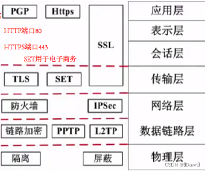

> PGP用于电子邮件加密与签名
>
> TLS（传输层安全协议）是SSL（安全套接层协议）的标准化继承者
>
> HTTPS：是HTTP协议通过SSL/TLS加密后的版本，它依赖TLS/SSL提供安全传输，但本身不是与TLS“最接近”的协议，而是TLS的应用载体
>
> IPSec：工作在网络层，用于保护IP数据包

- SSL协议用于网银交易：
  - 三方面的服务：用户和服务器的合法性验证、加密数据以隐藏被传输的数据、保护数据的完整性
  - 实现过程：接通阶段 — 密码交换阶段（客户端和服务器之间交换双方认可的密码）— 会谈密码阶段
    （客户端和服务器之间产生彼此交谈的会谈密码）― 检验阶段 — 客户认证阶段 ― 结束阶段

- 浏览器和服务器之间用于加密HTTP消息的密钥是会话密钥，而会话密钥本身是通过服务器的公钥加密后传输给服务器的，服务器再用其私钥解密获得会话密钥，之后双方使用会话密钥进行对称加密通信。因此，加密HTTP消息的方式是“会话密钥 + 公钥加密”。

## 信息安全

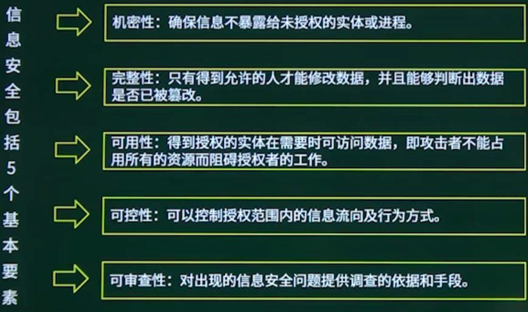

> 信息安全的核心属性包括**保密性**、**完整性**、**可用性**和**不可抵赖性**。题干描述“所有资源只能由授权方或以授权的方式进行修改，即信息未经授权不能进行改变的特性”，这正是**信息完整性**的定义。
>
> - ==**完整性**==：确保信息在存储、传输或处理过程中不被未授权修改、破坏、伪造或丢失。它关注的是数据的**一致性与未被篡改**。
> - ==**保密性**==：防止信息泄露给非授权用户，关注的是“谁能看到”。
> - ==**可用性**==：确保授权用户在需要时能访问和使用信息或资源，关注的是“能否使用”。
> - ==**不可抵赖性**==：确保操作者不能否认其行为，关注的是“责任归属”。

主动攻击&被动攻击

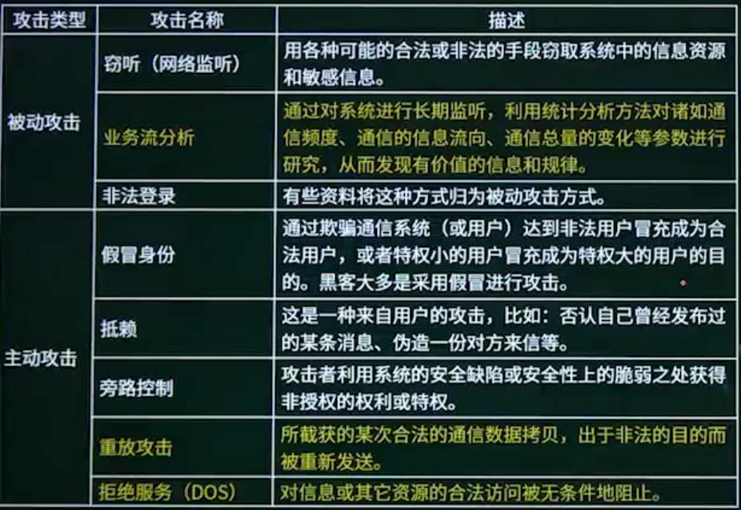

> 设备防雷击属于物理安全范畴，主要防范自然灾害对硬件设备的破坏；
> 入侵检测属于网络安全范畴，用于监控和识别非法访问或攻击行为；
> 流量限制通常用于网络性能管理或带宽控制
> 漏洞发现与补丁管理是典型的系统安全需求措施
>
> > **被动攻击 (Passive Attack)**：
> >
> > - **特点**：攻击者只是**监听、监视、截获**数据传输，**不修改**数据，也**不破坏**系统资源。
> > - **目的**：获取敏感信息（如密码、机密文件）。
> > - **难点**：因为不改变数据流，很难被检测到，只能预防（如加密）。
> > - **典型例子**：**流量分析**、**窃听（会话拦截/嗅探）**。
> >
> > **主动攻击 (Active Attack)**：
> >
> > - **特点**：攻击者会对数据流进行**篡改**、**伪造**，或者对系统资源进行**破坏**。
> > - **目的**：破坏系统的可用性、完整性或真实性。
> > - **典型例子**：**拒绝服务攻击 (DoS)**、**修改消息**、**伪装（Masquerade）**、**重放攻击**。

## 防火墙技术

- 防火墙是在内部网络和外部因特网之间增加的一道安全防护措施，它认为内部网络是安全的，外部网络是不安全的。分为网络级防火墙和应用级防火墙，两级之间的安全手段如下所示：

  - 网络级防火墙，层次低，但是效率高，因为其使用包过滤和状态监测手段，一般只检验网络包外在（起始地址、状态）属性是否异常，若异常，则过滤掉，不与内网通信，因此对应用和用户是透明的。但是这样的问题是，如果遇到伪装的危险数据包就没办法过滤

  - 应用级防火墙，层次高，效率低，因为应用级防火墙会将网络包拆开，具体检查里面的数据是否有问题，会消耗大量时间，造成效率低下，但是安全强度高。包括双宿主主机、屏蔽主机网关、被屏蔽子网等方法。

    - 被屏蔽子网方法，是在内网和外网之间增加了一个屏蔽子网，相当于多了一层网络，称为DMZ （非军事区），这样，内网和外网通信必须多经过一道防火墙，屏蔽子网中一般存放的是邮件服务器、WEB服务器这些内外网数据交互的服务器，可以屏蔽掉一些来自内部的攻击，但是完全来自系统内部服务器的攻击还是无法屏蔽掉

    > 外网：这是安全级别最低的区域。
    > DMZ (非军事化区)：它是一个介于内网和外网之间的缓冲地带
    > 内网：这是安全级别最高的区域

> 包过滤防火墙主要工作在网络层和传输层，其过滤规则通常基于数据包的IP地址、端口号、协议类型等信息。
> 1、源IP地址：用于判断数据包的来源，是防火墙常用的过滤依据。
> 2、目的IP地址：用于判断数据包的目标，也是防火墙规则的重要依据。
> 3、源端口号：用于识别发送方的应用程序端口，防火墙可据此允许或拒绝特定服务。
> 4、MAC地址：属于数据链路层信息，包过滤防火墙通常不检查MAC地址，因为MAC地址在局域网内有效，且在跨网络传输时可能被修改或不可见，防火墙一般不依赖该层信息进行过滤。

> `在出口防火墙上配置ACL(访问控制列表)功能`，可以基于预设规则对网络流量进行过滤，从而阻止外部未授权用户访问内部网络。ACL通过匹配数据包的源IP、目的IP、端口号、协议类型等特征，决定是否允许其通过，是实施访问控制的核心机制。
>
> **SNAT（源地址转换）**`主要用于将内部私有IP转换为公网IP`，`便于内部主机访问外网`，但不直接用于阻止外部访问

> 拖库：先从一个网站窃取数据。
>
> 洗库：对窃取的数据进行整理和变现。
>
> 撞库：撞库攻击是黑客通过收集互联网已泄露的用户和密码信息，生成对应的字典表，尝试批量登录其他网站，以获取更多账户信息。
>
> 社工库：将所有获得的数据汇总，形成一个更强大的攻击工具，用于后续的“撞库”或社会工程学攻击。
>
> 零日漏洞：是指被发现后立即被恶意利用的安全漏洞。它主要利用的是系统尚未修复的未知漏洞进行攻击。
>
> 供应链投毒攻击是指攻击者通过渗透合法的软件开发或分发供应链，将恶意代码注入到正常的软件更新或安装包中。为了实现这一目的，攻击者往往会利用合法的开发流程（如获取合法的代码签名证书），并通过代码混淆、数字证书伪装等手段，使恶意软件看起来像是合法的，从而绕过安全审查和用户警惕
>
> AI 赋能攻击是利用人工智能技术（如机器学习、深度学习等）来增强攻击的效果和效率，例如自动生成钓鱼邮件、智能绕过验证码等。

> 题目描述的是某单位网站首页被恶意篡改，需要部署设备以阻止此类攻击。网页篡改属于**Web应用层攻击**，通常通过注入恶意代码、利用漏洞或绕过权限控制实现。
>
> - **A. 数据库审计**：主要用于记录数据库操作行为，属于事后追溯手段，无法主动阻止攻击。
> - **B. 包过滤防火墙**：工作在**网络层**，主要基于IP、端口、协议等过滤流量，无法识别应用层内容（如SQL注入、网页篡改代码），对Web应用攻击无效。
> - **C. Web应用防火墙**：专为**应用层**设计，可深度检测HTTP/HTTPS请求，识别并拦截SQL注入、XSS、网页篡改、挂马等Web攻击行为，是防护网页篡改的核心设备。
> - **D. 入侵检测系统**：侧重**检测**攻击行为，通常不具备主动阻断能力，无法有效“阻止”攻击。

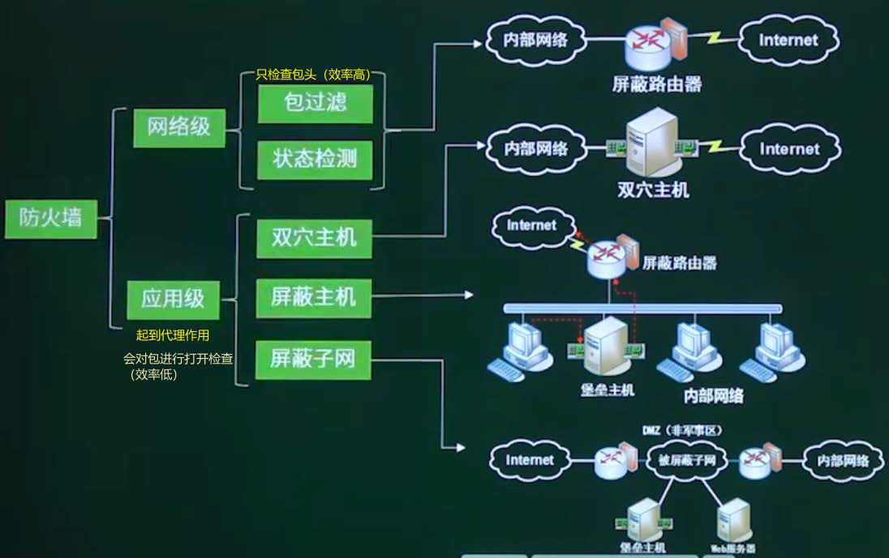

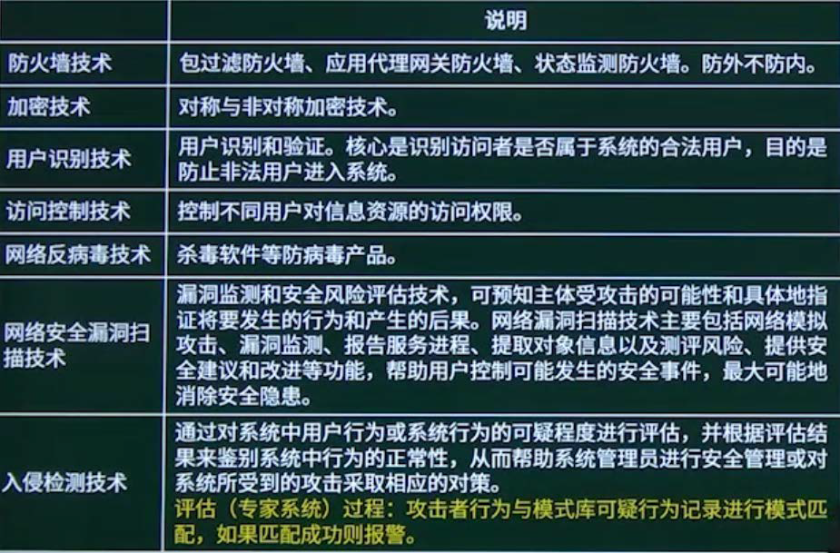

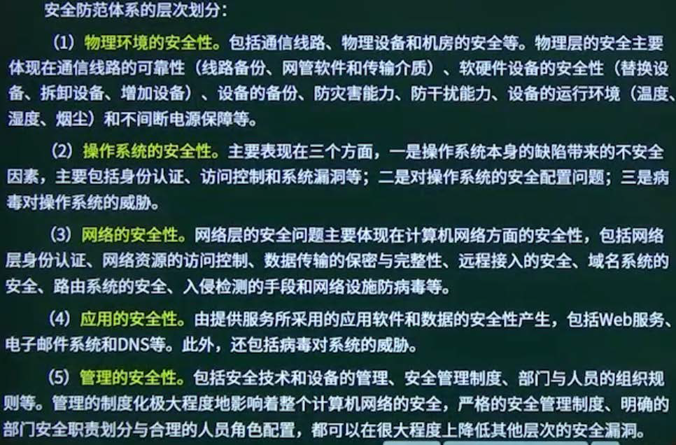

## 计算机病毒和木马

- 病毒：编制或者在计算机程序中插入的破坏计算机功能或者破坏数据，影响计算机使用并且能够自我复制的一组计算机指令或者程序代码
  - 病毒具有：传染性、隐蔽性、潜伏性、破坏性、针对性、衍生性、寄生性、未知性
- 木马：是一种后门程序，场被黑客用作控制远程计算机的工具，隐藏在被控制电脑上的一个小程序监控电脑一切操作并盗取信息
- 病毒和木马种类：系统引导型病毒，文件外壳型病毒，目录型病毒
- 蠕虫病毒（感染EXE文件）：熊猫烧香，罗密欧与朱丽叶，恶鹰，尼姆达，冲击波
- 木马：QQ消息尾巴木马，特洛伊木马，BackOffice、NetbusNetspy、YAI、SubSeven、冰河、“广外女生”
- 宏病毒（感染word、excel等文件中的宏变量)：美丽沙，台湾1号
- CIH病毒：史上唯一破坏硬件的病毒
- 红色代码：蠕虫病毒 + 木马

> - **木马病毒**：通常伪装成合法程序或文件，诱导用户主动下载或执行。其核心功能是**隐蔽控制**，一旦激活，会为用户打开后门，允许攻击者远程操控设备、窃取数据或安装其他恶意程序。木马**不具备自我复制能力**，依赖用户行为传播。
> - **蠕虫病毒**：具有**自我复制和自动传播**能力，无需用户干预，可通过网络漏洞、邮件、共享文件夹、U盘等途径主动扩散。其目标是快速感染尽可能多的系统，部分蠕虫还会携带破坏性载荷（如震网病毒可破坏工业控制系统）。

> - 系统病毒（前缀：Win32、PE、W32，如：KCOM——Win32.KCOM）
> - 蠕虫病毒（如：恶鹰——Worm.BBeagle）
> - 木马病毒、黑客病毒（如：QQ消息尾巴木马——Trojan.QQ3344）
> - 脚本病毒（如：红色代码——Script.Redlof）
> - 宏病毒（如：美丽莎——Macro.Melissa）
> - 后门病毒（如：灰鸽子——Backdoor.Win32.Huigezi）
> - 病毒种植程序病毒（冰河播种者——Dropper.BingHe2.2C）
> - 破坏性程序病毒（杀手命令——Harm.Command.Killer）
> - 玩笑病毒（如：女鬼——Jioke.Grl ghost）
> - 捆绑机病毒（如：捆绑QQ——Binder.QQPass.QQBin）
>
> 1、X卧底病毒是典型的通过木马形式感染智能手机的恶意程序。
> 2、欢乐时光 是一种早期的计算机病毒，主要通过感染可执行文件和网页传播，影响的是传统PC系统
> 3、熊猫烧香 是2007年肆虐国内PC网络的著名蠕虫病毒变种，主要感染Windows系统的可执行文件
> 4、CIH 是历史上首个能直接破坏硬件（如BIOS）的文件型病毒，主要影响PC

| 类型       | 感染目标             |
| ---------- | -------------------- |
| 引导型病毒 | 引导盘               |
| 文件型病毒 | exe文件              |
| 宏病毒     | doc、xls等office文件 |
| 网络型病毒 | 电子邮件             |
| 混合型     | （图片中该栏为空）   |

## 多媒体基本概念

媒体可分为下面五类：

- 感觉媒体：直接作用于人的感觉器官，使人产生直接感觉的媒体。如:视觉、听觅、触觉等
- 表示媒体：指传输感觉媒体的中介媒体，即用于数据交换的编码。如:文字、图形、动画、音频和视频等
- 表现媒体：进行信息输入和信息输出的媒体。如:键盘、鼠标和麦克风;显示器、打印机和音响等
- 存储媒体：存储表示媒体的物理介质。如磁盘、光盘和内存等
- 传输媒体：传输表示媒体的物理介质。如电缆、光纤、双绞线等

## 声音

- 以声音的带宽来衡量声音的大小，单位是HZ。声音是一种模拟信号，要对其进行处理，就必须将其转化为数字信号。转换过程有三个步骤：采样、量化、编码。
- 人耳能听到的音频信号的频率范围是20HZ~20KHZ
- 声音的采样频率一般为最高频率的两倍，才能保证不失真
- 未经压缩的数字音频数据的传输率计算公式为：$数据传输率（bps）= 采样频率（HZ）X 量化位数（bit）×声道数$
- 声音波形经过数字化后所需占用的存储空间计算公式为：$声音信号数据量（Byte）= 数据传输率（bps）×
  持续时间（s）/ 8$
- 数字音乐合成方法
  - 数字调频合成法FM：使高频振荡波的频率按调制信号规律变化的一种调制方式。采用不同调制波频率和调制指数，就可以方便的合成具有不同频谱分布的波形，再现某些乐器的音色。可以采用这种方法得到真肴独特效的"电子模拟声"，创造出丰富多彩的声音，是真实乐器所不具备的音色
  - 波表合成法Wavetable：将各种真实乐器所能发出的所有声音（包括各个音域、声调）录制下来，存贮为一个波表文件。播放时，根据MIDI文件纪录的乐曲信息向波表发出指令，从"表格"中逐一找出对应的声音信息，经过合成、加工后回放出来。合成的音质更好
- ==声音特性：==
  - ==音量==：即响度，表示声音的强弱程度，主要取决于`声波振幅的大小`
  - ==音高==：表示各种声音的高低，主要取决于声波的振动频率，`振动频率越高则音越高`
  - ==音调==：表示声音的调子的高低，由`声音本身的频率决定`
  - ==音色==：又称为音品，`由声音波形的谐波频谱和包络决定`
- 声音文件格式：.wav、.snd、.au、.aif、.voc、.mp3、.ra、.mid等

> 计算机通过MIC（话筒接口）接收到的原始信号是音频模拟信号
> 计算机本身无法直接处理模拟信号，必须通过声卡中的模数转换器（ADC）将模拟信号转换为数字信号
> 转换过程包括三个关键步骤：
> - 采样：按固定时间间隔对模拟信号的幅度进行测量；
> - 量化：将采样得到的幅度值映射到有限的数字级别；
> - 编码：将量化后的数值转换为二进制数字信号，供计算机存储和处理。
> 因此，在未经过数字化处理之前，话筒接口接收到的是音频模拟信号，而非采样信号、量化信号或数字信号
>
> 计算机处理的是数字信号，而模拟视频信号是连续的模拟量，因此计算机要处理模拟视频信号，首要步
> 骤是将其转换为数字信号，即进行A/D变换（模数转换）。
> - A/D变换：将时间连续、幅值连续的模拟信号转换为时间离散、幅值离散的数字信号，是计算机能“理
> 解”和处理模拟视频信号的前提。
> - D/A变换：是数字信号还原为模拟信号的过程，用于播放或输出，属于处理流程的后端。
> - 数据存储：是数字化和压缩完成后的结果
>
> 在FM方式的数字音乐合成器中，变更数字载波频率可以变更乐音的音调，变更它的信号幅度可以变更乐音的音高
>
> 计算机数字音乐合成技术主要有 FM（调频） 和 Wave Table（波表） 两种方式。
> - FM：通过频率调制生成复杂谐波结构，早期广泛用于电子乐器，音色具有金属感，但模拟真实乐器时存在局限
> - Wave Table：基于预录制的真实乐器采样波形，通过波形表切换和插值平滑过渡，能高度还原真实乐器的音色动态与细节

## 图形和图像

- 颜色三要素：
  - 亮度：彩色明暗深浅程度
  - 色调(红、绿)：颜色的类别
  - 饱和度：某一颜色的深浅程度
- 彩色空间：即设备显示图片所使用的色彩空间，普通的电脑显示器是RGB色彩空间，除了红、绿、蓝三原色外，其他颜色都是通过这三原色叠加形成的
  - 电视中使用YUV色彩空间，主要是为了兼容黑白电视，使用的是亮度原理，即调不同的亮度，显示不同的颜色
  - CMY(CMYK)，印刷书籍时采用的色彩空间，这个采用的是和RGB相反的减法原理，浅蓝、粉红、黄三原色的印刷颜料实际上是吸收除了本身色彩之外的其他颜色的，因此，印刷出来才是这些颜色
  - HSV(HSB)，艺术家彩色空间，是从艺术的角度划分的图像的属性：分辨率（每英寸像素点数dpi)、像素深度（存储每个像素所使用的二进制位数)【像素深度决定了图像能显示的颜色数量】
- 图像文件格式：.bmp、.gif、.jpg、.png、.tif、.wmf等
- 图像深度是图像文件中记录一个像素点所需要的位数。显示深度表示显示缓存中记录屏幕上一个点的位数（bit），也即显示器可以显示的颜色数
  - 水平分辨率：显示器在横向上具有的像素点数目
  - 垂直分辨率：显示器在纵向上具有的像素点数目
  - 矢量图的基本组成单位是图元，位图的基本组成单位是像素，视频和动画的基本组成单元是帧

> 在彩色图像中，RGB8:8:8表示每个像素由三个颜色分量（红R、绿G、蓝B）组成，每个分量各占用8位（bit）来表示其强度。因此，一个像素的总位数为：8（R） + 8（G） + 8（B） = 24位每个位有0或1两种状态，24位可以组合出的不同颜色值总数为：2^24 种
>
> 计算机终端用户因等待时间过长而放弃下载或显示图片/影像的问题，其核心在于数据传输和加载效率。解决此
> 类问题通常需要优化传输方式或文件格式，以支持“边下载边显示”或“渐进式加载”。
>
> - 流媒体技术 —— 通过将音视频文件分段传输，客户端无需等待完整下载即可开始播放
> - JPEG累进编码方式 —— 图像从模糊到清晰逐步加载，用户可提前看到图像轮廓
> - GIF图像文件格式 —— 支持多帧动画和较小文件体积，适合网络传输和快速显示。
> - AD/DA变换方式 —— 这是模拟信号与数字信号之间的转换技术，主要用于音频采集与播放设备，与网络传输效率或图像加载速度无关，无法解决因等待时间过长导致的用户流失问题。
>
> BMP ：这是Windows系统的标准图像格式。通常是无压缩的，文件体积大，且不支持动画，只能存储单张静态图像。
> JPEG：这是一种广泛使用的有损压缩格式，非常适合存储照片。它也是静态图像格式，不支持动画。
> GIF ：GIF格式支持索引色（最多256色），它的一个重要特性就是支持多帧图像存储。通过在同一个文件中存储多张图片并设置延迟时间，就可以实现简单的动画效果。
> TIFF：这是一种灵活的位图格式，主要用于印刷和出版行业，支持高色彩深度和多种压缩方式。虽然它在技术规范上支持多页（或多帧），但它的主要用途是存储高质量的静态图像或扫描文档，通常不用于制作动画。
>
> 位图是由像素点构成的栅格图像，每个像素记录颜色信息，因此在表现细腻色彩和复杂细节时效果优异，常用于照片等图像。但因其需要存储大量像素数据，占用空间较大。位图的处理方式主要侧重于图像的获取（如拍照、扫描）和复制（如裁剪、复制粘贴），而显示速度较快，因为显示时直接读取像素数据，无需复杂计算。
> 矢量图由数学公式和线条定义，文件体积小，缩放无损，适合用于标志、图标等需要精确线条的图形。但其显示时需实时计算，显示速度相对较慢。

## 多媒体计算

-  图像容量计算

| 条件           | 示例                                                         |
| -------------- | ------------------------------------------------------------ |
| 知道像素，位数 | 每个像素为16位，图像为640×480像素，求容量： 640×480×16÷8 = 614,400B |
| 知道像素，色数 | 640×480像素，256色的图像，求容量： 640×480×log₂(256)÷8 = 307,200B |

- 音频容量计算

容量 = 采样频率(Hz) × 量化/采样位数(位) × 声道数 × 时间 ÷ 8

- 视频容量计算

容量 = 每帧图像容量(Byte) × 每秒帧数 × 时间 + 音频容量 × 时间

上述计算中，图像中要理解色数的概念。要理解音频容量计算的原理，就是每个采样通道的采样次数 X 每次
采样的位数 X 总的采用通道数

视频就是一帧帧图像的组合，因此本质是求图像容量，当然要加上音频容量

注意单位B和b的区别和换算，注意K(大写，1024，存储时才用）和k(小写，1000）的区别，注意结果单位

MPEG是MovingPictureExpertGroup的简称，最初是指由国际标准化组织（ISO）和国际电工委员会（IEC）联合组成的一个研究视频和音频编码标准的专家组。

- 这个专家组至今为止已制定和制定中的标准包括MPEG-1、MPEG-2、MPEG-4、MPEG-7和MPEG-21标准。

  - 其中MPEG-1、MPEG-2和MPEG-4主要针对音、视频编码技术，

  - 而MPEG-7是多媒体内容描述接口标准，

  - MPEG-21是多媒体应用框架标准。

  - VCD使用了MPEG-1标准作为其音、视频信息压缩编码方案，

  - 而MPEG-2标准中的音、视频压缩编码技术被应用到DVD中。

- 10000张分辨率为1024X768的真彩（32位）图片刻录到DVD光盘上，假设每张光盘可以存放4GB的信息，则需要多少张光盘
  - 单张图片的数据量（bit） = 1024×768×32bit
  - 单张图片的数据量（Byte） = (1024×768×32)/8Bytes
  - 光盘数量=[10000*(1024×768×32)/8]/(4*230)=7.324[因此8张]
- CIF是常用的标准化图像格式，其图像分辨率标准为352×288像素。该分辨率在H.323协议簇中被规定为视
  频采集设备的标准采集分辨率，常用于视频会议、监控等场景，其图像效果接近VCD画质。
  640×480是常见的SVGA或VGA分辨率
  320×240是QCIF分辨率的近似值
- JPEG：用于静态图像压缩。
  MPEG：包括MPEG-1、MPEG-2、MPEG-4等，用于视频压缩。
  H.261：主要用于视频会议和视频电话。
  ADPCM：是一种音频编码技术