## CPU的功能

- ==程序控制==：通过执行指令来控制程序的执行顺序
- ==操作控制==：一条指令功能的实现需要若干个操作信号配合来完成，CPU产生每条指令的操作信号并将操作信号送往对应的部件，控制相应的部件按指令的功能要求进行操作
- ==时间控制==：CPU对各种操作进行时间上的控制，即在指令执行过程中操作信号的出现时间，持续时间及出现的时间顺序都需要进行严格的控制
- ==数据处理==：CPU通过对数据进行算术运算及逻辑运算等方式进行加工处理，数据加工处理的结果被人们所利用。所以，对数据的加工处理也是CPU最根本的任务
- CPU还需对==系统内部和外部==的中断（异常） 做出响应，进行相应的处理

## CPU的组成

- 1.==运算器==：

  1. 功能：数据加工处理部件，用于完成计算机的各种算术和逻辑运算

  2. 组成：
     - ==算术逻辑单元(ALU)==：负责处理数据，实现对数据的算术运算和逻辑运算。
     - ==累加寄存器(AC)==：`简称累加器，是一个通用寄存器`。`暂存算术运算或逻辑运算的中间运算结果`。
     - ==数据缓冲寄存器(DR)==： `暂存指令或数据字或操作数`。
     - ==状态条件寄存器(PSW)==：`保存指令执行后的状态`

- 2.==控制器==：

  1. 功能：用于控制整个CPU的工作，决定了计算机运行过程的自动化。不仅要==保证程序的正确执行，而且能够处理异常事件==

  2. 组成：

     - ==指令寄存器(IR)==： `存放的是从内存中取得指令，就像个中间站一样，不过是存放指令的中间站`

       > 指令寄存器（IR）用于存放当前正在执行的指令。它的工作完全由 CPU 内部控制单元管理，用于指令的译码和执行。汇编程序员无法通过任何指令直接读取或修改 IR 的内容。
       >
       > 因此，IR 对程序员是透明的、不可见的

     - ==程序计数器(PC)== ：`存放的是指令的地址，还有计数的功能`

       > 汇编程序员虽然不能像操作通用寄存器那样直接对 PC 进行算术运算，但可以通过转移指令来改变 PC 的值，从而改变程序的执行流程。
       >
       > 因此，PC 对程序员是可见的、可访问的

     - ==地址寄存器(AR)==：`存放的是cpu访问内存单元的地址`

     - ==指令译码器(ID)==：`是把操作码解析成对应的指令操作`

  3. 控制逻辑：

     - 指令控制逻辑：要完成==取指令、分析指令和执行指令==的操作，`其过程分为取指令，指令译码按指令操作码执行，形成下一条指令地址等步骤。`

     - 时序控制逻辑：要为每条指令按时间顺序提供应有的控制信号

     - 总线控制逻辑：是为多个功能部件服务的信息通路的控制电路

       > 总线结构带来的核心物理优势是减少信息传输线的数量

     - 中断控制逻辑：用于控制各种中断请求，并根据优先级的高低对中断请求进行排队，逐个交给CPU

- 3.寄存器组

  - 分类：专用寄存器（运算器和控制器中的寄存器是专用寄存器）、通用寄存器

## CPU 对待 I/O 设备的方式

- CPU 对待 I/O 设备的方式取决于地址是如何分配的
  - ==统一编址==：I/O 接口中的寄存器和主存的存储单元被放在同一个地址空间里，CPU 使用`访存指令`来访问 I/O 设备
  - ==独立编址==：CPU 必须使用专门的`输入输出指令`来与 I/O 设备通信

## 补充

1. CPU在执行程序时，依据当前==所处的指令周期阶段==来判断从内存中取出的内容是==指令==还是==数据==

   > 并不是内存告诉CPU这是什么，而是**CPU根据自己当前正在干什么活（处于什么阶段），来定义读进来的东西是什么**

2. 在计算机==执行指令周期==时，首先需要确定要读取的`指令在内存中的位置`。这个位置由==程序计数器（PC）==保存，它`始终指向下一条将要执行的指令的地址`。当CPU准备取指时，会将`PC中的地址内容发送到`**``地址总线`**上，从而`定位内存中对应的指令单元`。之后，==内存控制器==会将该地址处的`指令数据通过`**`数据总线`**传回CPU，`存入指令寄存器（IR）进行译码和执行`。

3. 总线分类：

   - ==PCI总线属于并行内总线==，它主要用于连接计算机内部的高速外围设备，如显卡、网卡等，其特点是`数据传输宽度较宽`，适合在`短距离内高速传输数据`
   - ==SCSI总线则属于并行外总线==，它主要用于连接外部存储设备（如硬盘、磁带机等），同样采用并行传输方式，但`传输距离相对较长`，适用于`外部设备间的通信`
   - ISA总线：早期PC机中广泛使用的系统总线标准，为扩展卡提供连接接口。
   - EISA总线：ISA总线的扩展版本，提供更宽的数据路径和更高的传输速率，兼容ISA设备。

4. 指令周期：是CPU工作的基本时间单位，指CPU从主存中取出并执行完整指令的全部时间

5. 一条指令周期包含多个机器周期。机器周期是完成一个基本操作所需的时间。一个指令周期可能包含取指令周期，执行周期，间址周期，中断周期等【包含的情况都不一样，比如中断周期并不一定都有】

> **内部总线**：位于CPU内部，用于连接CPU内部的各个寄存器、运算器和控制器等部件。
>
> **系统总线**：是计算机各部件之间信息传输的公共通道，主要用于连接**CPU、主存（内存）以及连接外设的I/O接口（或I/O通道）**。它通常包括数据总线、地址总线和控制总线。
>
> **外部总线（或通信总线）**：用于计算机系统与计算机系统之间，或计算机与外部设备（如打印机、扫描仪等）之间的通信。

## 进制转换

- 二进制转八进制
- 小数转二进制

| 换算标准            | 常用单位符号 | 换算公式                                                | 主要应用场景                         |
| ------------------- | ------------ | ------------------------------------------------------- | ------------------------------------ |
| 按 2^10 (1024 进位) | KB, MB, GB   | 1 KB = 1024 B <br />1 MB = 1024 KB <br />1 GB = 1024 MB | 电脑系统显示的容量、内存、CPU 缓存   |
| 按 10^3 (1000 进位) | KB, MB, GB   | 1 KB = 1000 B<br /> 1 MB = 1000 KB <br />1 GB = 1000 MB | 硬盘/U盘等厂商标称容量、网络传输速率 |

## 原码、反码、补码、移码

- 符号位：0正，1负
- 原码：原码就是符号位加上真值的绝对值
- 反码：正数反码与原码相同。负数反码是绝对值按位取反（符号位不变）
- 补码：正数补码与原码相同。负数补码等于反码末尾+1，符号位参与计算
- 移码：整数和负数的移码都是符号位取反

## 数值表示范围

- 机器字长为n时，各种码制表示的==带符号数==的范围

| 码制 | 数码个数 | 定点整数                       | 定点小数                             |
| ---- | -------- | ------------------------------ | ------------------------------------ |
| 原码 | $2^n-1$  | $-(2^{n-1}-1)\sim+(2^{n-1}-1)$ | $-(1-2^{-(n-1)})\sim+(1-2^{-(n-1)})$ |
| 反码 | $2^n-1$  | $-(2^{n-1}-1)\sim+(2^{n-1}-1)$ | $-(1-2^{-(n-1)})\sim+(1-2^{-(n-1)})$ |
| 补码 | $2^n$    | $-2^{n-1}\sim+(2^{n-1}-1)$     | $-1\sim+(1-2^{-(n-1)})$              |
| 移码 | $2^n$    | $-2^{n-1}\sim+(2^{n-1}-1)$     | $-1\sim+(1-2^{-(n-1)})$              |

> - 数码：二进制编码本身代表的数的含义
> - 数码个数：不同的数字的个数
> - 原码和反码对于`±0`的含义是一致的。但是补码和移码对于`-0`认为是最小的负数
>
> 我的理解：定点整数至于几次方，其实就是==将一个符号位减去==之后，当前位置是选1还是选0有两个选项，因此是2的n-1次方。然后`因为原码和反码对于±0是一回事，所以最大和最小都得-1`，而补码和移码因为-0表示对应的负数（最小的负数比如下面写的），所以不需要-1
>
> `补码`：其中-128的补码是1000 0000 是人为规定($2^7=128$)

## 浮点数表示

- $N=尾数 × 基数^{指数}$

  - `指数也称为阶码`

- ==规格化要求==：尾数的符号位与小数点后第一位数字相异

  - 若尾数为正（符号位为0），则小数点后第一位必须为1，即形式为`0.1xxxxx`。

  - 若尾数为负（符号位为1），则小数点后第一位必须为0，即形式为 `1.0xxxxx`。

    > 这种表示确保了尾数的绝对值在区间 `[0.5,1)`内（对于正数）或 `[-1, -0.5)`内（对于负数），从而最大化有效数字的精度。

- IEEE 754 标准中（实际所有现代 CPU/GPU 都遵守它），`阶码采用移码（偏移值表示）`，`尾数采用原码（无符号纯小数）`

- 一般：阶码用移码，尾数用补码。（用于讲清浮点加减运算原理）

  > 在定点二进制运算器中，补码的数学性质将减法操作转化为加法操作，从而统一使用加法器完成加减运算

- 表示范围：

  - 阶码的位数决定数的表示范围，位数越多范围越大。
  - 尾数的位数决定数的有效精度，位数越多精度越高。

- 编码的距离：

  > 假设有一个编码方案，合法码字有：
  > 0000、0011、1100、1111
  > 1、计算所有码字对的距离
  > 	0000 ↔ 0011：距离=2（改变第3、4位）
  > 	0000 ↔ 1100：距离=2（改变第1、2位）
  > 	0000 ↔ 1111：距离=4
  > 	0011 ↔ 1100：距离=4
  > 	0011 ↔ 1111：距离=2
  > 	1100 ↔ 1111：距离=2
  > 2、找到最小值
  > 所有距离：{2, 2, 4, 4, 2, 2}
  > 最小距离 = 2
  > 3、得出结论：这个编码的距离d=2

- 浮点数加减运算对阶码的影响

  > | 步骤         | 阶码变化                           | 后果                                                         |
  > | ------------ | ---------------------------------- | ------------------------------------------------------------ |
  > | **对阶**     | 小阶向大阶看齐，阶码 = max(E₁, E₂) | 只是取两者中较大的阶码，不会超过原有最大值，**不上溢**       |
  > | **尾数运算** | 阶码不变                           | 只可能让尾数本身"溢出"（如 1.1+1.1 产生进位），**不直接动阶码** |
  > | **右规**     | 尾数右移一位，**阶码 +1**          | 可能冲破阶码最大值 → **阶码上溢（overflow）**                |
  > | **左规**     | 尾数左移，**阶码 −1**              | 可能跌破阶码最小值 → **阶码下溢（underflow，按机器零处理）** |
  >
  > **完整逻辑链是这样的：**
  >
  > 尾数运算时若结果绝对值 ≥ 2（产生进位），就需要**右规**把尾数右移一位、阶码加 1 来恢复规格化。正是这个"阶码 +1"的动作，可能让阶码超出所能表示的最大正值（例如 IEEE 754 单精度阶码超过 +127），从而发生**阶码上溢**，运算结果溢出报错。
  >
  > 对阶阶段虽然也会让小阶的阶码增大，但最多只增大到两个操作数中较大的那个阶码，而两个操作数本身都是合法规格化数，所以不会溢出。
  >
  > **一句话记忆：右规 → 阶码变大 → 上溢；左规 → 阶码变小 → 下溢。**

> 浮点数相加运算是首先进行对阶，阶码小的向阶码大的对齐
>
> 当我们将**小阶**调整为**大阶**时，意味着指数变大了。
>
> - **数学原理**：根据指数运算规则，指数变大，为了保持数值不变，底数（尾数）必须变小。在二进制中，变小就是除以2。
> - **操作**：**尾数右移**。每右移一位，相当于除以2，同时阶码加1。

> $$
> N=M\times2^E
> $$
>
> - $M$：尾数，通常采用**定点小数**，决定有效数字。
> - $E$：阶码，采用**定点整数**，决定数值大小。
> - 基数：软考常规题默认采用二进制，基数为 2。
>
> **题目：**
>
> 设16位浮点数，其中阶符1位、阶码值6位、数符1位、尾数8位。阶码用移码表示，尾数用补码表示，求浮点数的数值范围。
>
> **第一步：计算阶码范围**
>
> 阶码共7位，采用移码整数：
>
> $$
> E_{\min}=-2^6=-64
> $$
>
> $$
> E_{\max}=2^6-1=63
> $$
>
> **第二步：计算尾数范围**
>
> 尾数共9位，采用补码小数：
>
> $$
> M_{\min}=-1
> $$
>
> $$
> M_{\max}=1-2^{-8}
> $$
>
> **第三步：计算浮点数范围**
>
> $$
> N=M\times2^E
> $$
>
> 最大正数：
>
> $$
> N_{\max}=(1-2^{-8})\times2^{63}
> $$
>
> 最小负数：
>
> $$
> N_{\min}=-1\times2^{63}=-2^{63}
> $$
>
> **最终答案：**
> $$
> \boxed{-2^{63}\le N\le(1-2^{-8})2^{63}}
> $$

> ### 二进制小数的位权
>
> 二进制小数：
>
> ```text
> 0.1011
> ```
>
> 各位权值为：
>
> ```
> 0 . 1     0     1    1
>  ↓    ↓    ↓    ↓
> 2^-1 2^-2 2^-3 2^-4
> ```
>
> 所以：
>
> \[ 0.1011_2 =2^{-1}+2^{-3}+2^{-4} \]
>
> 规律：
>
> \[ \boxed{\text{小数点后第 }n\text{ 位的权值为 }2^{-n}} \]
>
> ### 尾数示例
>
> 若尾数有 10 位：
>
> ```
> 0000000001
> ```
>
> 应理解为：
>
> ```
> 0.0000000001₂
> ```
>
> 其中唯一的 `1` 在小数点后第 10 位，因此：
>
> \[ M=1\times2^{-10}=2^{-10} \]
>
> 注意：
>
> ```
> 0000000001 → 2^-10
> ```
>
> 而：
>
> ```
> 1111111111
> ```
>
> 表示：
>
> \[ 2^{-1}+2^{-2}+\cdots+2^{-10} =1-2^{-10} \]
>
> 因此：
> $$
> \boxed{0000000001=2^{-10}}
> \\
> \boxed{1111111111=1-2^{-10}}
> $$

## 校验码

- 奇偶校验码

  - `可以检错，不能纠错`
  - 通过在编码中增加一位校验位来使编码中1的个数为奇数（奇校验）或者为偶数（偶校验），从而使码距变为2

- 循环冗余校验码(CRC）

  - ==码距为2==，`可以检错，不能纠错`
  - 广泛应用于数据通信领域和磁介质存储系统中。它利用==生成多项式为k个数据位产生r个校验位==来进行编码，其编码长度为==k+r==。
  - 循环冗余校验码是由两部分组成的，==左边为信息码（数据） ，右边为校验码==
  - 求CRC编码时， 采用的是==模2运算==。

- 海明码

  - 可以`检错和纠错`
    在==数据位之间的特定位置上插入k个校验位==，通过扩大码距来实现检错和纠错
  - 设数据位是n 位， 校验位是k 位，则n和k必须满足：==**$2^k\ge n+k+1$**==

  > 海明码的排布其实就一句话：**先把编号为 22 的幂的位置空出来放校验位，剩下的位置按顺序塞原始数据位**
  >
  > 总位置从 **1** 开始编号：
  >
  > - 位置 1,2,4,8,16,…1,2,4,8,16,… ：放校验位 P1,P2,P3,P4,P5,…*P*1,*P*2,*P*3,*P*4,*P*5,…
  > - 其余位置 3,5,6,7,9,10,11,12,…3,5,6,7,9,10,11,12,… ：按顺序放数据位 D1,D2,D3,D4,D5,…*D*1,*D*2,*D*3,*D*4,*D*5,…

  ## 计算机体系结构

  - 按处理机数量（宏观上）：
    - ==单处理系统==：利用一个处理单元与其他外部设备结合起来
    - ==并行处理与多处理系统==：将两个以上的处理机互连起来，彼此进行通信协调，以便共同求解一个大问题的计算机系统
    - ==分布式处理系统==：指物理上远距离而松耦合的多计算机系统
  - 按并行程度（微观上）：
    - Flynn分类法：按指令流和数据流的多少进行分类
    - 冯泽云分类法：按并行度对各种计算机系统进行结构分类
    - Handle分类法：在系统中三个层次上按并行程度及流水线处理程度分类
    - Kuck分类法：用指令流和执行流及其多重性来描述计算及系统控制结构的特征

## Flynn分类法

> 按指令流和数据流的多少进行分类

- 单指令流单数据流SISD：一个控制部分、一个处理器、一个主存模块
- 单指令流多数据流SI`M`D：一个控制部分、`多个处理器`、多个主存模块
- 多指令流单数据流`M`ISD：`多个控制部分`、一个处理器、多个主存模块
- 多指令流多数据流`M`I`M`D：`多个控制部分`、`多个处理器`、多个主存模块

> Single Instruction Single Data
>
> Single Instruction Multiple Data

## CISC&RISC

> CISC和RISC是指令集发展的两种途径
>
> complex & reduce

- `C`ISC：==复杂，指令数量多，频率差别大，多寻址且复杂==
- `R`ISC：==精简，指令数量少，操作寄存器，单周期，少寻址，多通用寄存器，流水线==

| 特征     | RISC (精简指令集)           | CISC (复杂指令集)              |
| -------- | --------------------------- | ------------------------------ |
| 指令长度 | 固定（如都是32位）          | 不固定（长短不一，如1-15字节） |
| 寻址方式 | 少，通常只有几种            | 多，有十几种甚至更多           |
| 执行速度 | 大多数指令 1个时钟周期 完成 | 复杂指令需要 多个时钟周期      |
| 指令类型 | 少（几十条），精简高效      | 多（上百条甚至更多），功能强大 |

## 指令控制

- 指令控制的方式：顺序方式、重叠方式、流水方式

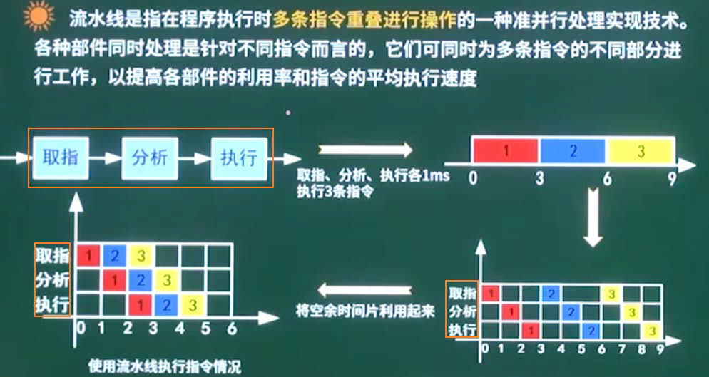

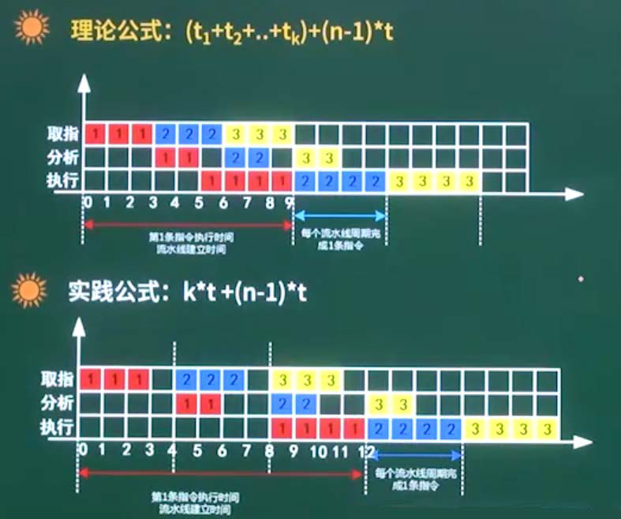

- ==利用率==：指网络或设备被占用的时间比例

- ==带宽==：最大数据传输能力【类似水管多粗】

- ==速率==：发送端每秒发出的比特数【数据跑得多快】

- ==吞吐率==：接收端在单位时间内成功收到、并交给上层的有用数据量
  $$
  吞吐率=\frac{指令条数}{一条完整指令的时间+(n-1)*流水周期}
  $$

- ==吞吐量==：指系统在单位时间内能够处理的请求数量、事务数量或数据量【偏向能力】

- ==负载==：指施加在系统上的压力或工作量【偏向施加的压力】

- ==流水线的总共时间==：

  - 理论公式：$一条完整指令的时间+(n-1)*流水周期=(t_1+t_2+...+t_k)+(n-1)*t$
  - 实践公式：$k*t+(n-1)*t$
  - $n$是指令数，`流水线周期代表最长的操作时间`

- 流水线的最大吞吐率：
  $$
  \lim\limits_{n \to \infty} \frac{n}{k*t+(n-1)*t}=\frac1t
  $$

## 存储器分类

- 1.按==访问方式==：

  - 按地址访问的存储器

  - 按内容访问的存储器

    > - 按内容存取：相联存储器(**Cache 的命中判断过程是相联访问**)
    > - 按地址存取
    >   - 随机存取存储器（如内存）
    >   - 顺序存取存储器（如磁带）
    >   - 直接存取存储器（如磁盘）

- 2.按==储存器所处位置==

  - `内存`：也称`主存`，用来存放机器当前运行所需的程序和数据

  - `外存`：也称`辅存`，用来存放当前不参加运行的大量信息，而在需要时调入内存

    > 二级存储器结构：主存+辅存
    > 三级存储器结构：主存+辅存+Cache

- 3.按==存储器的构成材料==

  - `磁存储器`：用磁介质做成
  - `半导体存储器`：
    - 根据所用元件：双极型、MOS型
    - 根据数据：静态、动态
  - `光存储器`：利用光学方法读/写数据的存储器

- 4.按==存储器的工作方式==：

  - `读/写`存储器( RAM[Random Access Memory] )：既能读取数据也能存入数据

    > DRAM(D动态)`集成率相对较高，功耗相对较小，需要动态刷新`【主存构成】
    >
    > SRAM(S静态)`集成率相对较低，功耗相对较大，不需要动态刷新` 【Cache构成】

  - ==只读存储器==

    - 固定`只读`存储器(ROM[Read Only Memory])：内容只能读出，不能改变【如BIOS 掉电不丢失】
    - `可编程`的`只读`存储器(PROM [Programmable Read Only Memory])：其中的内容可以由用户一次性地写入，写入后不能改变
    - `可擦除可编程`的`只读`存储器(EPROM[Erasable Programmable Read Only Memory])：其中的内容既可以读出，也可以由用户写入，写入后还可以修改
    - `电擦除可编程`的`只读`存储器（EEPROM）：与EPROM相似，既可以读出，也可以写入，只不过这种存储器采用`电擦除`的方式进行数据的`改写`
    - `闪速`存储器（FM[Flash Memory]）：简称闪存，其特性介于EPROM和EEPROM之间，类似于EEPROM【闪存是一种`非易失性存储器，掉电后信息不会丢失，主要用于持久化存储`，不可以替换成主存】

    > 在各类存储器中，**DRAM（动态随机存取存储器）** 是**唯一使用电容存储信息**的存储器类型。由于电容存在自然漏电现象，存储的电荷会随时间逐渐衰减，导致数据丢失，因此必须**周期性地进行刷新操作**，以补充电荷、维持数据完整性。
    >
    > 相比之下：
    >
    > - **SRAM（静态随机存取存储器）** 使用双稳态触发器（六晶体管电路）存储数据，只要供电，数据即可保持稳定，**无需刷新**。
    > - **EPROM（可擦除可编程只读存储器）** 和 **EEPROM（电可擦除可编程只读存储器）** 属于非易失性存储器，数据断电后不会丢失，**不需要刷新**，且其存储机制不依赖电容。
    >
    > 因此，符合“使用电容存储信息且需要周期性地进行刷新”这一描述的存储器是 **DRAM**。

- 5.按寻址方式：`指令基本格式：操作码字段  +  地址码字段`

  1. `立即`寻址： 操作数就包含在指令中
  2. `直接`寻址： 操作数存放在内存单元中， 指令中直接给出操作数所在存储单元的地址
  3. `寄存器`寻址： 操作数存放在某一寄存器中， 指令中给出存放操作数的寄存器名
  4. `寄存器间接`寻址： 操作数存放在内存单元中， 操作数所在存储单元的地址在某个寄存器中
  5. `间接`寻址： 指令中给出操作数地址的地址
  6. `相对`寻址： 指令地址码给出的是一个偏移量（可正可负)， 操作数地址等于本条指令的地址加上该偏移量
  7. `变址`寻址：操作数地址等于变址寄存器的内容加偏移量

  - 寻址速度：立即寻址>寄存器寻址>直接寻址>寄存器间接寻址>间接寻址

- 6.按在系统中的作用（存储层次）

  - ==寄存器==：`CPU内部，最快最小`
  - ==Cache==：`SRAM实现，全硬件管理，解决速度问题`
  - ==主存==：`DRAM实现，存放运行中的程序`
  - ==辅存==：磁盘/SSD，长期存储
  - ==虚拟存储器==：主存+辅存的体系，软硬件结合，解决容量问题

## 相联存储器

- ==相联存储器==是一种按`内容存取`的存储器。

- 存储单元：$存储单元个数=最大地址-最小地址+1$

- 编址内容：

  - `按字编址`：存储体的存储单元是字存储单元，即最小寻址单元是一个字
  - `按字节编址`：存储体的存储单元是字节存储单元，即最小寻址单位是一个字节

- ==**$总容量=存储单元个数*编址内容$**==

- 根据存储器所要求的容量和选定的存储芯片的容量，就可以计算出所需芯片的总数，

  即$总片数=总容量/每片的容量$

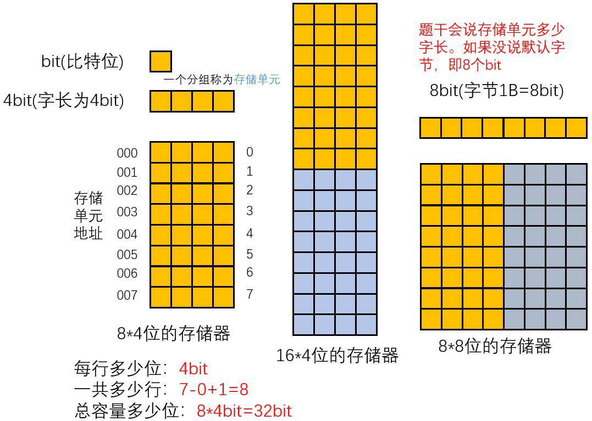

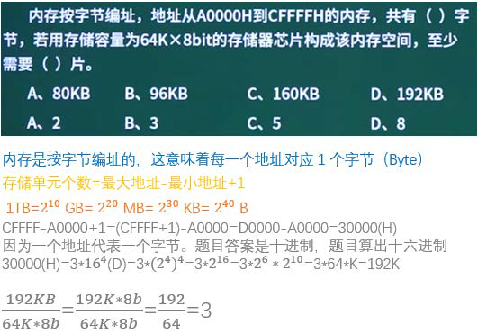


## 高速缓存

- 高速缓存的==组成部分==：

  - 控制部分
  - 存储部分

- 高速缓存中的==地址映像==方法：

  - `直接映像`：指主存的块与Cache块的`对应关系是固定的`。优点是`地址变换简单`，缺点是`灵活性差`、
    `Cache块冲突率高`。

  - `全相联映像`： 允许主存的任一块可以调入Cache存储器的任何一个块的空间中。优点是`Cache块冲突率
    低`、`灵活性好`，缺点是`访问速度慢`、`地址变换较复杂`、`成本太高`。

  - **`组相联映像`**：是前两种方式的折中方案，即**`组采用直接映像方式`**、**`块采用全相联映像方式`**。

    > `发生块冲突从少到多的顺序`：全相联映射-->组相联映射-->直接映射 

- ==替换算法==：

  - 随机替换算法
  - 先进先出算法
  - 近期最少使用算法
  - 优化替换算法

- ==性能分析==：

  - 命中率是Cache的一个重要指标，但不是最主要的指标

  - Cache的命中率与Cache容量的关系是：容量越大，命中率越高

    > “命中率”其实就是衡量 Cache “猜得准不准” 或者 “找得快不快” 的一个指标
    > 你想查资料时，直接在书桌上（Cache）就找到了的概率。
    >
    > Cache与主存的地址映射是由硬件自动完成的，不是由操作系统或者是程序员操作

    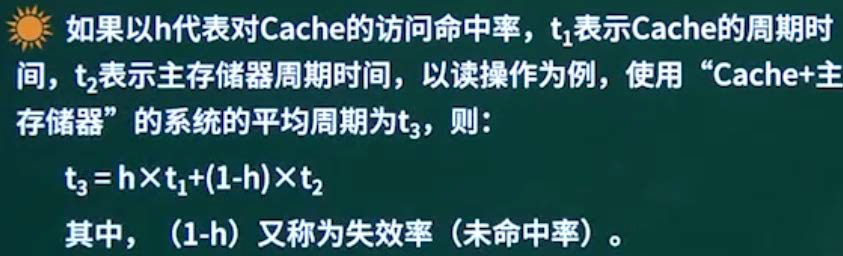

- ==多级Cache==：

  - 在多级Cache计算机中分为一级(L1Cache)，二级(L2Cache)等

> 在由高速缓存（Cache）、主存和硬盘构成的三级存储体系中，CPU在执行指令时访问的数据地址是**主存物理地址**。这是因为：
>
> - CPU直接访问的是主存，而高速缓存（Cache）是主存的一个高速副本，用于加速数据访问。当CPU发起访存请求时，它发送的是主存中的物理地址，系统硬件会自动在Cache中查找该地址对应的数据，若命中则直接从Cache读取，未命中则从主存加载。
> - **虚拟地址**是虚拟存储系统中的逻辑地址，需由MMU（内存管理单元）转换为物理地址后才能访问主存。题目未提及虚拟存储系统，因此不适用。
> - **硬盘的扇区地址**是外存地址，CPU不能直接访问外存，数据需先由操作系统调入主存后，CPU才能访问。
> - **高速缓存地址**是Cache内部的物理地址，CPU并不直接发送Cache地址，而是发送主存地址，由硬件自动映射到Cache地址。

## 虚拟存储器

- 虚拟存储器技术是==把很大的程序(数据)分成许多较小的块==，`全部存储在辅存中`。运行时把要用到的程序(数据)
  块`先调入主存`，并且`马上就要用到的程序块从主存调入高速缓存`。这样就可以一边运行程序，一边进行所需程序
  (数据)块的调进或调出。
- 虚拟存储器（Virtual Memory）既不是单纯的辅存，也不是单纯的内存，而是一种`“存储管理技术”`。
  你可以把它理解为一种“欺骗”CPU和程序的手段，通过软硬件配合，让用户觉得电脑拥有比实际物理内存大得
  多的内存空间。`它是一种逻辑上的存储空间。`
- 虚拟存储器管理方式：`段式虚拟存储器、页式虚拟存储器、段页式虚拟存储器`

> 不能提高CPU利用率、不能简化程序设计、不能加快内存访问速度
>
> 可以扩大逻辑内存容量

## 外存储器

- ==磁表面存储器==
  - 磁盘存取速度较快，具有较大的存储容量，是目前广泛使用的外存储器。硬盘就是最常见的外存储器
- ==光盘存储器==
  - 是一种采用聚焦激光束在盘式介质上非接触地记录高密度信息的新型存储装置
  - 根据性能和用途分为：
    - 只读型光盘(CD-ROM)
    - 只写一次型光盘(WORM)
    - 可擦除光盘

- ==固态硬盘==
  - 存储介质
    - 闪存(FLASH芯片)
    - DRAM
  - 具有传统机械硬盘不具备的读写快速，质量轻，能耗抵以及体积小等特点，但其价格仍较昂贵，容量较
    地，一旦硬件损坏，数据较难恢复

## 磁盘阵列技术

磁盘阵列是由多台磁盘存储器组成的一个快速，大容量，高可靠的外存子系统，常见的磁盘阵列称为廉价冗余
磁盘阵列(RAID)

## 直接程序控制

- ==直接程序控制==是指外设==数据的输入/输出过程==是在`CPU执行程序的控制`下完成的。
- 直接程序控制的两种情况：
  - ==程序查询方式==：`方法简单，硬件开销小，但I/O能力不高，严重影响CPU的利用`
    - 在此情况下，利用查询方式进行输入/输出，就是通过CPU执行程序来查询外设的状态，判断外设是否准备好接受数据或准备好向CPU输入数据
    - 两大缺点
      - `降低了CPU的效率`
      - `对外部的突发事件无法做出实时响应`
  - ==无条件传送==：
    - 在此情况下，`外设总是准备好的`，它可以`无条件地随时接受CPU发来的输出数据`，也`能够无条件地随时向CPU提供需要的输入数据`

## 中断方式

- CPU在`发出I/O指令后，无需等待`，`可以继续执行其他程序`。只有`当外设完成准备工作后`，才会`主动向CPU发送一个“中断请求”信号`
- 中断处理方法：多中断信号线法、中断软件查询法、菊花链法、总线仲裁法、中断向量表法
- 中断优先级控制：
  - 当不同优先级的多个中断源同时提出中断请求时，CPU应优先响应优先级最高的中断源
  - 当CPU在对某一个中断源服务时，有比它优先级更高的中断源提出中断请求，CPU应暂时中断正在执行的中断服务程序而转去对优先级更高的中断源服务，结束后再回到之前被中断的优先级较低的中断源服务程序继续执行，这种情况称为中断嵌套，即一个中断服务程序中嵌套着另一个中断服务程序

## 补充

- `CPU访问内存通常是同步方式`，`CPU与I/O接口交换信息通常是同步方式`，`CPU与PCI总线交换信息通常是同步方式`，`I/O接口与打印机交换信息则通常采用基于缓存池的异步方式`
- ==程序查询方式==是CPU`“主动轮询”`外设状态，==程序中断方式==是外设在准备好后`“主动通知”CPU`

- 工作模式：CPU接收到中断请求后，`会暂停当前正在执行的任务`，`保存好现场`，转而去`执行一个专门处理I/O的“中断服务程序”`。`处理完毕后，再恢复现场，继续执行原来的任务`。

> 电源故障属于系统级的硬件故障，通常由电源监控电路检测到电压异常时，向 CPU 发出一个不可屏蔽中断（NMI）。这属于**硬件中断**，且不是由程序执行逻辑引起的。
>
> 按键输入是通过外部设备（如键盘控制器）向 CPU 发出的中断请求，属于典型的**外部硬件中断**（可屏蔽中断）。
>
> 除零错误 当 CPU 在执行除法指令时，如果检测到除数为零，会立即产生一个异常（Exception）。这是由当前正在执行的指令（程序逻辑）直接引发的，属于**软件中断**（或称为异常、内部中断）。CPU 会主动抛出这个异常，以便操作系统进行相应的处理（如终止程序）。
>
> 定时器溢出 定时器（如可编程间隔定时器 PIT 或 APIC 定时器）是外部硬件设备，当其计数溢出时，会向 CPU 发送中断信号。这属于**外部硬件中断**。
>
> 在微型计算机中，键盘属于**低速输入设备**，且其输入是**随机发生的**，不适合使用程序查询或无条件传送方式。程序查询方式会浪费CPU时间等待设备就绪，而无条件传送方式假设设备始终就绪，不符合键盘实际工作状态。DMA方式适用于高速批量数据传输，键盘数据量小、频率低，无需DMA。
>
> **中断方式**允许CPU在键盘有输入时暂停当前任务，响应中断并处理键盘数据，处理完后恢复原任务，既高效又不浪费CPU资源，是管理键盘等输入设备的理想方式。

## 直接存储器存储方式

- ==直接内存存取==（DMA[Direct Memory Access]） 是指`数据在内存与I/O设备间的直接成块传送`，即在`内存与IO设备间传送一个数据块`的过程中，【 `不需要CPU的任何干涉`】，只需`要CPU在过程开始启动`(即==向设备发出“传送一块数据”的命令==）与`过程结束`（==CPU通过轮询或中断得知过程是否结束和下次操作是否准备就绪==)时的处理，实际操作由DMA硬件直接执行完成，CPU在此传送过程中可做别的事情。
- DMA是==直接内存存取==，`传送数据时间是存储周期`
- 把数据从硬盘搬到内存里，或者从内存搬到硬盘里
- `DMAC向总线裁决逻辑提出总线请求`；`CPU执行完当前总线周期即可释放总线控制权`。`此时DMA响应`，`通过DMAC通知I/O接口开始DMA传输`。
- DMA可以将其视为一种能够通过一组专用总线将`内部和外部存储器`与每个具有DMA能力的外设连接起来的控制器(`DMA控制是在主存与外设之间建立数据通路`)

## 总线结构

- 一般来说，任何连接两个以上电子元器件的导线都可以称为总线。微机中的总线分为==数据总线==、==地址总线==、==控制总线==。
  - ==数据总线（DB）== ：`用来传送数据信息，是双向的`。CPU既可以通过DB从内存或输入设备读入数据，也可以通过DB将内部数据送至内存或输出设备。DB的宽度决定了CPU和计算机其他设备之间每次交换数据的位数。
  - ==地址总线（AB ）==：`用于传送CPU发出的地址信息，是单向的`。传送地址总线的目的是指明与CPU交换信息的内存单元或I/O设备，==地址总线的宽度决定了CPU的最大寻址能力==。
  - ==控制总线（CB）== ：`用来传送控制信号、时序信号和状态信息等，双向线表示`。其中有的信号是CPU向内存或外部设备发出的信息，有的信号是内存或外部设备向CPU发出的信息。CB中的每一条线的信息传送方向是单方向且确定的，但CB作为一个整体则是双向的。

## 补充

- 一条总线同一时刻仅允许一个设备发送，但允许多个设备接收。【==分时双工==】

- 什么是“按字节编址”？
  - 内存就像一栋大楼，里面有很多个“房间”，每个房间都有一个唯一的门牌号（地址）。
    - **按字节编址**的意思是：**每个房间正好能放 1 个字节（1 Byte = 8 bit）的数据**，每个房间对应一个门牌号。
    - 所以，如果内存容量是 4GB，那就意味着这栋楼有 4G 个房间（每个房间 1 字节）。

- 什么是“地址总线”？
  - 地址总线就是 CPU 用来“喊门牌号”的电线。
    - 每根地址线只能传 0 或 1（二进制的一位）。
    - 如果有 **n 根地址线**，CPU 一次就能同时发出一个 **n 位的二进制数**，这个二进制数就是一个门牌号。
    - n 位二进制数最多能表示$2^n$个不同的编号（从全0到全1）。

- 在计算机体系结构中，`字长通常决定了 CPU 一次能处理的二进制数据的位数`，同时也`决定了数据总线的宽度`。==因为字长为 32 位，这意味着数据总线一次可以并行传输 32 位（bit）的数据。因此，数据总线的宽度为 32。==
- “内存容量为 4GB”。`地址总线的宽度决定了 CPU 能够寻址的内存空间大小`。在计算机内存中，通常按字节（Byte）进行编址。内存容量 4GB 换算成字节为：$4 GB=4×2^{30} Bytes=2^2×2^{30} Bytes=2^{32} Bytes$
  要寻址$ 2^{32}$个不同的存储单元（每个单元 1 字节），需要的地址线数量 n 满足 $2^n=2^{32}$。解得 n=32 。因此，地址总线的宽度为 32。

> ### 混合索引文件计算
>
> #### ❌ 误区
>
> - **误区点**：认为“1KB字节”可能不是 1024，或者计算 $1\text{KB} / 4\text{B}$ 时得出了 2048（2k）。
> - **纠正**：在操作系统和计算机存储中，**1K 永远等于 1024** ($2^{10}$)。题目写“1KB字节”虽然语意重复，但就是为了强调单位是 **Byte (字节)**。
> - **正确算式**：  $$ \text{一个块包含的索引项数} = \frac{1024 \text{ Bytes}}{4 \text{ Bytes}} = 256 \text{ 个} $$  *(绝不是 2048)*
>
> #### ✅ 核心计算模型（混合索引）
>
> 假设块大小为 1KB，地址项为 4B，则一个索引块可存 **256** 个地址。
>
> | 索引类型     | 占用项数  | 寻址能力计算                 | 容量贡献      |
> | ------------ | --------- | ---------------------------- | ------------- |
> | **直接索引** | 5项 (0-4) | $5 \times 1$ 块              | **5 KB**      |
> | **一级间接** | 2项 (5-6) | $2 \times 256$ 块            | **512 KB**    |
> | **二级间接** | 1项 (7)   | $1 \times 256 \times 256$ 块 | **65,536 KB** |
>
> #### 💡 关键结论
>
> - **最大文件大小** = 直接 + 一级 + 二级  $$ 5 + 512 + 65536 = \mathbf{66053 \text{ KB}} $$
> - **逻辑块号定位**：
>   - 0~4 $\rightarrow$ 直接
>   - 5~516 ($5+512-1$) $\rightarrow$ 一级间接
>   - 517~66052 $\rightarrow$ 二级间接

## 安全威胁

- 入侵检测技术包括专家系统、模型检测、简单匹配
- 漏洞扫描不是入侵检测的内容【防火墙也不能漏洞扫描】
- 入侵检测是被动监测技术，不主动拦截非法数据包，也不直接控制网络访问
- 地址转换是将内部网络的私有IP地址转为外部网络公有IP地址，解决IP地址短缺问题，并隐藏内部网络结构
- 防病毒用于检测、清除计算机系统中病毒，等恶意程序
- 防火墙基于访问控制列表等规则，对每一个进出网络的请求分组进行合法性检查，允许合法流量通过，拒绝非法流量

> 能够直接阻断攻击的是**入侵防御系统（IPS）**。入侵**检测**系统(IDS)的主要功能是监测和报警，它本身不具备阻断能力。要实现阻断，IDS必须联动防火墙或IPS等其他设备。

| 威胁           | 说明                                                         |
| -------------- | ------------------------------------------------------------ |
| 授权侵犯       | 为某一特权使用一个系统，却将该系统用作其他未授权的目的       |
| 拒绝服务       | 对信息或其他资源的合法访问被无条件地拒绝，或者推迟与时间密切相关的操作 |
| 窃听           | 信息从被监视的通信过程中泄露出去                             |
| 信息泄露       | 信息被泄露或暴露给某个未授权的实体                           |
| 截获/修改      | 某一通信数据项在传输过程中被改变、删除或替代                 |
| 假冒           | 一个实体(人或系统)假装成另一个实体                           |
| 否认           | 参与某次通信交换的一方否认曾发生过此次交换                   |
| ==非法使用==   | 资源被某个未授权的人或未授权的方式使用                       |
| 人员疏忽       | 一个授权的人为了 金钱或利益，或者由于粗心将信息泄露给未授权的人 |
| ==完整性破坏== | 通过对数据进行未授权的创建、修改或破坏，使数据的一致性受到损坏 |
| ==媒体清理==   | 从废弃的或打印过的媒体中获得信息                             |
| 物理入侵       | 一个入侵者通过物理控制而获得对系统的访问                     |
| ==资源耗尽==   | 某一资源(如访问端口)被故意超负荷使用，导致其他用户的服务被中断 |

## 加密技术

- ==对称加密(私有密钥加密)==、==非对称加密(公开密钥加密)==【根本区别在于加密和解密是否使用同一把钥匙】

- 对称加密（私钥/私有密钥） 算法： 

  > **共享密钥**是指在加密和解密过程中使用**同一个密钥**的加密算法，也称为对称加密算法

  - `DES、3DES、RC-5、IDEA、AES、RC4`【AES、IDEA、DES系列、RC系列】
    - DES、3DES、AES 、IDEA、RC5 都是==分组加密==。只有 RC4 是==流密码==
  - `加密强度不高，但效率高`。`密钥分发困难`
  - 具体内容：
    - 数据加密标准(DES)：主要采用替换和移位的方法加密
    - 三重DES(DES,又称TDEA)：在DES的基础上采用三重DES，效果相当于将密钥的长度加倍
    - RC-5：RC-5是在RCF2040中定义的，RSA数据安全公司的很多产品都在使用RC-5
    - 国际数据加密算法(IDEA)：在DES算法的基础上发展起来的，类似于3重DES
    - 高级加密标准(AES)：基于排列和置换运算。排列是对数据重新进行安排，置换是将一个数据单元替换为另一个数据单元

- 非对称加密（公钥/公开密钥） 算法：

  > **公开密钥**是指加密和解密使用**不同密钥**的加密算法，其中公钥可以公开，私钥必须保密

  - `RSA、ECC、DSA`
    - RSA：国际通用非对称加密算法，广泛用于X.509证书的签名与密钥交换
    - SM2：我国国密标准中的非对称加密算法，用于数字签名、密钥交换和公钥加密，基于椭圆曲线密码学（==ECC==）原理
  - `加密速度慢，但强度高`
  - 与对称加密算法不同，非对称加密算法需要两个密钥：`公开密钥和私有密钥`。两者是一对，如果公开密钥对数据进行加密，只有用对应的私有密钥才能解密；如果用私有密钥对数据进行加密，只有用对应的公开密钥才能解密。

> 常见的Hash算法包括：
>
> - MD系列：如MD5、MD4
> - SHA系列：如SHA-1、SHA-256、SHA-384、SHA-512

## 认证技术

> 使用`SHA-*`系列、`MD5`是哈希算法、国密`SM3`

- 摘要：将==发送的明文==进行`Hash算法`后得到`摘要`放==在密文后一起发送过去==，与==接收方解密后的明文==进行`相同的Hash算法`得到的==摘要进行对比如果一致==，则没有篡改，否则有篡改

- 数字摘要：通过一个固定的算法(如 `SHA-256`),将任意长度的数据(无论是一句话还是一部电影)`计算出一串固定长度、独一无二的字符`。这串字符就是它的“数字指纹”。`不能反推原信息`

  > - **MD5** 属于 **摘要算法**（也叫哈希算法/散列算法）。
  > - **特点**：可以针对**任意长度**的输入数据，计算出固定长度的结果。
  >
  > - **MD5**：分组大小为 512比特，生成的摘要长度为 **128比特**（即16字节，通常表示为32位十六进制字符串）。
  > - **SHA-1**：同样是基于512比特分组，但生成的摘要长度为 **160比特**。

- 数字签名：发送方用自己的`私钥对摘要进行签名`（加密）得到==数字签名放在密文后一起发送过去==，接收方用发送方的`公钥对数字签名进行验证`（解密）如果验证成功则该消息没有被假冒且不能否认，否则该消息的真实性为假冒发送

  - 数字签名是用==私钥签名==， ==公钥验证==，一般是==对信息摘要进行签名==

  - 数字签名是==非对称加密算法==的一种方法来保证信息不会被篡改

  - 典型应用：SSL/TLS证书、电子合同、APK签名

    > 密码存储通常采用哈希加盐，不需要数字签名

- 数字证书：

  - CA：权威机构
  - 用户向CA机构申请数字证书==将个人信息和公钥发给CA机构==，==CA机构颁给用户数字证书==， `数字证书用CA的私钥进行签名`（加密），`用CA的公钥验证（解密）数字证书得到用户的公钥`
  - `数字证书`主要是用来对==用户身份进行认证==，而`数字签名`主要用于==确保消息不可被否认==

  > 在数字证书体系中，网站向CA（证书授权中心）申请数字证书，CA在验证网站身份后，会使用**自己的私钥**对证书内容进行数字签名，以确保证书的真实性和完整性。
  >
  > 当用户访问该网站时，网站会将数字证书发送给用户的浏览器。浏览器收到证书后，需要使用**CA的公钥**来解密证书上的数字签名，从而验证该签名是否由可信的CA签发。如果验证通过，说明证书未被篡改且确实由CA颁发，用户即可信任该网站的合法性。


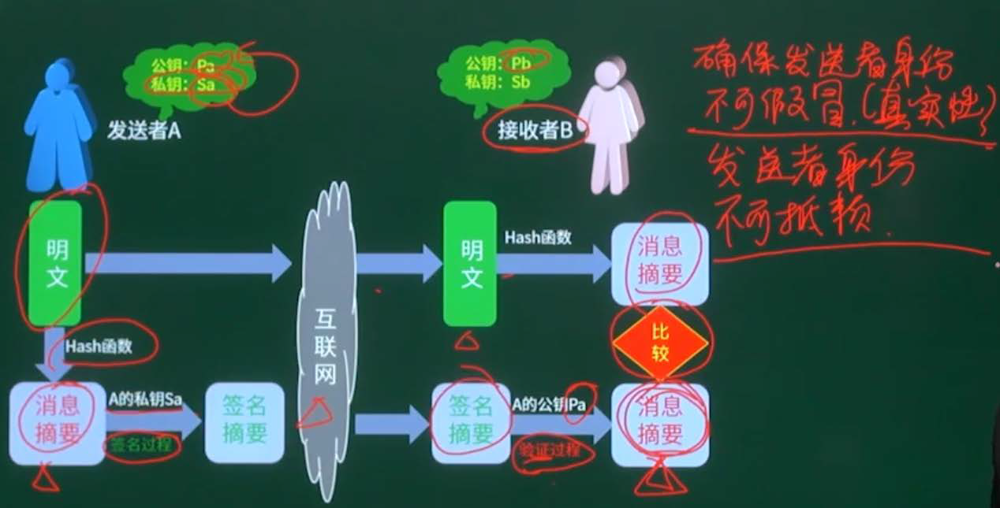

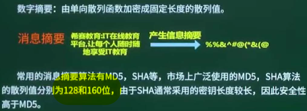

## 计算机可靠性

- 串联系统可靠性（R）与失效率（λ）

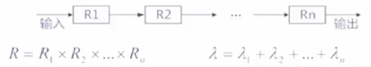

- 并联系统可靠性（R）与失效率（μ）

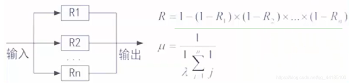

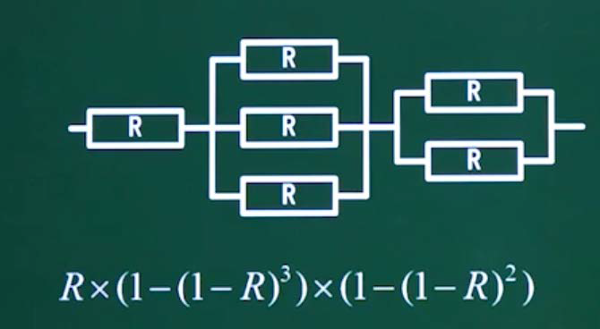

## 计算机系统的性能评价

- `MTTF（平均无故障时间）`反映==系统的可靠性==，即==系统正常运行时间的长短==；`MTTF / (1 + MTTF)`是==系统可靠性的度量公式==；【==**可靠性直接记住这个公式即可**==】
- `MTTR（平均修复时间）`反映==系统的可维护性==，即==系统从故障到恢复所需时间的长短==，越短，说明系统可维护性越好==MTTR / (1 + MTTR)是系统的**可维护性**==
- `MTBF反应平均故障间隔时间`。==MTBF=MTTR+MTTF==
- `1 / (1 + MTTR) `是==**系统可用性**的近似表达之一==，但==**标准可用性公式**为 MTTF / (MTTF + MTTR)【表示用户可以使用网络时间】==

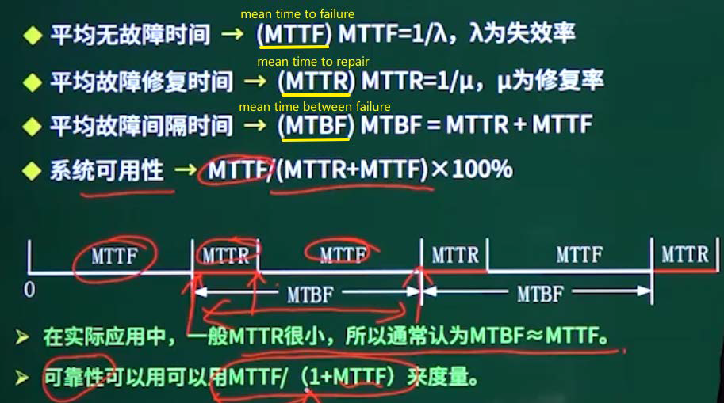


> 核心知识点：CPU 到底能跑多快？
>
> 假设 **CPU** 是一个负责搬砖的**“流水线打工人”**。
>
> - **指令** = 需要搬的一块砖（一个任务）。
> - **时钟周期** = 工人完成 1 个最基本的肌肉动作（比如抬手、弯腰）。
>
> 我们只需要搞懂以下 4 个核心指标：
>
> 1. `主频`（$f$）：工人的“手速”
>
> - **定义**：CPU 1 秒钟内能完成多少个最基本的肌肉动作（`时钟周期`）。
> - **单位**：`GHz`（1 GHz = $10^9$ 次/秒[Hz]）。
> - **大白话**：主频越高，这个工人“瞎折腾”的速度越快。比如 2.8GHz 代表工人每秒能折腾 **28亿次**。
>
> 2. `CPI`（Clock Per Instruction）：干一块活要“折腾”多少次
>
> - **定义**：完成 1 个任务（执行 1 条指令）平均需要消耗多少个时钟周期。
> - **大白话**：搬一块砖，简单的话挥 2 次手就搞定了（CPI=2），难的话要挥 6 次手（CPI=6）。**CPI 越小，干活效率越高。**
>
> 3. `IPC`（Instruction Per Clock）：手速的“含金量”
>
> - **定义**：工人每折腾 1 个基本动作，平均能完成多少块砖。
>
> - **关系**：它是` CPI 的倒数`，即 
>   $$
>   IPC = \frac{1}{CPI}
>   $$
>
> - **大白话**：CPI 是“每搬一块砖费几次手”，IPC 是“每次手能搬几块砖”。
>
> 4. `MIPS`（Million Instructions Per Second）：每秒干完多少“百万个”任务
>
> - **定义**：CPU 1 秒钟实际能完成多少条指令。
>
> - **大白话**：综合了工人的手速（主频 $f$）和干活费不费事（CPI）。
>
> - **计算公式**：
>
>   - `公式一（最常用）`：
>     $$
>     MIPS = \frac{主频}{平均CPI}
>     $$
>
>   - `公式二`：
>     $$
>     MIPS = 主频 \times IPC
>     $$
>
> > **注意**：计算主频和 MIPS 换算时，千万别忘了 $10^9$（GHz十亿）和 $10^6$（MIPS百万）的转换。 
> >
> > 公式化简为：
> > $$
> > MIPS = \frac{主频(\text{GHz}) \times 1000}{平均CPI}
> > $$
>
> ---
>
> 某计算机系统的CPU主频为 2.8GHz。某应用程序包括3类指令，各类指令的CPI（执行每条指令所需要的时钟周期数）及指令比例如下表所示。
>
> | 指令类型 | 指令A | 指令B | 指令C |
> | :------: | :---: | :---: | :---: |
> | **比例** |  35%  |  45%  |  20%  |
> | **CPI**  |   4   |   2   |   6   |
>
> **问题**：
>
> 1. 执行该应用程序时的平均CPI为（ ）。
> 2. 运算速度用MIPS表示，约为（ ）。
>
> ---
>
> **答案与详细解析**
>
> 第一步：计算平均 CPI
>
> **核心思路**：平均 CPI 是各类指令的 CPI 与其在程序中执行比例的加权平均值。
> **计算公式**：
> $$平均CPI = \sum (指令比例_i \times CPI_i)$$
>
> **代入数据计算**：
> $$平均CPI = (35\% \times 4) + (45\% \times 2) + (20\% \times 6)$$
> $$= 1.4 + 0.9 + 1.2 = 3.5$$
>
> **结论**：平均CPI为 3.5。==可能有时候需要找最接近的数==
>
> 第二步：计算 MIPS
>
> **核心思路**：将 CPU 的主频（手速）除以 平均CPI（干活的难度）。
> **计算公式**：
> $$
> MIPS = \frac{CPU主频}{平均CPI \times 10^6}
> $$
> *（注：分母中的 $10^6$ 是因为 MIPS 的单位是百万条指令/秒，而主频 Hz 是每秒的周期数）*
>
> **代入数据计算**：
> 已知 CPU 主频为 2.8GHz，即 $2.8 \times 10^9$ Hz，平均 CPI 为 3.5。
> $$
> MIPS = \frac{2.8 \times 10^9}{3.5 \times 10^6}\\
> = \frac{2.8}{3.5} \times 10^3\\
> =0.8 \times 1000 = 800
> $$
> **结论**：MIPS 约为 800

