## 软件工程概述

- ==软件工程基本原理==：用分阶段的生命周期计划严格管理、坚持进行阶段评审、实现严格的产品控制、采用现代程序设计技术、结果应能清楚的审查、开发小组的人员应少而精、承认不断改进软件工程实践的必要性
- ==软件工程的基本要素==： 方法、工具、过程
- ==软件生存周期==：可行性分析与项目开发计划、需求分析、概要设计（选择系统解决方案，规划子系统)、详细设计（设计子系统内部具体实现）、编码、测试、维护

> - ==系统开发合同==：这是开发方与用户（或客户）之间签订的法律文件，`明确了双方的权利、义务、项目范围、费用和交付标准等`。它的主要`作用是约束甲乙双方，而不是用于开发团队内部沟通`。
> - ==系统设计说明书==：这份文档详细`描述了系统的技术实现方案，包括架构设计、模块划分、数据库设计、接口定义等`。它的主要`读者是系统开发人员，用于指导编码工作，项目管理人员通常不关注其技术细节`。
> - ==系统开发计划==：这份文档`是项目管理的核心`，它`定义了项目的目标、范围、进度安排`（如**甘特图、PERT图**）、`资源分配、预算和风险管理`等。`项目管理人员依据它来监控项目进度、协调资源和评估绩效`；而`系统开发人员则需要根据它来了解项目整体目标、个人任务、时间节点和可用资源`。因此，它`是连接开发人员与项目管理人员的核心沟通桥梁`。
> - ==系统测试报告==：这份文档`记录了测试活动、发现的缺陷以及系统的整体质量评估`。它主要`在测试人员和开发人员、项目管理人员之间传递，用于反馈产品质量，但不是贯穿整个项目周期的主要沟通文档`。

> 这是软件工程（尤其是**人机交互与界面设计**）领域的经典考点：**交互设计的黄金三原则**。
>
> 这个概念由交互设计之父 **Theo Mandel** 提出，是软件设计师考试中关于“UI/UX设计”部分的必背内容。
>
> 核心考点：黄金三原则
>
> 1. **置于用户控制之下 (Place the user in control)**
>    - **含义**：不要强迫用户按照固定步骤操作，要允许用户自定义、撤销、重做，避免用户感到被系统“绑架”。
> 2. **减轻用户的记忆负担 (Reduce the user's memory load)**
>    - **含义**：设计时遵循“识别优于回忆”的原则。比如提供菜单让用户选择，而不是让用户去背诵和输入一串命令。
> 3. **保持界面的一致性 (Make the interface consistent)**
>    - **含义**：在整个软件中，相同的操作、布局、颜色应该代表相同的含义，避免让用户在不同页面重新学习。
>
> ### 避坑指南
>
> **“界面美观整洁”** 虽然在日常设计中很重要，但它**不属于** Theo Mandel 提出的“交互设计黄金三原则”。软考中常把“美观”、“色彩丰富”等作为干扰项，专门用来凑数，看到这些词直接排除即可。

## 能力成熟度模型CMM

- ==能力成熟度模型CMM==：对软件组织化阶段的描述，随着软件组织定义、实施、测量、控制和改进其软件过程，软件组织的能力经过这些阶段逐步提高
- CMM【Capability Maturity Model】五个成熟度级别
  1. ==初始级【乱】==：`软件过程的特点是无序混乱，有时甚至很混乱`。几乎`没有明确定义步骤`，项目的成功完全依赖个人的努力和英雄式核心人物的作用
  2. ==可重复级【重复】==：`建立了基本的项目管理过程和实践来跟踪项目费用、进度和功能特性，有必要的过程准则来重复以前在同类项目中的成功`
  3. ==已定义级【文档、定义】==：`管理和工程两方面的软件过程已经文档化、标准化，并综合成整个软件开发组织的标准软件过程`。所有项目都采用根据实际情况修改后得到的标准软件过程来开发和维护软件
  4. ==已管理级【标准、管理】==：`制定了软件过程和产品质量的详细度量标准`
  5. ==优化级【分析、优化】==：`加强了定量分析，通过来自过程质量反馈和来自新观念、新技术的反馈使过程能不断持续地改进`

## 能力成熟度模型CMMI

- ==能力成熟度模型CMMI==： `将已有的几个CMM模型结合在一起`，使之构造成为“**`集成模型`**”。支持多个工程学科和领域的、系统的、一致的过程改进框架，能适应现代工程的特点和需要，能提高过程的质量和工作效率

- CMMI两种表示方法：【Capability Maturity Model Integration】

  - ==阶段式模型==：类似于CMM，它`关注组织的`**`成熟度`**，五个：

    1. ==初始的==：过程不可预测且缺乏控制
    2. ==已管理的==：过程为项目服务
    3. ==已定义的==：过程为组织服务
    4. ==定量管理的==：过程已度量和控制
    5. ==优化的==：集中于过程改进

  - ==连续式模型==：`关注每个过程域的`**`能力`**，(六个)：

    - 对应于`未完成级`、`已执行级`、`已管理级`、`已定义级`、`量化管理级`、`优化级`

    1. 能力等级0指`未执行过程`，表明`过程域的一个或多个特定目标没有被满足`；
    2. 能力等级1指`过程通过转化可识别的输入工作产品`，`产生可识别的输出工作产品`，`关注于过程域的特定目标的完成`；
    3. 能力等级2指`过程作为已管理的过程制度化`，`针对单个过程实例的能力`；
    4. 能力等级3指`过程作为已定义的过程制度化`，`关注过程的组织级标准化和部署`；
    5. 能力等级4指`过程作为定量管理的过程制度化`；
    6. 能力等级5指`过程作为优化的过程制度化`，`表明过程得到很好地执行且持续得到改进`。

    > 其实就是第一点的初始化拆成两个，一个是都没执行，啥也没有满足；然后另一个是可以产生输出，但是是特定
    >
    > 原来的第三个定义对应第三个，也是制度，是针对单个过程

## 统一过程UP

- 统一过程模型：是一种开发过程，特性如下：

  - ==三大特点==：` 用例和风险驱动、以架构为中心、迭代并且增量`

  - ==开发的四个阶段==：

    - `起始`（项目的初始活动，如确认需求和风险评估等）

      > `起始阶段的里程碑是生命周期目标`
      >
      > 初启阶段结束时产生一个构想文档、一个有关用例模型的调查、一个初始的业务用例、一个早期的风险评估和一个可以显示阶段和迭代的项目计划等制品

    - `精化`（需求分析和架构设计等)

      > `精化阶段的里程碑是生命周期架构`
      >
      > 精化阶段结束时产生一个补充需求分析、一个软件架构描述和可执行的架构原型等制品

    - `构建`（系统的构建，产生实现模型等)

      > `构建阶段的里程碑是初始运作功能`
      >
      > 构建阶段结束时的成果是一个准备交到最终用户手中的产品，包括具有最初运作能力的在适当的平台上集成的软件产品、用户手册和对当前版本的描述

    - `移交`（软件提交方面的工作，产生软件增量，进行β测试，交付系统等）

      > `移交阶段的里程碑是产品发布`
      >
      > 移交阶段结束时产生移交给用户产品发布版本

  - `UP的每一次迭代都是一次完整的软件开发过程`，包括整个软件开发生命周期，有五个核心工作流（`需
    求、分析、设计、实现、测试`)

> 本题考查对敏捷统一过程（AUP）的理解。
>
> **A选项**：“在大型任务上连续” —— 正确。AUP采用“全局串行、局部迭代”的原则，即在宏观项目阶段（如初始、细化、构建、转换）上按顺序推进，但在每个阶段内部可灵活迭代。
>
> **B选项**：“在小型活动上迭代” —— 正确。AUP强调在小型活动或迭代中快速反馈、持续改进，这是敏捷方法的核心理念。
>
> **C选项**：“每一个不同的系统都需要一套不同的策略、约定和方法论” —— **不正确**。虽然AUP强调灵活性和适应性，但其核心是基于统一过程（UP）的简化版本，提供一套**通用的、可裁剪的过程框架**，而非为每个系统都重新设计策略和方法论。AUP的目标是提供一种**轻量级、可适配的统一过程**，适用于不同规模和类型的系统，而不是“每个系统都需要一套不同的策略”。
>
> **D选项**：“采用经典的UP阶段性活动，即初始、精化、构建和转换” —— 正确。AUP正是基于UP的四个经典阶段（初始、细化、构建、转换）构建的，只是将其简化并融入敏捷实践。

## 软件过程模型

### 瀑布模型

- 结构化方法中的模型，是结构化的开发，开发流程如同瀑布一般，一步一步的走下去，直到最后完成项目开发， `只适用于需求明确或者二次开发(需求稳定) ，当需求不明确时，最终开发的项目会错误，有很大的缺陷`

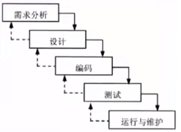

### V模型

- V模型：`是瀑布模型的一个变体`。`特点是增加了很多轮测试，并且这些测试贯穿于软件开发的各个阶段，不
  像其他模型都是软件开发完再测试，很大程度上保证了项目的准确性`

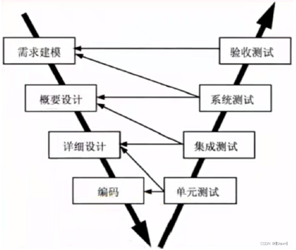

### 原型模型

- 原型模型：即快速原型开发，与瀑布模型相反，`原型针对的就是需求不明确的情况`，首先`快速构造一个功能
  模型，演示给用户看，并按用户要求及时修改，中间再通过不断的演示与用户沟通，最终设计出项目，就不
  会出现与用户要求不符合的情况，采用的是迭代的思想`

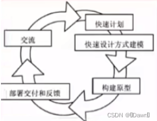

### 螺旋模型

- 螺旋模型：是多种模型的混合，`针对需求不明确的项目，与原型类似`，`但是增加了风险分析，这也是其最大的特点`
- 四步：`制定计划—风险分析—实施工程—用户评估`

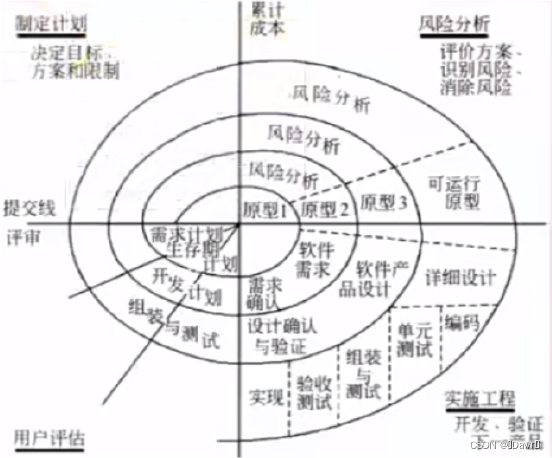

### 增量模型

- 增量模型： `首先开发核心模块功能`，`而后与用户确认，之后再开发次核心模块的功能`，`即每次开发一部分功能，并与用户需求确认，最终完成项目开发`， `优先级最高的服务最先交付`
- 特点：`但由于并不是从系统整体角度规划各个模块，因此不利于模块划分`。`难点在于如何将客户需求划分为多个增量`。`与原型不同的是增量模型的每一次增量版本都可作为独立可操作的作品，而原型的构造一般是为了演示`

> - `强调开发的阶段性早期计划`。增量模型要求在每个增量开发前进行规划，确保每个阶段的目标清晰、可管理，从而有效控制开发节奏。
> - `第一个可交付版本所需的时间少且成本低`。`因为初始增量仅包含核心功能，无需等待整个系统完成即可交付，从而快速满足用户基本需求并降低初期投入`。
> - `开发由增量表示的小系统所承担的风险小`。`每个增量都是独立可运行的子系统，其开发过程中的问题可在早期发现并修正，避免风险累积到后期`。
> - `增量模型涉及多个版本的迭代、配置管理复杂、进度协调困难，其管理成本往往更高，系统配置的复杂性也随之增加，尤其在增量间依赖关系未良好规划时，更易导致后期重构或版本不稳定`。

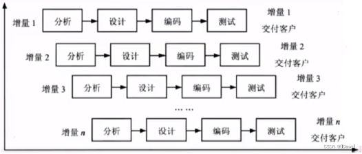

### 喷泉模型

喷泉模型：是一种`以用户需求为动力`，`以对象作为驱动的模型`，`适合于面向对象的开发方法`。使`开发过程具有迭代性和无间隙性`

### 基于构件的软件开发模型

- 基于构件的开发模型CBSD[Component-Based Software Development] ：`利用预先包装的构件来构造应用系统`。`构件可以是组织内部开发的构件，也可以是商品化成品软件构件`
- 特点是`增强了复用性`，在系统开发过程中，会构建一个构件库，供其他系统复用，因此可以提高可靠性,节省时间和成本

### 形式化方法模型

- `建立在严格数学基础上的一种软件开发方法`，`主要活动是生成计算机软件形式化的数学规格说明`

## 软件开发方法

- ==结构化方法==： `流程固定，针对需求明确的项目， 自顶向下，逐层分解，面向数据流`。将数据流映射为软件系统的模块结构，`数据流类型包括变换流型和事务流型`，不同类型的数据流有不同的映射方法。以瀑布模型为代表，一旦开发完成，将难以修改，不利于复用及后续版本的开发，现在被面向对象法给代替了
  - ==结构化方法的设计==：
    - `体系结构设计`是宏观架构设计
    - `数据设计`是数据流的设计
    - `接口设计`关注模块间的连接设计
    - `过程设计`是模块内的具体实现过程的数据结构和算法的设计
- ==Jackson方法==： `面向数据结构的开发方法`， `适合于小规模的项目`
- ==原型方法==：`适合于需求不明确的开发，以原型模型为代表`
- ==面向对象方法==： `强调复用性`，`构建全面合理的模型供不同项目使用，方便修改，节省开发时间和效率，增强复用性， 以构件组装模型为代表`

## 敏捷开发

- `针对中小型项目`，`主要是为了给程序员减负`，`去掉一些不必要的会议和文档`。

- ==开发宣言==：
  - `个体和交互胜过过程和工具`
  - `可以工作的软件胜过面面俱到的文档`
  - `客户合作胜过合同谈判`
  - `响应变化胜过遵循计划`
  
- ==结对编程==： 一个程序员开发， 另一个程序在一旁观察审查代码，能够有效的提高代码质量，在开发同时对代码进行初步审查， 共同对代码负责

- ==自适应开发==：`强调开发方法的适应性`(Adaptive)。不像其他方法那样有很多具体的实践做法，它更`侧重为软件的重要性提供最根本的基础`，并从更高的组织和管理层次来阐述开发方法为什么要具备适应性

- ==水晶方法==：`每一个不同的项目都需要一套不同的策略、约定和方法论`

- ==特性驱动开发==：是一套`针对中小型软件开发项目的开发模式`。是一个`模型驱动的快速迭代开发`过程，它`强调的是简化、实用、易于被开发团队接受，适用于需求经常变动的项目`

- ==极限编程XP== ： `核心是沟通、简明、反馈和勇气`。因为知道`计划永远赶不上变化`，XP无需开发人员在软件开始初期做出很多的文档。`XP 提倡测试先行，为了将以后出现bug的几率降到最低`

- ==并列争球法SCRUM== ：是一种`迭代的增量化过程`，`把每段时间(30天) 一次的迭代称为一个“冲刺”` ，并`按需求的优先级别来实现产品多个自组织和自治的小组并行地递增实现产品`

  > 在Scrum框架中，核心流程围绕**Sprint**（迭代周期）展开，包含**Product Backlog**（产品待办列表）、**Sprint Backlog**（冲刺待办列表）等关键工件，以及**Sprint计划会议**、**每日站会**、**Sprint评审会议**和**Sprint回顾会议**等事件。
  >
  > **Refactoring（重构）** 是软件开发中的一种实践，用于改进代码结构而不改变其外部行为，它属于**技术实践**，并非Scrum框架中定义的步骤或事件。Scrum关注的是**迭代流程、角色职责和工件管理**，而非具体的编码技术活动。
  >
  > 因此，在Scrum的步骤中，**不包括 Refactoring**。

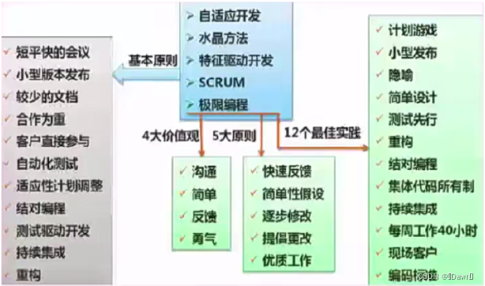

> 极限编程是一种轻量级（敏捷）、高效、低风险、柔性、可预测的、科学的软件开发方式。
>
> 4大核心价值观，即沟通、简单性、反馈和勇气；
>
> 遵循5个原则，分别是快速反馈、简单性假设、逐步修改、提倡更改和优质工作。
>
> 包含12个最佳实践：计划游戏（快速设计且设计随软件完善而迭代）、小型发布（系统设计能尽早交付）、隐喻（用合适比喻传达信息）、简单设计（仅处理当前需求以保持设计简洁）、`测试先行（先写测试代码再写程序）`、重构（重新审视需求与设计以适配新旧需求）、结对编程、集体代码所有制、持续集成（按日甚至按小时提供可运行版本）、每周工作40个小时、现场客户以及编码标准。
>
> 

## 软件工具

- ==软件开发工具==：对于于软件开发过程的各种活动。包括`需求分析工具、设计工具、编码与排错工具、测试工具`
- ==软件维护工具==：辅助软件维护过程中活动的软件，辅助维护人员对软件代码及其文档进行各种维护活动。包括`版本控制工具、文档分析工具、开发信息库工具、逆向工程工具、再工程工具`
- ==软件管理和软件支持工具==：辅助管理人员和软件支持人员的管理活动和支持活动，以确保软件高质量的完成。包括`项目管理工具、配置管理工具、软件评价工具`

## 软件文档

- ==开发文档== 

  - 可行性研究和项目任务书

  - 需求规格说明

  - 功能规格说明

  - 设计规格说明(包括程序和数据规格说明)

  - 开发计划

  - 软件集成和测试计划

  - 质量保证计划、标准、进度

  - 安全和测试信息
- ==产品文档==

  - 培训手册

  - 参考手册和用户指南

  - 软件支持手册

  - 产品手册和信息广告
- ==管理文档==

  - 开发过程的每个阶段的进度和进度变更的记录

  - 软件变更情况的记录

  - 相对于开发的判定记录

  - 职责定义
- ==软件概要设计文档==
  - 模块划分
  - 体系结构
  - 全局数据结构
  - 数据库逻辑设计
  - 接口设计

## 软件开发环境

- ==软件开发环境==：指支持软件产品开发的软件系统，由软件工具集和环境集成机制构成。工具集用于支持软件开发的相关过程、活动和任务；环境集成机制为工具集成和软件开发、维护和管理提供统一的支持
- ==开发支持环境==：环境信息库， 过程控制和消息服务， 用户界面规范

## 软件项目管理

- 有效的项目管理集中在==4P==上： `人员、产品、过程、项目`

## 软件项目成本估算方法

- ==自顶向下估算==：又称类比估算法，确定一个总金额，再向下分摊到每一个功能点
- ==自底向上估算==：从底层功能点开始估算成本，向上累加
- ==差别估算法==：与以前项目比较，找出不同点重新估算，相同点则直接估算
- ==专家估算==：聘请专家以其经验对项目整体费用进行估算

## 软件项目COCOMO估算模型

- ==COCOMO模型==：`常见的软件规模估算方法`。常用的`代码行分析方法作为其中一种度量估计单位`，`以代码行数估算出每个程序员工作量，累加得软件成本`
- ==模型按其详细程度可以分为三级==：
  - ==基本COCOMO模型==：是一个`静态单变量模型`，它`用一个以已估算出来的原代码行数(LOC)为自变量的经验函数计算软件开发工作量`
  - ==中间COCOMO模型==：`在基本COCOMO模型的基础上`，`再用涉及产品、硬件、人员、项目等方面的影响因素调整工作量的估算`
  - ==详细COCOMO模型==：包括`中间COCOMO模型的所有特性`，但`更进一步考虑了软件工程中每一步骤（如分析、设计）的影响`
- ==COCOMOⅡ模型==：COCOMO的升级，也是`以软件规模作为成本的主要因素`，`考虑多个成本驱动因子`。`该方法包括三个阶段性模型`：
  - ==应用组装模型==，软件工程前期阶段使用，`对应对象点`
  - ==早期设计阶段模型==，需求已经稳定并且基本的软件体系结构已经建立时使用，`对应功能点、代码行`
  - ==体系结构阶段模型==，软件的构造过程中使用，`对应代码行`

> 基础的是基本（==代码行==）【Ⅰ其实就只有源代码行数】、中间（人员、硬件等）、详细（分析设计）
>
> Ⅱ的是：应用组装（对象点）、早期设计（功能点、代码行）、体系结构（代码行）
>
> 在软件项目成本估算模型COCOMO II中，体系结构阶段模型是基于**源代码的行数**进行估算的。该模型在层次结构中包含三种规模估算选择：对象点、功能点和代码行。其中：
>
> - **应用组装模型**使用对象点；
> - **早期设计模型**使用功能点（可转换为代码行）；
> - **体系结构模型**则直接使用**源代码行数**作为估算基础。

## 软件项目Putnam估算模型

- ==Putnam估算模型==：`一种动态多变量模型`，假设在软件开发的整个生存周期中工作量有特定的分布

## 进度管理

- ==Gantt图==：

  `又称为横道图`，`横轴表示时间，纵轴表示活动`，`以时间顺序表示活动`， `能反应活动间的并行关系，但无法反应活动之间的依赖关系，因此也难以清晰的确定关键任务和关键路径`

  > 甘蔗图，横着的

- ==PERT图==：

  `类似于前趋图，是有向图`， `反应活动之间的依赖关系`，`有向边上标注活动运行的时间`，`但无法反应活动之间的并行关系`

- ==关键路径重要概念==：

  - ==最早开始时间ES==：取所有前驱活动最早完成时间EF的最大值
  - ==最早完成时间EF==：最早开始时间ES + 活动本身时间DU
  - ==**关键路径(项目总工期)**==：`项目中耗时最长的一条线路`【找关键路径是把所有的路（分支）全部算一遍，找最大的就是关键路径】
  - ==最晚完成LF==：取后续活动最晚开始时间的最小值
  - ==最晚开始时间LS==：最晚完成LF - 活动本身时间DU
  - ==松弛时间==：某活动的最晚开始时间 - 最早开始时间（或最晚完成时间 - 最早完成时间），也即该活动最多可以晚开始多少天

> 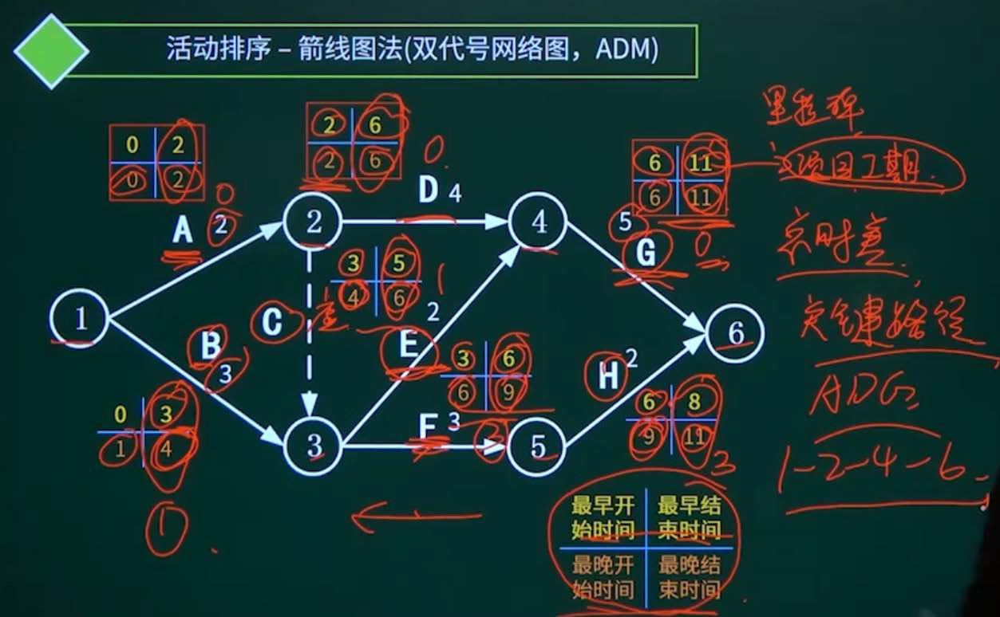
>
> 
>
> ---
>
> 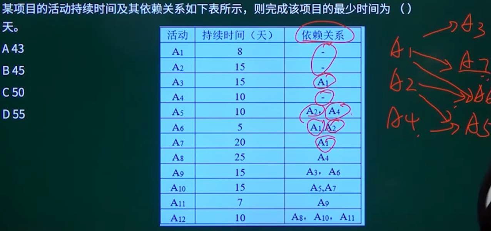
>
> 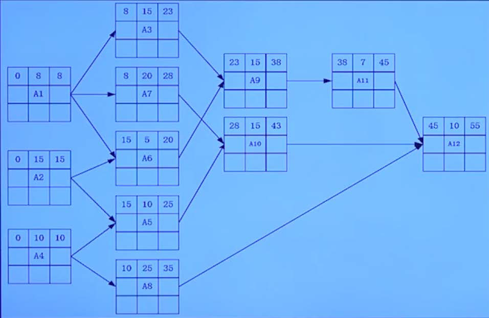
>
> 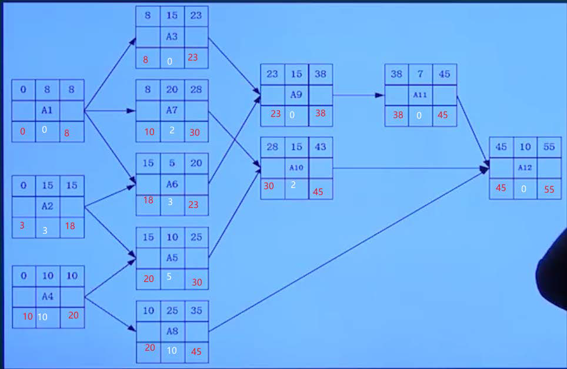
>
> ---
>
> 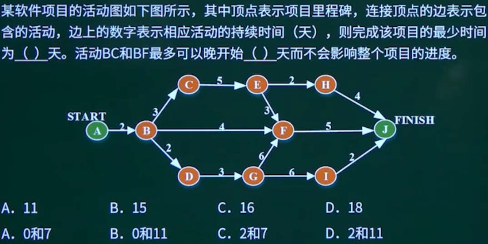
>
> 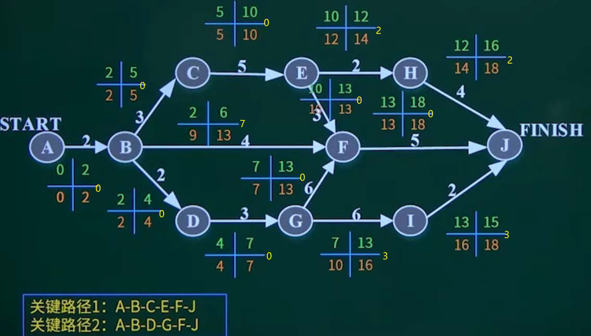

## 软件项目的组织

- ==组织结构模式==： `项目型`(项目经理绝对领导)、`职能型`（部门领导为主)、`矩阵型`(二者结合，既有项目经理也有部门领导，但权利分割不同)。
- ==程序设计小组的组织方式==：
  - `主程序员制小组`：主程序员全权负责，后援工程师必要时能替代主程序员， `适合大规模项目`
  - `民主制小组`：也即无主程序员小组， 成员之间地位平等，任何决策都是全员参与投票，`适合于项目规模小`，开发人员少，采用新技术和确定性较小的项目
  - `层次式小组`：两个层次，一名组长领导若干个高级程序员，每个高级程序员领导若干个程序员

## 软件配置管理

- ==基线==：`软件开发过程中特定的点`，是项目生存期`各开发阶段末尾的特定点`，又称为`里程碑`，反应阶段性成果

- ==软件配置项==：是软件工程中产生的信息项，是配置管理的基本单位

  - `软件开发过程中的所有文档、代码、工具都可作为配置项`，主要包括六种类型：

    1. 环境类（系统开发环境)
    2. 定义类（需求分析与系统定义阶段)
    3. 设计类（设计阶段）
    4. 编码类（编码及单元测试阶段)
    5. 测试类（系统测试完成后的工作）
    6. 维护类（维护阶段）

    - 即`产品组成部分的工作成果 + 项目管理和机构支撑过程域产生的文档`

  - ==版本控制==：即软件配置项的版本控制， `配置项有三个状态： 草稿、正式、修改`

  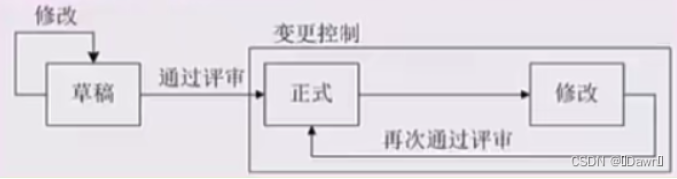

- 版本命名规则

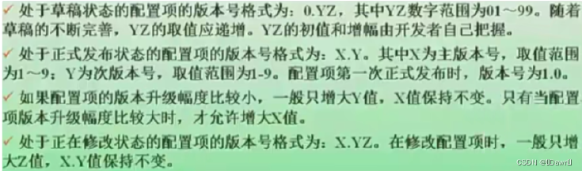

- 变更控制：`软件开发过程中的每一次修改都要纳入变更，以防止版本混乱`，需要用到基线和配置数据库的概念。

  `配置数据库分为下面三种`：

  - ==开发库==。【也称为动态库或程序员库】专供开发人员使用，其中的信息可能做频繁修改，对其控制相当宽松
  - ==受控库==。【也称为系统库或主库】在生存期某一阶段工作结束时发布的阶段产品，这些是与软件开发工作相关的计算机可读信息和人工可读信息。软件配置管理正是对受控库中的各个软件项进行管理，受控库也称为软件配置库
  - ==产品库==。【也称为静态库或发布库】在开发的软件产品完成系统测试后，作为最终产品存入产品库，等待交付用户或现场安装

## 风险管理

- ==软件风险两个特性==：`不确定性`（可能发生也可能不发生)、`损失`（发生会产生恶性后果）
- `项目风险威胁到项目计划`，`如果项目风险发生，有可能拖延项目的进度和增加项目的成本`。指预算、进度、人员、资源、利益相关者、需求等方面的潜在问题以及它们对软件项目的影响。`项目复杂度、规模及结构不确定性也属于项目风险因素`
- `技术风险威胁到要开发软件的质量和交付时间`，如果技术风险发生，开发工作就变得很困难或者不可能，指
  设计、实现、接口、验证和维护等方面的潜在问题。此外，规格说明的歧义性、技术的不确定性、技术陈旧
  以及“前沿”技术也是技术风险因素
- `商业风险威胁到要开发软件的生存能力`
  1. ==市场风险==。开发了一个没有人真正需要的优良产品或系统
  2. ==策略风险==。开发的产品不再符合公司的整体商业策略
  3. ==销售风险==。开发了一个销售部门不知道如何去销售的产品
  4. ==管理风险==。由于重点的转移或人员的变动而失去了高级管理层的支持预算风险。没有得到预算或人员的保证

> ==商业风险==涉及项目是否与公司战略目标一致、是否满足市场需求、是否具备商业价值等。
>
> ==项目风险==关注进度、成本、资源；
>
> ==开发风险==关注技术实现；
>
> ==人员风险==关注团队能力与稳定性。
>
> 
>
> 在软件项目管理中，`风险避免是主动控制风险时最有效的策略`，因为它`从源头上消除风险发生的可能性，而不是被动应对或减轻其影响`。
>
> - ==风险避免==：通过改变项目计划、范围或技术路线，彻底规避风险源
> - ==风险监控==：属于被动或持续跟踪行为，用于观察风险状态变化，不属于“主动控制”的核心策略。
> - ==风险管理及意外事件计划==：属于风险应对的后续措施，用于处理已发生或无法避免的风险，属于“被动响应”或“应急准备”，不是主动控制的首选。
>
> ==主动控制风险的核心是“预防”，而“风险避免”正是预防性最强、最根本的策略==
>
> `风险可以控制大小，但是不能避免或者消除`。`如果风险可以预测，那也不一定能避免`

## 风险管理的过程

- ==风险识别==： `识别出项目中已知和可预测的风险`，确定风险的来源、产生的条件、描述风险的特征以及哪些项目可以产生风险， 形成一个`风险列表`

- ==风险预测==：又称为`风险估计`，从两个方面预测风险，即风险可能及生的概和风险发生产生的后果，因此有`风险曝光度 = 风险发生的可能性 * 风险发生会带来的损失`

  > 假设正在开发的软件项目可能存在一个未被发现的错误，而这个错误出现的概率是0.5%，给公司造成的损失将是1000000元，那么这个错误的风险曝光度就应为：$1000000 \times 0.5\% = 5000$元

- ==风险评估==： `定义风险参照水准`，`将识别出来的风险评估分类`

- ==风险控制==： `辅助项目组建立处理风险的策略`，包括`风险避免、风险监控、RMMM计划`（风险缓解、监控和管理计划）

## 沟通管理

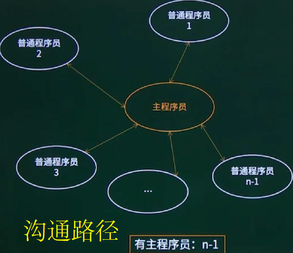

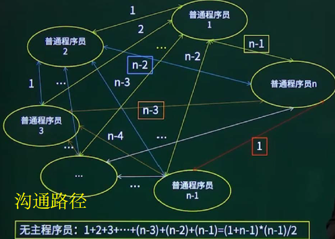

## ==软件质量特性==

- ISO/IEC9126软件质量模型：==质量特性和子特性==

- ==功能性==：`“功能够不够、对不对、能不能配合、安不安全”`
  - ==适合性【也是】==：软件提供的功能正好是用户需要的，不多不少

  - ==准确性【也是】==：软件算出来的结果必须是对的
  - 互用性：软件能跟别的系统或软件配合着用
  - 依从性：软件遵守相关的标准、规范或法律法规
  - ==安全性【超容易放在可靠性立马】==：软件能防住没权限的人乱动，保护数据不被偷

- ==可靠性==：`“崩溃、出错、恢复、稳定运行”`
  - 成熟性：软件平时不容易出毛病、不崩

  - 容错性：就算输入有问题或出了小错，软件也能扛住不崩溃
  - 易恢复性：软件崩了之后能快速恢复数据和正常运行

- ==易使用性==：`“好不好用、好不好学、界面清不清楚”`
  - 易理解性：用户一看就知道这软件是干嘛的、怎么上手

  - 易学性：用户能很快学会怎么操作这个软件
  - 易操作性：用户实际用起来顺手，不容易点错

- ==效率==：`“响应时间、内存占用、CPU消耗”`
  - 时间特性：软件响应快、处理任务花的时间短

  - 资源特性：软件跑起来占的内存、CPU等资源少

- ==可维护性==：`“改代码、定位bug、测试、改后不出新问题”`
  - 易分析性：出问题了容易找到是哪段代码的锅

  - 易改变性：要改功能或加需求时，改起来方便，不容易牵一发动全身
  - 稳定性：改了代码之后不容易引发新的bug
  - 易测试性：改完之后方便验证改得对不对、有没有引入新问题

- ==可移植性==：`“换平台、换系统、安装、替换”`
  - 适应性：软件换到不同的硬件、系统或环境里也能正常跑

  - 易安装性：软件装起来简单，不用折腾半天
  - 一致性：软件遵循跟移植相关的标准或约定，方便迁移
  - 易替换性：这个软件能比较方便地被另一个同类软件换掉

## McCall质量模型

- 三个方面，11个质量特性
- 三层框架模型：质量特性、评价标准、度量指标

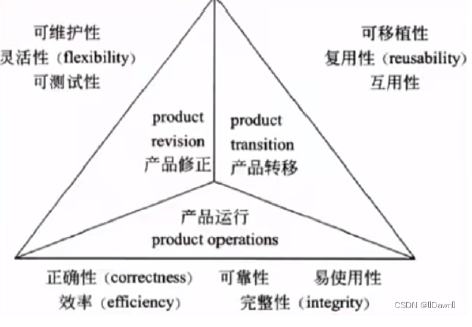

## 软件质量保证

- ==3个要点==：
  - 软件必须`满足用户需求`，与用户需求不一致的软件无质量可言
  - 软件应`遵循`规定的一系列`开发标准`，不遵循这些准则的软件，其质量难以得到保证
  - 软件还应`满足某些隐含的需求`（如可理解性、可维护性，未明确写在用户需求中）
- ==7个任务==：
  - `应用技术方法`（把软件质量设计到产品中而非事后保证)
  - 正式的`技术评审`
  - `测试软件`
  - `标准的实施`（遵循标准)
  - `控制变更`
  - `度量`（收集软件度量)
  - `记录保存和报告`

## 软件容错技术

- 通常将`质量`理解为`用户满意程度`，为了使用户满意有两个必要条件：
  - 设计的规格说明书符合用户标准，称为`设计质量`
  - 程序按照设计规格说明书所规定的情况正确执行，称为`程序质量`
- 设计质量评审、程序质量评审
- `容错`就是软件遇到错误的`处理能力`， `实现容错的手段主要是冗余`，包括下面四种冗余技术：
  - ==结构冗余==：
    - `静态`（通过表决和比较， 少数服从多数）
    - `动态`（ 多重模块待机备份，故障时切换备份机）
    - `混合冗余`（ 二者综合）
  - ==信息冗余==：为检错和纠错在数据中加上一段`额外的信息`，例如校验码原理
  - ==时间冗余==：遇到错误时`重复执行`，例如回滚，重复执行还有错，则转入错误处理逻辑
  - ==冗余附加技术==：`冗余附加技术是指为实现结构、信息和时间冗余技术所需的资源和技术`，包括程序、指令、数据、存放和调动它们的空间和通道等

> 在屏蔽软件错误的容错技术中，冗余附加技术包括：
> 1. 冗余备份程序的存储及调用
> 2. 实现错误检测和错误恢复的程序
> 3. 实现容错软件所需的固化程序
>
> `注意屏蔽软件错误不包含：关键程序和数据的冗余存储及调用`

## 软件度量

- 软件的两种属性：
  - ==外部属性==指`面向管理者和用户的属性`， `可直接测量，一般为性能指标`
  - ==内部属性==指`软件产品本身的的属性`，`如可靠性等， 只能间接测量`
- ==**McCabe度量法**==：==又称为环路复杂度==，假设有向图中有向边数为m ， 节点数为n ，则此有向图的环路复杂度为：$m - n + 2=边-点+2$

> 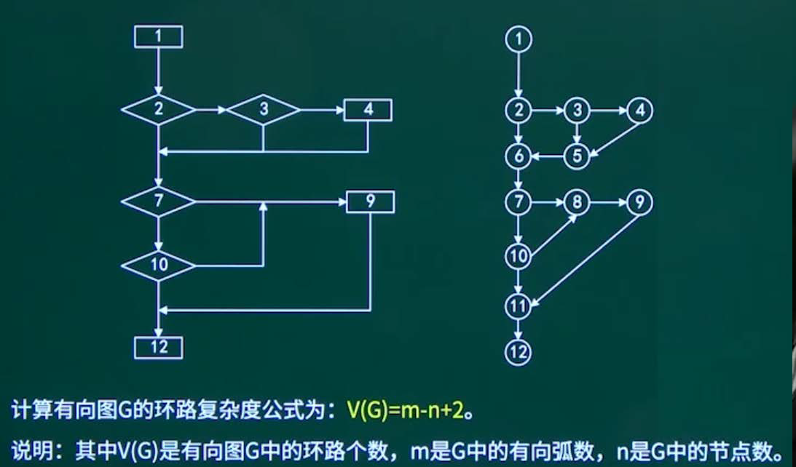
>
> ---
>
> 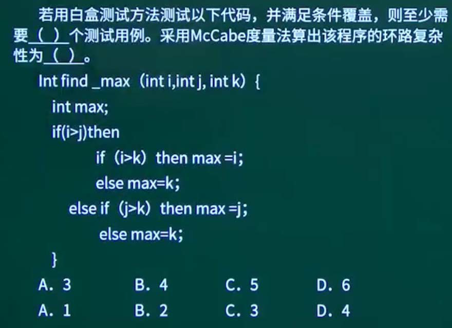
>
> 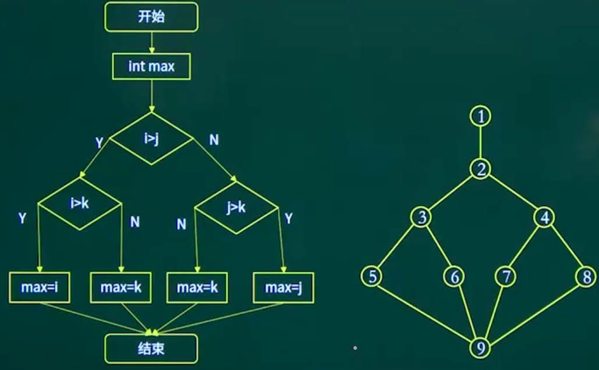