## ==面向对象设计的七大原则==

1、==单一职责原则==：设计目的单一的类
2、==开放-封闭原则==：对扩展开放，对修改封闭
3、==李氏(Liskov)替换原则==：子类可以替换父类
4、==依赖倒置原则==：要依赖于抽象，而不是具体实现；针对接口编程，不要针对实现编程
5、==接口隔离原则==：使用多个专门的接口比单一总接口好
6、==组合重用原则==：尽量使用组合，而不是继承关系达到重用目的
7、==迪米特(Demeter)原则(最少知识法则)==：`一个对象应当对其他对象有尽可能少的了解`

## ==面向对象设计其他原则==【针对包】

1、==重用发布等价原则==：重用的粒度 就是发布的粒度
2、==共同封闭原则==：包中的所有类对于同一性质的变化应该是共同封闭的。一个变化若对一个包产生影响，则将对该包里的所有类产生影响，而对于其他的包不造成任何影响。
3、==共同重用原则==：一个包里的所有类应该是共同重用的。如果重用了包里的一个类，那么就要重用包中的所有类。
4、==无环依赖原则==：在包的依赖关系图中不允许存在环，即包之间的结构必须是一个直接的无环图形。
5、==稳定依赖原则==：朝着稳定的方向进行依赖。
6、==稳定抽象原则==：包的抽象程度应该和其稳定程度一致。

## 领域类模型

==领域类模型是面向对象分析阶段的核心成果==，它从`业务领域视角出发`，抽象出系统中的关键概念及其关系，`用于描述“是什么”，而非“怎么做”`。其核心组成要素包括：

- ==属性==：描述领域对象（即概念类）的特征
- ==关联==：表示领域对象之间的静态联系
- ==领域对象==：即概念类，是业务领域中具有意义的实体或角色
- 而`操作(即方法或行为)是类模型(或称分析类、设计类)中的内容`，`用于描述对象"能做什么"`，`属于系统行为建模
范畴，不属于领域模型的描述范围`。领域模型关注的是业务概念本身及其结构关系，不涉及具体实现行为。

## 面向对象基本概念

- ==对象==：`基本的运行实体，为类的实例，封装了数据和行为的整体`，如学生、汽车等真实存在的实体。`对象具有清晰的边界、良好定义的行为和可扩展性`

- ==消息==： `对象之间进行通信的一种构造称为消息`

- ==类==：是对象的抽象，定义了一组大体相似的对象结构，定义了数据和行为。包括：
  
  - ==实体类==（`实体类的对象表示现实世界中的实体，如人、物等`）
  - ==边界类【也是接口】==（` 接口类（边界类）的对象为用户提供一种与系统合作交互的方式，分为人和系统两大类，其中人的接口可以是显示屏、窗口、Web窗体、对话框、菜单、列表框、其他显示控制、条形码、二维码或者用户与系统交互的其他方法。系统接口涉及到把数据发送到其他系统，或者从其他系统接收数据。`）
  - ==控制类==（用于对一个或几个用例所`特有的控制行为进行建模`，在用例执行过程中被动出现的特定行为的类;控制类的对象用来控制活动流，充当协调者。）
  
- ==继承==： 父类和子类之间共享数据和方法的机制。是类之间的一种关系

  > - **单继承**：一个子类只继承一个父类的属性和方法，形成树状结构。
  > - **多重继承**：一个子类可以继承多个父类的属性和方法，常见于C++等语言，Java中通过接口实现类似功能。
  > - **层次继承**：指继承关系在类层次结构中逐级传递，如A继承B，B继承C，则A间接继承C，这是继承的自然结果。
  >
  > 而**分布式继承**并不是面向对象设计中的标准继承类型。它并非描述类之间继承关系的术语，而是可能涉及系统架构或网络环境中的概念，与面向对象中的继承机制无关。

- ==多态==：不同的对象收到同一个消息时产生完全不同的反应。包括：
  
  - ==参数多态==（不同类型参数多种结构类型）`Java 中的 ArrayList<T>`
  
  - ==包含多态==（父子类型关系）`继承和方法重写实现的多态`
  
  - ==过载多态==（类似于重载，一个名字不同含义）`同名的函数，但参数列表不同`
  
  - ==强制多态==（强制类型转换）`隐式类型转换来实现多态`
  
  - **多态由继承机制支持**
  
  - **动态绑定是实现多态的基础**
  
    > 1. 过载多态（Overload）
    >
    > - **大白话**：**同名不同参**。函数名一样，但参数不一样，系统知道你在喊谁。
    > - **官方定义**：同一个名（操作符、函数名）在不同的上下文中有不同的类型。
    >
    > 2. 包含多态（Inclusion）
    >
    > - **大白话**：**各显神通**。爸爸喊一声“叫”，猫叫喵，狗叫汪。（最经典的多态，靠重写实现）。
    > - **官方定义**：同样的操作可用于一个类型及其子类型（一般需运行时类型检查）。
    >
    > 3. 参数多态（Parametric）
    >
    > - **大白话**：**万能模具**。不管塞进去是苹果还是梨，模具都能处理（泛型）。
    > - **官方定义**：应用广泛、最纯的多态（类型参数化）。
    >
    > 4. 强制多态（Coercion）
    >
    > - **大白话**：**自动变身**。你要整数我给了小数，系统偷偷帮你转成整数来凑合用。
    > - **官方定义**：编译程序通过语义操作，把操作对象的类型强行加以变换，以符合函数或操作符的要求。
  
- ==覆盖==：子类在原有父类接口的基础上，用适合于自己要求的实现去置换父类中的相应实现。即`在子类中重定义一个与父类同名同参的方法`

- ==函数重载==： `与覆盖要区分开，函数重载与子类父类无关，且函数是同名不同参数`

- ==封装==：一种`信息隐蔽技术`，其目的是`使对象的使用者和生产者分离`，也就是使`其他开发人员无需了解所要使用的软件组件内部的工作机制，只需知道如何使用组件`

- ==静态类型==是指`一个对象的类型在编译时就确定`

- ==动态类型==指`对象类型在运行时才能确定`

- ==静态绑定（静态分配）==是基于静态类型的，在程序执行前方法已经被绑定

- ==动态绑定==是基于动态类型的， 运行时根据变量实际引用的对象类型决定调用哪个方法， 动态绑定支持多态

## 面向对象分析、设计与测试

- ==面向对象分析==：是`为了确定问题域，理解问题`。包含五个活动：
  - ==认定对象==（`按自然存在的实体确定对象`）
  - ==组织对象== (`分析对象关系， 抽象成类`）
  - ==对象间的相互作用==（描述各对象在应用系统中的关系）
  - ==确定对象的操作==（操作，如创建增加删除等）
  - ==定义对象的内部信息==（`属性`）

- ==面向对象设计==：是设计分析模型和实现相应源代码在目标代码环境中这种源代码可被执行。`设计问题域的解决方案`
- ==面向对象程序设计==：用面向对象程序设计语言实现设计方案
- ==面向对象测试==：与普通测试步骤并无不同。可分为四个层次：
  - ==算法层==（ 测试类中定义的每个方法，类似`单元测试`）
  - ==类层==（ 测试同一个类中所有方法与属性的相互作用，特有的`模块测试`）
  - ==模板层==（测试一组协同工作的类之间的相互作用，类似`集成测试`）
  - ==系统层==（类似`系统测试`）

> 面向对象分析的目的是理解应用问题，识别问题域中的对象及其关系，而不是直接进行程序设计
>
> | 阶段              | 核心任务                           | 记忆       |
> | ----------------- | ---------------------------------- | ---------- |
> | OOA：面向对象分析 | 识别对象、属性、操作及对象间的关系 | 分析做什么 |
> | OOD：面向对象设计 | 设计类、接口及系统结构             | 设计怎么做 |
> | OOP：面向对象编程 | 使用程序设计语言实现系统           | 编码实现   |

> ==面向对象分析==（OOA）解决的是系统“做什么”的问题，`关注的是业务需求和现实世界的问题域`。它的主要活动是`认定对象、组织对象、描述对象间的相互作用、确定对象的操作`。这个阶段产出的是概念模型，比如概念类图和用例图，不涉及具体的技术实现，主要用来跟业务方、用户对齐需求。
>
> ==面向对象设计==（OOD）解决的是系统“怎么做”的问题，`关注的是技术实现和解决方案`。它的主要活动是`识别类及对象、定义属性、定义服务、识别关系、识别包`。这个阶段要把分析阶段的抽象概念细化成可落地的构造蓝图，比如设计类图要补全属性的数据类型、方法的可见性，还要考虑包划分、数据库映射、接口协议等实现细节，主要用来跟开发团队对齐实现方案。

## UML

- UML 是`统一建模语言`，`和程序设计语言并无关系`
- UML==三个要素==：
  - `UML的基本构造块`
  - `支配这些构造块如何放置在一起的规则和运用`
  - `整个语言的一些公共机制`
- UML的==基本构造块==包括：
  - `事物`（对模型中最具有代表性的成分的抽象）
  - `关系` 把事务结合在一起）
  - `图`（聚集了相关的事物）

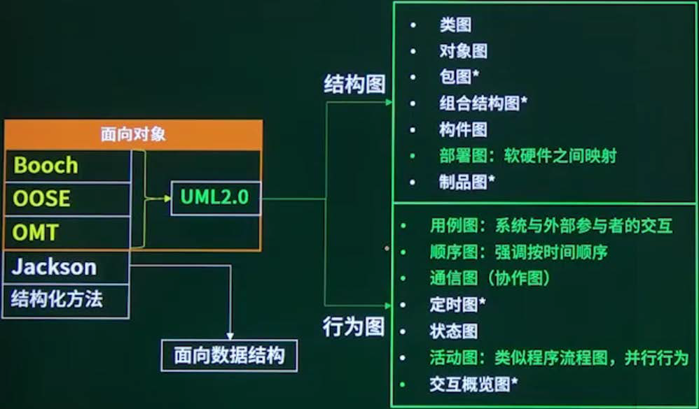

> - **拥有 (Ownership)**：
>   - UML规定，**一个模型元素只能被一个包“拥有”**。这意味着该元素的定义、生命周期和命名空间归属于这个特定的包。就像一个人的户口只能在一个地方，不能同时在两个地方落户。
>   - 如果一个类被两个包同时“拥有”，那么当你要修改这个类时，到底听谁的？这就产生了归属权冲突。
> - **引用/使用 (Usage/Reference)**：
>   - 虽然工具类只能**属于**（拥有）某一个包（比如 `com.common.utils`），但其他包（比如 `com.order` 或 `com.user`）可以通过 **依赖关系（Dependency）** 或 **导入（Import）** 机制来**使用**它。
>   - 在UML图中，这表现为包与包之间画一条虚线箭头（依赖），表示“我用了你的东西”，而不是“这个东西也是我的”。

- `关联的多重度`描述的是一个类的实例能够与另一个类的多少个实例相关联
- 在UML中，`接口`是一种用于声明对象类所需要的服务的抽象机制

## 事物

- UML中有==4种事物==：`结构事物、行为事物、分组事物和注释事物`

  - ==结构事物==：模型的静态部分，如类、接口、用例、构件等

    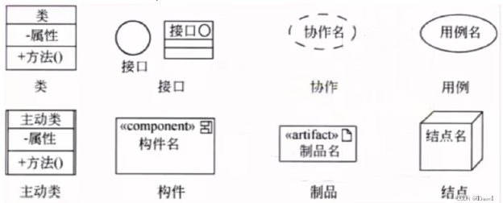

  - ==行为事物==：模型的动态部分，如交互、活动、状态机

    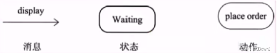

  - ==分组事物==：模型的组织部分，如包

    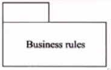

  - ==注释事物==：模型的解释部分，依附于一个元素或一组元素之上对其进行约束或解释的简单符号

    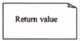

## 关系

- ==UML中有4种关系==：`依赖、关联、泛化和实现`
  - ==依赖==：`一个事物的语义依赖于另一个事物的语义的变化而变化`
  
  - ==关联==：是一种结构关系，`描述了一组链，链是对象之间的连接`。`分为组合和聚合,都是部分和整体的关系，其中组合事物之间关系更强`。两个类之间的关联，实际上是两个类所扮演角色的关联，因此，两个类之间可以有多个由不同角色标识的关联
  
  - ==泛化==： `一般 / 特殊的关系， 子类和父类之间的关系`
  
  - ==实现==：`一个类元指定了另一个类元保证执行的契约`
  
    > 组合：部分与整体同生共死
    >
    > 聚合：部分可脱离整体独立存在
    >
    > > **聚合**是关联关系的一种特例，表示“整体-部分”的关系，即“has-a”关系。在这种关系中，整体对象包含其他对象作为其组成部分，但这些部分对象可以独立存在，拥有自己的生命周期，也可以被多个整体对象共享。
    > >
    > > **UML 类图（Class Diagram）**，它是描述系统**静态结构**的，比如对象（类）与对象之间的关系（聚合、组合、泛化等）
    > >
    > > **UML 用例图（Use Case Diagram）** 中，它是描述系统**动态行为和功能**的，专门用来表达“功能（用例）”之间的逻辑关系【`extend` 和 `include`】

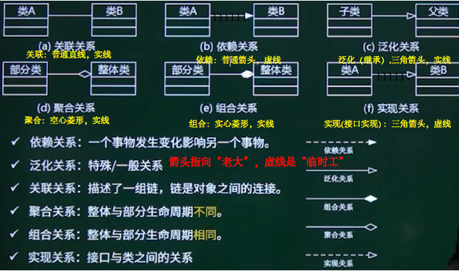

## UML中的图

### ==类图==

- `静态图`，为系统的`静态设计视图`，展现一组对象、接口、协作和它们之间的关系

  > 类图是静态的蓝图，不用于表示特定时刻的对象快照
  >
  > ---
  >
  > 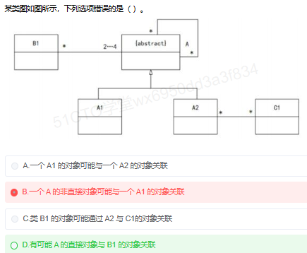
  >
  > 1. **分析类图结构与关系**
  >    - **抽象类 A**：图中 `abstract` 类 A 下方有实线空心三角指向 A1 和 A2，这表示 **A1 和 A2 是 A 的具体子类（实现类）**。A 是抽象类，不能被实例化，只能通过其子类来创建对象。
  >    - **关联关系 1（B1 与 A）**：B1 与 A 之间有一条关联线。B1 端的多重性为 `*`，A 端的多重性为 `2..4`。这表示一个 B1 的对象可以关联 2 到 4 个 A 的对象。
  >    - **关联关系 2（A 自身）**：A 类自身有一条自关联线，多重性为 `*` 和 `A *`。这表示 A 的对象之间可以相互关联。
  >    - **关联关系 3（A2 与 C1）**：A2 与 C1 之间有一条关联线，两端多重性均为 `*`。这表示 A2 的对象与 C1 的对象存在多对多的关联。
  > 2. **逐项分析选项**
  >    - **A 选项：一个 A1 的对象可能与一个 A2 的对象关联** A1 和 A2 都是 A 的子类。由于 A 类自身存在自关联关系（`*` 对 `*`），即 A 的对象可以与 A 的对象关联。在运行时，A 的实际对象可以是 A1 或 A2 的实例。因此，一个 A1 的对象（作为 A 的实例）完全可以通过 A 的自关联关系，与一个 A2 的对象（作为 A 的实例）产生关联。该选项**正确**。
  >    - **B 选项：一个 A 的非直接对象可能与一个 A1 的对象关联** 这里的“非直接对象”指的是 A 的具体子类实例，即 A1 或 A2 的对象。 因为 A 存在自关联关系，所以 A 的任意一个实例（无论是 A1 的实例还是 A2 的实例）都可以与另一个 A 的实例关联。 因此，一个 A 的非直接对象（例如 A2 的对象）完全可能与一个 A1 的对象通过 A 的自关联关系产生关联。该选项**正确**。
  >    - **C 选项：类 B1 的对象可能通过 A2 与 C1 的对象关联** 观察图中的关联路径：
  >      1. B1 的对象与 A 的对象存在关联。
  >      2. A 的具体子类包括 A2，所以 B1 的对象可以关联到一个 A2 的对象。
  >      3. A2 的对象与 C1 的对象存在关联（多对多）。 综合来看，B1 的对象 $\rightarrow$ 关联 A2 的对象 $\rightarrow$ 关联 C1 的对象。这是一条完全可行的关联路径。该选项**正确**。
  >    - **D 选项：有可能 A 的直接对象与 B1 的对象关联** 图中 A 类被明确标记为 `{abstract}`，即 **抽象类**。 根据面向对象的基本原理，**抽象类不能被实例化**，也就是说，在程序运行过程中，**不可能产生 A 的直接对象**（只能产生 A 的子类对象，如 A1 或 A2 的对象）。 既然无法创建 A 的直接对象，自然也就不可能存在“A 的直接对象与 B1 的对象关联”的情况。该选项**错误**。

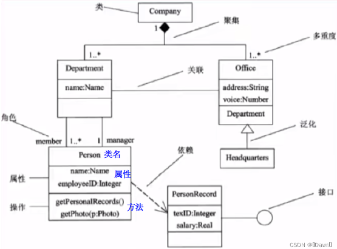

### ==对象图==

-  `静态图`，展现某一时刻一组`对象及它们之间的关系`，为`类图的某一快照`。在没有类图的前提下，对象图就是静态设计视图

  > 对象图是类图在运行时的实例

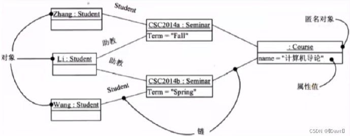

### ==用例图==

-  `静态图`，展现了一组用例、参与者以及它们之间的关系
  - ==包含关系==：`<<include>>`，箭头指向被包含用例(公共用例) 【"我主动调用你"（箭头朝外），虚线 + 普通箭头】
  
  - ==扩展关系==：`<<extend>`，箭头指向被扩展用例(基本用例) 【"我依附于你"（箭头朝内指向被扩展者），虚线 + 普通箭头】
  
  - ==泛化关系==：箭头指向父用例【实线 + 空心三角箭头】
  
    > 只有包含指向外面，扩展和泛化都指向里面

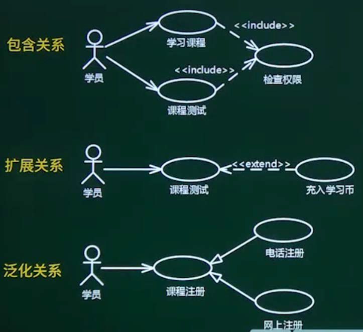

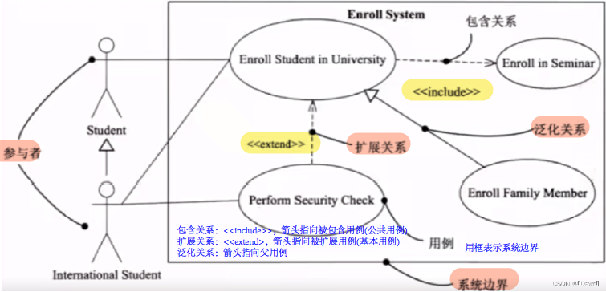

> - 确定系统边界是需求分析阶段的核心任务之一
> - 关系规范化则是逻辑设计阶段的重要内容

### ==序列图==

- 即`顺序图`， `动态图`，是场景的图形化表示，描述了以时间顺序组织的对象之间的交互活动
  - ==同步消息==：进行阻塞调用，调用者中止执行，等待控制权返回。需要等待返回消息，用`实心三角箭头`表示
  - ==异步消息==：发出消息后继续执行，不引起调用者阻塞，也不等待返回消息，由`空心箭头`表示
  - ==返回消息==：由从右到左的`虚线箭头`表示

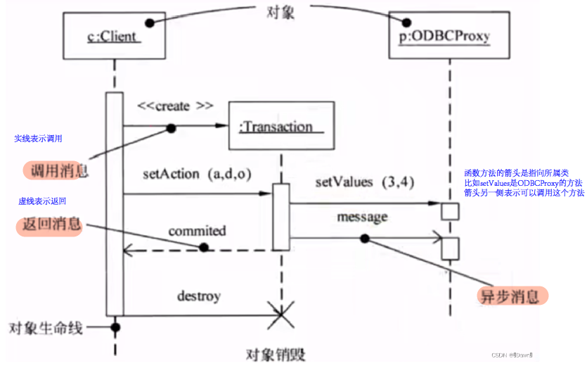

### ==通信图==

-  `动态图`，即`协作图`，是顺序图的另一种表示方法，也是由对象和消息组成的图，只不过不强调时间顺序， 只强调事件之间的通信，而且也没有固定的画法规则， 和顺序图统称为交互图

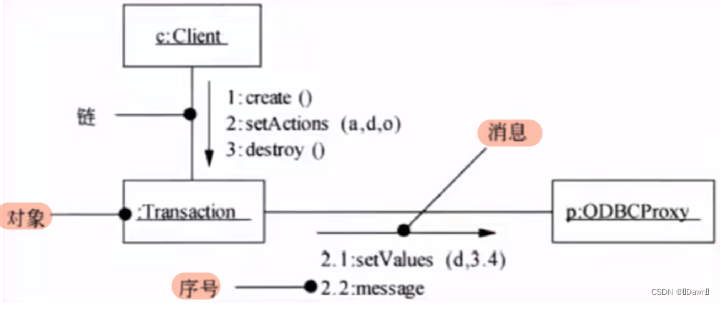

### ==状态图==

-  `动态图`，展现了一个状态机，描述单个对象在多个用例中的行为，包括简单状态和组合状态
  
  - ==转换==可以通过事件触发器触发，事件触发后相应的监护条件会进行检查。
  - 状态图中转换和状态是两个独立的概念，如图中方框代表状态， 箭头上的代表触发事件， `实心圆点为起点和终点`
  - 一个==转换==**必须包含**`源状态 → 目标状态，并由触发事件和可选的监护条件驱动`。
  - ==转换的五要素==：
    - ==源状态==：即受转换影响的状态；
    - ==目标状态==：当转换完成后对象的状态；
    - ==触发事务==：用来为转换定义一个事务，包括调用、变更、信号、时间四类事务；
    - ==监护条件==：布尔表达式，确定是否激活转换；
    - ==动作==：转换激活时的操作转换是“路”，而转换后效果是“路上的一个动作”
  - ==监护条件==是一个`布尔表达式`，它仅在触发事件发生时被检查，若条件满足则允许转换发生。
  - 动作可以有事件触发器、监护条件、状态
  
  > 在UML状态图中，**迁移（transition）** 是对象从一个状态转移到另一个状态的过程，其发生需满足两个核心条件：**触发事件的发生** 和 **监护条件（Guard Condition）为真**。此外，迁移的前提是对象当前必须处于该迁移的**源状态（Source State）**。
  >
  > - **选项A**：活动（Activity）确实可以在状态内部执行（如do活动），也可以在迁移过程中执行（如迁移上的effect动作），因此该选项**正确**。
  > - **选项B**：该选项表述“若事件触发一个没有特定监护条件的迁移，则对象离开当前状态”是**不严谨的**。即使没有显式监护条件，系统默认监护条件为“真”，但**前提是对象必须当前处于该迁移的源状态**。如果对象不在源状态，即使事件触发且无监护条件，迁移也不会发生。因此该选项忽略了“源状态”这一关键前提，**错误**。
  > - **选项C**：迁移可以包含事件触发器、监护条件、源状态和目标状态，这是UML状态图的标准定义，因此该选项**正确**。
  > - **选项D**：事件是触发状态迁移的主要机制，因此该选项**正确**。
  
  > 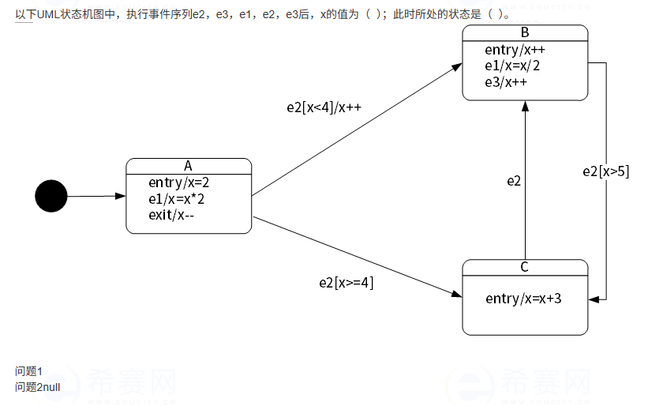
  >
  > ------
  >
  > ### 1. 理解状态机图的结构
  >
  > 首先，我们需要明确图中各个状态和转换的含义：
  >
  > - **初始状态（黑实心圆）**：指向状态 A，表示系统启动时首先进入状态 A。
  > - **状态 A**：
  >   - `entry / x=2`：进入状态 A 时，执行 $x = 2$。
  >   - `e1 / x = x * 2`：在状态 A 时，遇到事件 `e1`，执行 $x = x * 2$（内部转换，不离开状态）。
  >   - `exit / x--`：离开状态 A 时，执行 $x--$（即 $x = x - 1$）。
  >   - 转换：
  >     - 到状态 B：事件 `e2`，条件 `[x < 4]`，动作 `/ x++`。
  >     - 到状态 C：事件 `e2`，条件 `[x >= 4]`（无额外动作）。
  > - **状态 B**（父状态，包含子状态，但图中未细分，我们将其视为一个整体）：
  >   - `entry / x++`：进入状态 B 时，执行 $x++$。
  >   - `e1 / x = x / 2`：在状态 B 时，遇到事件 `e1`，执行 $x = x / 2$。
  >   - `e3 / x++`：在状态 B 时，遇到事件 `e3`，执行 $x++$。
  >   - 转换：
  >     - 到状态 C：事件 `e2`，条件 `[x > 5]`。
  > - **状态 C**：
  >   - `entry / x = x + 3`：进入状态 C 时，执行 $x = x + 3$。
  >   - 转换：
  >     - 到状态 B：事件 `e2`（无条件，无额外动作）。
  >
  > ------
  >
  > ### 2. 逐步执行事件序列
  >
  > 我们需要执行的事件序列是：**e2, e3, e1, e2, e3**。
  >
  > #### 初始状态：进入状态 A
  >
  > - 系统从初始伪状态进入状态 A，立即执行 A 的 `entry` 动作：`x = 2`。
  > - **当前状态：A，$x = 2$。**
  >
  > ------
  >
  > #### 事件 1：执行 e2
  >
  > - 当前在状态 A，寻找 `e2` 的转换：
  >   - 到 B：`e2 [x < 4] / x++`（条件 $2 < 4$ 成立）。
  >   - 到 C：`e2 [x >= 4]`（条件 $2 \ge 4$ 不成立）。
  > - 匹配到到状态 B 的转换。执行转换过程：
  >   1. **离开状态 A**：执行 `exit` 动作 `x--`。此时 $x = 2 - 1 = 1$。
  >   2. **执行转换动作**：`x++`。此时 $x = 1 + 1 = 2$。
  >   3. **进入状态 B**：执行 `entry` 动作 `x++`。此时 $x = 2 + 1 = 3$。
  > - **结果：当前状态 B，$x = 3$。**
  >
  > ------
  >
  > #### 事件 2：执行 e3
  >
  > - 当前在状态 B，寻找 `e3` 的处理：
  >   - 状态 B 有一个内部事件 `e3 / x++`（内部转换，不触发 exit/entry）。
  > - 执行动作 `x++`：$x = 3 + 1 = 4$。
  > - **结果：当前状态 B，$x = 4$。**
  >
  > ------
  >
  > #### 事件 3：执行 e1
  >
  > - 当前在状态 B，寻找 `e1` 的处理：
  >   - 状态 B 有内部事件 `e1 / x = x / 2`。
  > - 执行动作 $x = x / 2$：$x = 4 / 2 = 2$。
  > - **结果：当前状态 B，$x = 2$。**
  >
  > ------
  >
  > #### 事件 4：执行 e2
  >
  > - 当前在状态 B，寻找 `e2` 的转换：
  >   - B 到 C 的转换：`e2 [x > 5]`。条件 $2 > 5$ 不成立。
  > - 状态 B 没有其他 `e2` 转换，事件无法匹配，被忽略。
  > - **结果：当前状态 B，$x = 2$（保持不变）。**
  >
  > ------
  >
  > #### 事件 5：执行 e3
  >
  > - 当前在状态 B，再次匹配内部事件 `e3 / x++`。
  > - 执行动作 `x++`：$x = 2 + 1 = 3$。
  > - **结果：当前状态 B，$x = 3$。**
  >
  > ------
  >
  > ### 3. 最终结论
  >
  > - 执行完序列后，$x$ 的值为 **3**。
  > - 此时所处的状态是 **B**。

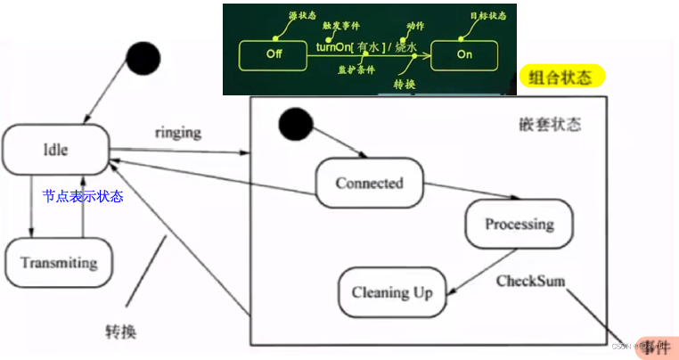

### ==活动图==

- 动态图，是一种`特殊的状态图`，`展现了在系统内从一个活动到另一个活动的流程`
  - ==活动==可以在转换时执行（即转换上的动作），也可以在状态内执行（即入口/出口动作或内部转换动作）
  - 活动的分岔和汇合线是一条水平粗线
  - `每个分岔的分支数代表了可同时运行的线程数`。
  - 活动图中能够`并行执行的是在一个分岔粗线下的分支上的活动`

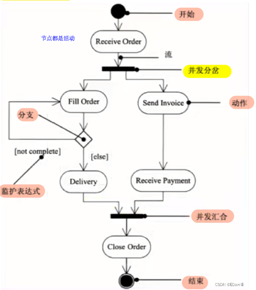

### ==构件图/组件图==

-  `静态图`，`为系统静态实现视图`，`展现了一组构件之间的组织和依赖`

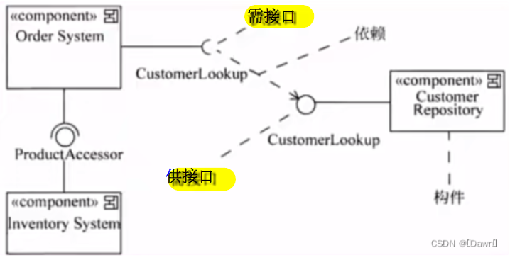

### ==部署图==

- `静态图`，为`系统静态部署视图， 部署图物理模块的节点分布`。它与构件图相关，通常一个结点包含一个或多个构件。其依赖关系类似于包依赖，`因此部署组件之间的依赖是单向的类似于包含关系`

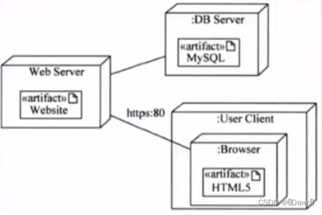

## 设计模式

- 设计模式的四个基本要素：
  - 模式名称
  - 问题：应该在何时使用模式
  - 解决方案：设计的内容
  - 效果：模式应用的效果
- ==设计模式的类别==：
  - ==创建型模式==：`主要处理创建对象`
  - ==结构型模式==：`主要处理类和对象的组合`
  - ==行为型模式==：`主要是描述类或者对象的交互行为`

### 创建型设计模式

> 关注对象的创建机制`主要处理创建对象`

#### ==工厂模式==

- 意图：`定义一个用于创建对象的接口`，`让子类决定实例化哪一个类`。`Factory Method 使一个类的实例化延迟到其子类`。
- 题目选项描述：
  - `当一个类希望由它的子类来指定它所创建的对象的时候`

#### ==抽象工厂模式==

- 意图：`提供一个创建一系列相关或相互依赖对象的接口`，而`无需指定它们具体的类`。
- 题目选项描述：
  - 提供`创建一系列相关或相互依赖的对象的接口，而无需指定这些对象所属的具体类`
  - 当一个`系统应该独立于它的产品创建、构成和表示时`
  - 当要强调一系列相关的产品对象的设计以便进行联合使用时
  - 一个`系统要由多个产品系列中的一个来配置时`
  - 为`图形用户界面（GUI） 组件定义不同平台的并行类层次结构`

> 工厂方法模式：开几家工厂，A厂只生产手机，B厂只生产耳机。每个工厂只干一件事。
>
> 抽象工厂模式：小米工厂同时生产小米手机、小米耳机、小米充电器；华为工厂同时生产华为手机、华为耳机、华为充电器。同一品牌成套产出

#### ==构建器/生成器模式== 

- 意图：`将一个复杂对象的构建与它的表示分离，使得同样的构建过程可以创建不同的表示。`
- 题目选项描述：
  - 当`创建复杂对象的算法应该独立于该对象的组成部分及其装配方式时`
  - 当`构造过程必须允许被构造的对象有不同的表示时`
  - 将`一个复杂对象的构建与其表示分离`，使得`同样的构建过程可以创建不同的表示`
  - 适用于`抽象复杂对象的构建步骤和基于构建过程的具体实现构建复杂对象的不同表示`
  - ==判断关键词==： `复杂对象、不同的表示`

#### ==原型模式==

- 意图：`用原型实例指定创建对象的种类，并且通过复制这些原型创建新的对象`。
- 题目选项描述：
  - 一个`类的实例只能有几个不同状态组合中的一种`
- 适用性：
  - 当一个`系统应该独立于它的产品创建、构成和表示时`。
  - 当要`实例化的类是在运行时刻指定时`，例如，通过动态装载。
  - 为了避免创建一个与产品类层次平行的工厂类层次时。
  - 当`一个类的实例只能有几个不同状态组合中的一种时`。`建立相应数目的原型并克隆它们`，可能比每次用合适的状态手工实例化该类更方便一些。

#### ==单例模式==

- 意图：`保证一个类仅有一个实例，并提供一个访问它的全局访问点`。
- 题目选项描述：
  - `它能够保证一个类只产生唯一的一个实例`
  - `一个类仅有一个实例`
- 适用性：
  - 当`类只能有一个实例而且客户可以从一个众所周知的访问点访问它时`。
  - 当这个`唯一实例`应该是通过子类化可扩展的，并且客户无须更改代码就能使用一个扩展的实例时。

#### ==总结==

> 主要是围绕对象的创建`主要处理创建对象`

| 创建型设计模式                   | 定义                                                         | 记忆关键字       |
| -------------------------------- | ------------------------------------------------------------ | ---------------- |
| Abstract Factory 抽象工厂模式 | `提供一个`**`接口`**，可以**创建**一系列相关或相互依赖的对象，而`无需指定它们具体的`**`类`** | `抽象接口`       |
| Builder 构建器模式            | 将一个`复杂类的表示与其`**`构造`**`相`**`分离`**，使得`相同的构建过程能得出`**`不同`**`的表示` | `类和构造分离`   |
| Factory Method 工厂方法模式   | 定义一个创建对象的**接口**，但`由子类决定需要实例化哪一个类`。使得`子类实例化过程推迟` | `子类决定实例化` |
| Prototype 原型模式            | 用**原型**实例指定创建对象的类型，并且`通过`**`拷贝`**`这个原型来创建新的对象` | `原型实例，拷贝` |
| Singleton 单例模式            | **`一个`**`类只有一个实例`，`并提供一个访问它的全局访问点`   | `唯一实例`       |

### 结构型设计模式

> - 模式既是类结构型模式，又是对象结构型模式
> - `关注类和对象的组合`

#### ==适配器模式==

- 意图：`将一个类的接口转换成客户希望的另外一个接口`。`Adapter模式使得原本由于接口不兼容而不能一起工作的那些类可以一起工作`。
- 题目选项描述:
  - `将一个对象加以包装以给客户提供其希望的另外一个接口`
  - `使所有接口不兼容类可以一起工作`
- 适用性:
  - `想使用一个已经存在的类，而它的接口不符合要求`。
  - 创建一个可以服用的类，该类可以与其他不相关的类或不可预见的类（即那些`接口可能不一定兼容的类`)协同工作。
  - (仅适用于对象Adapter)`想使用一个已经存在的子类，但是不可能对每一个都进行子类化以匹配它们的接口。对象适配器可以适配它的父类接口`。

#### ==桥接模式==

> 核心目的：
>
> - 适配器模式：接口转换，让不兼容的接口能一起工作
> - 桥接模式：解耦抽象和实现，让两者独立变化
>
> 适配器就像电源转接头——你有一个美标插头（旧接口），但墙上是国标插座（目标接口），转接头的作用就是让两者能接上。它是为了解决"已经存在的不兼容"。
>
> 桥接就像遥控器和电视——遥控器（抽象）和电视品牌（实现）是两个独立变化的维度。你可以用同一个遥控器控制索尼、三星、LG；也可以给同一个电视配普通遥控器、语音遥控器、手机App。它是为了在设计初期就避免"类爆炸"。
>
> 适配器是"事后补救"，桥接是"事前设计"

- 意图：`将抽象部分与其实现部分分离，使它们都可以独立地变化`。
- 题目选项描述:
  - `类的抽象和其实现之间不希望有一个固定的绑定关系`
  - 都给另一个对象提供了一定程度上的间接性， 都`涉及从自身以外的一个接口向这个对象转发请求`。（这是
    桥接和适配器共同的特征）
- 适用性:
  - `类的抽象以及它的实现都应该可以通过生成子类的方法加以扩充`。`这是 Bridge模式传得开发者可以对
    不同的抽象接口和实现部分进行组合，并分别对它们进行扩充。`
  - `对一个抽象的实现部分的修改应对客户不产生影响，即客户代码不必重新编译。`
  - (C++)`想对客户完全隐藏抽象的实现部分`。
  - `有许多类要生成的类层次结构`。
  - `想在多个对象间共享实现（可能使用引用计数)，但同时要求客户并不知道这一点`。

#### ==组合模式==

- 意图：将`对象组合成树型结构以表示“ 部分-整体”的层次结构`。Composite使得用户对单个对象和组合对象的使用具有一致性。
- 题目选项描述
  - 表示对象的`部分-整体`层次结构

> - `Composite类`负责`定义有子部件的部件的行为`，如添加、删除子组件，获取子组件列表等。而`Leaf类代表叶子节点，不包含子部件，因此不定义这些操作`
>
> - Component是抽象接口，不具体实现行为。
>   组合部件的对象（即Composite对象）通过Component提供的接口进行操作，因为Composite类继承自Component，它必须实现Component接口中定义的方法，从而保证客户端可以通过统一的Component接口来操作单个对象或组合对象。
>
>   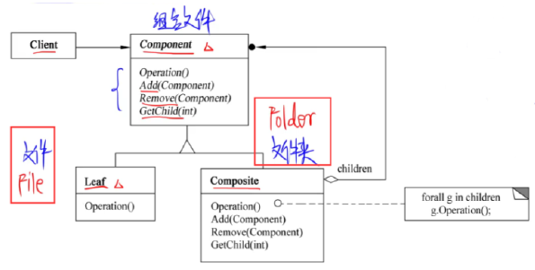

#### ==装饰器模式==

- 意图：`动态地给一个对象添加一些额外的职责`。就增加功能而言，Decorator模式比生成子类更加灵活。
- 题目选项描述:
  - `将一个对象加以包装以提供一些额外的行为`
  - `在不影响其他对象的情况下，以动态、透明的方式给单个对象添加职责`
- 适用性:
  - `处理那些可以撤销的职责`
  - `当不能采用生成子类的方式进行扩充时`。一种情况是，`可能有大量独立的扩展，为支持每一种组合将产生大量的子类，使得子类数目呈爆炸性增长`。另一种情况可能是，`由于类定义被隐藏，或类定义不能用于生成子类`。

#### ==外观模式==

- 意图：`为子系统中的一组接口提供一个一致的界面，Facade模式定义了一个高层接口，这个接口使得这一子系统
  更加容易使用`。
- 题目选项描述:
  - `将一系列对象加以包装以简化其接口`
  - `需要为一个复杂子系统提供一个简单接口`
- 适用性:
  - `要为一个复杂子系统提供一个简单接口时，子系统往往因为不断演化而变得越来越复杂`。大多数模式使用
    时都会产生更多更小的类，这使得子系统更具有可重用性，也更容易对子系统进行定制,但也给那些不需要定
    制子系统的用户带来一些使用上的困难。Facade可以提供一个简单的默认视图，这一视图对大多数用户来说
    已经足够，而那些需要更多的可定制性的用户可以越过Facade层。
  - `客户程序与抽象类的实现部分之间存在着很大的依赖性`。引入Facade将这个子系统与客户以及其他的
    子系统分离，可以提高子系统的独立性和可移植性。
  - 当需要`构建一个层次结构的子系统时`，使用Facade模式定义子系统中每层的入口点。如果子系统之间是
    相互依赖的，则可以让它们仅通过Facade进行通信，从而简化了它们之间的依赖关系。

#### ==享元模式==

- 意图：运用`共亨技术有效地支持大量细粒度的对象`。
- 题目选项描述:
  - `因使用大量的对象而造成很大的存储开销时，进行对象共享,以减少对象数量从而达到较少的内存占用并
    提升性能`。
- 适用性:
  - `一个应用程序使用了大量的对象`
  - 完全由于`使用大量的对象， 造成很大的存储开销`
  - `对象的大多数状态都可变为外部状态`
  - `如果删除对象的外部状态，那么可以用相对较少的共享对象取代很多组对象`

#### ==代理模式==

- 意图：`为其他对象提供一种代理以控制对这个对象的访问`

- 题目选项描述:
  - `将一个对象加以包装以控制对这个对象的访问`
  - `在需要比较通用和复杂的对象指针代替简单的指针时`
  - `为其他对象提供一种代理以控制对这个对象的访问`
- 适用性：
  - `Proxy模式适用于在需要比较通用和复杂的对象指针代替简单的指针的时候`,常见情况有:
    - 远程代理(Remote Proxy)为一个对象在不同地址空间提供局部代表。
    - 虚代理(Virtual Proxy）根据需要创建开销很大的对象。
    - 保护代理(Protection Proxy)控制对原始对象的访问，用于对象应该有不同的访问权限的时候。
    - 智能引用(Smart Reference)取代了简单的指针，它在访问对象时执行一些附加操作。典型用途包括:对指向实际对象的引用计数，这样当该对象没有引用时，可以被自动释放;当第一次引用一个持久对象时，将它装入内存;在访问一个实际对象前，检查是否已经锁定了它，以确保其他对象不能改变它。

#### ==总结==

> 主要处理类和对象的组合

| 结构型设计模式        | 定义                                                         | 记忆关键字          |
| --------------------- | ------------------------------------------------------------ | ------------------- |
| Adapter 适配器模式 | 将一个类的接口转换成客户希望得到的另一种接口。它使原本不兼容的接口得以协同工作 | 转换，兼容接口      |
| Bridge 桥接模式    | 将类的抽象部分和它的实现部分分离开来，使它们可以独立的变化   | 抽象和实现分离      |
| Composite 组合模式 | 将对象组合成树型结构以表示“整体-部分”的层次结构。使得用户对单个对象和组合对象的使用具有一致性 | 整体-部分，树形结构 |
| Decorator 装饰模式 | 动态的给一个对象添加一些额外的职责。它提供了用子类扩展功能的一个灵活的替代，比派生一个子类更加灵活 | 附加职责            |
| Facade 外观模式    | 定义了一个高层接口，为子系统中的一组接口提供一个一致的外观，从而简化了该子系统的使用 | 对外统一接口        |
| Flyweight 享元模式 | 提供支持大量细粒度对象共享的有效方法                         | 细粒度，共享        |
| Proxy 代理模式     | 为其他对象提供一种代理以控制这个对象的访问                   | 代理控制            |

### 行为型设计模式

> 关注对象之间的通信和职责分配

#### ==责任链模式==

- 意图：`使多个对象都有机会处理请求，从而避免请求的发送者和接收者之间的耦合关系。将这些对象连成一条链，并沿着这条链传递该请求，直到有一个对象处理它为止`。
- 题目选项描述：
  - `有多个对象可以处理一个请求，在运行时刻自动确定由哪个对象处理`
  - `一个客户需要使用一组相关对象`
  - `想在不明确指定接收者的情况下向多个对象中的一个提交一个请求`
- 适用性：
  1、`有多个的对象可以处理一个请求，哪个对象处理该请求运行时刻自动确定`。
  2、`想在不明确指定接收者的情况下向多个对象中的一个提交一个请求`。
  3、`可处理一个请求的对象集合应被动态指定`。

#### ==命令模式==

- 意图：将一个**请求**封装为一个**对象**，从而使得`可以用不同的请求对客户进行参数化`；`对请求排队或记录请求日
  志，以及支持可撤销的操作`。
- 题目选项描述：
  - `抽象出执行的动作以参数化某对象`
  - `将请求封装为对象从而可以使用不同的请求对客户进行参数化`
  - `在不同的时刻指定、排列和执行请求`
- 适用性：
  - 在`不同的时刻指定、排列和执行请求一个Command对象可以有一个与初始请求无关的生存期`。如果一个请求的接收者可用一种与地址空间无关的方式表达，那么就可以将负责该请求的命令对象传递给另一个不同的进程并在那儿实现该请求。【Command模式是过程语言中的回调，Callback机制的一个面向对象的替代】
  - `支持取消操作Command的Execute操作可在实施操作前将状态存储起来，在取消探作时这个状态用来消除该操作的影响`。Command接口必须添加一个Unexecute操作，该操作取消上一次Execute 调用的效果。执行的命令被存储在一个历史列表中。可通过向后和向前遍历这一列表并分别调用Unexecute和Execute来实现重数不限的“取消和“重做”。
  - `支持修改日志这样当系统崩溃时，这些修改可以被重做一遍`。在 Command 接口中添加装载操作和存储操作，可以用来保持变动的一个一致的修改日志。从崩溃中恢复的过程包括从磁盘中重新读入记录下来的命令并用Execute操作重新执行它们。
  - `用构建在原语操作上的高层操作构造一个系统`，这样一种结构在支持事务(Transaction）的信息系统中很常见。Command模式提供了对事务进行建模的方法。Command有一个公共接口，使得可以用同一种方式调所有的事务，同时使用该模式也易于添加新事务以扩展系统。

#### ==解释器模式==

- 意图：`给定一个语言，定义它的文法的一种表示，并定义一个解释器，这个解释器使用该表示来解释语言中的句子`
- 题目选项描述：
  - `有一个语言需要解释执行，并且可将句子表示为一个抽象语法树`
- 适用性：
  `Interpreter模式适用于当有一个语言需要解释执行,并且可将该语言中的句子表示为一个抽象语法树时`，以下情况效果最好:
  - 该文法简单。对于复杂的发文，文法的类层次变得庞大而无法管理。此时语法分析程序生成器这样的工具是更好的选择。它们无须构建抽象语法树即可解释表达式，这样可以节省空间还可能节省时间。
  - 效率不是一个关键问题。最高效的解释器通常不是通过直接解释语法分析树实现的，而是首先将它们转换成另一种形式。不过，即使在这种情况下，转换器仍然可用该模式实现。

#### ==迭代器模式==

- 意图：`提供一种方法顺序访问一个聚合对象中的各个元素，且不需要暴露该对象的内部表示`。
- 题目选项描述:`访问一个聚合对象的内容而无须暴露它的内部表示`
- 适用性:
  - `访问一个聚合对象的内容而无须暴露它的内部表示`
  - `支持对聚合对象的多种遍历`
  - `为遍历不同的聚合结构提供一个统一的接口`

#### ==中介者模式==

- 意图：`用一个中介对象来封装一系列的对象交互。中介者使各对象不需要显式地相互引用，从而使其耦合松散，
  而且可以独立地改变它们之间的交互。`

- 题目选项描述:

  - `一个对象引用其他很多对象并且直接与这些对象通信， 导致难以复用该对象`

  - `一组对象以定义良好但是复杂的方式进行通信，产生的相互依赖关系结构混乱且难以理解`。

  - `减少多个对象或类之间的通信复杂性`

  - `欲使一个后端数据模型能够被多个前端用户界面连接`

    > 中介模式和观察者模式是相互竞争的模式，主要差别是:前者的中介对象封装了其他对象间的通信，而后者通过引入其他对象来分布通信。

- 适用性:

  - 一组对象以定义良好但是复杂的方式进行通信，产生的相互依赖关系结构混乱且难以理解。

#### ==备忘录模式==

- 意图：`在不破坏封装性的前提下捕获一个对象的内部状态，并在对象之外保存这个状态`。这样以后就`可以将对象恢复到原先保存的状态`。
- 题目选项描述:
  - `将对象的状态恢复到先前的状态`
  - `在不破坏封装性的前提下， 捕获对象的内部状态并在对象之外保存`
  - `必须保存一个对象在某一个时刻的(部分）状态`
- 适用性:
  - `必须保存一个对象在某一个时刻的（部分） 状态，这样以后需要时它才能恢复到先前的状态`
  - `如果一个用接口来让其他对象直接得到这些状态，将会暴露对象的实现细节并破坏对象的封装性`

#### ==观察者模式==

- 意图：`定义对象间的一种一对多的依赖关系，当一个对象的状态发生改变时，所有依赖于它的对象都得到通知并被自动更新`。

- 题目选项描述:
  - `当一个对象必须通知其它对象，而它又不能假定其它对象是谁时`
  - `在发布-订阅(Publish-Subscribe）消息模型中，订阅者订阅一个主题后，当该主题有新消息到达时，所有订阅者都会收到通知`
  - `使所要交互的对象尽量松耦合`
  - `当一个对象状态改变时所有依赖它的对象得到通知并自动更新`
  - `一个对象的改变需要改变其它对象`
- 适用性:
  - `当一个抽象模型有两个方面，其中一个方面依赖于另一个方面，将这两者封装在独立的对象中以使它们可
    以各自独立地改变和复用`
  - `当对一个对象的改变需要同时改变其他对象，而不知道具体有多少对象有待改变时`
  - `当一个对象必须通知其他对象，而它又不能假定其他对象是谁，即不希望这些对象是紧耦合的`

#### ==状态模式==

- 意图：`允许一个对象在其内部状态改变时改变它的行为`。对象看起来似乎修改了它的类。
- 题目选项描述:
  - `一个对象的行为决定于其状态且必须在运行时刻根据状态改变行为`
  - `一个对象在其内部状态改变时改变其行为`
- 适用性:
  - `一个对象的行为决定于它的状态`，并且它必须在运行时刻根据状态改变它的行为。
  - `一个操作中含有庞大的多分支的条件语句，且这些分支依赖于该对象的状态`。这个状态常用一个或多个枚举常量表示。通常，有多个操作包含这一相同的条件结构。State模式将每一个条件分支放入一个独立的类中。这使

#### ==策略模式==

- 意图：`定义一系列的算法，把它们一个个封装起来，并且使它们可以相互替换`。此模式`使得算法可以独立于使用它们的客户而变化`。
- 题目选项描述:
  - `需要使用一个算法地不同变体`
  - `许多相关的类仅仅是行为有异`
  - `在设计某购物中心的收银软件系统时，要求能够支持在不同时期推出打折、返利、满减等不同促销活动`
- 适用性:
  - `许多相关的类仅仅是行为有异`。`“策略”提供了一种用多个行为中的一个行为来配置—个类的方法`。
  - `需要使用一个算法的不同变体`。例如,定义一些反映不同空间的空间/时间权衡的算法。当这些变体实现为一个算法的类层次时，可以使策略模式。
  - `算法使用客户不应该知道的数据`。可`使用策略模式以避免暴露复杂的、与算法相关的数据结构`。
  - `一个类定义了多种行为,并且这些行为在这个类的操作中以多个条件语句的形式出现，将相关的条件分支移入它们各自的Strategy类中，以代替这些条件语句`

#### ==访问者模式==

- 意图：`表示一个作用于某对象结构中的各元素的操作。它允许在不改变各元素的类的前提下定义作用于这些元素的新操作`。
- 题目选项描述：
  - `需要对一个对象结构中的对象进行很多不同的并且不相关的操作`
- 适用性：
  - `一个对象结构包含很多类对象，它们有不同的接口，而用户想对这些对象实施一些依赖于其具体类的操
    作`。
  - `需要对一个对象结构中的对象进行很多不同的并且不相关的操作，而又想要避免这些操作“污染”这些对
    象的类`。Visitor 使得用户可以将相关的操作集中起来定义在一个类中。当该对象结构被很多应用共享时，
    用Visitor模式让每个应用仅包含需要用到的操作。
  - `定义对象结构的类很少改变， 但经常需要在此结构上定义新的操作`。改变对象结构类需要重定义对所有
    访问者的接口，这可能需要很大的代价。如果对象结构类经常改变，那么可能还是在这些类中定义这些操作
    较好。

#### ==模板方法模式==

- 意图：`定义一个操作中的算法骨架，而将一些步骤延迟到子类中`。`Template Method使得子类可以不改变一个算法的结构即可重定义该算法的某些特定步骤`。
- 适用性：
  - `一次性实现一个算法的不变的部分，并将可变的行为留给子类来实现`。
  - `各子类中公共的行为应被提取出来并集中到一个公共父类中，以避免代码重复`。
  - `控制子类扩展`。模板方法旨在特定点调用“hook”操作（默认的行为，子类可以在必要时进行重定义扩展)，这就只允许在这些点进行扩展。

#### ==总结==

> `主要描述的是类或者对象的交互行为`

| 行为型设计模式                        | 定义                                                         | 记忆关键字                 |
| ------------------------------------- | ------------------------------------------------------------ | -------------------------- |
| Chain of Responsibility 职责链模式 | 通过==给多个对象处理请求的机会==，==减少请求的发送者与接收者之间的耦合==。==将接收对象链接起来，在链中传递请求，直到有一个对象处理这个请求== | `传递请求`、`职责`、`链接` |
| Command 命令模式                   | 将一个==请求封装为==一个==对象==，从而可==用不同的请求对客户进行参数化==，将==请求排队或记录请求日志==，==支持可撤销的操作== | `参数化、日志记录`         |
| Interpreter 解释器模式             | 给定一种语言，==定义它的文法表示==，并==定义一个解释器==，该==解释器用来根据文法表示来解释语言中的句子== | `文法、解释`               |
| Iterator 迭代器模式                | 提供一种方法来==顺序访问一个聚合对象中的各个元素而不需要暴露该对象的内部表示== | 顺序访问                   |
| Mediator 中介者模式                | ==用一个中介对象来封装一系列的对象交互==。它使==各对象不需要显式地相互调用，从而达到低耦合，还可以独立的改变对象间的交互== | 不直接引用                 |
| Memento 备忘录模式                 | 在==不破坏封装性的前提下==，==捕获一个对象的内部状态==，并==在该对象之外保存这个状态==，从而==可以在以后将该对象恢复到原先保存的状态== | `保存，恢复`               |
| Observe 观察者模式                 | 定义==对象间的一种一对多的依赖关系==，==当一个对象的状态发生改变时，所有依赖于它的对象都得到通知并自动更新== | `通知、自动更新`           |
| State 状态模式                     | ==允许一个对象在其内部状态改变时改变它的行为==               | 状态变成类                 |
| Strategy 策略模式                  | ==定义一系列算法==，把它们一个个==封装起来==，并且==使它们之间可互相替换，从而让算法可以独立于使用它的用户而变化== | `算法替换`                 |
| Template Method 模板方法模式       | ==定义一个操作中的算法骨架，而将一些步骤延迟到子类中==。使得==子类可以不改变一个算法的结构即可重定义算法的某些特定步骤== |                            |
| Visitor 访问者模式                 | ==表示一个作用于某对象结构中的各元素的操作==，使得==在不改变各元素的类的前提下定义作用于这些元素的新操作== | `新操作`                   |